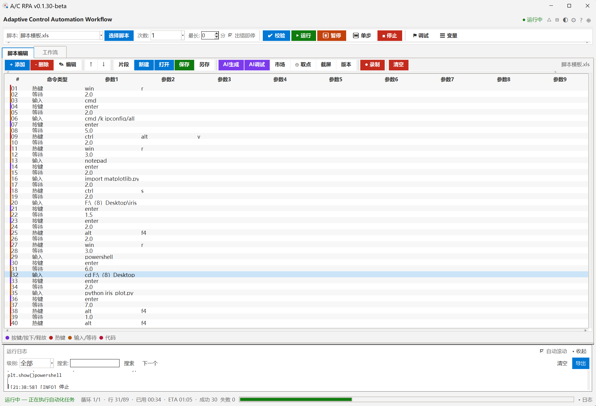
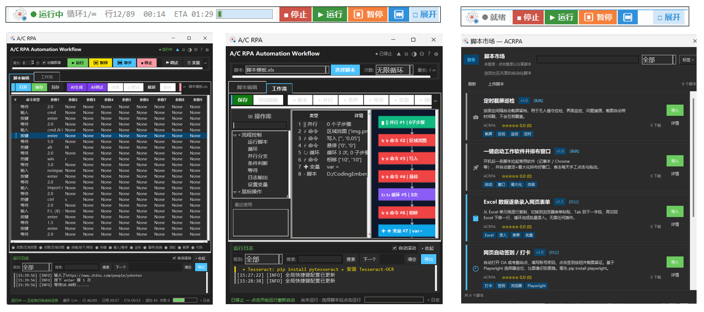
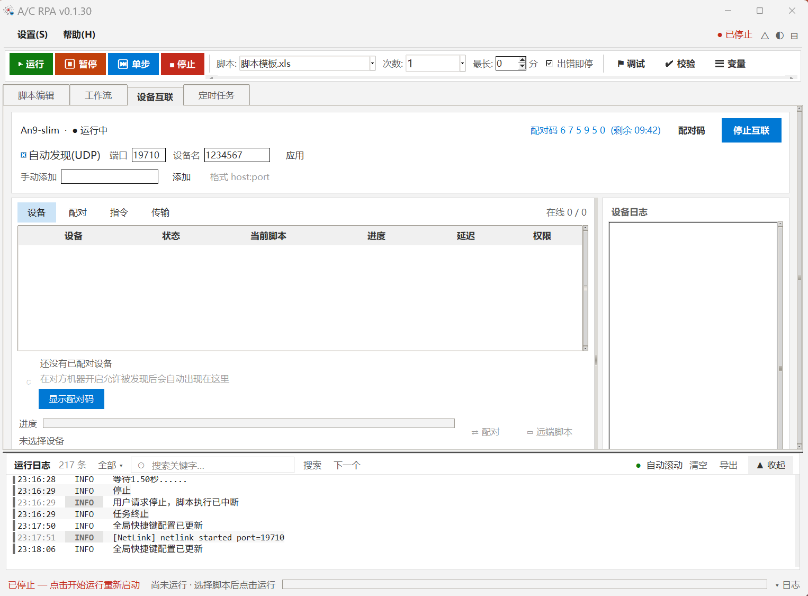
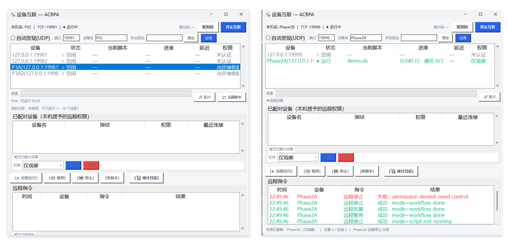
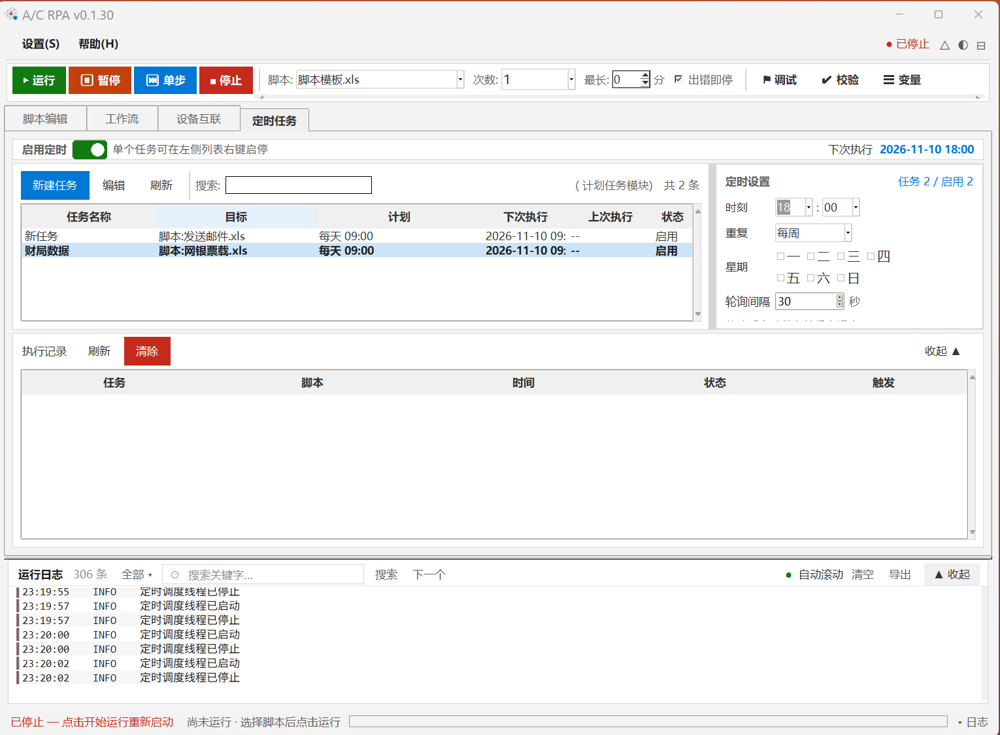

<div align="center">

# A/C RPA（Adaptive Control RPA）

**会填 Excel， 就会做自动化——把重复操作写成一张表格，剩下的交给电脑。**

Excel 即脚本 · 92 条内置命令 · 图像 / OCR / AI 三种定位 · 浏览器自动化 · 多机互联 · 单文件便携版

[](VERSION)
[](LICENSE)
[](#quickstart)
[](#quickstart)
[](#commands)
[](#download)

[下载](#download) · [快速开始](#quickstart) · [命令总表](#commands) · [NetLink](#netlink) · [常见问题](#faq) · [合规边界](#compliance)

</div>



---

## 这是什么

ACRPA 是一个**桌面自动化工具**：把操作步骤写进一张 Excel 表格（或用「录制」跑一遍），程序按行执行 —— 找图点击、按键输入、窗口调度、OCR 识别、浏览器操作、多脚本编排，全部内置。打包后是约 **14 MiB 的单文件便携版**，免安装、免 Python 环境、双击即用。

- **不会编程也能用**：10 个内置模板 + 可视化录制，改几个参数就能跑。

- **会编程更好用**：`.acrpas` 是版本化 JSON，能进 Git、能 diff、能被程序生成；也能直接写 Python（沙箱 + AST 预检）。

- **需要规模时能扩**：NetLink 让一台机器盯着整间机房；无头 CLI 让脚本进 CI 和定时批处理。

  <div align="center">


### 适合 / 不适合

| ✅ 适合 | ❌ 不适合 |
| --- | --- |
| 固定界面的重复操作：录单、对账、批量填表、日报发送 | 需要语义理解的非结构化任务（用大模型 Agent 更合适） |
| 内网多机统一执行与监控 | 跨公网、跨组织的分布式调度（NetLink 面向可信内网） |
| 图形界面没有 API 可调的老系统 | 已有稳定 API 的系统 —— 直接调 API 永远更快更稳 |
| 需要留痕审批的票据 / 报表归档流程 | 游戏反作弊、风控对抗等规避检测类用途（**明确不支持**） |

---

## 核心能力

六组能力，对应脚本从「写」到「调」的完整链路：

| 能力 | 说明 |
| --- | --- |
| **✍️ 写脚本** | **Excel 即脚本**：A 列命令、B–J 列参数，无需编程。也可用**录制**跑一遍自动生成，或直接写 **Python**（`sandbox` / `trusted` / `full` 三级权限 + AST 预检 + 三层超时 + 审计）。 |
| **🎯 找元素** | 四种定位方式各取所长：**图像识别**（OpenCV / Pillow，区域与灰度加速、LRU 缓存）、**窗口相对坐标**（比找图快 10–100 倍，窗口移动后仍准确）、**OCR** 按文字定位、**AI** 用自然语言描述元素。 |
| **🔁 跑流程** | 条件 / 循环 / 跳出 + **工作流控制流图**（端口拖拽连线、静态检查：不可达 / 孤立 / 悬挂出口 / 循环风险 / 路径爆炸 / 环路复杂度）+ 定时触发器（一次 / 每天 / 每周）。 |
| **🌐 连网页** | Playwright 后端：定位 DSL（`css:` / `xpath:` / `text:` / `role:` / `label:` / `testid:` …）+ 链式定位、iframe 切换、多标签页、下载与上传、CDP 接管已开浏览器、网络抓包。 |
| **🖥️ 管多机** | NetLink 内网互联：UDP 自动发现、6 位配对码 + 挑战应答、三档权限、远程运行 / 暂停 / 停止、脚本分发、远程截图、手机浏览器只读面板。纯标准库，零新增依赖。 |
| **🐞 可调试** | 底部常驻日志面板（级别徽标、一键收起、可拖高）+ 执行控制栏 + 断点 / 条件断点 / 单步 / 变量监视 / 调用栈；失败自动留存现场。 |

> **近期增强**：命令库（<kbd>Ctrl</kbd>+<kbd>K</kbd>）模糊搜索全部命令、工作流控制流图、无头 CLI 与 JSON 报告、可选依赖扩展（应用内安装 / 启用 / 修复）、`import ACRPA` 无副作用的可测试入口、`热键` 支持 2–4 键组合。

<div align="center">



</div>

---

<a id="download"></a>

## 下载

> **版本口径**：当前源码为 **`0.1.30-beta`（预发布）**，构建产物尚未上传；**最近可下载的是正式版 `v0.1.29`**。
> 预发布建议先在测试机验证再投入使用。`python_full_enabled`（Python full 权限）与 `netlink_tls`（TLS 加密）**默认关闭**。

| 渠道 | 链接 |
| --- | --- |
| **GitHub**（推荐） | [Release 页面](https://github.com/yohoten/acrpa/releases/tag/v0.1.29) · 直链 [`ACRPA-v0.1.29.exe`](https://github.com/yohoten/acrpa/releases/download/v0.1.29/ACRPA-v0.1.29.exe) |
| **Gitee** | [发行版列表](https://gitee.com/yohoten/ACRPA/releases) —— 代码与 tag 已同步，Release 附件请优先用 GitHub |

**文件信息**：`ACRPA-v0.1.29.exe` · 14,987,809 字节（约 14.29 MiB）· 便携版，双击即用。
**SHA-256**：`e230d1950b8877ebbdd3025d83e705f9e007f829b34af22020e842c2fe3e2185`（已回填 [`VERSION`](VERSION) 第 3 行）

```bat
certutil -hashfile "ACRPA-v0.1.29.exe" SHA256
```

```powershell
Get-FileHash .\ACRPA-v0.1.29.exe -Algorithm SHA256
```

首次运行如遇 SmartScreen 提示：**更多信息 → 仍要运行**（构建未做代码签名）。

---

<a id="quickstart"></a>

## 快速开始

### 方式一：便携版（推荐）

下载 exe → 双击 → 完成。无需 Python、无需安装、不写注册表。

### 方式二：从源码运行

```bat
:: 1. 环境（Windows x64 + Python 3.8 及以上；本项目在 3.9 上开发与打包）
py -3.9 -m venv .venv
.venv\Scripts\activate

:: 2. 依赖
pip install -r requirements.txt -i https://pypi.tuna.tsinghua.edu.cn/simple

:: 3. 启动（在项目根目录执行）
python run.py
```

> `run.py` 会自动把项目根与 `src/` 加入 `sys.path` 并做依赖预检，不需要手动 `cd src`。

依赖清单见 [`requirements.txt`](requirements.txt)：`pyautogui` / `Pillow` / `pyperclip` / `xlrd` / `xlwt` / `requests` / `urllib3` / `certifi` / `pywin32`。

**可选能力**（缺少不影响启动，对应命令在下拉里显示 `⚠` 角标，可在「设置 → 扩展」安装 / 修复）：OpenCV 图像匹配、Playwright 浏览器、PaddleOCR.dll 原生 OCR、DD 内核输入、HTTP 请求、电源与音量控制等 —— 由 [`src/capabilities.py`](src/capabilities.py) 的能力注册表统一探测（`READY` / `MISSING` / `BROKEN` / `DISABLED` 四态）。

### 方式三：无头 CLI（CI / 定时批处理）

传入 `--script` 即进入**无头模式**，不创建任何窗口：

```bat
python run.py --script demos\ok.acrpas --var n=21 --json-report out.json --exit-code
```

| 参数 | 说明 |
| --- | --- |
| `--script PATH` | 运行脚本（`.acrpas` / `.xls`）；**省略则正常启动图形界面** |
| `--workflow PATH` | 运行工作流 JSON |
| `--var K=V` | 预置变量，可重复；数值串自动转数字 |
| `--json-report PATH` | 执行报告写成 JSON（省略则打印到 stdout） |
| `--exit-code` | 脚本失败时返回非零退出码（默认失败也返回 0） |
| `--quiet` | 只保留退出码，不打印进度 |

退出码：`0` 成功 · `1` 脚本失败（需配合 `--exit-code`）· `2` 用法错误。

```json
{
  "script": "demos\\ok.acrpas", "started": "…", "finished": "…",
  "duration_ms": 52, "status": "success",
  "total_rows": 3, "executed_rows": 3, "failed_row": null, "error": null,
  "rows": [{"index": 0, "cmd": "设置变量", "status": "ok", "message": ""}]
}
```

> 无头模式使用 schema 默认值（**不读 `config.json`**），以保证 CI 结果确定。依赖图形会话的命令（找图 / 键鼠 / 窗口 / OCR / 浏览器）在无桌面会话下不可用。
>
> 另有 `--rollback`（回滚到上一个版本）与 `--exec-task <id>`（向已运行实例投递任务），供更新与单实例 IPC 使用。

---

<a id="commands"></a>

## 命令总表

**92 条命令 / 11 个分组**，全部由 [`src/commands.py`](src/commands.py) 的注册表驱动，与 [`res/help/command_schema.json`](res/help/command_schema.json) 同源。应用内按 <kbd>Ctrl</kbd>+<kbd>K</kbd> 可模糊搜索全部命令。

| 分组 | 条数 | 代表命令 | 说明 |
| --- | --: | --- | --- |
| [基础操作](#cmd-basic) | 19 | `找图` `点图` `按键` `输入` `等待` | 鼠标、键盘、屏幕的原子动作 |
| [流程控制](#cmd-flow) | 6 | `如果` `循环开始` `跳出循环` | 条件与循环 |
| [窗口管理](#cmd-window) | 7 | `激活窗口` `窗口坐标` `等待窗口` | 直接操作 Windows 窗口，不依赖图像识别 |
| [变量与数据处理](#cmd-var) | 4 | `设置变量` `字符串处理` `数学运算` | 变量读写与运算 |
| [OCR 文字识别](#cmd-ocr) | 3 | `识别文字` `等待文字` `点击文字` | 按文字定位，不依赖图像模板 |
| [AI 增强](#cmd-ai) | 3 | `AI找图` `AI识别界面` `AI优化建议` | 需自备 API Key |
| [代码执行](#cmd-code) | 2 | `代码` `Python` | Python 扩展，沙箱 + 审计 |
| [工作流](#cmd-workflow) | 2 | `运行工作流` `工作流变量` | 多脚本编排 |
| [浏览器自动化](#cmd-browser) | 26 | `打开网页` `浏览器点击` `等待元素` `等待数据包` | Playwright 后端，可选依赖 |
| [文件与系统](#cmd-sys) | 15 | `复制文件` `启动程序` `音量控制` `磁盘空间` | 文件与操作系统操作 |
| [数据与编码](#cmd-data) | 5 | `HTTP 请求` `JSON 取值` `哈希值` | 接口取数与编解码 |

<a id="cmd-basic"></a>

### 基础操作（19）

| 命令 | 参数 | 说明 |
| --- | --- | --- |
| `找图` | `button.png, 0.96` | 全屏查找图片并悬停 |
| `区域找图` | `icon.png, 0.8, 100, 100, 500, 500, 灰度` | 限定区域查找（更快） |
| `点图` | `submit.png, 0.96` | 找到图片并点击 |
| `区域点图` | `icon.png, 0.9, 左, 上, 宽, 高, 灰度, 按键, 次数` | 限定区域找图并点击 |
| `按键` | `enter, 1` | 模拟按键（可指定次数） |
| `热键` | `ctrl, shift, alt, a` | 组合键，**支持 2–4 个按键**（后两位可选，不填行为与旧版一致） |
| `输入` | `Hello World` | 剪贴板方式输入（Ctrl+V） |
| `写入` | `Hello, 0.05, auto` | 逐字输入，模式 `auto` / `direct` / `simulate` |
| `等待` | `2.5` | 延时（秒，支持随机区间 `1.0-3.0`） |
| `坐标` | `500, 300` | 点击屏幕绝对坐标 |
| `悬停` | `500, 300` | 鼠标移动到坐标 |
| `拖拽` | `600, 400` | 鼠标拖拽到坐标 |
| `滚轮` | `-3` | 滚动（负 = 下，正 = 上） |
| `相移` | `10, -5` | 相对当前位置移动 |
| `按下` / `释放` | `shift` | 按住 / 松开，不自动释放 |
| `复制` / `粘贴` | 无参数 | `Ctrl+A, Ctrl+C` / `Ctrl+A, Ctrl+V` |
| `截屏` | `shot1, D:\shots` | 截图并保存 |

<a id="cmd-flow"></a>

### 流程控制（6）

| 命令 | 参数 | 说明 |
| --- | --- | --- |
| `如果` | `${count} > 10` | 条件为真则进入分支（支持 `${变量}`） |
| `否则` | — | 否则分支 |
| `结束如果` | — | 结束条件块 |
| `循环开始` | `5` 或 `${i} < 10` | 次数或条件循环 |
| `循环结束` | — | 结束当前循环 |
| `跳出循环` | — | 立即跳出 |

<a id="cmd-window"></a>

### 窗口管理（7）

| 命令 | 参数 | 说明 |
| --- | --- | --- |
| `激活窗口` | `记事本` | 激活指定窗口（支持模糊匹配） |
| `关闭窗口` | `无标题 - 记事本` | 关闭指定窗口 |
| `最小化窗口` / `最大化窗口` | `计算器` | 最小化到任务栏 / 最大化 |
| `获取窗口位置` | `记事本, x, y, w, h` | 坐标与大小写入变量 |
| `等待窗口` | `Chrome, 10, 存在` | 等待窗口出现 / 消失 |
| `窗口坐标` | `记事本, 100, 50` | 相对窗口左上角点击（窗口移动后仍准确） |

> 窗口管理命令不依赖图像识别，**比找图快 10–100 倍**，能用窗口命令就别用找图。

<a id="cmd-var"></a>

### 变量与数据处理（4）

| 命令 | 参数 | 说明 |
| --- | --- | --- |
| `设置变量` | `count, 100` | 设置变量值 |
| `读取剪贴板` | `clip_text` | 剪贴板内容读入变量 |
| `字符串处理` | `text, 截取, 0, 5, result` | 截取 / 替换 |
| `数学运算` | `${a} + ${b}, result` | 计算并存入变量 |

<a id="cmd-ocr"></a>

### OCR 文字识别（3）

| 命令 | 参数 | 说明 |
| --- | --- | --- |
| `识别文字` | `左, 上, 宽, 高, 变量名` | 识别屏幕区域文字 |
| `等待文字` | `提交成功, 10, 存在, 左, 上, 宽, 高` | 等待文字出现 / 消失 |
| `点击文字` | `提交成功, 0.9, 左, 上, 宽, 高` | 找到文字位置并点击 |

> 后端可选 `auto` / `paddle` / `winrt` / `tesseract`（`ocr_preferred_backend`），另有 PaddleOCR.dll 原生后端（可选，默认关闭，见 [`docs/paddle-ocr-dll-使用说明.md`](docs/paddle-ocr-dll-使用说明.md)）。

<a id="cmd-ai"></a>

### AI 增强（3）

| 命令 | 参数 | 说明 |
| --- | --- | --- |
| `AI找图` | `登录按钮, 0.8, click` | 分析截屏，按自然语言描述找元素 |
| `AI识别界面` | `ui` | 列出所有 UI 元素并存入变量 |
| `AI优化建议` | `log` | 分析执行数据给出优化建议 |

> 需在「设置 → AI 增强」配置 `api_key`（或自定义提供商与 BaseURL），密钥存 **Windows 凭据库**，不写进 `config.json`。另有应用内 **[AI] 调试** 入口：自然语言提问，AI 分析日志作答。

<a id="cmd-code"></a>

### 代码执行（2）

| 命令 | 参数 | 说明 |
| --- | --- | --- |
| `代码` | `myscript` | 执行 `.txt` 中的 Python（文件名不含后缀），走 `py_sandbox`：AST 预检 + 超时 + 审计，失败返回 `False` |
| `Python` | `result = 1 + 1, sandbox` | 行内执行 Python，权限 `sandbox` / `trusted` / `full` |

> `full` 权限需 `python_full_enabled=true` 显式开启（**默认关闭**）。旧的 `exec` 行为只能通过 `legacy_code_command=true` 临时回退，**回退后失去全部安全护栏**，建议尽快移除。

<a id="cmd-workflow"></a>

### 工作流（2）

| 命令 | 参数 | 说明 |
| --- | --- | --- |
| `运行工作流` | `workflow.json` | 调用工作流文件执行多脚本编排 |
| `工作流变量` | `var_name, value` | 设置工作流级共享变量 |

<a id="cmd-browser"></a>

### 浏览器自动化（26，可选）

> 需 `pip install playwright` 并执行 `playwright install`。定位统一支持 DSL（`css:` / `xpath:` / `text:` / `tag:` / `role:` / `label:` / `placeholder:` / `testid:` / `@attr` / `@@` 组合）、**链式 / 相对定位**（`A >> B` 逐级收窄；步骤 `nth:` / `first:` / `last:` / `parent:` / `next:` / `prev:` / `child:` / `filter:` / `has:`）与原生 CSS / `text=`。完整语法见 [`docs/浏览器使用说明.md`](docs/浏览器使用说明.md)。

| 命令 | 参数 | 说明 |
| --- | --- | --- |
| `打开网页` | `https://example.com` | 打开 URL（支持 `${变量}`） |
| `浏览器点击` | `#submit` / `text=登录` / `role:button[name=登录]` | 点击元素 |
| `浏览器输入` | `#user, admin` 或 `#user, ${kw}` | 填入文本 |
| `等待元素` | `#loading, 10, 消失` | 等待出现 / 消失 / 存在 / 移除 / 可点击 / 可用 / URL 变动 / 标题变动（第 3 参数缺省 = 出现） |
| `浏览器截图` | `shot1, 整页` / `h1, tag:h1, D:\shot\a.png, shot_path` | 视口 / 整页 / 元素截图，可写回路径 |
| `浏览器执行JS`（别名 `执行JS`） | `document.title, page_title, 是` | 执行 JS，返回值写回变量 |
| `浏览器读取` | `#price, 文本, price` / `, 标题, t` | 一次性读取文本 / 属性 / 值 / HTML / 数量 / URL / 标题 / 存在 / 可见 |
| `浏览器选择` | `#city, 北京, 标签` | 下拉框选择（标签 / 值 / 序号） |
| `浏览器管理` | `打开, Edge, 否, D:\prof, https://…` | 打开 / 接管 / 关闭浏览器；可指定无头、用户数据目录（持久化登录态） |
| `关闭浏览器` | 无参数 | 关闭当前浏览器上下文 |
| `浏览器读取Cookie` | `cookie_json, json, D:\out\cookies.json` | 导出 Cookie（`json` / `header` / `netscape`） |
| `浏览器设置Cookie` | `cookie_json` 或 `D:\in\cookies.json, .example.com` | 注入 Cookie，可指定兜底域名 |
| `切换框架` / `返回主框架` | `#pay` / `2` / `main` | 进入 iframe / 回到顶层 |
| `新建标签页` | `https://example.com/report`（可空） | 新建并切换为活动页 |
| `切换标签页` | `0` / `报表` / `example.com` | 按序号（0 基）/ 标题 / URL 匹配 |
| `关闭标签页` | 无参数 / `1` | 关闭当前或指定页（自动回退到剩余页） |
| `等待下载` | `D:\out, 报表, 30, dl_path` | 等待下载完成，绝对路径写回变量 |
| `浏览器上传` | `tag:input@type=file, D:\a.pdf, D:\b.pdf` | 对 `input[type=file]` 设置本地文件（支持多文件） |
| `连接已开浏览器`（别名 `接管浏览器`） | `http://127.0.0.1:9222`（可空 = 用配置） | 通过 CDP 接管已开 Chrome / Edge（需 `--remote-debugging-port` 启动） |
| `开始监听` | `/api/login, xhr`（可空） | 监听网络响应入队；URL 支持包含 / `/正则/` 与资源类型过滤 |
| `等待数据包` | `/api/token, 1, 20, token_json` | 等待并取回命中数据包，JSON 写回变量或落盘 |
| `停止监听` | 无参数 | 停止监听并清空队列（幂等） |
| `启动浏览器录制` | 无参数 | 调 playwright codegen，把结果转为 DSL 追加（需 playwright CLI） |

<a id="cmd-sys"></a>

### 文件与系统（15）

> ⚠️ 本组含破坏性操作。`删除文件` 默认**送回收站**、`结束进程` 默认**启用保护白名单**；永久删除 / 强制结束会先弹二次确认，且**安全闸门参数不接受变量插值**（详见[危险操作的确认闸门](#safety)）。

| 命令 | 参数 | 说明 |
| --- | --- | --- |
| `复制文件` / `移动文件` | `源, 目标, 覆盖(是/否), 变量名` | 复制 / 移动文件或目录 |
| `删除文件` | `路径, 递归(是/否), 送回收站(是/否)` | **默认送回收站**；`送回收站=否` 为永久删除，会先确认 |
| `创建目录` | `路径, 已存在则忽略(是/否)` | 递归创建目录 |
| `列出目录` | `路径, *.xlsx, 时间, list` | 按通配匹配、按名 / 时间 / 大小排序，写入变量 |
| `读取文本文件` | `路径, auto, content` | 编码 `utf-8` / `gbk` / `auto` |
| `写入文本文件` | `路径, 内容, 追加, utf-8` | 覆盖或追加 |
| `文件是否存在` | `路径, exists` | 结果写入 `是` / `否` 变量 |
| `启动程序` | `D:\app.exe, --flag, D:\, 等待=否, 隐藏=否` | 启动外部程序 |
| `结束进程` | `notepad.exe, 强制(是/否), 保护白名单(是/否)` | **默认启用白名单**；强制结束会先确认 |
| `打开系统面板` | `设备管理器` | 任务管理器 / 服务 / 注册表 / 控制面板 / 设备管理器 / 网络连接 / 电源选项 / 系统属性 / 回收站 / 计算器 / 记事本 |
| `电源操作` | `关机, 60, 否, 预演=是` | 关机 / 重启 / 注销 / 锁屏 / 待机 / 休眠；`预演=是` 只演练不执行 |
| `音量控制` | `设置, 30` / `静音切换` | 设置 / 增减 / 静音 |
| `磁盘空间` | `D:\, total, free, pct` | 总容量 / 可用 / 使用率写入变量 |
| `设置窗口样式` | `记事本, 220, 是, 隐藏` | 透明度（0–255）/ 置顶 / 隐藏 |

<a id="cmd-data"></a>

### 数据与编码（5）

| 命令 | 参数 | 说明 |
| --- | --- | --- |
| `HTTP 请求` | `GET, https://api.example.com/items, , , 10, resp, code` | 方法 / URL / 头 / 体 / 超时；响应与状态码写入变量，可选落盘 |
| `JSON 取值` | `resp, data.items[0].id, , first_id` | 源可为变量 / 文件 / JSON 文本，按路径取值，支持默认值 |
| `Base64 编解码` | `编码, hello, b64` | 编码 / 解码 |
| `URL 编解码` | `解码, a%20b, text` | 编码 / 解码 |
| `哈希值` | `sha256, 文件, D:\a.zip, digest` | `md5` / `sha1` / `sha256`，源可为文本或文件 |

---

## 脚本格式

| 格式 | 定位 | 说明 |
| --- | --- | --- |
| **`.acrpas`** | **一等格式（推荐）** | 版本化 JSON：`{"schema":1,"name":…,"rows":[{"cmd":…,"args":[9 个字符串]}],"vars":{},"images":[]}`。能进 Git、能 diff、能被程序生成，与 `.xls` 双向兼容。 |
| `.xls` | 遗留位置式 Excel | 第 1 行为标题，第 3 行起为命令。**读写均支持**（`xlrd` 读 / `xlwt` 写）。 |
| `.xlsx` | ⚠️ 当前不可用 | 读取统一走 `xlrd`，而本项目钉的是 `xlrd>=2.0`，该版本**已移除 xlsx 支持** —— 实测报 `XLRDError: Excel xlsx file; not supported`。文件选择框虽列出 `.xlsx`，请改用 `.acrpas` 或在 Excel 里另存为 `.xls`。 |

Excel 列布局（9 个位置参数，与 schema 一致）：

| A | B | C ~ J |
| --- | --- | --- |
| 命令 | 参数 1 | 参数 2 ~ 9（辅助参数：精度 / 坐标 / 区域等） |

### 变量引用（重要）

用 `${name}` 引用变量。**桌面端的替换只在这三处生效**：

| 位置 | 示例 | 是否替换 |
| --- | --- | --- |
| `如果` / `循环开始` 的条件表达式 | `如果 ${count} > 10` | ✅ |
| `数学运算` 的表达式 | `数学运算 ${index} + 1, index` | ✅ |
| `浏览器输入` 的文本 | `浏览器输入 #keyword, ${kw}` | ✅ |
| `输入` / `写入` 的文本 | `输入 ${username}` | ❌ **原样粘贴出 `${username}`** |

浏览器命令另在 [`browser_backend.py`](src/browser_backend.py) 内自行解析 `${变量}`（网址、输入文本、截图与 Cookie 保存路径），并把结果写回 `engine.variables` —— `打开网页` 另写 `browser_url` / `browser_title`，失败写 `browser_last_error`。

> 要把变量值送进桌面应用：用 `浏览器输入`，或先把值写进剪贴板再用 `粘贴`。

---

## 模板

- **内置模板 10 个**（应用内「模板」对话框直接选用，来源 [`src/templates.py`](src/templates.py)）：
  `登录流程` · `表单填写` · `数据采集` · `批量点击` · `页面截图` · `文件下载` · `窗口切换` · `文本编辑` · `滚动浏览` · `右键菜单`
- **`template/` 示例脚本 11 个 + 工作流 1 个**（片段库可直接导入）：
  `脚本模板` · `发送邮件` · `数据采集` · `网银票载` · `间隔点击` · `browser_checkin` · `clipboard_form_entry` · `im_message_sender` · `invoice_ocr_archive` · `screen_patrol` · `workday_launcher` · `workflow001.json`

**上手四步**：选模板 → 菜单「文件 → 导入脚本」→ 改参数（窗口标题 / 坐标 / 输入内容）→ <kbd>F5</kbd> 运行。

> ⚖️ **受监管场景模板声明**：`template/网银票载.xls` 一类面向金融机构 / 票据业务的模板，**仅限持牌金融机构授权员工在受控内网 / 授权范围内使用**。详见[合规与使用边界](#compliance)。

<div align="center">



</div>

---

<a id="safety"></a>

## 危险操作的确认闸门

`电源操作` / `删除文件` / `结束进程` 三类命令在执行前会经过独立闸门（[`src/engine.py`](src/engine.py)）：

- **无 GUI 时拒绝执行**，不会静默放行 —— 无头 CLI 跑这三类命令会明确报错。
- **确认回调抛异常 = 拒绝**（失败即拒绝，不失败开放）。
- **安全闸门参数不接受变量插值**（`预演` / `强制` / `送回收站` / `递归` / `保护白名单`），脚本**无法**用 `${x}` 把 `送回收站` 改成 `否` 来绕过确认。
- 关掉确认（`CONFIRM_DANGEROUS=False`）只是不再询问，handler 自身的护栏照旧生效。

配合默认值：`删除文件` 默认送回收站、`结束进程` 默认启用系统进程白名单、`电源操作` 支持 `预演=是` 只演练。

---

<a id="market"></a>

## 脚本市场

应用内可**浏览 / 搜索 / 按分类与标签筛选**社区脚本并**一键安装**到编辑器。上传投稿需先用 **GitHub / Gitee 个人访问令牌（PAT）** 登录（令牌仅存 **Windows 凭据库**，不落 `config.json`），再经 **5 步向导**打包为 `.acrpapkg`（或旧单文件 `.xls`）并发起 PR。

- 操作指引（浏览 / 安装 / 登录 / 上传 / 包格式 / 常见问题）：[`docs/marketplace-v2-使用说明.md`](docs/marketplace-v2-使用说明.md)
- 市场仓库（Gitee）：[yohoten/acrpa-marketplace](https://gitee.com/yohoten/acrpa-marketplace) —— 索引 `index.json` + `scripts/*.xls` + `packages/*.acrpapkg`
- 设计文档：[`docs/marketplace-v2-design.md`](docs/marketplace-v2-design.md)

> ⚠️ 客户端目前对 `.acrpapkg` **只有 sha256 完整性校验**（证明内容与索引一致），**不能证明来源可信**；作者签名与验签为后续规划项。请谨慎安装来源不明的脚本。

---

<a id="netlink"></a>

## 多设备互联（NetLink）

面向**企业内网**的多机协同：一台机器监控多台机器的运行状态、远程运行 / 暂停 / 停止、批量下发脚本，手机浏览器也能看进度。纯 Python 标准库实现，**零新增依赖**，打包体积几乎不变。

### 功能矩阵

| 能力 | 说明 | 最低权限 |
| --- | --- | --- |
| 多机实时监控 | 设备列表 + 运行状态 + 当前脚本 + 进度（行 / 循环 / 已运行时长）+ 实时日志流 + 定时任务状态 | 仅观察 |
| 零配置发现 | UDP 广播自动发现同网段；VLAN / 多网卡可退回静态对端 `IP:端口` | 仅观察 |
| 配对认证 | 6 位配对码（默认 600s）+ `PBKDF2-HMAC-SHA256` 派生密钥 + `nonce/HMAC` 挑战应答；连续 5 次错误锁定；密钥存 Windows 凭据库，配对后免 PIN 重连 | — |
| 远程操控 | 运行 / 暂停 / 恢复 / 停止；脚本走 `pause_event`、工作流走 `WorkflowEngine._pause_event`（已分叉）；被控端首次弹确认框；指令串行化 + 全控制端广播回执 | 允许操控 |
| 脚本分发 | 单文件上限 32 MB → 被控端 `<脚本目录>/received/`；64 KB 分块 + 序号 + 结束帧 sha256 与大小双重校验，失败不留残留；支持多设备批量下发与「推完即运行」 | 允许接收脚本 |
| 远端脚本管理 | 查看被控端脚本清单（脚本目录 / 已接收）并直接远程运行 | 允许接收脚本 |
| 远程截图 | 缩略图默认 640 宽 / 质量 60（上限 1280 / 80），1 秒节流，**只在内存编码传输不落盘** | 允许操控 |
| 浏览器只读面板 | 内置 `http.server` 单页（默认 19712，**默认关闭**），令牌鉴权（查询串 / Cookie / Bearer 三形式），**零写操作** | — |
| TLS 可选加密 | stdlib `ssl` 自签证书（需自备 PEM），对端证书 `sha256` 指纹 **TOFU 固定**，指纹不符直接拒连；**默认关闭** | — |
| 审计日志 | 所有远程指令与截图请求写入 `logs/netlink_audit_YYYYMMDD.log`（谁 / 何时 / 什么 / 结果），可按天数清理 | 允许操控 |

三档权限：**仅观察** → **允许操控** → **允许接收脚本**。

### 设计要点

- **对等架构**：无独立服务器，每个实例内嵌一个节点，同时是 Server 与 Client，单条 TCP 连接全双工对等。
- **不侵入执行引擎**：`engine.py` / `workflow.py` / `scheduler.py` 三文件零改动，通过既有 `state` 状态量（`quit2` / `pause_event` / `exec_state`）与 `root.after` 回主线程。
- **崩溃隔离**：网络线程全为 daemon，网络层异常不影响本地自动化。

### 快速上手

1. 两台同网段 Windows 各装 ACRPA，在 **设置 → 网络互联** 勾选「启用设备互联」，设备名填不同值（端口保持默认）。
2. 被控端权限设为「允许操控」（要传脚本则设「允许接收脚本」）。
3. 主界面点 **🌐** 打开互联窗口；被控端点「配对码」查看 6 位码，控制端点「🔗 配对」输入。
4. 配对成功后设备表自动出现对方并实时刷新，无需手工订阅。
5. 选中设备即可 `▶ 远程运行 / ⏸ 暂停 / ⏹ 停止 / 推脚本 / 📂 远端脚本 / 📷 截图`。

<div align="center">



</div>

---

<a id="config"></a>

## 配置

配置文件为程序目录下的 `config.json`（首次运行自动生成，共 **144 个配置项**，完整 schema 见 [`src/state.py`](src/state.py)）。所有改动都可在应用内「设置」完成，无需手工编辑。

```json
{
  "dark_mode": false,             // 深色模式
  "retry_max": 3,                 // 命令失败最大重试次数
  "retry_interval": 1.0,          // 重试间隔（秒）
  "image_timeout": 5.0,           // 图像查找超时（秒）
  "stop_on_error": true,          // 出错时立即停止
  "api_key": "",                  // AI 密钥（实际存 Windows 凭据库）
  "api_model": "deepseek-v4-flash",
  "minimize_to_tray": false,      // 关闭时最小化到托盘
  "mini_bar_enabled": true        // Mini Bar 折叠模式
}
```

### 常用项

| 键 | 默认值 | 含义 |
| --- | --- | --- |
| `dark_mode` | `false` | 深色模式 |
| `retry_max` / `retry_interval` | `3` / `1.0` | 失败重试次数 / 间隔（秒） |
| `image_timeout` | `5.0` | 图像查找超时（秒） |
| `stop_on_error` | `true` | 出错立即停止 |
| `max_execution_minutes` | `0` | 最长执行时间（分钟，0 = 不限） |
| `bound_window_title` | `""` | 全局绑定窗口标题 |
| `failsafe` | `true` | 鼠标移到左上角急停 |
| `input_mode` | `"sendinput"` | 输入后端 `sendinput` / `dd` / `sendmessage` |
| `use_dd_driver` | `false` | 启用 DD 驱动（需自备 DLL） |
| `api_key` / `api_model` | `""` / `"deepseek-v4-flash"` | AI 密钥与模型 |
| `ai_smart_retry` / `ai_anomaly_detect` | `false` | AI 智能重试 / 异常检测 |
| `sched_enabled` / `sched_poll_interval` | `false` / `30` | 定时调度开关 / 轮询间隔（秒） |
| `log_level` / `log_retention_days` | `1` / `7` | 日志级别 `0=DEBUG..3=ERROR` / 保留天数 |
| `recording_mode` | `"absolute"` | 录制坐标模式 `absolute` / `relative` |
| `ocr_preferred_backend` | `"auto"` | OCR 后端 `auto` / `paddle` / `winrt` / `tesseract` |
| `browser_headless` | `true` | 浏览器无头模式 |
| `python_default_perm` / `python_full_enabled` | `"sandbox"` / `false` | Python 命令默认权限 / 是否允许 `full` |
| `ui_scale` | `1.0` | 界面缩放 0.8–1.5 |
| `mini_bar_enabled` / `mini_bar_height` / `mini_bar_opacity` | `true` / `28` / `80` | Mini Bar 开关 / 高度 / 透明度 |

### NetLink 关键项

| 键 | 默认值 | 含义 |
| --- | --- | --- |
| `netlink_enabled` | `false` | 启用设备互联 |
| `netlink_port` | `19710` | TCP 监听端口 |
| `netlink_device_name` | `""` | 本机显示名（空 = 主机名） |
| `netlink_perm_level` | `"observe"` | 权限档 `observe` / `control` / `script` |
| `netlink_autodiscover` / `netlink_discovery_port` | `true` / `19711` | UDP 发现开关 / 端口 |
| `netlink_static_peers` | `[]` | 静态对端 `IP:PORT` |
| `netlink_require_auth` / `netlink_pin_ttl` | `true` / `600` | 配对认证 / 配对码有效期（秒） |
| `netlink_confirm_control` | `true` | 首次远程操控需被控端确认 |
| `netlink_script_dir` | `""` | 允许远程运行的脚本目录（空 = 程序目录 `scripts/`） |
| `netlink_audit_days` | `0` | 审计日志保留天数（0 = 跟随日志） |
| `netlink_web_enabled` / `netlink_web_port` | `false` / `19712` | 只读面板开关 / 端口 |
| `netlink_tls` / `netlink_tls_pins` | `false` / `[]` | TLS 开关 / 已固定对端指纹 |

<div align="center">



</div>

---

## 更新与发版

程序启动 3 秒后自动检查新版本（可在「设置 → 系统」关闭）。状态栏提示「新版本 vX.Y.Z 可用 — 点击更新」即进入更新窗口：**检查 → 下载 → 一键重启更新**。只替换主程序与 `VERSION`，**配置、脚本、模板、日志一律不动**。

检查逻辑有几个专门为「不静默失败」做的设计：

- **多源探测并取最高版本**：GitHub Releases API → raw / jsDelivr / Gitee 清单镜像。某个来源报出的版本不比本机新时**不会立刻收工**，而是继续探测其余来源 —— 避免镜像缓存落后把真实新版本吞掉。
- **明确区分「无更新 / 网络故障 / 清单损坏」**，不把网络异常伪装成「已是最新」。
- **传输双栈**：`requests` 证书校验失败时自动改用系统证书库，应对企业 TLS 拦截（否则两个权威来源会永久不可达，只剩会缓存旧版本的镜像可用）。
- **装包前复核包内 `VERSION`**：镜像返回旧包时自动换源，而不是装错版本。

**版本号唯一事实来源**是项目根目录 [`VERSION`](VERSION)：首行版本号，其后可写多条下载直链（按顺序尝试）与一行 `sha256:...`。打包版按 `EXE 同级目录 → 内嵌副本 → 项目根目录` 顺序查找，因此可直接在 EXE 旁放一份 `VERSION` 覆盖版本或切换更新通道。

### 发版流程

```bash
python tools/bump_version.py --patch              # 1. 递增版本号（同步 VERSION + README 标记）
python build.py --clean                            # 2. 打包
python tools/make_release.py --write-sha256        # 3. 生成 dist/ACRPA.zip + 校验和 + 回填 VERSION
python tools/publish_release.py --exe              # 4. 建草稿 → 上传附件 → 发布
python tools/make_release.py --no-zip --purge-cdn main   # 5. 清 CDN 缓存
```

> 三条踩过的坑：① 仓库启用了 **release 不可变**，已发布 Release 不能改正文或补附件（`422`），必须「草稿 → 上传 → 发布」；② **tag 一旦被发布过的 Release 占用就不可复用**，需换 tag（常见做法补第四段，如 `v0.1.26.0`）—— 工具从 `VERSION` 直链推导 tag，改直链即改 tag；③ **jsDelivr 会缓存分支别名**，不清缓存会让部分网络永远看到旧版本号。

---

## DD 驱动（可选）

自 v0.1.22 起支持 **DD 驱动**作为高性能输入后端：内核级模拟、**无需激活窗口**、后台低干扰，失败自动回退 PyAutoGUI。

1. 从 [dddxoft/master](https://github.com/ddxoft/master) 下载 `dd.54900.dll`；
2. 放入 `lib/dd_driver/`；
3. `config.json` 设 `"use_dd_driver": true`；
4. **以管理员身份运行**。

```text
写入,Hello World,0.02,direct    # DD_str 直接输入（最快）
写入,你好世界,0.05,simulate     # 模拟按键（支持中文）
写入,Test@#$%,0.02,auto         # 自动选择最佳方式
```

> 📦 仓库内 `lib/dd_driver/dd63330.dll` 的**再分发需遵守其原始许可**，本仓库不作任何变更或授予；**建议自行获取**符合许可的 DLL。

---

## 项目结构

```text
ACRPA/
├── run.py                 # 进程入口：判决 + 分流（GUI / CLI / 回滚 / IPC）
├── build.py               # PyInstaller 打包
├── VERSION                # 版本号 + 下载直链 + sha256（唯一事实来源）
├── src/
│   ├── app.py             # 组装窗口、注入上下文
│   ├── ACRPA.py           # 主窗口
│   ├── engine.py          # 执行引擎（重试 / 暂停 / 危险操作闸门）
│   ├── commands.py        # 92 条命令注册表
│   ├── workflow.py        # 工作流引擎
│   ├── browser_backend.py # Playwright 后端
│   ├── netlink/           # 多机互联（协议 / 配对 / 分发 / 审计）
│   ├── ui/                # 主题、工作流画布、日志面板、设置卡片
│   └── …                  # 脚本模型 / 校验 / 打包、市场、OCR、托盘等
├── res/
│   ├── help/              # 应用内帮助（13 篇 md）+ 命令 schema 与分组
│   └── template/          # 随包模板
├── template/              # 示例脚本（片段库）
├── docs/                  # 设计文档与发布说明
├── tools/                 # 发版、版本、生成器、测试
└── img/                   # 截图
```

**开发约定**

```bash
python tools/run_tests.py --safe     # 回归测试
python tools/bump_version.py --verify # 扫描 src/ 确认无旧版本号残留
```

> 架构层面的演进规划见 [`docs/ACRPA-完善路线图.md`](docs/ACRPA-完善路线图.md) 与 [`docs/项目结构优化建议.md`](docs/项目结构优化建议.md)。

---

<a id="faq"></a>

## 常见问题

**找不到图片？**
检查图片路径、识别精度（建议 0.8–0.95）、目标窗口是否置前；分辨率或缩放变化后需重新截图。

**图像识别慢？**
优先用**窗口管理命令**替代找图（快 10–100 倍）；或用区域找图缩小范围、开启灰度、减小图片尺寸。

**脚本打不开 / 格式报错？**
优先用 `.acrpas`（JSON）；`.xls` 读写都支持。**`.xlsx` 目前读不了** —— 读取走 `xlrd`，而项目钉的 `xlrd>=2.0` 已移除 xlsx 支持（`XLRDError: Excel xlsx file; not supported`）。请在 Excel 里「另存为 → Excel 97-2003 工作簿（`.xls`）」，或改用 `.acrpas`。

**变量没有替换？**
桌面端的 `输入` / `写入` **不做** `${var}` 替换（这是有意的：避免把用户输入当模板）。替换只在条件表达式、数学运算、`浏览器输入` 三处生效，详见[变量引用](#脚本格式)。

**录制不准确？**
录制前关闭无关窗口、操作节奏平稳；优先用 `relative`（窗口相对坐标）模式。

**窗口管理不可用？**
安装 `pywin32`，并以管理员身份运行可获得更好效果。

**AI 功能不可用？**
在「设置 → AI 增强」填 `api_key`，或配置自定义提供商与 BaseURL。密钥存 Windows 凭据库。**注意：AI 找图 / AI 识别界面会把整屏截图上传到云端服务**，见[合规边界](#compliance)。

**命令下拉里的 `⚠` 是什么意思？**
该命令依赖的可选能力当前未就绪（未安装 / 自检失败 / 被禁用）。到「设置 → 扩展」安装或修复；**启用 / 禁用需重启生效**。

**没有桌面环境怎么跑？**
用无头 CLI：`python run.py --script x.acrpas --json-report out.json --exit-code`。注意危险命令（电源 / 删除 / 结束进程）在无 GUI 时会被**拒绝执行**。

**NetLink 搜不到设备？**
确认两端同网段且都已勾选「启用设备互联」；VLAN / 多网卡改用静态对端；检查防火墙是否放行 TCP `19710` 与 UDP `19711`。

---

<a id="compliance"></a>

## 合规与使用边界

> 本节以**中性、审慎**的措辞说明能力边界与使用者责任，不构成任何形式的授权或免责承诺。使用者应在**合法合规、获得授权**的前提下使用本工具；因使用方式不当导致的一切后果由使用者自行承担。

**1. 输入模拟（DD 驱动）**
DD 驱动定位为**后台低干扰输入**：内核层模拟、无需激活目标窗口、失败可回退 PyAutoGUI。本工具**不以规避任何检测 / 风控机制为卖点**，也不提供针对特定系统绕过其安全策略的能力；请勿用于违反目标系统使用条款的场景。

**2. 受监管场景模板**
`template/网银票载.xls` 一类面向金融机构 / 票据业务的模板，**仅限持牌金融机构授权员工在受控内网 / 授权范围内使用**。使用者应自行确认业务授权与合规要求。

**3. 脚本市场供应链**
市场远程下发脚本等同于一条**代码 / 内容分发通道**，安装即意味着在本地运行第三方脚本。客户端目前**仅有 sha256 完整性校验**，不能证明来源可信；**作者签名与验签为后续规划项**。请谨慎安装未签名 / 来源不明的脚本。

**4. 隐私（AI 找图 / AI 识别界面）**
这两个功能会把**整屏截图**编码后**上传到所配置的云端 AI 服务**。截图中可能包含**网银表单、聊天窗口、验证码、个人身份信息**等敏感内容。使用前请把界面切到**不涉敏的区域**（或对截图脱敏）—— 这是该功能的**合规底线**。

**5. DD DLL 再分发**
仓库内 `lib/dd_driver/dd63330.dll` 的再分发需遵守其原始许可；本仓库不对其授权方式作任何变更或授予，建议自行获取。

**6. NetLink 暴露面**
NetLink（UDP 发现 / TCP 控制 / 远程截图 / 脚本分发 / 只读面板）面向**企业内网**，存在端口暴露与权限管理风险，**请勿在不可信网络或公网直接开放**。详见 [`docs/netlink-总览与部署指南.md`](docs/netlink-总览与部署指南.md)。

---

## 文档索引

**应用内帮助**（`res/help/`，也可在程序「帮助」窗口直接阅读）

`00-快速开始` · `01-命令速查` · `02-脚本编辑` · `03-执行控制` · `04-工作流` · `05-浏览器自动化` · `06-NetLink设备互联` · `07-脚本市场` · `08-设置` · `09-常见问题FAQ` · `10-快捷键` · `11-版本与更新` · `12-联系与支持`

**仓库文档**（`docs/`）

| 主题 | 文档 |
| --- | --- |
| 浏览器 | [使用说明](docs/浏览器使用说明.md) · [后端增强设计](docs/浏览器后端增强设计.md) |
| NetLink | [总览与部署](docs/netlink-总览与部署指南.md) · [配对与权限](docs/netlink-配对与权限说明.md) · [远程操控](docs/netlink-远程操控使用说明.md) · [脚本分发](docs/netlink-脚本分发使用说明.md) · [远程截图](docs/netlink-远程截图说明.md) · [只读面板](docs/netlink-网页只读面板说明.md) · [TLS 加密](docs/netlink-TLS加密说明.md) |
| 扩展 | [Python 代码扩展](docs/python扩展使用说明.md) · [PaddleOCR.dll](docs/paddle-ocr-dll-使用说明.md) · [脚本市场](docs/marketplace-v2-使用说明.md) |
| 规划与架构 | [完善路线图](docs/ACRPA-完善路线图.md) · [项目结构优化建议](docs/项目结构优化建议.md) · [RPA 架构对标](docs/rpa-architecture-benchmark.md) |
| UI 设计 | [UI 设计与布局美化 v4](docs/UI设计与布局美化方案-v4.md) · [UI 美化 v1](docs/UI美化设计方案.md) · [布局方案 v2](docs/UI美化与布局设计方案-v2.md) · [优化方案 v3](docs/UI优化方案-v3.md) · [设置窗口](docs/设置窗口优化设计方案.md) · [日志面板](docs/底部常驻日志面板重构设计方案.md) · [执行控制 Tab](docs/执行控制tab设计方案.md) · [工作流界面](docs/工作流界面美化设计方案.md) |
| 发布说明 | [v0.1.30-beta](docs/releases/v0.1.30-beta.md) · [v0.1.29](docs/releases/v0.1.29.md) · [历史版本](docs/releases/) |

## 界面截图

| 文件 | 画面 |
| --- | --- |
| [`img/image1.png`](img/image1.png) | 脚本编辑界面 |
| [`img/image2.png`](img/image2.png) | 执行编辑界面 |
| [`img/image3.png`](img/image3.png) | 工作流可视化编排 |
| [`img/image4.png`](img/image4.png) | 设置页导航 |
| [`img/image5.png`](img/image5.png) | 深色模式界面 |
| [`img/netlink-devices.png`](img/netlink-devices.png) | 设备互联窗口：设备列表 + 状态 + 进度 + 日志流 |
| [`img/netlink-pairing.png`](img/netlink-pairing.png) | 配对流程：配对码弹窗 + 配对输入 + 首次操控确认 |
| [`img/netlink-webui.png`](img/netlink-webui.png) | 浏览器只读面板：多机进度卡片 + 日志流 |

---

## 更新日志

<details open>
<summary><b>v0.1.30-beta（2026-10-31 · 预发布）</b> —— <code>热键</code> 扩展到 2–4 键组合</summary>

本版聚焦脚本编辑：`热键` 由「只支持 2 个按键」扩展为「支持 2–4 个按键」，并同步录制器、扩展 API、AI 生成提示词与脚本编辑模板，同时修掉几处历史遗留的静默失败与组合键解析丢键问题。**脚本列结构未变，旧脚本与旧 Excel 无需修改。**

1. **`热键` 支持 2–4 键**：`按键1, 按键2, 按键3(可选), 按键4(可选)`，例如 `热键,ctrl,shift,alt,a`。参数 3/4 不填时行为与旧版完全一致（按序按下、逆序释放）。
2. **录制器支持多修饰键**：依次按 Ctrl → Shift → Alt → A 会录出 `热键,ctrl,shift,alt,A`，修饰键按首次按下顺序记录；键盘钩子与轮询两条路径均已同步。
3. **扩展 API 与 AI 提示词**：`key_press()` 支持任意段数组合键（>4 段截断并告警，<2 段直接失败）；AI 生成提示词补充三键示例。
4. **修复**：参数不足不再静默成功（执行前校验并报错）；旧录制格式 `热键,ctrl,s,1,0.1` 自动识别并告警；修复 `key_press("ctrl++")` 末尾 `+` 被丢弃。

**已知限制**：大写字母组合键在部分键盘布局下待实机验证；旧格式识别依赖「参数3=`1` 且参数4=`0.1`」特征。本版构建**未做代码签名**。

</details>

<details>
<summary><b>v0.1.29（2026-10 · 正式版）</b> —— 界面美化 / 底部日志面板 / PaddleOCR.dll</summary>

1. **界面美化**：色板与设计令牌扩充；ttk 按钮统一扁平 + 1px 描边 + 键盘焦点环 + hover 双变化；树形列表新增选中左缘 2px 强调条与行 hover；日志新增级别徽标（ⓘ / ✔ / ⚠ / ✘）；UI 缩放切换后样式与图标自动重建。
2. **底部常驻日志面板 + 执行控制工具栏**：日志从「执行控制」Tab 迁到底部常驻（两个 Tab 共用），支持收起 / 展开与拖高（默认 160 px，最小 60 px）；▶ 运行 / ■ 停止按当前激活 Tab 自动分派脚本或工作流。
3. **设置窗口优化**：保存失败自动定位并高亮出错卡片；新增「高级设置」可折叠卡片；OCR 真实状态行与「刷新状态 / 重置后端」；数值越界自动回退默认值。
4. **PaddleOCR.dll 原生 OCR 后端**（可选，默认关闭）：`src/paddle_dll.py` 封装 DLL 导出，初始化与推理先在子进程预检以隔离崩溃；依赖或模型缺失时静默回退。
5. **AI 与稳定性**：AI 密钥可用性统一为单一真源 `has_ai_key()`；AI 生成脚本经 `normalize_ai_output` 规范化并区分「生成成功 / 认证失败」；DD 驱动与输入、代码执行日志细化。
6. **窗口标题显示版本号**：标题栏 / 任务栏 / Alt-Tab 统一显示 `A/C RPA v0.1.29`，取自 `VERSION`；取版本失败时回退为不带版本号的 `A/C RPA`。

</details>

<details>
<summary><b>v0.1.29-beta / v0.1.28-beta（2026-10-01）</b> —— NetLink 多设备互联 + 六项体验优化</summary>

**NetLink**：实时多机监控、UDP 零配置发现、6 位配对码 + `PBKDF2-HMAC-SHA256` 挑战应答、三档权限、远程运行 / 暂停 / 停止、脚本分发与远端脚本管理、远程截图、浏览器只读面板、TLS 可选加密、审计日志。纯标准库，零新增依赖。

**六项体验优化**：Mini Bar 三形态重做（图标 / 紧凑 / 运行，尺寸可配、位置记忆、平滑动画）；暗黑模式显示修复（主题安全取值 `themed()`，Toast 四类跟随主题，19 处输入框补 `insertbackground`）；互联按钮瘦身（`🌐 互联` → `🌐`）；自定义 AI 提供商与 BaseURL；Python 代码扩展（沙箱 + AST 预检 + 三层超时 + 审计）；命名字体 + `ui_scale` 7 档 + DPI 感知。

> v0.1.29-beta 为**重新发布**：`v0.1.28-beta` 的 tag 被 immutable release 永久保留无法重建，故换 tag 发布、沿用同一二进制。

</details>

<details>
<summary><b>v0.1.30 开发线（未发布分支内容）</b> —— 三阶段结构性完善</summary>

- **稳定化**：找图缓存返回 `Point` 并纳入 `(图片, 精度, 区域, 灰度)` 键 + 加锁；版本比较收敛为唯一实现；停止语义强化（`AbortSignal` 分段检查）；脚本保存原子化（临时文件 + `os.replace`）；NetLink 配对限流（全局 + IP 维度）。
- **结构化**：`app.py` 入口拆分（`import ACRPA` 无副作用）；`ui/theme.py` + `ThemeBus`（删除「按中文文案嗅探语义色」）；工作流 Tab / 日志面板 / 执行控制栏出模块；设置窗口拆为门面 + 卡片；`.acrpas` 一等格式；`ScriptTableModel` + 稳定行 ID；运行前 dry-run 校验。
- **能力**：命令库 <kbd>Ctrl</kbd>+<kbd>K</kbd>；工作流 CFG D–E 期（端口连线、边删除、适应窗口、撤销重做、静态检查面板）；无头 CLI + JSON 报告；可选依赖插件化（Capability 四态 `READY`/`MISSING`/`BROKEN`/`DISABLED` + `requires` 声明）；尺寸 Token + 键盘可达性。

</details>

<details>
<summary><b>更早版本</b></summary>

- **v0.1.27**（2026-09-13）以 v0.1.25 为基线重建，修复 v0.1.26 的接线缺陷（`_update_pending` 缺失导致 `NameError`、`show_update_dialog` 未导入导致更新入口失效），保留其全部更新机制改进。
- **v0.1.26**（2026-09-13）更新机制重构：多源降级、完整语义化版本比较、sha256 与体积 / 容器校验、便携版一键重启自更新、发版工具链（`make_release.py` / `publish_release.py`）。
- **v0.1.25**（2026-08-10）工作流 Tab 深度定制（操作库分类树 + 搜索 + 最近使用、新节点类型、右键复制 / 禁用 / 注释、执行高亮、变量管理）；版本号全局统一管理。
- **v0.1.24**（2026-08-09）设置页「高级设置」；AI 模型下拉改用统一模型注册表；修复 claude 端点映射错误、DD DLL 路径不生效。
- **v0.1.23**（2026-07-20）模板对话框改上下布局；托盘切换异常保护；修复录制后脚本未加载、`card_log` 变量名冲突、emoji 的 Tcl 兼容性。
- **v0.1.22**（2026-07-20）结构化日志升级（分级 / 时间戳 / 每日轮转 / 自动清理）；设置页重构为 6 张卡片；新增录制按钮。
- **v0.1.21**（2026-07-18）系统托盘图标（`Shell_NotifyIcon` + `WNDPROC` 子类化）、Mini Bar 折叠模式、托盘右键菜单与气泡通知。
- **v0.1.20**（2026-07-17）工作流流程图可视化；窗口相对坐标体系；录制增强（拖拽 / 滚轮 / 窗口激活）；条件断点；图像缓存 LRU。
- **v0.1.19**（2026-07-16）AI 增强模块（视觉定位 / 智能重试 / 异常检测 / 优化建议 / 自然语言调试）。
- **v0.1.18**（2026-07-06）OCR 命令、脚本市场面板、调试器增强、打包体积优化。
- **v0.1.17 ~ v0.1.13**（2026-05 ~ 07）DD 驱动集成与双模式输入、退出清理机制、AI 生成器与模板优化。

</details>

---

## 联系

- 邮箱：**yoho12138@aliyun.com**
- QQ 交流群：**682075338**（二维码 `res/qq-group.jpg`）
- 微信：扫码添加（二维码 `res/wechat_qrcode.png`）
- 欢迎提建议、报 Bug、参与共建。

## 许可证

[MIT](LICENSE) © 2026 yohoten
