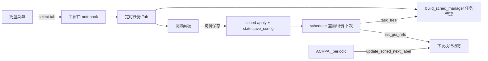

## 产品概述

在主窗口「工作流」Tab 之后新增「定时任务」Tab，作为定时调度的一站式入口。左侧以现有「管理计划任务」为主页面，右侧为窄设置面板；迁移完成后从「设置」窗口移除全部定时任务内容，托盘「打开定时执行设置」改为直接聚焦并切换到新 Tab。

## 核心功能

- **新增「定时任务」Tab**：位于主窗口 `notebook` 第 3 位（「工作流」之后），采用「左管理 + 右设置」布局。
- **左侧任务管理（主区）**：嵌入现有「管理计划任务」能力——任务表格（名称/目标/计划/下次执行/上次执行/状态）、新建/编辑/删除、启用/禁用、立即执行、查看日志、多关键词搜索、右键菜单、Ctrl+V 粘贴新建。
- **右侧设置面板（窄区）**：承载定时任务相关设置——启用定时、时刻（时/分）、重复模式（仅一次/每天/每周）、星期勾选、下次执行预览、调度轮询间隔；修改后自动保存并安全重启调度器。
- **入口统一**：托盘菜单「打开定时执行设置」聚焦主窗口并选中新 Tab，不再弹独立窗口。
- **设置清理**：从「设置」窗口移除「定时任务」页面与「定时调度」卡片，相关搜索索引与别名一并清理。

## 视觉与交互效果

- 左区为任务管理表格，沿用现有 Treeview 选中加粗、状态着色（启用/禁用/过期）与工具栏按钮风格。
- 右区为卡片式窄设置面板，分组呈现「定时开关」「重复规则」「下次执行」「轮询间隔」，配色与工作流/编辑区及设置卡片一致，深浅主题联动。
- 首次切换到该 Tab 时才构建（懒加载），避免拖慢启动；切换后自动刷新任务列表与「下次执行」状态。

## 技术栈

- Python + Tkinter / ttk（与现有主窗口、设置窗口、工作流 Tab 一致）。
- 复用 `src/ui/workflow_view.py` 的 Tab 模块范式：`build(notebook, tab, colors, fonts, deps)` + `get_widgets()` + 主题订阅刷新。
- 复用 `src/dialogs.py` 的「管理计划任务」构建逻辑与 `src/scheduler.py` 的任务操作 API。
- 复用 `src/ui/settings/cards/sched.py` 与 `advanced.py` 中「schedule」段的设置变量与保存/重启调度逻辑。

## 实现方案

### 1. 管理器可嵌入化（`src/dialogs.py`）

将 `open_sched_manager()` 的函数体抽为 `build_sched_manager(parent, ...)`：接受任意容器（Frame 或 Toplevel），在 `parent` 内构建工具栏 + 任务表 + 搜索 + 右键菜单 + 日志弹窗，返回句柄字典（`frame`、`tree`、`refresh`、`toolbar`）。`open_sched_manager()` 退化为薄封装（创建 Toplevel 后调用 builder 并绑定 Esc），保留向后兼容；托盘入口不再调用它。

### 2. 新建 Tab 模块（`src/ui/sched_tab.py`）

- `build(notebook, tab, colors, fonts, deps)`：用左右分栏布局，左列 `weight=1` 嵌入 `dialogs.build_sched_manager(left_frame)`，右列固定宽度（约 `utils.sp(260)`）构建设置面板。
- 设置面板复用 `cards/sched.py` 的启用/时刻/重复/星期/下次执行控件与 `advanced.py` 的轮询间隔控件；直接复用 `state._sched_enabled_var`（ACRPA 启动时已创建，避免调度器线程引用失效），自建 hour/minute/repeat/weekday/poll 变量。
- 保存逻辑复用 `sched.py apply()` + `advanced.py apply()` 中「schedule」段的写状态与 `sched.stop_scheduler()/calc_next_run()/start_scheduler()` 重启流程，加 600ms 防抖后调用 `state.save_config()`。
- 暴露 `get_widgets()`、`refresh_theme(colors)`、`update_sched_next_label(text)`、`refresh_tasks()`。

### 3. 主窗口接入（`src/ACRPA.py`）

- 在 `tab_workflow` 之后新增 `tab_sched = tkinter.Frame(notebook, bg=C["bg"])`，`notebook.add(tab_sched, text="  定时任务  ")`。
- 仿照 `_build_workflow_tab()` 增加 `_build_sched_tab()`（幂等懒构建 + try/except 记录 `log1` + 转发别名），复用 `ui_workflow_view` 相同的 `fonts`/`deps` 注入。
- 将 `_on_wf_tab_changed` 扩展为三态判断：`tab_workflow → build + set_active_tab(1)`、`tab_sched → build + set_active_tab(0 或新枚举)`、其余 `set_active_tab(0)`；`ui_exec_bar.set_active_tab` 仅需保证「非工作流时隐藏工作流上下文条」。

### 4. 刷新链与入口重接

- `sched.set_gui_refs(root, state._sched_enabled_var, next_label, task_tree)`：在新 Tab 构建完成后注入「下次执行」标签与任务树（替换启动时 `None`），实现状态/列表联动刷新。
- `_periodic` 中 `settings_window.update_sched_next_label(sched_val)` 改指 `ui_sched_tab.update_sched_next_label(sched_val)`。
- `_tray_open_scheduler()` 改为 `root.deiconify()` + `root.lift()` + `notebook.select(tab_sched)`。

### 5. 设置窗口清理（`src/ui/settings/`）

- `window.py`：从 `_PAGE_BUILD` 删除 `schedule` 页；`_CARD_KEYS`/`_card_modules` 移除 `sched`；删除/空化 `update_sched_next_label` 与 `ctx.set_sched_label` 相关链路。
- `navigation.py`：`PAGE_DEFS`/`PAGE_ORDER`/`PAGE_ALIASES` 移除 `schedule` 页与分组项。
- `cards/advanced.py`：移除 `schedule` 段构建与 `_SECTION_TITLES["schedule"]`，并在 `apply()` 中对 `sched_poll_var` 加 `hasattr/handles.get` 保护。
- `cards/sched.py`：迁移后不再接线；确认无测试/工具引用后可删除或保留为死代码（优先保留以避免破坏外部导入）。
- `settings_window.py` 薄壳：同步调整 `update_sched_next_label` re-export（可保留兼容空实现）。

### 架构与数据流



## 实现要点

- **性能**：懒构建（启动不建 Tab）；任务列表仅切到 Tab 时 + 手动刷新时重载，避免后台高频重绘；任务量小，`task_summary` 逐条渲染可接受。
- **防回归**：`open_sched_manager` 保留薄封装兼容既有 import；`advanced.py apply()` 对缺失 `sched_poll_var` 做保护；主题切换通过 ThemeBus 订阅统一刷新新 Tab。
- **日志**：构建/保存异常复用 `log1`，构建失败沿用工作流 Tab 的「记录一次、保留空 Tab」策略，不中断主流程。
- **爆炸半径控制**：新增 Tab 为纯增量；设置窗口清理仅限 schedule 页与 sched 卡，不改其它页；`set_active_tab` 保持对 0/1 的既有语义不变。

## 目录结构

```
src/
├── ui/
│   └── sched_tab.py                  # [NEW] 「定时任务」Tab 模块：左管理右设置布局、懒构建、主题刷新、下次执行标签刷新
├── dialogs.py                        # [MODIFY] 抽取 build_sched_manager(parent,...)，open_sched_manager 改为薄封装
├── ACRPA.py                          # [MODIFY] 新增第 3 个 Tab、懒构建、三态 tab 切换、托盘入口改 select、刷新链重接
├── settings_window.py                # [MODIFY] 调整 update_sched_next_label re-export（兼容空实现/移除）
└── ui/settings/
    ├── window.py                     # [MODIFY] 移除 schedule 页与 sched 卡接线、set_sched_label/update_sched_next_label 链路
    ├── navigation.py                 # [MODIFY] 移除 schedule 页定义/别名/分组
    └── cards/
        ├── advanced.py               # [MODIFY] 移除 schedule 段构建 + apply 加保护
        └── sched.py                  # [MODIFY/可选删除] 不再接线；保留以避免外部导入破坏（确认无引用后删除）
```

## 关键代码结构

```python
# dialogs.py —— 可嵌入管理器
def build_sched_manager(parent, on_done=None):
    """在 parent 内构建任务管理工具栏 + 表格 + 搜索/右键/日志，返回句柄。"""
    return {"frame": ..., "tree": mgr_tree, "refresh": _mgr_refresh,
            "toolbar": mgr_toolbar}

# ui/sched_tab.py —— 新 Tab 模块对外契约
def build(notebook, tab, colors, fonts, deps) -> dict:
    """左区嵌入 build_sched_manager，右区构建设置面板；返回控件句柄。"""
def get_widgets() -> dict
def refresh_theme(colors) -> None
def update_sched_next_label(text) -> None
def refresh_tasks() -> None
```