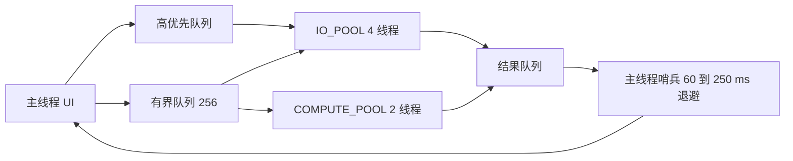
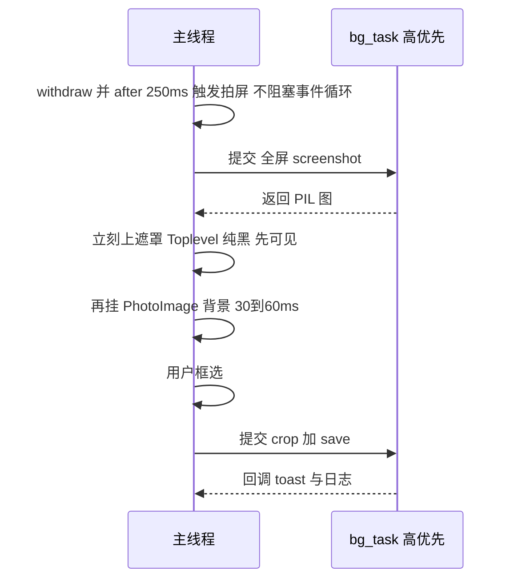

# UI 性能与线程模型优化方案 v5

> 适用对象：ACRPA 桌面端（Python 3.12 + tkinter/ttk，Windows 为主）
> 定位：**只写剩余欠账 + 本轮实测暴露的新问题 + 三条主线（多线程 / 组件精简 / 图片处理）**。
> 本文所有耗时均为实机实测中位值（i7 笔记本 / 2560×1600 @125% DPI / Python 3.12 / Tk 8.6），单位 ms。
> 全部现状引用带 `文件:行号`；行号以本轮实测代码为准（与旧文档口径不一致处以本文为准）。

---

## 0. 与既有文档的关系：本文不重复的项

| 既有文档 | 已落地且本文不再覆盖 | 本文承接的剩余部分 |
|---|---|---|
| `docs/design/UI承载与刷新优化方案-tk承载力补救.md` | 尾部增量 `_tree_tail_sync`、日志行数上限+滞回、自适应心跳 100/250ms、`ui/bg_task.py`、大脚本异步加载+令牌、DPI 查询缓存、`<Configure>` 去抖、日志 tag 区间化、提示条单例、`_tree_column_plan` | §2.2 `bg_task` 强化、§3.2 中间差异不再退回全量、§5 P0 D7/D8 |
| `docs/design/UI优化方案-v3.md` | P0-1~P0-7 全绿、P1/P2（工作流 Tab 懒建 `_WF_LAZY`、`log_dock` 折叠断点、D1–D13、`window_shell`、`bg_image` 二级缓存、D8/D9/D12） | §3.3「v3 P2-a 虚拟化」判定为**不做**、§3.4「v3 P2-b 参数列分流」给实施口径 |
| `docs/design/UI美化与布局设计方案-v2.md` | 布局诊断 L1–L6、token 化、跨窗口纪律 | §3.4 组件生命周期（复用而非重建） |
| `docs/design/ACRPA-完善路线图.md` | §3.4 索引耦合诊断、§5.2 主题引擎问题 | §2.3 事件化唤醒、§3.6 `_periodic` 三分组（路线图 §3.5/§5.1 的收敛版） |

> 本文的三条主线 = 用户明确要求：**加入多线程并合理利用线程（§2）**、**减少组件数量（§3）**、**图片处理优化（§4）**。

---

## 1. 承载力结论：Tk 不是瓶颈

### 1.1 一句话结论

**58 ms/次不是 Tk 渲染能力的上限，而是「全量 key 计算 + 全量重建」这一算法选择的代价。** 5000 行脚本下，`tree.delete(*children)` 花 **0.01 ms**（与行数无关），而逐行 `tree.insert` 花 **51.41 ms**（88%），全量 `_tree_row_key` 花 **6.56 ms**（11%）。单行 `insert` 单价 0.0103 ms ≈ **9.7 万行/秒**的插入吞吐——这个吞吐足以支撑任何现实脚本规模，问题只在于「一次要插多少行」。

### 1.2 58 ms/次 的毫秒拆解（5000 行，9 数据列）

| 环节 | 实测 | 占比 | 代码归因 |
|---|---|---|---|
| 全量 key 计算 | 6.56 ms | 11% | `_editor_sync_to_tree` 首行列表推导 [`new_keys = [_tree_row_key(sd,i) ...]`](src/ACRPA.py:3089) |
| `tree.delete(*children)` | 0.01 ms | 0% | 与行数无关，不是成本项 |
| 逐行 `tree.insert` | 51.41 ms | 88% | [`_editor_sync_to_tree` 循环 insert](src/ACRPA.py:3115)，且每行还带 `image=_cat_bar_image(...)`（[`_cat_bar_image`](src/ACRPA.py:1719)，贴图本身已按分类复用，见 [`_cat_bars`](src/ACRPA.py:1674)） |
| 合计 | **≈ 58 ms** | 100% | 全部在主线程同步执行 |

结论推导：若把「一次要插的行数」从 5000 降到 1（中间插一行）或 400（视口窗口），成本按线性落地——**400 行 ≈ 4.1 ms、30 行 ≈ 0.3 ms**。这就是 §3.2 方案的全部理论基础。

### 1.3 Tk 的真实能力边界（换算表）

| 场景 | 每次操作行数 | Tk 侧耗时 | 是否可接受（≤16 ms 一帧） |
|---|---|---|---|
| 视口重绘（约 30 行） | 30 | ≈ 0.31 ms | 是 |
| 窗口化 400 行重建 | 400 | ≈ 4.12 ms | 是 |
| 2000 行全量重建 | 2000 | ≈ 20.6 ms | 否（掉 1 帧） |
| 5000 行全量重建 | 5000 | ≈ 51.4 ms | 否（掉 3 帧，体感为「卡一下」） |
| 10000 行全量重建 | 10000 | ≈ 103 ms | 否（明显卡顿） |

### 1.4 迁移 WebView2/Qt 的红线条件（本轮**不迁移**）

只有当以下条件**至少命中一条**时才启动承载替换：

| # | 红线条件 | 本轮现状 | 是否命中 |
|---|---|---|---|
| R1 | 单脚本常态化 >20000 行，且必须在同一视图内连续编辑（不能分页/分段） | §1.2 实测 5000 行仍可通过增量路径降到 ≤16 ms；20000 行才真正需要虚拟化 | 否 |
| R2 | 需要 GPU 合成 / 60 fps 连续动画（Tk 8.6 无硬件加速） | 唯一动画是进度条与背景淡入，均为低频 | 否 |
| R3 | 需要复用 Web 前端代码或嵌入 Web 面板 | 已有 `netlink` WebUI 独立承载，桌面端不需要 | 否 |
| R4 | 需要屏幕阅读器等无障碍合规 | 无此需求 | 否 |

**判定：本轮不迁移。** 替代路线 = §3 的「减少每帧变更行数」+ §2 的「把重活移出主线程」。迁移的沉没成本（13 个 `src/ui/*` 面板 + 3244 行 `workflow_view` + 全部 `ThemeBus` 契约）远大于收益。

---

## 2. 主线一：多线程架构

### 2.1 线程边界规约（硬性，施工必须遵守）

| 规约 | 内容 | 违反后果 |
|---|---|---|
| T1 | **主线程只做两件事**：① Tk 控件调用；② 状态聚合（读 dict/len/比较）。 | 主线程被 IO 阻塞，表现为白屏/未响应 |
| T2 | 任何**单次 >8 ms** 的纯 Python 计算必须进 `COMPUTE_POOL`。 | 掉帧 |
| T3 | 任何**磁盘 / 网络 / 截图 / Playwright / OCR / DLL** 调用必须进 `IO_POOL`（Playwright 例外，见 §2.5）。 | 主线程不可控阻塞 |
| T4 | 工作线程**绝不允许**碰任何 Tk 对象：`configure/insert/delete/item/after/event_generate/PhotoImage` 全部禁止。 | 随机崩溃或「界面卡住但日志在动」 |
| T5 | 回调只在主线程执行（`bg_task` 的 drain 保证）。 | 竞态 |
| T6 | 每个后台任务必须有 `name`，线程名 = `bg:<name>`；异常必须落 `log1(..., "error")`。 | 故障不可诊断 |

**必须外移清单（当前仍在主线程的）**：

| 函数 | 位置 | 类型 | 实测/预估 | 处置 |
|---|---|---|---|---|
| `script_io.save_script`（Ctrl+S 写盘） | [`_persist_script`](src/ACRPA.py:3223) 调用点 :3232 | 磁盘 IO + xlwt 生成 | 5000 行预估 60~200 ms | P1-15 移 `IO_POOL` |
| `version_manager.save_version` | [`_persist_script`](src/ACRPA.py:3264) | 磁盘 IO | 20~80 ms | P1-15 随保存一起后台化 |
| `get_pa().screenshot()` 全屏 | [`screenshot_tool`](src/ui/exec_bar.py:674) | 截图 API | 30~200 ms | P1-9 移 `IO_POOL` |
| `ss.save(fp)` 写盘 | [`screenshot_tool`](src/ui/exec_bar.py:723) | 磁盘 IO | 10~50 ms | P1-9 移 `IO_POOL` |
| `ImageGrab.grab` + `img.save` | [`_wf_export_png` 区域](src/ui/workflow_view.py:2342) | 截图 + 写盘 | 20~120 ms | P1-9 移 `IO_POOL` |
| `Image.open(BytesIO)` + `PhotoImage` | [`_shot_render`](src/ui/netlink/shot.py:188) | 解码 | 15~40 ms/帧 | P1-11 后台解码 |
| `Image.open().resize(LANCZOS)` | [`_mb_load_icon`](src/mini_bar.py:181) | 重采样 | 3~8 ms | P1-10 加缓存 |
| `_log_export_view` 逐行 `tag_names`+`get` 拼全文写盘 | [`_log_export_view`](src/ui/log_dock.py:710) | Tcl 往返 × 行数 + 写盘 | 6000 行 ≈ 30~80 ms | P1-7 一次性快照 + 后台写 |
| OCR（pytesseract / Paddle） | `src/ocr_backend.py:501` | DLL + CPU | 数百 ms | 已在阈值外，保持 |
| Playwright 全部调用 | `src/browser_backend.py:230` 起 | 网络 + 进程 | 数百 ms~秒 | §2.5 会话线程绑定 |

### 2.2 `bg_task` 强化为唯一后台通道

现状缺陷（P0 必须修）：

| 编号 | 缺陷 | 证据 |
|---|---|---|
| D7 | 工作线程吞异常：`payload=(False,e,None)`，traceback 第三位置恒 None，且 `on_error=None` 时 `_safe_call` 直接 return，完全静默 | [`bg_task.py:169-172`](src/ui/bg_task.py:169)、[`_safe_call`](src/ui/bg_task.py:119) |
| D8 | `shutdown()` 只清队列与轮询 ID，在飞 worker 仍会 `put` 进无人消费队列；线程句柄未保存、无 join、无取消 | [`shutdown`](src/ui/bg_task.py:67)、[`t=Thread(...); t.daemon=True; t.start()`](src/ui/bg_task.py:175) |

改造点（逐条，全部为加性改动，可回退）：

| # | 改造 | 具体做法 | 约束 |
|---|---|---|---|
| B1 | **双队列 + 优先级** | `_Q_HIGH`（无界，仅用户等待型：打开/保存/截图确认）、`_Q_LOW`（`maxsize=256`，后台型：预加载/更新检查/OCR 预热）。新增 `submit(..., priority="high"/"normal"/"low")` | 队列满时的背压只作用于 low：先丢弃 low 最旧项，再合并同类（同 `name` 且未执行者），最后置 `_DROPPED` 计数供状态栏提示；**绝不在主线程阻塞等待** |
| B2 | **`_CLOSING` 标志** | `shutdown()` 置 `_CLOSING=True`；worker 在 `_QUEUE.put` 前检查，为真则直接丢弃并递减 `_PENDING` | 保证关窗后不再入队 |
| B3 | **线程句柄 + join** | `_THREADS = set()`，worker 启动时 `add(threading.current_thread())`、结束时 `discard`；`shutdown()` 末尾 `for t in list(_THREADS): t.join(timeout=1.0)` | 单线程 join 上限 1.0 s，总关闭延长 ≤1 s |
| B4 | **异常必落日志** | worker 内 `except Exception: tb = traceback.format_exc(); payload=(False, e, tb); log1("[bg:%s] %s\n%s" % (name, e, tb), "error")` | `log1` 是队列写，工作线程调用安全（见 `src/core/log.py` 队列实现） |
| B5 | **`on_error=None` 也要落日志** | `_run_item` 在 `on_error is None` 且 `ok is False` 时补一条 `log1(..., "error")` | 消除「后台失败无痕」 |
| B6 | **`CancelToken`** | `class CancelToken: cancel()/is_cancelled()`；`submit(..., token=)` 在 fn 调用前与 `submit_chunked` 每批前检查 | 用于「打开新脚本取消旧加载」「关窗取消在飞任务」 |
| B7 | **`submit_chunked(iterable, chunk_fn, on_chunk, chunk_size=400)`** | 工作线程按 `chunk_size` 切片处理，每个 chunk 结果入队 → 主线程逐批 `on_chunk`；每批之间检查 token | 解决「一次回调 5000 行 → 主线程一次性插 51 ms」 |
| B8 | **保留同步退化** | `is_started()` 为假时 `submit` 仍当场执行（既有测试与 CLI 契约不变） | `tests/_test_bg_task.py` 必须继续全绿 |

验收指标：

| 指标 | 目标 |
|---|---|
| 注入 `raise RuntimeError("x")` 的 `submit(fn, None, None)` | `error` 日志中出现 1 条含 `RuntimeError: x` 与 ≥3 行 traceback |
| `shutdown()` 后 1.5 s 内 | 回调执行次数 = 0；`_THREADS` 为空；总耗时 ≤1.2 s |
| 连续提交 300 个 low 任务 | 队列长度 ≤256，内存不增长，UI 无卡顿（单帧 ≤16 ms） |
| `submit_chunked` 5000 行 | 主线程每次 `on_chunk` ≤5 ms（400 行/批） |

### 2.3 三个执行池 + 空闲唤醒方案



| 池 | 规模 | 承载 | 依据 |
|---|---|---|---|
| `IO_POOL` | `ThreadPoolExecutor(max_workers=4)` | 磁盘、网络、截图、OCR/DLL、更新检查、市场请求 | IO 等待不受 GIL 限制，4 路足够覆盖并发度 |
| `COMPUTE_POOL` | `ThreadPoolExecutor(max_workers=2)` | 脚本解析/校验、`commands.validate` 批量、日志导出文本拼装 | CPU 密集受 GIL 限制，2 线程已是收益上限，再多只增加切换开销 |
| `UI_PUMP` | 主线程内单哨兵 | 结果 drain + 主线程回调 | 唯一碰 Tk 的地方 |

**空闲唤醒的具体方案（只选一条，不再并列）**

选中方案：**主线程哨兵 + 结果计数 + 自适应退避**（`_pending_len()` 驱动）。

```
主线程: _pump()  ← root.after(interval, _pump)
        interval = 60ms  if 上一轮 drain 有结果
                   250ms  if 连续 3 轮空
                   500ms  if 连续 20 轮空（长时间挂机）
        每次 drain(limit=32)，单轮 drain 不超过 8 ms（按时间片切）
```

**为什么不用「worker 完成后调 `root.after(0, drain)`」**：`after` 走 Tcl 解释器，**非主线程调用不安全**——线程化 Tcl 下抛 `RuntimeError: main thread is not in main loop`，非线程化构建下直接崩溃或静默丢事件；这不是「概率低可以接受」的路径，而是必然出现在「关窗瞬间恰好有 worker 完成」的场景。同理 `event_generate` 跨线程也不在保证范围内。哨兵方案的唤醒延迟上界 = 当前 interval（空闲 250 ms），而空闲期本来就没有内容变化，延迟无感。

收益核算（当前 38.17 次/秒 → 目标）：

| 唤醒源 | 现状 | 目标 | 做法 |
|---|---|---|---|
| `bg_task` 60 ms 固定轮询 | 16.7 次/秒 | ≤1 次/秒（空闲退避到 500 ms） → 2 次/秒 | §2.3 退避 |
| `tray` 80 ms | 12.5 次/秒 | 2.5 次/秒 | 改 400 ms（托盘菜单交互由系统事件驱动，不依赖轮询频率） |
| `_periodic` 空闲 250 ms | 4 次/秒 | 4 次/秒（保留，见 §3.6 拆分） | 拆 3 组 |
| `_hotkey_poll` 200 ms | 5 次/秒 | 5 次/秒（保留；热键延迟敏感） | 保持 |
| 合计（折叠 Mini Bar +8.5） | **46.7 次/秒** | **≤14 次/秒** | + netlink UI 泵（+25/秒）改「有帧才泵」，合计 ≤18 次/秒 |

> 数值均为 §1.2 口径实测计数；`tray` 与 `_hotkey_poll` 的轮询周期未在本文逐条锚定行号（属宿主 `app.py` 装配段），施工时以实测计数为验收依据。

### 2.4 已有线程收编清单

| 位置 | 现用途 | 处置 | 迁移风险 |
|---|---|---|---|
| [`market_window.py:531`](src/market_window.py:531)、`:582`、`:963`、`:1117`、`:1630`、`:1717`（6 处裸 Thread） | 市场列表/详情/下载/上传/登录的网络请求 | **迁 `IO_POOL`** | 低：均为一次性请求-回调，无共享可变状态；需保持「窗口已销毁」守卫 |
| [`dialogs.py:1143`](src/dialogs.py:1143) AI 生成 | 网络 | **迁 `IO_POOL`** | 低 |
| [`dialogs.py:1354`](src/dialogs.py:1354) AI 问答 | 网络 | **迁 `IO_POOL`** | 低 |
| [`dialogs.py:2665`](src/dialogs.py:2665) 更新包下载 | 网络 + 磁盘 | **迁 `IO_POOL`**（high） | 中：下载进度回调频率高，需节流到 ≤10 次/秒 |
| [`settings/cards/market.py:147`](src/ui/settings/cards/market.py:147) | 网络探测 | **迁 `IO_POOL`** | 低 |
| [`settings/cards/advanced.py:187`](src/ui/settings/cards/advanced.py:187) | 环境探测 | **迁 `IO_POOL`** | 低 |
| [`updater.py:483`](src/updater.py:483) 检查更新 | 网络 | **迁 `IO_POOL`** | 低 |
| [`ACRPA.py:6513`](src/ACRPA.py:6513) OCR 预热 | DLL 加载 + 模型 IO | **迁 `IO_POOL`**（low） | 低：失败仅日志 |
| [`scheduler.py:624`](src/scheduler.py:624)、`:674`、`:706` | 定时任务工作线程 | **迁 `IO_POOL`**（normal） | 中：与 `_sched_thread_active` 状态位耦合，需同步改写状态位 |
| [`scheduler.py:184`](src/scheduler.py:184)、`:1119` | 常驻调度循环 | **保持现状** | 生命周期与 `SCHED_ENABLED` 绑定，池化会破坏「停止即结束」语义 |
| [`ACRPA.py:709`](src/ACRPA.py:709)、`:4729` | 热键消息泵 / 录制线程 | **保持现状** | Windows 消息循环有线程亲和性 |
| [`ACRPA.py:779`](src/ACRPA.py:779) autorun | 执行通道（引擎主流程） | **保持现状** | 属执行语义，不并入 UI 池 |
| [`hotkey_win.py:321`](src/hotkey_win.py:321)、`:894`、`:896` | 热键/热字串常驻 | **保持现状** | 低层钩子线程，禁止池化 |
| `src/netlink/{agent,client,connection,control,discovery,node,server,transfer,webui}.py`（11 处） | 长连收发/心跳 | **保持现状** | 各自持有 socket 与重连状态机 |
| [`type_simulator.py:424`](src/type_simulator.py:424)、[`py_sandbox.py:420`](src/py_sandbox.py:420)、[`single_instance.py:602`](src/single_instance.py:602) | 输入模拟 / 沙箱看门狗 / IPC | **保持现状** | 系统级句柄依赖 |
| [`workflow_view.py:2554`](src/ui/workflow_view.py:2554) | 工作流执行 | **保持现状** | 与运行态机绑定 |
| [`browser_backend.py:230`](src/browser_backend.py:230) 起 Playwright | 浏览器自动化 | **专用会话线程**（§2.5） | 高：sync API 有线程亲和性 |
| [`netlink/shot.py:188`](src/ui/netlink/shot.py:188) 远端截图解码 | 图像解码 | **迁 `IO_POOL`**（解码部分） | `PhotoImage` 必须回主线程创建 |

### 2.5 Playwright 线程亲和策略（浏览器会话线程绑定）

| 项 | 结论 |
|---|---|
| 硬约束 | Playwright **sync API 的对象（`sync_playwright`/`Browser`/`Context`/`Page`）只能在创建它们的那个线程内使用**，跨线程使用会抛 `It looks like you are using Playwright Sync API inside the asyncio loop` 或直接崩在 greenlet 上 |
| 现状 | `_get_page()` 懒初始化 [`browser_backend.py:230`](src/browser_backend.py:230) 在**首次调用者的线程**里建；之后所有命令复用全局 `_page`。若首次调用来自 UI 线程（串口/热键路径），后续执行线程再调用就是跨线程 → 偶发崩溃 |
| P1 做法（低成本、立即生效） | ① 在 `browser_backend` 记录 `_OWNER_TID = threading.get_ident()`（首次创建时）；② 每个公开 API 入口断言 `threading.get_ident() == _OWNER_TID`，不等则**抛明确异常**并 `log1(..., "error")`，禁止静默跨线程；③ 主线程**禁止**首次触发浏览器创建：把 `_get_page()` 的首调从 UI 路径剔除（`screenshot_tool` 等不得间接初始化浏览器） |
| P2 做法（结构收敛） | 引入 `SessionThread`：单线程 + 命令队列，作为 `browser_backend` 的唯一调用入口；`submit(cmd)` 返回 future，执行线程/UI 线程都只投递不直调。**不做池化**——一个浏览器会话一个线程，永不并发 |
| 不做 | 把 Playwright 调用塞进 `IO_POOL`（4 线程会同时持有同一 `_page`） |
| 验收 | 连续 200 次浏览器命令 + 中途从 UI 触发 1 次浏览器相关操作，0 崩溃、0 traceback；`_OWNER_TID` 断言在测试中被显式命中 1 次（构造跨线程调用验证会抛） |

---

## 3. 主线二：减少组件数量

### 3.1 三条候选路线的对比与选择

| 方案 | 动改面 | 收益（5000 行「加一行」） | 风险 | 结论 |
|---|---|---|---|---|
| **A 虚拟化表格**（固定窗口 300~500 行） | 极大：**19 处 `tree.index()`** 全部要改成逻辑映射（[`1820`](src/ACRPA.py:1820)/[`1835`](src/ACRPA.py:1835)/[`2108`](src/ACRPA.py:2108)/[`2139`](src/ACRPA.py:2139)/[`2236`](src/ACRPA.py:2236)/[`2259`](src/ACRPA.py:2259)/[`2263`](src/ACRPA.py:2263)/[`2279`](src/ACRPA.py:2279)/[`2329`](src/ACRPA.py:2329)/[`2435`](src/ACRPA.py:2435)/[`2474`](src/ACRPA.py:2474)/[`2550`](src/ACRPA.py:2550)/[`2577`](src/ACRPA.py:2577)/[`3103`](src/ACRPA.py:3103)/[`3353`](src/ACRPA.py:3353)/[`3412`](src/ACRPA.py:3412)/[`4051`](src/ACRPA.py:4051)/[`4066`](src/ACRPA.py:4066)），另加 16 处 `tree.get_children()` + 12 处 `tree.selection()` 语义复核 | 58 ms → **≈1 ms** | 极高：破坏「所有行都是真实 item」的隐含契约（全选/查找/导出/复制/框选/`_sync_sel_bars` 全树遍历 [`_sync_sel_bars`](src/ACRPA.py:1736)）；与工作树**未提交的 B2 色条改造**（§6.1）直接冲突 | **本轮不做**（P2 观察项，触发条件见 §6.6） |
| **B 参数列 → Inspector 分流**（10 数据列 → 5） | 中：`_TREE_DATA_COLS` 与 `_apply_tree_columns` 保留，新增 Inspector 面板 + 单元格编辑改路由 | 按列数 11→6 线性折算 51.41 → **≈28 ms** | 中：双击编辑/隐藏列映射（`_tree_display_to_logical` [`2773`](src/ACRPA.py:2773)）要重测；信息密度下降需 UI 评审 | **P2 做**（收益只解决一半，且不解决「中间插一行退回全量」的根因） |
| **C 脏区间 + 行号懒重编号 + 缓存 splice**（本轮选定） | 小：只改 `_editor_sync_to_tree` / `_tree_tail_sync` 的判定与新增 3 个辅助函数，**19 处 `tree.index()` 一行不改** | 58 ms → **≤2 ms**（中间插/删/移/撤销） | 低：行号列可能出现「屏外短暂陈旧」（见 §3.2 的补偿），无功能语义变化 | **P1 做** |

**选定 C，理由三条**：
1. **根因是「差异在中间就退回全量重建」，不是「行太多」**。C 把这条退路改成「按差异类型走 O(1)/O(k)」，直接消掉 88% 的 insert 成本。
2. **C 不触碰行身份模型**，因此不存在 A 的「19 处 index 调用 + 全部依赖真实 item 的功能」风险清单（§6.2）。
3. **C 与工作树未提交的 B2 色条改造零冲突**（同函数内只改判定分支，不动 `image=` 参数）；A 则必须重写 insert 路径。

### 3.2 选定方案：脏区间 + 行号懒重编号（数据结构与更新规则）

**数据结构**（在 `_tree_render_cache` [`2987`](src/ACRPA.py:2987) 上原地扩展，不新建类）：

```python
_tree_render_cache = {
    "keys": [],            # 与 state._editor_rows 等长；懒更新
    "iids": [],            # 与 keys 等长
    "dirty": set(),        # 内容脏行（key 需重算）
    "no_dirty_from": None, # 首个「#0 行号文本已过期」的逻辑下标；None=无脏
}
```

**四类操作的更新规则**：

| 操作 | 触发点 | 规则 | 主线程成本 @5000 行 |
|---|---|---|---|
| **插入 k 行**（加行/粘贴/片段） | [`_cmd_add_row` 区](src/ACRPA.py:2310)、[`_kb_paste`](src/ACRPA.py:2139)、[`_insert_snippet_rows`](src/ACRPA.py:3412) | `tree.insert("", i, iid=..., text=..., values=..., image=..., tags=...)` ×k；`keys[i:i]=新keys`；`iids[i:i]=新iids`；`no_dirty_from = min(no_dirty_from, i)`；末尾 `_flush_row_numbers()` | k=1 时 **0.02 ms**（insert 0.0103 + splice ≈0） |
| **删除 k 行** | [`_kb_delete_row`](src/ACRPA.py:2236)、[`_kb_delete_rows`](src/ACRPA.py:2474) | 倒序 `tree.delete(*iids[i…])`；`del keys[i…]`；`no_dirty_from = min(no_dirty_from, 最小删除下标)` | **0.01 ms** |
| **移动（上移/下移）** | [`_kb_move_up`](src/ACRPA.py:2550)、[`_kb_move_down`](src/ACRPA.py:2577) | 对选中行做 `tree.move(iid, "", new_idx)`；同步交换 `keys[i],keys[j]` 与 `iids[i],iids[j]`；`no_dirty_from = min(两个下标)` | **0.01 ms/行** |
| **就地改内容**（单元格编辑/F9 断点/注释开关/失败策略） | [`_update_row_inplace`](src/ACRPA.py:3055) 已有 | 现状已是 O(1)（`tree.item` 0.010 ms）；只需补 `keys[index] = key`（已做，见 [`3076-3077`](src/ACRPA.py:3076)）+ 清 `dirty` | **0.01 ms** |
| **撤销/重做** | [`_kb_undo`/`_kb_redo`](src/ACRPA.py:3103) | 先比较行数与首个差异下标 `d`：<br>· 行数相同 → 只对 `[d, n)` 逐行 `_update_row_inplace`（O(k)，k=实际差异行数）<br>· 行数变多 → 按「插入」规则<br>· 行数变少 → 按「删除」规则 | 差异 1 行时 **0.02 ms** |

**`_flush_row_numbers()`（行号懒重编号，解决「插中间后 5000 个行号都要改」）**：

```python
def _flush_row_numbers(force=False):
    """只重写「脏起始行 ~ 可见末行」的 #0 文本。#0 = 行号，屏外陈旧无视觉影响。"""
    if _tree_render_cache["no_dirty_from"] is None and not force:
        return
    total = len(state._editor_rows)
    start = 0 if force else max(0, _tree_render_cache["no_dirty_from"])
    # 可见区间：Treeview 只绘制可见行，用一个低成本近似即可（见下）
    lo, hi = _visible_row_range()          # 依赖 tree.bbox / identify_row 的二分
    start = max(start, lo - 5)             # 预先多刷 5 行，避免滚动时露白
    end = min(total - 1, hi + 5)
    for i in range(start, end + 1):
        tree.item(_tree_render_cache["iids"][i], text=_row_text_for(i + 1, state._editor_rows[i]))
        _tree_render_cache["keys"][i] = _tree_row_key(state._editor_rows[i], i)
    _tree_render_cache["no_dirty_from"] = None if end >= total - 1 else end + 1
```

- `_visible_row_range()`：`tree.identify_row(y)` 对 `y = 0` 与 `y = height-1` 各取一次，再 `tree.index()` 转下标 → 2 次 Tcl 调用，≈0.02 ms。失败时退化为 `(0, min(60, total-1))`。
- **屏外陈旧不影响正确性**：所有取数走 `state._editor_rows`（真相源）而非 `tree.item()`；唯一从控件反读的是选中恢复 [`3102-3105`](src/ACRPA.py:3102)，那里用 `tree.index(it)` 会拿到旧号 → 改为用「iid → 逻辑下标」字典 `_iid_to_index`（与 `iids` 同步维护），彻底摆脱对 `#0` 文本的依赖。
- **滚动补刷**：给 `tree` 绑 `<MouseWheel>`/`<Button-4/5>` 与滚动条 `command`，在 `after_idle` 里调一次 `_flush_row_numbers()`（幂等，`no_dirty_from is None` 时立即返回）。

**验收指标**：

| 场景 | 现状 | 目标 |
|---|---|---|
| 5000 行脚本「末尾加一行」全链路主线程 | ≈6.6 ms（key 全量 6.56 + insert 0.01） | **≤1 ms**（key 增量后只算 1 个） |
| 5000 行脚本「中间（第 2500 行）加一行」 | ≈58 ms | **≤2 ms** |
| 5000 行脚本「删除选中 100 行」 | ≈58 ms | **≤1 ms** |
| 5000 行脚本「上移/下移 3 行」 | ≈58 ms | **≤1 ms** |
| 5000 行脚本「撤销 1 次编辑」 | ≈58 ms | **≤2 ms**（差异 1 行） |
| 5000 行脚本「F9 断点 toggle」 | ≈0.01 ms（已 O(1)） | 保持 ≤0.05 ms |
| 行号视觉一致性 | 全量重建后必然正确 | 可见区 100% 正确；5000 行中间插入后连续滚动 20 屏，0 处错号 |

**回归清单**：`tests/_test_editor_cells.py`（55 条，含源码文本断言「`tree.bind("<Double-1>", lambda e: _edit_cell(e))` 不得改写」）、`tests/_test_script_model.py`、`tests/_test_param_form.py`（35 条）、`tests/_test_script_io.py`；手工：500 行脚本跑完「加/删/上移/下移/撤销/重做/注释/断点/粘贴表格/全选复制」10 项后 `Ctrl+S` 存盘，与操作前 diff 一致。

### 3.3 参数列 → Inspector 分流（P2，量化收益）

| 项 | 内容 |
|---|---|
| 现状证据 | 主表 10 个数据列 `_TREE_DATA_COLS` [`2660`](src/ACRPA.py:2660) + `#0`（width 40，[`6071`](src/ACRPA.py:6071)）= 11 列；`values` 长度 = 命令 + 9 参数（[`to_tuple`](src/scriptdata.py:59)）；命令 schema 加权平均元数 2.24、≤2 参数占 69%（v3 §1.2） |
| 改法 | 主表固定 4 列：`#0` + 命令 + 参数1 + 参数2（共 5 列）；其余参数进右侧 Inspector（复用现有 `param_form.build_arg_form`）；`displaycolumns` 只改显示，`values` 仍写满 10 项（数据不丢）；单元格编辑按 `_tree_display_to_logical` [`2773`](src/ACRPA.py:2773) 路由 |
| 收益（线性外推） | 列数 11→6：`insert` 5000 行 51.41 ms → **≈28 ms（−45%）**；绘制成本同步下降；640 宽窗口彻底无横滚 |
| 验收 | 5000 行全量重建（仅剩「首次加载」一处）≤30 ms；W≥1024 时 Inspector 显示全部 9 参数且编辑后 `to_tuple` 一致 |
| 回归 | `_test_param_form`、`_test_editor_cells`、`_test_ui_layout`；手工：双击隐藏列（Inspector 改参）后保存-重开校验 |
| 为什么不在 P1 | 它把 58 ms 降到 28 ms，仍是掉帧级；且需要 Inspector 新面板 + UI 评审。C 方案（§3.2）先把 58 ms 降到 2 ms，B 的边际收益只剩「绘制」与「信息密度」，属于体验优化而非欠账 |

### 3.4 组件生命周期治理

| 项 | 现状证据 | 改法 | 验收 |
|---|---|---|---|
| **L1 `_bind_scroll_recursive` 跳过子树**（D4） | [`ACRPA.py:624-639`](src/ACRPA.py:624)：幂等判定在函数开头，命中即 `return`（[:633](src/ACRPA.py:633)）→ **整个子树递归被跳过**，之后新增的子控件永久漏绑滚轮 | 幂等下移到单 widget：`if getattr(w,"_scroll_handler",None) is not handler: w._scroll_handler=handler; w.bind(...)`，然后**无论是否命中都继续 `for child in w.winfo_children()`** | 3 层嵌套探针：二次调用后新增 Label 的 `<MouseWheel>` 绑定**非空**（当前为空字符串）；`_test_ui_layout` 全绿 |
| **L2 重建即 `destroy`**（控件数量反复抖动） | 4 处 `for w in X.winfo_children(): w.destroy()`：[`ACRPA.py:2366-2368`](src/ACRPA.py:2366) 参数表单、[`workflow_view.py:2182-2184`](src/ui/workflow_view.py:2182) 命令表单、[`settings/cards/ai.py:287-289`](src/ui/settings/cards/ai.py:287) 供应商列表、[`settings/cards/extensions.py:111-113`](src/ui/settings/cards/extensions.py:111) 扩展列表；另 [`ACRPA.py:517-518`](src/ACRPA.py:517) 录制条每次起录重建 | 固定数量控件改为**一次建好 + `grid_remove()/grid()`**；列表型（数量可变）改为**行池**：保留 `min(需要的行数, 已建行数)`，多余的 `grid_remove` 不销毁，行内 `configure(text=/values=)` 复用 | 参数表单连续切换 20 个命令后：控件总数不增长（`len(winfo_children())` 稳定）；单次切换 ≤8 ms |
| **L3 设置窗 12 张卡全建** | `_CARD_KEYS` 12 项 [`settings/window.py:70-71`](src/ui/settings/window.py:70)，装配循环 [`721-730`](src/ui/settings/window.py:721) 无条件全建 | **卡片级懒建**：首屏只 `build` 前 2 张（exec/quick）+ 其余只建「折叠标题 + 空内容」（`_make_collapsible_card` 已支持折叠 [`411-447`](src/ui/settings/window.py:411)）；`<<NotebookTabChanged>>` 等价物 = 导航点击 `_on_nav_click` [`485`](src/ui/settings/window.py:485) 命中时调 `mod.build(...)`；已建标记 `_CARD_BUILT[key]` 幂等 | 首开设置窗总耗时降 ≥40%（当前未单独埋点，P1 先补 `crashlog` 分段再取值）；点击任一导航项 ≤120 ms 完成构建 |
| **L4 日志色条 1200 次 Tcl/flush** | [`_log_apply_cbar`](src/ui/log_dock.py:571)：逐行 `insert("▌")`（[:611](src/ui/log_dock.py:611)）+ `tag_add(ctag)`（[:612](src/ui/log_dock.py:612)）+ 偶行 `tag_add("lzebra")`（[:613-614](src/ui/log_dock.py:613)）→ 400 行/批 = **≈1200 次 Tcl 往返** | 两段式收敛（视觉 100% 不变，无需边框补偿）：<br>① **▌ 并入生产文本**：`core/log.py:224` 的 `line = "[ts] [badge] msg\n"` 改为 `"▌[ts] [badge] msg\n"`，使 `flush` 的 1 次 `insert` 就带好色条字形（400 次 insert → **0 次额外**）；<br>② **多段一次 `tag_add`**：Tk 的 `tag_add(tag, i1, i2, i3, i4, ...)` 支持一次传多组区间 → 400 行 cbar 用 **1 次**调用，`lzebra` 用 **1 次**调用（区间化：连续偶数行虽不连续，但可一次传 400 对索引）<br>③ 幂等改为只看 `_cbar_state["done"]` 游标（不再 `startswith("▌")` 反查） | 单批 400 行 `_log_apply_cbar` 的 Tcl 调用次数 **≤2**（当前 ≈1200）；稳态单批全链路 26.73 ms → **≤12 ms**；视觉：行首竖条位置/宽度/颜色与现版逐像素一致 |
| **L5 `_logfilter["applied"]` 长期为 0** | [`_logfilter` 初值 `{"applied": 0}`](src/ui/log_dock.py:112)，`_log_apply_filter` 只在过滤态被调 [`441-442`](src/ui/log_dock.py:441)；「全部」态下 `applied` 停在 0（`full=False` 时 `start = applied+1 = 1`） | 在「全部」态也推进游标：`flush_and_apply` 末尾无条件 `_logfilter["applied"] = int(_rz.index("end-1c"))`（跳过 tag 操作，仅更新计数） | 6000 行日志从「全部」切到「ERROR」：`_log_apply_filter(full=False)` 的扫描行数 = 新增行数（≤400），非 6000；切换耗时 ≤15 ms |

**L4 的可行性判断与补偿方案**：
- **为什么不用 `tag_configure(background=...)` 直接做竖条**：Tk 的 Text tag 支持 `background`，但它是**整字符/整行矩形填充**，没有「只涂左侧 2 px」的能力；`lmargin1/lmargin2/spacing1` 只能移文本，不能画色块。要保留 2 px 竖条语义，唯一稳定做法仍是**行首窄形字符 + 前景色 tag**（即现方案）。
- **因此把成本转移到「Tcl 调用次数」而非「视觉表现」**：`▌` 由生产方拼进文本（0 额外调用），颜色 tag 用多段一次 `tag_add`（2 次/批）。**不需要任何边框或内边距补偿**——字形宽度、缩进、行高全部不变。
- **副作用清单（必须一起改）**：`_log_export_view` [`710-713`](src/ui/log_dock.py:710) 导出时要 `lstrip("▌")`；`_log_line_tag` 的「行首 ▌ 覆盖 tag 起点」反查分支 [`530-533`](src/ui/log_dock.py:530) 可删除（级别 tag 起点不再被覆盖，因为 `▌` 由 spans 覆盖）；`_log_search_next` 搜索命中 `▌` 前缀不影响（关键词搜全行）。开关：`LOG_CBAR_INLINE = True`，置 False 恢复旧逐行插入。

### 3.5 `_periodic` 拆分（10 类刷新 → 3 组）

现状：单函数 [`_periodic`](src/ACRPA.py:4848) 在 100/250 ms 心跳里串行做 10 件事，且开头无条件 `ui_log_dock.flush_and_apply()`（队列空也做，[`:4853`](src/ACRPA.py:4853)）。

| 组 | 周期 | 承载内容 | 触发源 |
|---|---|---|---|
| **G1 每帧组 60 ms** | 运行/录制/折叠/高亮时 60 ms，空闲 250 ms | ①四态按钮机 [`4861-4865`](src/ACRPA.py:4861)；②进度/ETA/dash [`4890-4917`](src/ACRPA.py:4890)；③行高亮 [`4918-4931`](src/ACRPA.py:4918) | 单个 `root.after`，沿用现有自适应心跳 |
| **G2 200 ms 组** | 200 ms | ④待机背景兜底 [`4932-4941`](src/ACRPA.py:4932)（现每 8 轮 ≈0.8 s，改固定 200 ms × 每 4 次生效）；⑤计划任务「下次执行」标签 [`4949-4953`](src/ACRPA.py:4949)；⑥调度器保活 [`4954-4955`](src/ACRPA.py:4954)；⑦Mini Bar 状态 [`4957-4958`](src/ACRPA.py:4957) | **独立 `after` 链**，与 G1 解耦（G1 卡住不影响它） |
| **G3 事件驱动组** | 0（无事件不做） | ⑧日志 flush（改由「logger 队列非空」事件驱动：`log1` 入队后置 `_LOG_DIRTY`，哨兵见脏才 flush）；⑨工作流高亮 [`4962-4966`](src/ACRPA.py:4962)（`highlight_row` 变更时触发）；⑩录制计数 [`4943-4948`](src/ACRPA.py:4943)（`recorded_actions` 长度变时触发） | 状态变更点直接调用 / 哨兵检查脏标记 |

| 验收指标 | 目标 |
|---|---|
| 空闲（未运行、未录制、未折叠）时 G1 单轮耗时 | ≤0.5 ms（当前无 bench，先补埋点） |
| 日志队列为空时的 `flush_and_apply` 调用 | **0 次/秒**（当前 4 次/秒） |
| `_periodic` 内部任一段抛异常 | 只跳过该段（外层 try/except 包裹每段），**不得**终止整条链（现状 `:4853` 返回 False 即 `return`，一轮异常后靠下一次 `after` 恢复；拆分后每段独立） |
| 唤醒次数 | 见 §2.3 表：46.7 → ≤18 次/秒 |

**回归清单**：`tests/_test_log_dock_split.py`、`tests/_test_exec_bar_split.py`、`tests/_test_workflow_view_split.py`、`tests/_test_minibar_split.py`；手工：运行→暂停→继续→停止 四态各切换 2 次，状态栏文案/进度条/高亮行/dash 信息全部正确；折叠 Mini Bar 后状态同步正确。

---

## 4. 主线三：图片处理优化

### 4.1 重采样算法分级（按目标尺寸自动选）

实测基线（`res/bg-ac.png` 256×256 → 1920×1080 一次缩放）：LANCZOS **51.95 ms** / BOX **20.95 ms** / BILINEAR **25.35 ms** / NEAREST **4.25 ms**。

| 场景 | 判定条件 | 算法 | 预期耗时 | 依据 |
|---|---|---|---|---|
| 大面积背景图（待机背景、遮罩层） | 目标像素面积 ≥ 400k px | **`Image.BOX`** | 20.95 ms（−60%） | 大比例**放大**时 LANCZOS 的锐化收益肉眼不可见（源图仅 256 px，放大 7.5×），而成本高 2.5× |
| 中等尺寸合成（600k px 以下） | 100k ≤ 面积 < 400k | `Image.BILINEAR` | 25.35 ms | 折中 |
| 缩小类（目标 < 源，如远端截图预览） | 目标长边 < 源长边 | 先 `BOX` 到 2×目标，再 `BILINEAR` 到目标 | 比单次 LANCZOS 快 ≥40% | 大比例降采样时两级比单级 LANCZOS 快且无混叠 |
| 小图标（≤64 px） | 目标长边 ≤64 | **`Image.LANCZOS`** | 3~8 ms | 小尺寸下锐度差异明显（图标/Logo），成本可接受 |
| 纯色/纯遮罩缩放 | 无插值需求 | `Image.NEAREST` | 4.25 ms | — |

落地位置：

| 文件 | 现状 | 改法 |
|---|---|---|
| [`bg_image.py:157`](src/ui/bg_image.py:157) / `:270` / `:295` / `:540` | 全部 `Image.LANCZOS` | 抽 `_pick_resample(src_size, dst_size)` 纯函数（可自测），按上表返回算法常量；四处调用改传 `resample=_pick_resample(...)` |
| [`mini_bar.py:181`](src/mini_bar.py:181) | `resize((size,size), LANCZOS)` | 图标尺寸 ≤ `_MB_ICON_MAX`（约 24~32 px）→ **保持 LANCZOS**（合规上表「小图标」行），但必须加缓存（§4.2） |
| [`netlink/shot.py`](src/ui/netlink/shot.py:188) | 无缩放（全尺寸解码） | 按 §4.2 预缩放 + BOX/BILINEAR |

验收：`load_bg_photo` 首次 35.82 ms → **≤22 ms**；换主题后首帧 26.62 ms → **≤12 ms**；小图标质量主观无退化（与旧版并排截图比对）。

### 4.2 缓存键与失效

| 对象 | 现状 | 改法（键 → 值） | 失效条件 |
|---|---|---|---|
| 待机背景 `bg_image` | 已有 `_src_cache`（path→RGBA）/ `_tile_cache`（path+尺寸+alpha→RGBA），实测二次命中 0.17 ms ≈ 210× | **保持不动**（已达最优），只在其内部换 §4.1 的重采样算法 | 主题/DPI/尺寸变化（现有键已覆盖） |
| Mini Bar 图标 | [`mini_bar.py:181`](src/mini_bar.py:181) 每次条高/缩放变化都 `Image.open().convert("RGBA").resize(LANCZOS)`，**无任何缓存** | 新增两级：`_ICON_SRC = {}`：`abs_path → RGBA 源图`（不解码第二次）；`_ICON_TK = OrderedDict()`：`(abs_path, size) → PhotoImage`（LRU 4，尺寸档位只有几个） | 主题切换（图标本身不含主题色→不必失效）；`UI_SCALE` 变化会改 size → 新键自然命中缺失 |
| 远端截图 `netlink/shot.py` | 每帧 `Image.open(BytesIO)` + `ImageTk.PhotoImage(img)`，无缩放上限、无缓存 | ① **长边上限 1600 px**（超出先 BOX 缩到 1600，预览够用，解码+PhotoImage 成本降 60%+）；② **按窗口尺寸预缩放**：`target = min(1600, 预览区宽/高)`；③ **单张 PhotoImage 复用**：`(w,h,帧签名) → PhotoImage`，同尺寸只重建一次；④ 解码与缩放进 `IO_POOL`，主线程只 `ImageTk.PhotoImage(pil_image)`（**必须主线程**） | 分辨率变化 / 窗口尺寸变化 / 新帧到达 |

验收：`_shot_render` 主线程耗时（1080p 帧）从「解码 15~40 ms + PhotoImage 10~20 ms」降到 **≤10 ms**（只剩 PhotoImage）；同尺寸连续 30 帧只创建 1 次 PhotoImage；>1600 px 帧预览内存峰值下降 ≥50%。

### 4.3 截图全链路移出主线程

现状（区域截图 [`screenshot_tool`](src/ui/exec_bar.py:664)）：

```text
主线程: withdraw() → time.sleep(0.3)  ← 事件循环完全阻塞 300ms（:673）
      → get_pa().screenshot()         ← 全屏 grab 30~200ms（:674）
      → Toplevel overlay + PhotoImage ← 30~60ms（:684）
用户框选 → on_release: screenshot(region)（:719）→ ss.save(fp)（:723 写盘 10~50ms）
```

改造后时序：



要点：
1. `time.sleep(0.3)` 改 `root.after(250, _do_grab)`——**语义等价（等窗口动画完成），但事件循环不阻塞**。
2. 遮罩 `Toplevel` **先上屏**（纯黑 + cross 光标，0 ms），`PhotoImage` 后挂（此时用户已看到「正在截屏」的反馈而非卡死）。
3. crop + save 进 `IO_POOL`（high 优先级），完成回调 `log1` + `toast`。
4. [`workflow_view.py:2342-2343`](src/ui/workflow_view.py:2342) 的 `ImageGrab.grab` + `img.save` 同法：grab 由于依赖屏幕坐标与实时画布内容，**必须先 `update_idletasks()` 同步取坐标系**，然后 grab+save 整段提交后台（回调里 toast）。

| 验收指标 | 现状 | 目标 |
|---|---|---|
| 点击「截图」到遮罩可见 | ≥300 ms（阻塞，期间界面无响应） | **≤150 ms**，且期间 UI 可响应（无「未响应」标题） |
| 框选确认到保存完成 | 主线程同步 10~50 ms | 主线程单帧 **≤5 ms**；总时长 ≤400 ms |
| 流程图导出 | 主线程同步 20~120 ms | 主线程单帧 **≤5 ms** |

**回归清单**：`tests/_test_netlink_screenshot.py`（远端截图链路不回归）；手工：区域截图 ×5（含 Esc 取消、无效选区）、流程图导出 ×3（深/浅主题各一次）。

### 4.4 禁止在 UI 回调里 `Image.open`（静态门禁）

现有门禁：`tools/static_checks.py`（惰性环 + 打包规范，[`static_checks.py:39-66`](tools/static_checks.py:39) 为基线），本轮**新增第 3 条规则** `L0-3 图片/截图 API 主线程门禁`：

| 规则 | 检测 | 判定 |
|---|---|---|
| R-IMG-1 | `src/**/*.py` 中出现 `Image.open(` / `ImageGrab.grab(` / `.resize(` | 若所在函数名命中白名单（`*_worker`、`*_thread`、`_do_save`、`_grab_*`、`load_bg_photo`、`_mb_load_icon`、`_pick_resample` 内部）→ 通过；否则 **FAIL** 并打印 `文件:行` |
| R-IMG-2 | `ImageTk.PhotoImage(` | 必须在主线程路径（默认允许，仅禁止出现在 `_worker` 命名的函数体内）→ 防止「后台建 PhotoImage 偶发崩溃」 |
| R-IMG-3 | 新增 `docs/` 无关；仅扫描 `src/`，`tools/`、`tests/` 豁免 | 避免误伤基准脚本 |

验收：`python tools/static_checks.py` 退出码 0，且故意在 `_periodic` 里插一行 `Image.open` 时门禁 **FAIL** 并定位到该行（用一次性本地临时改动验证后立刻回退）。

---

## 5. 分期与验收

### 5.1 P0（阻塞缺陷，必须先修，覆盖 D1~D8）

| 编号 | 内容 | 关键文件:行号 | 改动面 | 验收指标 | 回归清单 |
|---|---|---|---|---|---|
| **P0-1 (D1)** | 日志级别区间只取左端 → 连续同级第 2..N 行丢级别；过滤 ERROR 时这些行被 `lf_hide` 误隐藏、色条涂成 `cbar_info` | 读端 [`_log_level_runs`](src/ui/log_dock.py:537)（只取 `rngs[k]`/[:549-558](src/ui/log_dock.py:549)）；生产端相邻同 tag 合并 [`core/log.py:226-231`](src/core/log.py:226) | 2 文件 / ~15 行 | 3 条连续 ERROR → `line_level` 含 1/2/3 三行；过滤 ERROR 后三行**全部可见**且色条均为 `cbar_error`；复现脚本从「2/3 行丢失」变「0 丢失」 | `_test_log_dock_split.py`；手工：制造 5 条连续 error + 2 条 info 交替，切 4 种级别过滤逐一核对 |
| **P0-2 (D2)** | 热字串 script 类型：`_hotstring_load_and_run` **从不设置 `state.filename`**，且 `_editor_load_xls` 是**异步**的 → `main_run()` 在行还没加载时就读 `state.filename`：要么执行**上一次打开的脚本**，要么 `has_script=False` 弹「没有选择要执行的脚本文件」 | [`_hotstring_load_and_run`](src/ACRPA.py:5216)（调 `_editor_load_xls` 后立刻 `main_run`）；[`_editor_load_xls`](src/ACRPA.py:2599) 全文未赋值 `state.filename`，加载经 [`ui_bg_task.submit`](src/ACRPA.py:2644) 异步；`state.filename` 只在 [`_cmd_open:3195`](src/ACRPA.py:3195) 与 [`_persist_script:3251`](src/ACRPA.py:3251) 设置 | 2 文件 / ~25 行 | ①`_editor_load_xls(fp)` 入口立即 `state.filename=fp; state.has_script=True; state.script_dir=dirname(fp)`；②`_editor_load_xls` 增加 `on_loaded=None` 参数，在 `_done` 里（token 校验通过后）回调；③`_hotstring_load_and_run` 改为 `_editor_load_xls(path, on_loaded=main_run)`，**不得**在 submit 返回后立刻 `main_run` | 手工：①开脚本 A → 触发热字串指向 B → 执行的是 B（当前是 A）；②新建空编辑器（`has_script=False`）→ 触发热字串 → **正常执行**，不再弹「没有选择脚本」；③连触 5 次无串档。`tests/_test_hotkey_win.py` |
| **P0-3 (D3)** | `script_io.save_script` / `_persist_script` 无「rows 为空」守卫，原语可把 5 行写成 0 行（`.bak` 留前像）；Ctrl+S 有守卫但原语本身危险，未来自动保存/关闭保存/脚本 API 都会踩 | [`_persist_script`](src/ACRPA.py:3223)（写盘在 :3232，无守卫）；对比 [`_cmd_save`](src/ACRPA.py:3299) 有 `if not state._editor_rows` | 1 文件 / ~20 行 | ①`_persist_script` 开头加「保存前快照 + 空守卫」：`if not state._editor_rows and not _LOAD_IN_FLIGHT: return False`；②加载进行中（`_LOAD_TOKEN` 有在飞任务）时提示**「正在加载，请稍候」**，而非「脚本为空，无法保存」；③`script_io.save_script` 对 `rows==[]` 且目标文件已有行数>0 时拒绝覆盖并返回 False | 手工：①加载中大脚本时按 Ctrl+S → 提示「正在加载」且磁盘行数不变；②把 rows 手工置空后调 `_persist_script` → 磁盘文件行数不变（不再 5→0）。`tests/_test_script_io.py`、`_test_atomic_save.py` |
| **P0-4 (D4)** | `_bind_scroll_recursive` 幂等判定写在函数开头并直接 `return`，跳过整棵子树 → 之后新增的子控件永久漏绑滚轮 | [`ACRPA.py:624-639`](src/ACRPA.py:624)（`:633` 的 `return`） | 1 文件 / ~8 行 | 改为「幂等只作用于当前 widget，随后**始终**递归子树」；3 层嵌套探针：二次调用后新增 Label 的 `<MouseWheel>` 绑定非空字符串（当前为空） | `_test_ui_layout.py`；手工：折叠/展开工具栏 3 次后在新增按钮上滚动，日志面板正常滚动 |
| **P0-5 (D5)** | `_default_profile_dir()` 把 `CONFIG_PATH`（**文件**路径）当目录 → `os.makedirs` 抛 `FileNotFoundError [WinError 3]`；`browser_persistent=True` 默认配置 **100% 不可用** | [`browser_backend.py:224-227`](src/browser_backend.py:224)（`os.path.join(base,"browser_profile")`）；调用点 [`os.makedirs` :272](src/browser_backend.py:272)；同文件 [`1186`](src/browser_backend.py:1186)/`3045` 用的是 `dirname(state.CONFIG_PATH)` —— 口径不一致 | 1 文件 / ~5 行 | 改为 `base = os.path.dirname(CONFIG_PATH)`，并统一到单一 helper（三处调用同源）；`CONFIG_PATH` 为空时回退 `%APPDATA%/ACRPA` | 手工：设置 `browser_persistent=True` 后启动浏览器 → 成功创建 profile 目录，`browser_profile/` 与 `config.json` 同级；`tests/_test_browser_manage.py` |
| **P0-6 (D6)** | `_log_trim` 裁掉奇数行 → zebra 奇偶反转、追加新行出现连续两行同样式；`LOG_MAX_LINES<200` 时裁剪事实上失效（滞回门槛 `limit+max(200,limit//10)`） | [`log_dock.py:399`](src/ui/log_dock.py:399) `delete("1.0","{}.0".format(excess+1))`；[:395](src/ui/log_dock.py:395) 滞回；[:613](src/ui/log_dock.py:613) `i%2==0` | 1 文件 / ~12 行 | ①`excess` 归一到偶数（`if excess % 2: excess += 1`）；②裁剪后置 `_cbar_state["done"]=0` 并**整段重扫**（仅裁剪发生时，一次 O(6000) ≈5 ms，可接受）；③滞回门槛改 `limit + min(200, max(20, limit//10))`，使 limit<200 时仍能裁 | 手工：221 行/上限 10（excess 212 偶数）与 220 行/上限 10（excess 211 奇数）两种情形，zebra 均从第 1 行起算；`LOG_MAX_LINES=50` 时行数稳定在 ≤50+20 | `_test_log_dock_split.py` |
| **P0-7 (D7)** | `bg_task` 工作线程吞异常且无 traceback 落日志；`on_error=None` 时完全静默 | [`bg_task.py:167-172`](src/ui/bg_task.py:167)（`payload=(False,e,None)`）；[`_safe_call`](src/ui/bg_task.py:119) 对 `None` 直接 return | 1 文件 / ~20 行 | 按 §2.2 B4/B5：异常必 `log1(...,"error")` + `traceback.format_exc()` 并入 payload；`on_error=None` 也落日志 | `tests/_test_bg_task.py`（新增 2 条：静默失败落日志、payload 第三位非空）；手工：注入 `raise` 后日志面板出现红色 ERROR 且含 traceback |
| **P0-8 (D8)** | `shutdown()` 后仍在飞的 worker 继续 `put` 进无人消费队列；全程无 join、无取消、无线程句柄 | [`bg_task.py:67`](src/ui/bg_task.py:67) `shutdown`；[`:175`](src/ui/bg_task.py:175) `t=Thread(...)` 未保存句柄 | 1 文件 / ~30 行 | 按 §2.2 B2/B3：`_CLOSING` + `_THREADS` + `join(timeout=1.0)` | `tests/_test_bg_task.py`；手工：提交 20 个 sleep(2) 任务后立刻关窗，进程 1.5 s 内退出、无 traceback、无「Tcl_AsyncDelete」类报错 |
| **P0-9** | 基线探针入库，使 §1.2 数字可复跑（否则后续所有验收无法对比） | 新增 `tools/_probe_ui_perf.py`（沿用 `tools/_out/probe_perf3_cbar_first.py` 的写法） | 1 新文件 / ~250 行 | `python -u tools/_probe_ui_perf.py` 输出 8 项：key 全量（500/2000/5000）、insert n 行、delete、日志单批全链路、`_log_apply_cbar`、`Image.resize` 4 算法、`load_bg_photo` 三态；与 §1.2 基准偏差 ≤20% | 退出码 0；不进 `static_checks` 门禁（`tools/` 豁免） |

### 5.2 P1（本轮性能主线）

| 编号 | 内容 | 关键文件:行号 | 改动面 | 验收指标 | 回归清单 |
|---|---|---|---|---|---|
| **P1-1** | 脏区间 + 行号懒重编号 + 缓存 splice（§3.2） | [`_editor_sync_to_tree`](src/ACRPA.py:3083)、[`_tree_tail_sync`](src/ACRPA.py:3010)、`_tree_render_cache`[:2987](src/ACRPA.py:2987) | 1 文件 / ~180 行 | 5000 行「中间加一行」58 ms → **≤2 ms**；「末尾加一行」6.6 → **≤1 ms**；行号可见区 100% 正确 | `_test_editor_cells`(55)/`_test_script_model`/`_test_param_form`(35)/`_test_script_io` |
| **P1-2** | 7 类「看似单行」操作改走 O(1)/O(k)，消除对全量重建的调用 | 19 处 `tree.index()`：[`1820`](src/ACRPA.py:1820)/[`1835`](src/ACRPA.py:1835)/[`2108`](src/ACRPA.py:2108)/[`2139`](src/ACRPA.py:2139)/[`2236`](src/ACRPA.py:2236)/[`2259`](src/ACRPA.py:2259)/[`2263`](src/ACRPA.py:2263)/[`2279`](src/ACRPA.py:2279)/[`2329`](src/ACRPA.py:2329)/[`2435`](src/ACRPA.py:2435)/[`2474`](src/ACRPA.py:2474)/[`2550`](src/ACRPA.py:2550)/[`2577`](src/ACRPA.py:2577)/[`3103`](src/ACRPA.py:3103)/[`3353`](src/ACRPA.py:3353)/[`3412`](src/ACRPA.py:3412)/[`4051`](src/ACRPA.py:4051)/[`4066`](src/ACRPA.py:4066) | 1 文件 / ~200 行 | 加行/删行/上移/下移/撤销/重做/注释/断点/粘贴 各自 **≤2 ms**（当前 58 ms）；`_editor_sync_to_tree` 只在「加载/清空/新建」时被调用（埋点计数验证） | 同上 + `_test_ui_layout` |
| **P1-3** | `bg_task` 强化：双队列+优先级+CancelToken+`submit_chunked`（§2.2） | [`bg_task.py`](src/ui/bg_task.py) 全文 | 1 文件 / ~150 行 | §2.2 表四行全达标；`submit_chunked` 5000 行每次 `on_chunk` ≤5 ms | `_test_bg_task.py`（新增 6 条） |
| **P1-4** | 三池 + 哨兵退避（§2.3） | 新增 `src/ui/task_pools.py`；接入点 `bg_task.py` | 2 文件 / ~200 行 | 空闲唤醒 46.7 → **≤18 次/秒**（含 netlink 泵只在有帧时唤醒）；`drain` 单轮 ≤8 ms | `_test_bg_task.py`；手工：空转 60 s，`crashlog` 里 `_pump` 调用计数符合预期 |
| **P1-5** | `_periodic` 三分组 + 日志 flush 空队列短路（§3.5） | [`_periodic`](src/ACRPA.py:4848)（flush 在 :4853） | 1 文件 / ~120 行 | 队列空时 `flush_and_apply` **0 次/秒**；任一段异常不影响其他段 | `_test_log_dock_split`/`_test_exec_bar_split`/`_test_minibar_split`/`_test_workflow_view_split` |
| **P1-6** | 日志色条 Tcl 收敛（L4：▌ 并入文本 + 多段 `tag_add`） | [`_log_apply_cbar`](src/ui/log_dock.py:571)、[`core/log.py:224`](src/core/log.py:224)、导出 [`710-713`](src/ui/log_dock.py:710) | 2 文件 / ~90 行 | 单批 400 行 Tcl 调用 **≤2 次**（当前 ≈1200）；单批全链路 26.73 → **≤12 ms**；视觉逐像素一致 | `_test_log_dock_split.py`；手工：深浅主题各截一屏比对 |
| **P1-7** | 日志导出移主线程 | [`_log_export_view`](src/ui/log_dock.py:698) | 1 文件 / ~40 行 | 主线程只做 1 次 `get("1.0","end-1c")` + `tag_ranges` 快照（≤10 ms），拼装与写盘在 `COMPUTE_POOL`/`IO_POOL` | 手工：6000 行导出，UI 不卡；内容与旧版逐字节一致（除 `▌` 前缀被 strip） |
| **P1-8** | `_logfilter["applied"]` 在「全部」态也推进 | [`flush_and_apply`](src/ui/log_dock.py:407)、[`_logfilter`](src/ui/log_dock.py:112) | 1 文件 / ~8 行 | 全量→ERROR 切换扫描行数 ≤400（当前 6000） | `_test_log_dock_split.py` |
| **P1-9** | 截图全链路移出主线程（§4.3） | [`exec_bar.py:664-731`](src/ui/exec_bar.py:664)、[`workflow_view.py:2342-2343`](src/ui/workflow_view.py:2342) | 2 文件 / ~80 行 | 点击→遮罩可见 ≤150 ms 且期间 UI 可响应；主线程单帧 ≤5 ms | `_test_netlink_screenshot.py`；手工 5+3 次 |
| **P1-10** | 重采样分级 + Mini Bar 图标两级缓存（§4.1/4.2） | [`bg_image.py:157/270/295/540`](src/ui/bg_image.py:157)、[`mini_bar.py:181`](src/mini_bar.py:181) | 2 文件 / ~60 行 | 背景首帧 35.82 → **≤22 ms**；换主题首帧 26.62 → **≤12 ms**；图标第二次同尺寸 ≤0.2 ms | `_test_minibar_split.py`、`_test_ui_layout` |
| **P1-11** | 远端截图预缩放 + PhotoImage 复用 + 长边 ≤1600（§4.2） | [`_shot_render`](src/ui/netlink/shot.py:164)（解码 :187-189） | 1 文件 / ~70 行 | 主线程单帧 ≤10 ms；同尺寸 30 帧只建 1 次 PhotoImage；内存峰值 −50% | `_test_netlink_screenshot.py` |
| **P1-12** | 跨屏 DPI 失效钩子 | `utils.refresh_dpi_cache`（无调用方） | 1 文件 / ~20 行 | 把窗口从 100% 屏拖到 150% 屏：字体/行高/色条高度全部重算 1 次（`<Configure>` 去抖 300 ms 或 `WM_DPICHANGED` 兜底），不出现半缩放假象 | `_test_ui_a11y_tokens`/`_test_ui_scale` 类断言 + 手工双屏拖拽 |
| **P1-13** | 静态门禁新增 `L0-3` 图片/截图主线程规则（§4.4） | [`tools/static_checks.py`](tools/static_checks.py)（在惰性环检查后追加） | 1 文件 / ~80 行 | 门禁通过；故意插入 `Image.open` 到 `_periodic` 时 FAIL 并定位到行 | `python tools/static_checks.py` 退出码 0 |
| **P1-14** | 线程收编第一批（§2.4 表中标「迁 IO_POOL」的 11 处） | `market_window.py`(6)、`dialogs.py`(3)、`settings/cards/market.py:147`、`cards/advanced.py:187`、`updater.py:483`、`ACRPA.py:6513`、`scheduler.py:624/674/706` | 7 文件 / ~120 行 | 上述位置 `threading.Thread(` 归零（`grep` 验证）；功能冒烟全通过；不再出现「窗口关闭后回调打到失效控件」 | `_test_market_upload`、`_test_updater_flow`、`_test_scheduler_l0l1`、`_test_settings_wired`；手工：市场页加载 3 次 + 关闭窗口，无 traceback |
| **P1-15** | 保存路径后台化（Ctrl+S 写盘 + 版本快照） | [`_persist_script`](src/ACRPA.py:3223) | 1 文件 / ~70 行 | 5000 行保存：主线程单帧 ≤8 ms（当前 60~200 ms）；保存期间可继续编辑（用行快照 + 二次保存排队） | `_test_atomic_save`、`_test_script_io`；手工：保存瞬间继续敲字，保存完成 toast 提示行数与实际一致 |

### 5.3 P2（结构优化）

| 编号 | 内容 | 关键文件:行号 | 改动面 | 验收指标 | 回归清单 |
|---|---|---|---|---|---|
| **P2-1** | 参数列 → Inspector 分流（§3.3） | [`_TREE_DATA_COLS`](src/ACRPA.py:2660)、[`_tree_column_plan`](src/ACRPA.py:2720)、[`_tree_display_to_logical`](src/ACRPA.py:2773) | 2 文件 / ~280 行（含新 Inspector） | 5000 行全量重建 ≤30 ms（51.41 → ≈28）；W≥1024 时 9 参数可在 Inspector 编辑且落库一致 | `_test_param_form`(35)、`_test_editor_cells`(55)、`_test_ui_layout` |
| **P2-2** | 组件复用：4 处 `destroy` 改 `grid_remove` + 行池（L2） | [`ACRPA.py:2366`](src/ACRPA.py:2366)、[`workflow_view.py:2182`](src/ui/workflow_view.py:2182)、[`cards/ai.py:287`](src/ui/settings/cards/ai.py:287)、[`cards/extensions.py:111`](src/ui/settings/cards/extensions.py:111)、[`ACRPA.py:517`](src/ACRPA.py:517) | 4 文件 / ~150 行 | 连续切换 20 次后子控件数稳定；单次切换 ≤8 ms | `_test_settings_wired`、`_test_workflow_view_split` |
| **P2-3** | 设置窗卡片级懒建（L3） | [`settings/window.py:70`](src/ui/settings/window.py:70)、[`721-730`](src/ui/settings/window.py:721)、[`_on_nav_click`](src/ui/settings/window.py:485) | 2 文件 / ~120 行 | 首开设置窗耗时 −40%；点导航项 ≤120 ms 建好该卡 | `_test_settings_split`、`_test_settings_wired` |
| **P2-4** | 事件总线替换剩余轮询（路线图 §3.5/§5.1 收敛版） | [`_periodic`](src/ACRPA.py:4848) 余下 G2 组 | 3 文件 / ~200 行 | G2 组全部改为事件驱动后，空闲唤醒再降 4 次/秒 | 全套 UI 测试 |
| **P2-5** | Playwright `SessionThread` 正式化（§2.5 P2 做法） | [`browser_backend.py:230`](src/browser_backend.py:230) 起 | 1 文件 / ~180 行 | 200 次命令 0 崩溃；跨线程调用必抛明确异常 | `_test_browser_*` 全部 12 套 |

### 5.4 P3（承载替换，本轮不做）

| 编号 | 内容 | 结论 |
|---|---|---|
| P3-1 | 虚拟化表格 / WebView2 / Qt 迁移 | **不做**。触发条件见 §1.4 红线；本轮由 P1-1/P1-2 把 58 ms 降到 ≤2 ms，红线 R1 未命中 |

### 5.5 回归执行方式（必须按此跑，否则会被误判为「测试挂了」）

| 项 | 命令 |
|---|---|
| 单套 | `python -u tests/_test_log_dock_split.py` |
| 子集 | `python -u tools/run_tests.py --safe --only "editor|log_dock|bg_task|param_form"` |
| 全量 | `python -u tools/run_tests.py --safe`（**必须带 `-u`**，否则 stdout 块缓冲，>6 分钟无任何输出，看起来像卡死） |
| 静态门禁 | `python tools/static_checks.py`（退出码 0） |

---

## 6. 风险与红线

### 6.1 工作树当前有第三方未提交改动（施工前置条件）

| 项 | 内容 |
|---|---|
| 现状 | `src/ACRPA.py` 存在**未提交**的 B2「行首 4px 分类色条」改造：新增 `_cat_bar_image`（[`1719`](src/ACRPA.py:1719)）、`_cmd_type_of`（[`1709`](src/ACRPA.py:1709)）、`_build_sel_bar`（[`1678`](src/ACRPA.py:1678)）、`tree.insert(item, image=...)`（[`3038`](src/ACRPA.py:3038)/[`3118`](src/ACRPA.py:3118)）、`#0` 列宽 32→40（[`6071`](src/ACRPA.py:6071)），约 +65/−19 行 |
| 红线 | **施工前必须先 `git stash` / `git add -A && git commit` 暂存或确认归属**，否则 P1-1/P1-2 的 diff 会与该改动混在同一区域（`_editor_sync_to_tree` 插入循环、`_update_row_inplace` 的 `image=` 参数），无法评审也无法回退 |
| 冲突热点 | [`_editor_sync_to_tree` 循环 3115-3119](src/ACRPA.py:3115)（B2 的 `image=` 与 P1-1 的 insert 分支重叠）、[`_tree_tail_sync` 3038-3040](src/ACRPA.py:3038)、[`_update_row_inplace` 3072-3074](src/ACRPA.py:3072) |
| 处置 | 施工顺序：①确认 B2 已提交或暂存；②P1-1 在 B2 之上做**纯逻辑分支改造**，`image=` 一律原样传递不改；③每步 `git diff` 人工核对不含非本方案的行 |

### 6.2 若将来做虚拟化表格，受影响功能清单（A 方案的风险留档）

| 功能 | 依赖 | 虚拟化后的处理 |
|---|---|---|
| 全选（Ctrl+A） | 「所有行都是真实 item」 | 改走逻辑模型 + 可见区间同步选中 |
| 查找/替换 | 需遍历全部行 | 数据层遍历，命中后滚动窗口定位 |
| 导出/复制到剪贴板 | 读 `tree.item()` | 改读 `state._editor_rows` |
| 框选（`<B1-Motion>` 区间选） | `tree.index()` 相邻性 | `_display_to_logical` 映射 |
| 选中左缘色条重刷 | [`_sync_sel_bars` 全树遍历](src/ACRPA.py:1736) | 只刷窗口内 item |
| 行 hover | 绑到 item 的 tag | 窗口平移时重绑 |
| 断点列点击 | `tree.index(item)+1` | 逻辑下标 |
| `Ctrl+S` 行数校验 | `len(state._editor_rows)` | 不变（真相源不在控件） |

### 6.3 其他红线

| 红线 | 说明 |
|---|---|
| Playwright sync API 线程亲和 | 见 §2.5。**严禁**把 browser 调用塞进 `IO_POOL`；严禁主线程首次触发浏览器创建 |
| `after` 跨线程 | **严禁**在 worker 里调 `root.after` / `event_generate`。唤醒只走 §2.3 哨兵 |
| `log_dock.py` 的 `main_paned.forget/add` 显隐机制 | 不得改动（v3 §7 已有约束） |
| `_test_param_form` 的源码文本断言 | `tree.bind("<Double-1>", lambda e: _edit_cell(e))` 等字符串**不得改写**（P1-2 只改操作函数体，不动绑定语句） |
| 四行网格与 `main_paned` 结构 | 不得改动 |
| 日志热路径 | `_log_apply_*` 内部禁止 `log1()`（递归写日志） |

### 6.4 `tools/static_checks.py` 的 96 条失败是**工具缺陷**，不是业务回归

- 现象：`python tools/static_checks.py` 报 96 条 FAIL，全在「打包规范门禁」段。
- 根因：[`_check_spec_excludes.py:32`](tools/_check_spec_excludes.py:32) 硬编码 `SPEC_PATH = os.path.join(ROOT, "ACRPA.spec")`，而实际文件名是 `ACRPA v0.1.30-beta.spec` → `ast.parse` 失败 → `spec_lists` 返回 `([], [])` → 「hiddenimports 未覆盖 `_PROJECT_MODULES` 每一项」全线失败。
- 处置：P1-13 一并修（`SPEC_PATH` 改为按 `glob("ACRPA*.spec")` 解析，多命中时取版本号最大者），**不作为业务验收项**；修好前该段 FAIL 一律忽略，只看「惰性环」段。

### 6.5 全量测试运行注意

`python tools/run_tests.py --safe` 因 stdout 块缓冲，>6 分钟无任何输出（表现为「卡住」）。**验证时必须 `python -u tools/run_tests.py --safe`**，或用 `--only <regex>` 跑受影响子集。CI 与本地验收均按此执行。

### 6.6 本轮明确「不做」的项

| 不做 | 理由 | 替代方案 |
|---|---|---|
| 虚拟化表格（v3 P2-a） | 动改 19 处 `tree.index()` + 破坏 8 类功能契约 + 与未提交 B2 冲突；而 P1-1/P1-2 已把目标操作降到 ≤2 ms | 保留触发条件：**单脚本 >20000 行且用户报告掉帧**时重启评估；届时按 §6.2 清单施工 |
| 迁移 WebView2 / Qt | 见 §1.4 四条红线全未命中 | 无 |
| 把 Playwright 池化 | sync API 线程亲和，池化必崩 | §2.5 SessionThread |
| 把 `netlink` 长连线程池化 | 各自持有 socket 与重连状态机，池化会破坏重连语义 | 保持现状 |
| 用「整行背景色带」替换 2 px 色条 | 会改视觉规范（v4 §4.6），需 UI 评审；而 L4 已能零视觉变化地消掉 Tcl 成本 | L4 方案 |
| 在 `_periodic` 里做 Tk 层「局部重绘」优化 | Tk 8.6 无局部重绘 API，`update_idletasks` 粒度由 Tk 内部决定 | 只减少「变更行数」 |

---

## 7. 施工顺序与回退开关

### 7.1 施工顺序（严格串行，每步独立可回退）

| Step | 内容 | 前置 | 检查点（必须通过才进入下一步） | 回退开关 |
|---|---|---|---|---|
| S0 | **确认工作树**：B2 色条改动已提交或 `git stash` | — | `git status` 干净或仅剩 B2 一个 commit | — |
| S1 | P0-9 探针入库并跑一遍，记录基线 | S0 | `_probe_ui_perf.py` 输出与 §1.2 偏差 ≤20% | 删文件 |
| S2 | P0-1 / P0-6 / P0-7 / P0-8（日志与 bg_task，互不耦合） | S1 | 三套测试全绿 + 手工复现清单逐条通过 | 各缺陷独立小 diff，`git revert` 单条 |
| S3 | P0-2 / P0-3（脚本执行与保存守卫） | S2 | 热字串三场景手工通过；磁盘行数不被清零 | `_LOAD_GUARD = True` |
| S4 | P0-4 / P0-5（滚轮递归、profile 目录） | S3 | 嵌套探针非空；persistent 浏览器可启动 | 单函数回退 |
| S5 | P1-3（bg_task 强化） | S4 | §2.2 四项验收 | `BG_TASK_V2 = False` 走旧实现 |
| S6 | P1-4（三池 + 哨兵） | S5 | 空闲唤醒 ≤18 次/秒 | `USE_TASK_POOLS = False` |
| S7 | P1-1 + P1-2（表格增量，改动最大，单独一步） | S6 | 5000 行六项操作全 ≤2 ms + 三套测试全绿 | `_TREE_INCREMENTAL = False` → 直接走 `_editor_sync_to_tree` 全量 |
| S8 | P1-5 / P1-6 / P1-7 / P1-8（日志与轮询拆分） | S7 | 单批 Tcl ≤2 次、flush 空队列 0 次/秒 | `LOG_CBAR_INLINE = False` / `PERIODIC_SPLIT = False` |
| S9 | P1-9 / P1-10 / P1-11 / P1-12（图片与截图链路） | S8 | 主线程单帧 ≤5 ms、背景首帧 ≤22 ms | `SHOT_ASYNC = False` / `BG_RESAMPLE_AUTO = False` |
| S10 | P1-13 / P1-14 / P1-15（门禁、线程收编、保存后台化） | S9 | 门禁退出码 0；`threading.Thread(` 定向归零；保存主线程 ≤8 ms | `SAVE_ASYNC = False` |
| S11 | P2-1 → P2-2 → P2-3 → P2-4 → P2-5（结构优化，逐项独立发布） | S10 | 每项自己的验收表 | 每项独立开关 |

> S7 是唯一「高风险高收益」步骤：它单独成一步、单独一次提交、单独一轮完整回归（`_test_editor_cells` 55 条 + `_test_param_form` 35 条 + 手工 10 项）。任何一项不达标即回退 `_TREE_INCREMENTAL=False`，不影响其他步骤。

### 7.2 回退开关汇总（模块级布尔，默认 True/自动）

| 开关 | 位置 | 置 False 后的行为 |
|---|---|---|
| `_TREE_INCREMENTAL` | `src/ACRPA.py` | 回到「差异在中间即全量重建」现行为 |
| `LOG_CBAR_INLINE` | `src/core/log.py` | `▌` 不再内联，回到逐行 `insert` + `tag_add` |
| `PERIODIC_SPLIT` | `src/ACRPA.py` | 回到单函数 `_periodic` 串行执行 |
| `USE_TASK_POOLS` | `src/ui/task_pools.py` | 回到「每任务一 daemon 线程」 |
| `BG_TASK_V2` | `src/ui/bg_task.py` | 回到无界队列/无 join/无 CancelToken |
| `SHOT_ASYNC` | `src/ui/exec_bar.py` | 回到主线程 `sleep(0.3)` + 同步 grab/save |
| `BG_RESAMPLE_AUTO` | `src/ui/bg_image.py` | 全部回到 `Image.LANCZOS` |
| `SAVE_ASYNC` | `src/ACRPA.py` | 回到主线程同步写盘 |
| `_TREE_AUTO_COLS` / `_LEGEND_AUTO` / `_IDLE_BG_DEFER` | 既有（v3 §7） | 保持原语义，本方案不改动 |

---

## 附录 A 本轮文件改动清单

| 文件 | P0 | P1 | P2 | 说明 |
|---|---|---|---|---|
| `src/ui/log_dock.py` | D1/D6 | P1-6/7/8 | — | 级别区间、裁剪奇偶、色条 Tcl 收敛、导出后台化 |
| `src/core/log.py` | D1（生产端） | P1-6（`▌` 内联） | — | 相邻同 tag 合并段 + 行文本前置色条字形 |
| `src/ACRPA.py` | D2/D3/D4 | P1-1/2/5/12/15 | P2-1/2 | 表格增量、`_periodic` 拆分、保存后台化、DPI 钩子、组件复用 |
| `src/ui/bg_task.py` | D7/D8 | P1-3 | — | 双队列/优先级/CancelToken/chunked/join |
| `src/ui/task_pools.py` | — | P1-4（新增） | — | 三池 + 哨兵 |
| `src/browser_backend.py` | D5 | — | P2-5 | profile 目录口径、SessionThread |
| `src/ui/exec_bar.py` | — | P1-9 | — | 截图链路移出主线程 |
| `src/ui/workflow_view.py` | — | P1-9 | P2-2 | 流程图导出后台化、表单复用 |
| `src/ui/netlink/shot.py` | — | P1-11 | — | 预缩放/缓存/上限/后台解码 |
| `src/mini_bar.py` | — | P1-10 | — | 图标两级缓存 |
| `src/ui/bg_image.py` | — | P1-10 | — | 重采样分级 |
| `src/ui/settings/window.py` | — | — | P2-3 | 卡片级懒建 |
| `src/ui/settings/cards/{ai,extensions,market,advanced}.py` | — | P1-14 | P2-2 | 线程归池、列表复用 |
| `src/market_window.py`、`src/dialogs.py`、`src/updater.py`、`src/scheduler.py` | — | P1-14 | — | 线程归池 |
| `tools/static_checks.py` | — | P1-13 | — | 新增 L0-3 规则 |
| `tools/_check_spec_excludes.py` | — | P1-13 | — | 修 `SPEC_PATH` 硬编码 |
| `tools/_probe_ui_perf.py` | P0-9（新增） | — | — | 基线探针 |

## 附录 B 指标采集方法（全部可复跑）

| 指标 | 采集方式 |
|---|---|
| key 全量 / insert n 行 / delete | `python -u tools/_probe_ui_perf.py --bench tree` |
| 日志单批全链路 / `_log_apply_cbar` | `python -u tools/_probe_ui_perf.py --bench log` |
| 图片重采样 4 算法 / `load_bg_photo` 三态 | `python -u tools/_probe_ui_perf.py --bench image` |
| 空闲唤醒次数 | `--bench idle`：空转 10 s，统计 `_pump`/`_periodic`/tray/`_hotkey_poll` 调用次数 |
| 主线程阻塞点 | 在候选函数首尾埋 `time.perf_counter()` + `log1(...,"warning")` 超阈值告警（仅探针期启用） |
| 启动分段 | `crashlog.startup_marks()` |
