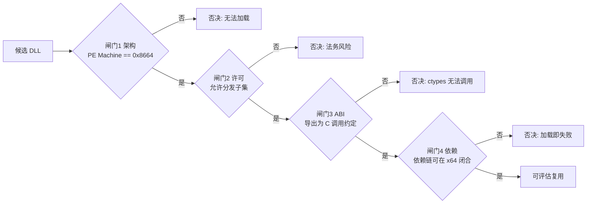
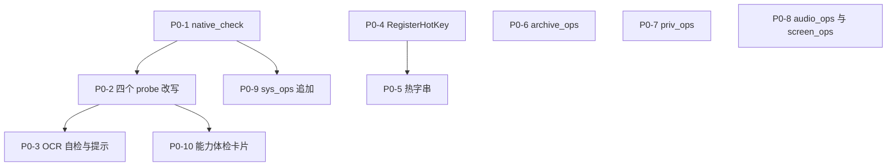

# 参考分析：zTasker 2.3.11 DLL 复用判定与 ACRPA 能力补强方案

> 分析对象：**zTasker 2.3.11** 安装目录内的 **35 个实体 DLL + 47 个 `api-ms-win-*` 垫片**
> 对照基线：**ACRPA**（Python 3.12.10 x64 / tkinter / PyInstaller onefile，体积硬目标 < 15 MB，见 `../build.py:2`、`../build.py:21`）
> 判定方式：zTasker 侧为 PE 头 / 导出表 / VersionInfo / License 文本的**静态实测**；ACRPA 侧为**源码只读核对**，所有结论带 `文件:行号`。
> 写作约束：本文**只**回答"DLL 能不能复用"与"缺失能力用什么替代补上"，不复述 UI/交互/数据模型借鉴。

---

## 0. 本文定位与分工

### 0.1 与既有文档的分工（避免重复）

| 文档                                                                                     | 覆盖范围                                                                                           | 与本文的关系                                                                                                                                                                               |
| ---------------------------------------------------------------------------------------- | -------------------------------------------------------------------------------------------------- | ------------------------------------------------------------------------------------------------------------------------------------------------------------------------------------------ |
| [`docs/参考分析-zTasker借鉴与ACRPA优化方案.md`](参考分析-zTasker借鉴与ACRPA优化方案.md) | 数据模型 / 触发器体系 / 执行语义 / 动作体系 / UI 交互 / 合规红线（§4.3 禁止清单、§4.4 合规结论） | **上位文档**。它的 §4.3 已给出"二进制一律禁止进包"的结论，本文**不重复论证法务逻辑**，只把它作为一条硬前提，转而回答"DLL 层面逐项判定表 + 替代实现"。本文不抄它的 UI/交互章节 |
| [`docs/参考分析-AutoHotkey借鉴与插件可行性.md`](参考分析-AutoHotkey借鉴与插件可行性.md) | AHK 作为脚本引擎/插件的可行性、GPL 传染、热字串空白                                                | 本文 §3.4、§5.1、§5.4 引用其结论（GPLv2 与 MIT 不兼容、AHK 不纳入），不重复展开                                                                                                         |
| [`docs/paddle-ocr-dll-使用说明.md`](paddle-ocr-dll-使用说明.md)                         | `PaddleOCR.dll` 的调用契约、依赖清单、免费社区版限制                                             | 本文 §5.2 在其基础上补"**依赖发现 + 可用性探测 + 降级提示**"，不重复其调用契约                                                                                                      |
| **本文**                                                                           | **DLL 逐项复用判定 + 能力域缺口 + 替代实现落点 + 体积影响 + 路线图**                         | —                                                                                                                                                                                         |

### 0.2 一句话结论

> **zTasker 的 DLL 一个都不能用，但它的"能力清单"是一份极好的需求对照表。**
> 照着这份清单，用 **ctypes / stdlib / 可选 pip 扩展** 把能力补齐，比复用任何 DLL 都更快、更小、更合法。

### 0.3 ⚠️ 本次核对发现的与既有描述不一致之处

以下三处，本任务给出的基线与**代码实际**不符。按"以代码为准"原则，本文全部结论采用代码事实：

| #            | 既有描述（任务基线 / 旧文档）                                                            | 代码事实                                                                                                                                                                                                                                                                                                                                                                                                                                                               | 影响                                                                             |
| ------------ | ---------------------------------------------------------------------------------------- | ---------------------------------------------------------------------------------------------------------------------------------------------------------------------------------------------------------------------------------------------------------------------------------------------------------------------------------------------------------------------------------------------------------------------------------------------------------------------- | -------------------------------------------------------------------------------- |
| **①** | 热键"只有 3~4 个内建动作的轮询式绑定，无用户自定义按键→脚本"                            | **已支持任务级热键**：`_TASK_HOTKEYS`（`../src/ACRPA.py:3748`）、`_rebuild_task_hotkeys()` 带双类冲突检测（`../src/ACRPA.py:3827-3874`）、`triggers.HotkeyTrigger`（`../src/triggers.py:517-542`）+ 线程安全事件队列 `fire_hotkey/consume_hotkey`（`../src/triggers.py:492-505`）。任务可绑 `hotkey` 触发器与 `stop_hotkey`                                                                                                                  | §5.1 的目标从"从零做热键"下调为"**换注册机制 + 补热字串 + 补上下文敏感**" |
| **②** | 调度器"仅 once/daily/weekly/interval 四种 period_type，无错过补偿 / 生效区间 / 次数上限" | `triggers.py` 已有 **8 种触发器**：once / daily / weekly / interval / countdown / hourly / on_boot / hotkey（`../src/triggers.py:246-542`）；`scheduler.py` 已字段化 `on_overlap / timeout_sec / missed_run / stop_hotkey / max_runs / start_date / end_date`（`../src/scheduler.py:8-10`、`63-66`），已有 `_run_missed_compensation`（`../src/scheduler.py:893`）、`_task_window_state` 生效区间与次数上限（`../src/scheduler.py:336-351`） | 调度域**不再列为缺口**，本文只在 §4 标注"已达标"                          |
| **③** | 行号引用`ACRPA.py:3655-3789` 指 `_HOTKEY_ACTIONS` / `_hotkey_poll`                 | 实际位置：`_HOTKEY_ACTIONS = {}` 在 `../src/ACRPA.py:3745`，`_hotkey_poll()` 在 `../src/ACRPA.py:3918`；`3655` 是 `_periodic` 里的调度启动判断                                                                                                                                                                                                                                                                                                             | 所有引用按实际行号给出                                                           |

另有一处"设计意图 vs 打包现实"的偏差，虽不属于事实错误但直接影响方案：

| #            | 表面现象                                                                                       | 打包事实                                                                                                 | 影响                                                                                                                         |
| ------------ | ---------------------------------------------------------------------------------------------- | -------------------------------------------------------------------------------------------------------- | ---------------------------------------------------------------------------------------------------------------------------- |
| **④** | `capabilities._probe_cv_match` 认为"装了 cv2 就 READY"（`../src/capabilities.py:210-212`） | `build.py` 把 `cv2` 整族 `--exclude-module`（`../build.py:206-207`），`ACRPA.spec:13` 同样排除 | **冻结版永远拿不到 cv2** → 找图在发行包内只能走 Pillow 或 `cv.match` 扩展。方案 §4、§6 必须按"冻结版无 cv2"来设计 |

---

## 1. TL;DR 结论卡

### 1.1 "DLL 能不能复用" —— 直接答案

| 问题                                                                  | 结论                                                              | 依据（详见 §2、§3）                                                   |
| --------------------------------------------------------------------- | ----------------------------------------------------------------- | ----------------------------------------------------------------------- |
| 有多少个 DLL**可以直接复用**（拷进来 `ctypes.WinDLL` 就能调） | **0 个**                                                    | 82 个 DLL 的 PE`Machine` 全为 `0x14C`（x86）；ACRPA 是 64 位 Python |
| 有多少个 DLL**在补全依赖 + 重编译后**可考虑                     | **0 个仍不可考虑**                                          | 法务条款禁止分发最终包任何单独一部分，且禁止二次制作/集成               |
| 有多少个 DLL 的**能力**值得用 Python 重建                       | **约 12 项**                                                | 见 §4 对照表的"补强动作"列                                             |
| 复用的**替代路径**是什么                                        | 纯 ctypes/stdlib 重建 + 可选 pip 扩展 +`extensions_src/` 扩展包 | 见 §5、§6                                                             |

### 1.2 三条阻断理由（任意一条即足以否决）

| #            | 阻断类型           | 硬事实                                                                                                                                                                                                               | 后果                                                                                                                                                           |
| ------------ | ------------------ | -------------------------------------------------------------------------------------------------------------------------------------------------------------------------------------------------------------------- | -------------------------------------------------------------------------------------------------------------------------------------------------------------- |
| **①** | **架构阻断** | 82 个 DLL + 9 个 exe 的 PE`Machine` **全部 = `0x14C`（IMAGE_FILE_MACHINE_I386）**                                                                                                                          | 64 位 Python 3.12 进程加载 32 位 DLL 必然`OSError: [WinError 193] %1 不是有效的 Win32 应用程序`。**不是配置问题，无法绕过**                            |
| **②** | **法务阻断** | `License.txt`：仅允许原样完整分发；**严禁打包/捆绑/集成等二次制作**；**未经书面许可不得分发最终包的任何单独一部分**；不得反编译、反向工程或复制其子集                                                  | 即使拿到 64 位版本也不能拷进来。落到工程上：`ACRPA.spec` 的 `datas`（`../ACRPA.spec:8`）**永远不会出现**任何 zTasker 路径                          |
| **③** | **ABI 阻断** | 除`Hash.dll` / `sqlite3.dll` / `Json.dll` / `Volume.dll` / `Bluetooth.dll` / `libcrypto-3` / `libssl-3` 外，其余均为 **MSVC C++ 修饰名导出**（形如 `?InsertHotkey@CHotKey@@QAEHGGP6AXPB_W@Z`） | `ctypes` 只支持 C 调用约定；C++ 成员函数需要 `this` 指针 + 名字修饰还原，`ctypes` 无法表达。且它们内部互相依赖 `utility.dll`，单独拷任意一个必然缺依赖 |

### 1.3 "那么该怎么做" —— 一句话

> **把 zTasker 的 DLL 目录当成"能力需求清单"读，逐项用 ACRPA 已有技术栈（ctypes / stdlib / 可选 pip）重建；能零依赖的重建就现在做（P0），需要三方依赖的走 `extensions_src/` 可选扩展包（P1/P2），主包体积一分钱不涨。**

---

## 2. 判定方法与可复现证据

### 2.1 四道判定闸门（按顺序，任一不过即否决）



zTasker 全部 DLL 在**闸门 1** 即被全量否决，闸门 2~4 只是为"如果有一天拿到 64 位版本该怎么办"留下判断依据。

### 2.2 证据一：PE 架构（`Machine` 字段）

PE 文件偏移 `0x3C` 处是 `e_lfanew`（PE 头偏移），`e_lfanew + 4` 即 `IMAGE_FILE_HEADER.Machine`：

| `Machine` 值 | 含义                                    | 本次实测                                |
| -------------- | --------------------------------------- | --------------------------------------- |
| `0x014C`     | IMAGE_FILE_MACHINE_I386（x86 / 32 位）  | **82 个 DLL + 9 个 exe 全部命中** |
| `0x8664`     | IMAGE_FILE_MACHINE_AMD64（x64 / 64 位） | 0 个                                    |

三个可复现的验证方式（cmd.exe 可直接粘贴，详见 §9）：

```bat
python -c "import pefile,sys;print(hex(pefile.PE(sys.argv[1],fast_load=True).FILE_HEADER.Machine))" Hash.dll
python -c "import sys,struct;b=open(sys.argv[1],'rb').read();print(hex(struct.unpack_from('<H',b,struct.unpack_from('<I',b,0x3c)[0]+4)[0]))" Hash.dll
powershell -NoProfile -Command "$b=[IO.File]::ReadAllBytes('Hash.dll');'{0:X4}' -f [BitConverter]::ToUInt16($b,([BitConverter]::ToInt32($b,60)+4))"
```

预期输出：`0x14c` / `0x14c` / `014C`。

### 2.3 证据二：加载失败的确定报错文本

64 位进程加载 32 位 DLL 的唯一结果（无需实际试，语义由 Windows 加载器固定）：

```
OSError: [WinError 193] %1 不是有效的 Win32 应用程序。
```

复现方式：

```bat
python -c "import ctypes;ctypes.WinDLL(r'<ZTASKER_HOME>\Hash.dll')"
```

对照实验（证明 Python 位数）：`python -c "import platform,sys;print(platform.architecture(),sys.maxsize>2**32)"` → 预期 `('64bit', 'WindowsPE') True`。

### 2.4 证据三：导出表形态（C vs C++ 修饰名）

| DLL            | 导出名样例                                                               | 结论                                                                                         |
| -------------- | ------------------------------------------------------------------------ | -------------------------------------------------------------------------------------------- |
| `Hash.dll`   | `GetMD5` / `GetSha1` / `GetSha256` / `GetSha384` / `GetSha512` | 未修饰 → C 调用约定，`ctypes` **理论上**可调（但被闸门 1 否决）                     |
| `HotKey.dll` | `?InsertHotkey@CHotKey@@QAEHGGP6AXPB_W@Z`                              | MSVC 修饰名（`@` 分隔、`QAE` = `__thiscall` 成员函数）→ **`ctypes` 无法调用** |

C++ 修饰名的判据：名字以 `?` 开头且含 `@` 分段，`QAE`/`SAE`/`UEA` 表示 `__thiscall`/`__stdcall`/`__cdecl` 的**成员函数**形态——这类导出需要传 `this` 指针，且参数类型受 MSVC 类布局约束，`ctypes` 无法构造，`cffi` 也不行。

### 2.5 证据四：许可条款原文语义

`License.txt` 四条（语义转述，非逐字引用；旧文档 [`参考分析-zTasker借鉴与ACRPA优化方案.md`](参考分析-zTasker借鉴与ACRPA优化方案.md) 227-236 行已记载）：

1. 允许**原样完整分发**（整包、不改动、不拆分）；
2. **严禁打包 / 捆绑 / 集成等二次制作**，严禁商业销售；
3. **未经书面许可，不得分发最终包的任何单独一部分**；
4. **不得修改、反编译、反向工程，或复制其子集**。

第 2 条与第 3 条直接封死"把一个 DLL 拷进 ACRPA 发行包"的任何解释空间。

### 2.6 证据五：VersionInfo 与"假 DLL"

| 文件                          | 实测特征                                   | 说明                                                                                                                |
| ----------------------------- | ------------------------------------------ | ------------------------------------------------------------------------------------------------------------------- |
| `zlib.dll`                  | VersionInfo 写`7z Plugin`（7-Zip 24.09） | **命名陷阱**：它不是 zlib，是 7-Zip 的编解码插件。任何"我们有 zlib.dll，可以省掉 `zlib` 模块"的推论都是错的 |
| `Res.dll`                   | 文件头`50 4B 03 04`（`PK\x03\x04`）    | **假 DLL**，实际是 2.5 MB 的 ZIP 资源包（图标等美术资源）                                                     |
| `web.dll`                   | 无有效 PE 导出                             | 同样是资源容器，非可调用模块                                                                                        |
| `api-ms-win-*.dll`（47 个） | ApiSet 转发存根，无业务导出                | 只为让 32 位 exe 在缺 VC 运行库的机器上启动；x86 版对 x64 进程**完全无意义**                                  |

---

## 3. DLL 全量分类判定表

> 判定等级：**不可用**（结构性否决）/ **低**（技术上可能，代价远大于收益）/ **中**（技术上可行且值得，但本项目仍不建议）/ **高**（可直接用）
> 全部 7 类的「复用判定」均为**不可用或低**，这是 §1.2 三条阻断的必然结果。

### 3.1 类别 A：纯 C ABI（32 位）

| 代表 DLL                               | 导出形态                                                                                                                                 | 架构         | 许可                                   | 复用判定                                   | 判定理由                                                                                                                                                         | ACRPA 替代（具体到模块）                                                                                                                                         |
| -------------------------------------- | ---------------------------------------------------------------------------------------------------------------------------------------- | ------------ | -------------------------------------- | ------------------------------------------ | ---------------------------------------------------------------------------------------------------------------------------------------------------------------- | ---------------------------------------------------------------------------------------------------------------------------------------------------------------- |
| `Hash.dll`                           | C 未修饰：`GetMD5/GetSha1/GetSha256/GetSha384/GetSha512`                                                                               | x86`0x14C` | zTasker 专有（受`License.txt` 约束） | **不可用**                           | 闸门 1 架构否决；闸门 2 法务否决。ABI 上唯一"干净"的一批，但仍不能拷                                                                                             | stdlib`hashlib`（已有命令「哈希值」，`../src/commands.py:817-818` → `../src/net_ops.py`）                                                                 |
| `sqlite3.dll`                        | C 未修饰（SQLite 3.8.8.2）                                                                                                               | x86          | Public Domain（上游）                  | **不可用**（但**结论上无需**） | 上游虽为公有领域，但**分发的是 zTasker 编译产物**，仍受其 `License.txt` 第 3 条约束。且 Python 自带 `sqlite3` 模块（`../build.py:265` 注释明确保留） | stdlib`sqlite3`（版本由 Python 决定，通常 ≥ 3.40，**比 3.8.8.2 新 8 年**）                                                                              |
| `Json.dll`                           | C 未修饰：`QueryByJsonPath` / `QueryByJmesPath`                                                                                      | x86          | zTasker 专有                           | **不可用**                           | 架构 + 法务否决                                                                                                                                                  | stdlib`json`（已有「JSON 取值」`../src/commands.py:811-812`）。若需 JSONPath 子集语法，见 §5.5                                                              |
| `Volume.dll`                         | C 未修饰：`ChangeToVol/ChangeVol/GetMute/GetVol/SetMute/SetMuteAll`                                                                    | x86          | zTasker 专有                           | **不可用**                           | 架构 + 法务否决                                                                                                                                                  | **已有更强实现**：`sys_ops` 手写 `IAudioEndpointVolume` COM vtable（`../src/sys_ops.py:7-8`），可读回真实音量值；zTasker 的 `ChangeVol` 是相对增减 |
| `Bluetooth.dll`                      | C 未修饰：`GetBluetoothDevices`                                                                                                        | x86          | zTasker 专有                           | **不可用**                           | 架构 + 法务否决                                                                                                                                                  | 见 §5.7（ctypes`bthprops.cpl` / PowerShell `Get-PnpDevice -Class Bluetooth`）                                                                               |
| `AVCap.dll`                          | C 未修饰：`Init/StartVideoCap/StartAudioCap/StartScreenRecord/StopScreenRecord/BurstCapture/CapturePicture/SetWMVProfileVer/ShowSetup` | x86          | zTasker 专有                           | **不可用**                           | 架构 + 法务否决；**另有功能性否决**：`ShowSetup` 会弹出模态录制设置向导，属于"仅供 EXE 内部使用"的交互式组件，无法在脚本化的 RPA 流程中调用              | 截图：`PIL.ImageGrab`（`../ACRPA.spec:9`）；录屏见 §5.6                                                                                                     |
| `libcrypto-3.dll` / `libssl-3.dll` | C 未修饰（OpenSSL 3.2.0）                                                                                                                | x86          | Apache-2.0（上游）                     | **不可用**                           | 上游许可宽松，但同样是 zTasker 编译产物，受`License.txt` 第 3 条约束；且闸门 1 架构否决                                                                        | stdlib`ssl` / `hashlib` / `hmac`；TLS 已在 `../src/netlink/tls.py` 落地                                                                                  |

### 3.2 类别 B：C++ 修饰名导出（32 位）

| 代表 DLL                               | 导出形态                                                                                                                                                               | 架构 | 许可                              | 复用判定         | 判定理由                                                                                                                                                                                                       | ACRPA 替代                                                                                                                                                                                                |
| -------------------------------------- | ---------------------------------------------------------------------------------------------------------------------------------------------------------------------- | ---- | --------------------------------- | ---------------- | -------------------------------------------------------------------------------------------------------------------------------------------------------------------------------------------------------------- | --------------------------------------------------------------------------------------------------------------------------------------------------------------------------------------------------------- |
| `HotKey.dll`（40 KB）                | `CHotKey` 成员函数：`InsertHotkey`/`InsertQuickPhrase`/`AddBlockKey`/`SetBlockSysHK`/`GetLastKeyboardInput`/`GetLastMouseInput`/`GetLastClickPosition` | x86  | zTasker 专有                      | **不可用** | 三重：架构否决 + 法务否决 +**ABI 否决**（`__thiscall` 成员函数，`ctypes` 无法构造 `this`）。且它只管热键钩子与热字串，**真正的调度在 `zTasker.exe` 内部**，单拿这个 DLL 得不到任何可用能力 | §5.1：`RegisterHotKey` + `WH_KEYBOARD_LL` 低层钩子（ctypes user32，零依赖）                                                                                                                          |
| `Http.dll`                           | `CHttp`：`Get`/`DownloadFile`/`AbortOperation`/`GetDownloadFileSize`                                                                                         | x86  | zTasker 专有                      | **不可用** | 架构 + 法务 + ABI 否决                                                                                                                                                                                         | stdlib`urllib.request` + `ssl`（已有「HTTP 请求」，`../src/net_ops.py:1-27`，含 SSRF 防护/响应体上限/重定向白名单）                                                                                 |
| `Mail.dll`                           | `CSmtp` / `CPOPClient` / `CIMAPClient`                                                                                                                           | x86  | zTasker 专有                      | **不可用** | 架构 + 法务 + ABI 否决                                                                                                                                                                                         | stdlib`smtplib` / `imaplib` / `poplib`。⚠️ **当前被 `build.py` 主动排除**（`../build.py:219`），若要上邮件命令必须先解禁（见 §6.3）                                                    |
| `ModernZip.dll` / `ZipWrapper.dll` | `CModernZip` 等类成员                                                                                                                                                | x86  | zTasker 专有                      | **不可用** | 架构 + 法务 + ABI 否决                                                                                                                                                                                         | stdlib`zipfile` / `tarfile` / `gzip`（见 §5.5）；7z 格式见 §5.5 的 `py7zr` 评估                                                                                                                 |
| `Ping.dll`                           | `CPing`：`Ping`/`Connect`/`GetIpByDomainName`                                                                                                                  | x86  | zTasker 专有                      | **不可用** | 架构 + 法务 + ABI 否决                                                                                                                                                                                         | `socket` + `subprocess` 调 `ping.exe`；DNS 用 `socket.getaddrinfo`（见 §5.7）                                                                                                                    |
| `TimeSync.dll`                       | `CTimeSync`：`GetTime`/`SyncTime`                                                                                                                                | x86  | zTasker 专有                      | **不可用** | 架构 + 法务 + ABI 否决                                                                                                                                                                                         | `w32tm /resync` 或 SNTP（NTP 包 48 字节，`socket` 即可，约 60 行）；**ACRPA 目前无此命令**（见 §5.7）                                                                                          |
| `SndPlay.dll`                        | `CSoundPlay` 成员                                                                                                                                                    | x86  | zTasker 专有                      | **不可用** | 架构 + 法务 + ABI 否决                                                                                                                                                                                         | stdlib`winsound`（WAV 播放，零依赖）；其余格式见 §5.6。**明确不采用 `bass.dll`**（见 §8）                                                                                                     |
| `TrayToast.dll`                      | `CTrayToast::ShowToast`                                                                                                                                              | x86  | zTasker 专有                      | **不可用** | 架构 + 法务 + ABI 否决                                                                                                                                                                                         | 已有：`utils.show_toast`（tkinter `Toplevel`，`../src/utils.py:71-123`）+ 托盘气泡 `Shell_NotifyIconW(NIM_MODIFY, NIF_INFO)`（`../src/tray.py:291-307`）                                        |
| `UI.dll`（DuiLib）                   | C++ 类导出                                                                                                                                                             | x86  | DuiLib 上游 Apache-2.0 / 部分 BSD | **不可用** | 架构 + 法务 + ABI 否决；且**架构理念冲突**：ACRPA 用 tkinter/ttk（`../docs/ACRPA-完善路线图.md:30` 明确"100% tkinter，零 Qt"）                                                                         | 不替代。保持 tkinter（换 UI 库是另一件事，不在本文范围）                                                                                                                                                  |
| `Utility.dll`                        | `Util::Window::ActivateWindow`、`Util::System::AdjustToken`（提权）、`Util::Registry`、`Util::File::CFileVersion`、`Util::Time`                              | x86  | zTasker 专有                      | **不可用** | 架构 + 法务 + ABI 否决                                                                                                                                                                                         | **全部可 ctypes 重建**：`SetForegroundWindow`/`ShowWindow`（已有「激活窗口」`../src/commands.py:331`）、`ShellExecuteW(runas)` 提权（§5.7）、`winreg`（stdlib）、`GetFileVersionInfoW` |
| `asl.dll`                            | MIT C++ 基础库（ASL = Advanced Simulation Library 风格工具集）                                                                                                         | x86  | MIT                               | **低**     | 上游 MIT 允许，但它是**C++ 模板/类库的编译产物**，只服务于 zTasker 自己的 C++ 代码；对 Python 侧无 API 价值                                                                                              | 无需替代（Python 标准库覆盖其功能域）                                                                                                                                                                     |

### 3.3 类别 C：仅供 EXE 内部使用的模态 UI 组件

| DLL            | 导出                                                 | 架构 | 许可         | 复用判定         | 判定理由                                                                                                                                                                     | ACRPA 替代                                                                                                                                                                            |
| -------------- | ---------------------------------------------------- | ---- | ------------ | ---------------- | ---------------------------------------------------------------------------------------------------------------------------------------------------------------------------- | ------------------------------------------------------------------------------------------------------------------------------------------------------------------------------------- |
| `ScrCap.dll` | **仅 1 个导出** `StartCap`（交互式框选截图） | x86  | zTasker 专有 | **不可用** | 架构 + 法务否决；**功能性否决**：`StartCap` 会阻塞调用线程并弹出全屏框选遮罩，返回值依赖用户鼠标操作。RPA 场景需要的是**无人值守的区域截图**，模态框选恰恰相反 | `PIL.ImageGrab.grab(bbox=(l,t,w,h))`（`../ACRPA.spec:9` 已含 `PIL.ImageGrab`）；已有「截屏」命令（`../src/commands.py:320`）与 UI 侧屏幕取点（`../src/ui/exec_bar.py:713`） |
| `AVCap.dll`  | 见 §3.1                                             | x86  | zTasker 专有 | **不可用** | 同上，`ShowSetup` 弹录制设置向导                                                                                                                                           | 见 §5.6                                                                                                                                                                              |

### 3.4 类别 D：假 DLL（实为 ZIP 资源包）

| 文件        | 真实格式                 | 体积   | 复用判定         | 判定理由                                                                                                 | ACRPA 替代                                                                              |
| ----------- | ------------------------ | ------ | ---------------- | -------------------------------------------------------------------------------------------------------- | --------------------------------------------------------------------------------------- |
| `Res.dll` | ZIP（头`50 4B 03 04`） | 2.5 MB | **不可用** | 内容为图标/位图等美术资源，属`License.txt` 第 3 条明令禁止分发的"最终包组成部分"；且美术作品另有著作权 | `res/` 自有素材（`../res/automation.ico` 等）；`ACRPA.spec:8` 已打包 `res` 目录 |
| `web.dll` | ZIP / 资源容器           | —     | **不可用** | 同上                                                                                                     | 网页面板为内联 HTML（`../src/netlink/webui.py`，`../build.py:136-138` 注释可证）    |

### 3.5 类别 E：命名陷阱

| 文件         | 真实身份                                                                         | 复用判定         | 判定理由                                                                                                                  | ACRPA 替代                                                |
| ------------ | -------------------------------------------------------------------------------- | ---------------- | ------------------------------------------------------------------------------------------------------------------------- | --------------------------------------------------------- |
| `zlib.dll` | **7-Zip 24.09 的 7z 编解码插件**（VersionInfo = `7z Plugin`），不是 zlib | **不可用** | 命名陷阱：不是 zlib 的 ABI，`compress()/uncompress()` 一律不存在。且 7-Zip 为 LGPL，插件与 7-Zip 主体耦合，不能独立分发 | stdlib`zlib`（Python 内置，真实 zlib）；7z 格式见 §5.5 |

### 3.6 类别 F：第三方开源原件（32 位编译版）

> 这一类最容易被误判为"许可宽松所以能用"。**但分发的对象不是上游源码，而是 zTasker 的编译产物** —— 仍受 `License.txt` 第 3 条约束。

| DLL                                                                                          | 上游许可                                                   | 架构 | 复用判定         | 判定理由                                                                                                                                                                                                                           | ACRPA 替代 / 取舍                                                                                                                                                                                        |
| -------------------------------------------------------------------------------------------- | ---------------------------------------------------------- | ---- | ---------------- | ---------------------------------------------------------------------------------------------------------------------------------------------------------------------------------------------------------------------------------- | -------------------------------------------------------------------------------------------------------------------------------------------------------------------------------------------------------- |
| `opencv_core2410` / `opencv_imgproc2410` / `opencv_highgui2410` / `opencv_video2410` | BSD-3（OpenCV**2.4.10**，2014 年）                   | x86  | **低**     | ① 架构 + 法务否决；②**无 `opencv_text` 模块**（2.4.x 的 text 模块另需 contrib，且此目录未带）→ 无法做文字检测；③ 2014 年版本**距今 10 年以上**，含大量已知 CVE（图像解码类内存破坏为主），作为运行时依赖是净负债 | 源码环境用`cv2`（`../src/capabilities.py:210-212` 探测）；冻结版按 `../build.py:206-207` **不含 cv2**，走 `cv.match` 扩展包（`../extensions_src/cv_match/extension.json`）或 Pillow 回退 |
| `bass.dll`（2.4.17）                                                                       | **Un4seen 商业授权**：个人免费、**商业需付费** | x86  | **不可用** | 架构 + 法务否决，**另有授权否决**：ACRPA 若商业分发将直接侵权                                                                                                                                                                | 见 §5.6 与 §8。**明确不采用**                                                                                                                                                                    |
| `openal32.dll`                                                                             | LGPL                                                       | x86  | **低**     | 架构 + 法务否决；LGPL 要求可替换/可重链接，与 onefile 打包天然冲突                                                                                                                                                                 | 不采用                                                                                                                                                                                                   |
| `sqlite3.dll`（3.8.8.2）                                                                   | Public Domain                                              | x86  | **不可用** | 见 §3.1                                                                                                                                                                                                                           | stdlib`sqlite3`                                                                                                                                                                                        |
| `asl.dll`                                                                                  | MIT                                                        | x86  | **低**     | 见 §3.2                                                                                                                                                                                                                           | 无需                                                                                                                                                                                                     |
| MS VC 运行库`msvcp120/msvcr120/msvcp140/vcruntime140/ucrtbase`                             | Microsoft 可再分发运行库                                   | x86  | **不可用** | 架构否决（x86 运行库对 x64 进程无用）；且 x64 侧由 Python 自身携带/系统`ucrtbase` 提供，**无需额外分发**                                                                                                                   | 无需                                                                                                                                                                                                     |

### 3.7 类别 G：`api-ms-win-*` ApiSet 垫片（47 个）

| 特征                                                                   | 结论                                                                                                                                                                                                                                                            |
| ---------------------------------------------------------------------- | --------------------------------------------------------------------------------------------------------------------------------------------------------------------------------------------------------------------------------------------------------------- |
| 文件名形如`api-ms-win-crt-runtime-l1-1-0.dll`、`api-ms-win-core-*` | 这是 Windows**ApiSet 转发存根**，作用是在目标机缺 VC 运行库时把调用转发到真实实现                                                                                                                                                                         |
| 导出                                                                   | 无业务导出，只有转发项                                                                                                                                                                                                                                          |
| 复用判定                                                               | **不可用**                                                                                                                                                                                                                                                |
| 判定理由                                                               | ① x86 版对 x64 进程**完全无效**；② 它们存在的前提是"缺 UCRT 的旧 Windows"，而 ACRPA 是 Python 3.12（**最低要求 Windows 8.1+，实际要求 Win10+**），系统必带 `ucrtbase.dll`；③ 若真缺 UCRT，正确做法是让用户装 VC++ 运行库，而不是分发 47 个存根 |
| ACRPA 替代                                                             | 无需。若线上真出现 UCRT 缺失，应在`crashlog`（`../src/crashlog.py`）里识别 `WinError 126` 并给出安装指引                                                                                                                                                  |

### 3.8 zTasker 目录里"完全没有的东西"（纠正常见预期）

> 这一节比上面 7 类更重要：**很多"以为能拿来用"的东西，其实根本不存在。**

| 常见预期                                     | 实际核查结果                                                                                                                | 对 ACRPA 的含义                                                                                                                                                                                                                                     |
| -------------------------------------------- | --------------------------------------------------------------------------------------------------------------------------- | --------------------------------------------------------------------------------------------------------------------------------------------------------------------------------------------------------------------------------------------------- |
| "有 OCR 推理 DLL，可以省掉 paddle/onnx"      | **没有**任何 OCR 推理 DLL。无 `onnxruntime` / `tesseract` / `paddle` / `rapidocr` / `mnn` / `opencv_text` | zTasker 的 OCR 是**外部进程** `Data\Bundle\ppocr\ocr.exe`（658 KB），且还需用户**另外下载 `ztocr.exe`**（`Data\Asset\ppocr.txt` 原文如此）→ 等价于"ACRPA 需要用户装后端"，**不比 ACRPA 现方案更好**                        |
| "有大漠/Interception/hidapi，可以做后台键鼠" | **没有** `dd*.dll` / `interception.dll` / `hidapi`                                                              | **ACRPA 的 `dd63330.dll`（x64 内核级）比 zTasker 强**。zTasker 的键鼠是**主 exe 内部 `SendInput`，只能对前台窗口**                                                                                                                  |
| "有 UI Automation 封装 DLL"                  | **没有**                                                                                                              | zTasker 的 UIA 是**AutoHotkey 脚本**：`Data\Bundle\UIA.ahk`（Descolada UIA-v2，419 KB）+ `AutoHotkey2.exe`（2.0.18，**GPLv2**）+ `UIA_Browser.ahk` + `v1\Chrome.ahk`。GPLv2 与 ACRPA 的 MIT（`../LICENSE`）不兼容 → 见 §5.4 |
| "有 lua/python/quickjs/v8/node 脚本引擎 DLL" | **没有**                                                                                                              | ACRPA 的`py_sandbox` + `acrpa_api`（`../src/py_sandbox.py`、`../src/acrpa_api.py`）是**更强**的方案（三级权限 + AST 预检 + 超时 + 审计）                                                                                              |
| "有 ffmpeg/libvlc/PortAudio"                 | **没有**                                                                                                              | 录屏/音频必须自建（§5.6）                                                                                                                                                                                                                          |
| "有 .NET 托管程序集，需要 pythonnet"         | **没有**任何 .NET 程序集                                                                                              | 所以**不存在**"要不要引入 pythonnet"这个问题——不要引入                                                                                                                                                                                      |
| "定时/热键调度在 HotKey.dll 里"              | **不在**。调度在 `zTasker.exe` 内部；`HotKey.dll`（40 KB）只管热键钩子与热字串                                    | ACRPA 的调度能力在`triggers.py` + `scheduler.py`，已超过 zTasker 的可复用部分（§0.3 ②）                                                                                                                                                       |

---

## 4. 逐能力域对照表

> 四列：**zTasker 有 / 没有**（含其实现载体）→ **ACRPA 现状**（带引用）→ **补强动作**（指向本文 §5 的哪一条）。
> 「已达标」表示 ACRPA 现状不弱于 zTasker，不需要补强动作。

| #  | 能力域                          | zTasker 侧（有无 + 载体）                                                                           | ACRPA 现状                                                                                                                                                                                                                                                 | 补强动作                                                         |
| -- | ------------------------------- | --------------------------------------------------------------------------------------------------- | ---------------------------------------------------------------------------------------------------------------------------------------------------------------------------------------------------------------------------------------------------------- | ---------------------------------------------------------------- |
| 1  | **OCR**                   | 有，但**不是 DLL**：外部进程 `ocr.exe` + 需另下 `ztocr.exe`                               | 4 后端（`../src/ocr_backend.py:4-11`）在本机**全不可用**：paddle_dll 缺 5 个依赖（`../src/paddle_dll.py:57`）、winrt 未装、tesseract 未装、pip paddleocr 未装。项目外 `rapidocr_onnxruntime` 实测可用（5 图 246 框，均值置信度 0.95+，27.5 s） | **§5.2**                                                  |
| 2  | **找图找色**              | 有：OpenCV 2.4.10（32 位，**无 text 模块**）                                                  | 源码环境`cv2` 可用；**打包版被排除**（`../build.py:206-207`），冻结版只能 Pillow 或 `cv.match` 扩展（`../extensions_src/cv_match/extension.json`）。找色：无独立命令                                                                         | **§5.2/§6.2**（扩展包策略）+ P1 增「找色」纯 Pillow 实现 |
| 3  | **键鼠模拟**              | 弱：主 exe 内`SendInput`（**仅前台窗口**，无驱动）                                          | 强：`pyautogui`（`../requirements.txt:1`，本机未装）+ `dd63330.dll`（**x64 内核级**，7 个 C 导出，`../src/dd_backend.py`）                                                                                                                   | **§5.3**（现状强于 zTasker，但缺统一抽象与降级可见性）    |
| 4  | **窗口 / UI 自动化**      | 窗口：`Utility.dll`（`Util::Window::ActivateWindow`）；UIA：**外部 AHK 脚本 + GPLv2 exe** | 窗口：`pywin32` + ctypes user32，7 条窗口命令（`../src/commands.py:331-337`）；**UIA：完全缺失**（`uiautomation`/`pywinauto`/`comtypes` 均未装）                                                                                           | **§5.4**                                                  |
| 5  | **热键**                  | `HotKey.dll`（C++ 修饰名，x86）+ exe 内调度                                                       | 三档轮询：内建 run/pause/stop（`../src/ACRPA.py:3745`）、任务级热键（`../src/ACRPA.py:3748`、`3827-3874`）、停止录制（`../src/ACRPA.py:3752`）。**机制是 `GetAsyncKeyState` 200 ms 轮询**（`../src/ACRPA.py:3918`）。**无热字串**  | **§5.1**                                                  |
| 6  | **定时调度**              | exe 内 30+ 触发器                                                                                   | **已达标**：8 种触发器（`../src/triggers.py:246-542`）+ 错过补偿（`../src/scheduler.py:893`）+ 生效区间/次数上限（`../src/scheduler.py:336-351`）+ `next_run_at` 落库（`../src/scheduler.py:289-303`）                                     | 无需补强（§0.3 ② 已记录口径纠正）                              |
| 7  | **脚本引擎**              | AHK v1/v2 外部 exe（**GPLv2**），无 lua/python DSL                                            | 强：`py_sandbox` 三级权限 + `AcrpaApi` 15 方法（`../src/py_sandbox.py`、`../src/acrpa_api.py`）                                                                                                                                                    | 已达标（且 GPL 风险更低，见 §8）                                |
| 8  | **截图**                  | `ScrCap.dll`（模态框选）、`AVCap.dll`                                                           | 有：`截屏` 命令（`../src/commands.py:320`）、`PIL.ImageGrab`（`../ACRPA.spec:9`）、远程截图（`../src/netlink/screen.py`）                                                                                                                        | 已达标                                                           |
| 9  | **录屏**                  | `AVCap.dll`：`StartScreenRecord`/`StopScreenRecord`/`BurstCapture`                          | **缺失**（无任何录屏命令）                                                                                                                                                                                                                           | **§5.6**                                                  |
| 10 | **音频播放 / 录音**       | `bass.dll`（**商业授权**）、`SndPlay.dll`、`openal32.dll`                               | **缺失**（只有音量控制，无播放/录音命令）                                                                                                                                                                                                            | **§5.6**（明确不采用 BASS）                               |
| 11 | **压缩**                  | `ModernZip.dll` / `ZipWrapper.dll` / `zlib.dll`（实为 7z 插件）                               | **缺失**（`file_ops.py` 只有 copy/move/delete/mkdir/list/read/write，**无任何 zip API**，全文无 `zipfile`）                                                                                                                                | **§5.5**                                                  |
| 12 | **哈希 / 加密**           | `Hash.dll`、`libcrypto-3`、`libssl-3`                                                         | **已达标**：stdlib `hashlib`（「哈希值」`../src/commands.py:817-818`）；TLS 走 `ssl`（`../src/netlink/tls.py`）                                                                                                                              | 不加 DLL。如需 AES，见 §5.5                                     |
| 13 | **HTTP**                  | `Http.dll`（C++）+ `libssl`                                                                     | **已达标且更强**：`../src/net_ops.py:1-27`（纯 urllib，含 SSRF 防护、4 MB 响应上限、跨协议重定向拒绝）                                                                                                                                             | 无需                                                             |
| 14 | **邮件（SMTP/POP/IMAP）** | `Mail.dll`：`CSmtp`/`CPOPClient`/`CIMAPClient`                                              | **缺失**；且 `smtplib`/`imaplib`/`poplib` 被 `../build.py:219` **主动排除**                                                                                                                                                            | **§5.5**（含解禁 `build.py` 的必要性）                  |
| 15 | **Ping / 连通性**         | `Ping.dll`：`Ping`/`Connect`/`GetIpByDomainName`                                            | **缺失**                                                                                                                                                                                                                                             | **§5.7**                                                  |
| 16 | **网络校时**              | `TimeSync.dll`：`GetTime`/`SyncTime`                                                          | **缺失**                                                                                                                                                                                                                                             | **§5.7**                                                  |
| 17 | **Toast 通知**            | `TrayToast.dll::ShowToast`                                                                        | **已达标**：`utils.show_toast`（`../src/utils.py:71`）+ 托盘气泡（`../src/tray.py:291-307`）                                                                                                                                                   | 已达标（可选：把托盘气泡封成命令，§5.7）                        |
| 18 | **蓝牙**                  | `Bluetooth.dll::GetBluetoothDevices`                                                              | **缺失**                                                                                                                                                                                                                                             | **§5.7**                                                  |
| 19 | **音量**                  | `Volume.dll`                                                                                      | **已达标且更强**：`IAudioEndpointVolume` 手写 COM（`../src/sys_ops.py:7-8`），可读回真实值；音量键回退 `../src/sys_ops.py:636`                                                                                                                 | 无需                                                             |
| 20 | **JSON 查询**             | `Json.dll`：`QueryByJsonPath` / `QueryByJmesPath`                                             | 部分：`JSON 取值`（`../src/commands.py:811-812`）只支持点号路径，**不支持 `$.a[0].b` / `$..x` 这类 JSONPath 语法**                                                                                                                           | **§5.5**                                                  |
| 21 | **ZIP 归档**              | 见#11                                                                                               | 见#11                                                                                                                                                                                                                                                      | **§5.5**                                                  |
| 22 | **提权 / 令牌**           | `Utility.dll::Util::System::AdjustToken`                                                          | **缺失**（无 "以管理员运行" 命令）                                                                                                                                                                                                                   | **§5.7**                                                  |

---

## 5. 重点补强方案

> 每项固定五段：**【现状】【目标】【实现路径】【依赖与体积影响】【风险】【验收标准】**。
> 所有「实现路径」都指到具体模块/函数级；新增模块的命名与 `src/` 既有风格一致（小写下划线、单文件单职责）。

### 5.1 热键系统重做：轮询 → `RegisterHotKey` + 热字串

#### 现状

| 事实                                                                   | 位置                                                                                                                 |
| ---------------------------------------------------------------------- | -------------------------------------------------------------------------------------------------------------------- |
| 内建热键表`_HOTKEY_ACTIONS`（run/pause/stop）                        | `../src/ACRPA.py:3745`                                                                                             |
| 任务级热键表`_TASK_HOTKEYS` + 冲突检测（与内建冲突 / 任务间重复）    | `../src/ACRPA.py:3748`、`3827-3874`                                                                              |
| 「停止录制」热键`_RECORD_STOP_SPEC`                                  | `../src/ACRPA.py:3752`、`3801`                                                                                   |
| 键位解析`_parse_hotkey_spec`（ctrl/alt/shift/win + 具名键 + 单字符） | `../src/ACRPA.py:3756-3783`                                                                                        |
| 触发机制：`GetAsyncKeyState` **200 ms 轮询 + 边沿检测**        | `../src/ACRPA.py:3918-3977`                                                                                        |
| 任务热键事件队列`fire_hotkey` / `consume_hotkey`                   | `../src/triggers.py:492-505`                                                                                       |
| `HotkeyTrigger`（调度循环消费事件）                                  | `../src/triggers.py:517-542`                                                                                       |
| 热字串 hotstring                                                       | **全库 0 处**（[`参考分析-AutoHotkey借鉴与插件可行性.md`](参考分析-AutoHotkey借鉴与插件可行性.md):85 已记载） |

轮询式的三个具体缺陷（不是"体验问题"，是可复现的缺陷）：

1. **优先级不可控**：`GetAsyncKeyState` 只看"当前是否按下"，无法**吞掉**按键 → 用户绑 `Ctrl+S` 时，目标程序照样收到 `Ctrl+S`（可能触发保存/提交），热键与目标应用**双重响应**。
2. **200 ms 窗口丢失**：按下并松开间隔 < 200 ms 的快速敲击可能整帧错过；反之长按需靠边沿检测兜底。
3. **全库轮询成本**：`_hotkey_poll` 在每个 tick 对 `_HOTKEY_ACTIONS + _TASK_HOTKEYS + _RECORD_STOP_SPEC` 逐个 `GetAsyncKeyState`，任务热键多时是 O(N) 次系统调用/200 ms。

#### 目标

- 用 `RegisterHotKey` 接管**所有带修饰键的组合热键**：由 Windows 投递 `WM_HOTKEY`，**天然吞掉按键**、无轮询、无丢失、O(1) 唤醒。
- 保留轮询路径作为**兜底**（`RegisterHotKey` 对"无修饰键"的组合不适用，且可能被其他程序抢占）。
- 新增**热字串**能力（ASCII 触发词 → 展开文本/执行脚本）。
- **不引入任何依赖**：全部 `ctypes.windll.user32` + 一个隐藏消息窗口。

#### 实现路径

**新增模块 `src/hotkey_win.py`（纯 ctypes + stdlib，约 300 行）**

```
hotkey_win.py
├─ class HotkeyManager            # 单例；持有隐藏 HWND 与注册表
│   ├─ _create_message_window()   # CreateWindowExW("STATIC"...) 隐藏窗口
│   │                             # 或 CreateWindowExW 自定义类 + WNDPROC 回调
│   ├─ _wndproc(hwnd, msg, wp, lp)
│   │     · msg == WM_HOTKEY(0x0312) → 按 lp(id) 查表 → 投递到回调
│   │     · msg == WM_INPUT 系列（见热字串）
│   ├─ register(action, spec) -> (ok, err)     # 解析 spec → RegisterHotKey(hwnd, id, mods, vk)
│   ├─ unregister(action)
│   ├─ rebuild(bindings: dict) -> dict         # 全量重建，返回 {action: err}
│   └─ pump()                                  # 在独立线程跑 GetMessage 循环
├─ MOD_MAP = {ctrl: MOD_CONTROL, alt: MOD_ALT, shift: MOD_SHIFT, win: MOD_WIN, noRepeat: MOD_NOREPEAT}
├─ parse_spec(text) -> (mods, vk) | None       # 复用/替换 _parse_hotkey_spec 的实现
└─ class HotstringEngine                       # 热字串
    ├─ start(triggers: list[(trigger_text, action)])
    ├─ _install_ll_hook()                      # SetWindowsHookExW(WH_KEYBOARD_LL)
    ├─ _on_key(vk, is_down) -> 吞键/放行
    └─ stop()
```

**线程模型（关键约束）**

- `RegisterHotKey` 与 `GetMessage` **必须在同一线程**（`WM_HOTKEY` 投递到注册该热键的线程消息队列）。因此 `HotkeyManager.pump()` 跑在一个**专用 daemon 线程**上，注册/注销通过 `PostThreadMessageW` 或命令队列交给该线程执行——**不要在 Tk 主线程调 `register`**。
- 回调**只做 `root.after(0, fn)` 投递**，与现有 `_hotkey_poll` 的做法保持一致（`../src/ACRPA.py:3956` 已是 `root.after(0, _hotkey_executors[action])`；任务热键走 `triggers.fire_hotkey`，`../src/triggers.py:492`）。这样下游代码**零改动**。

**与 `_HOTKEY_ACTIONS` 的兼容迁移策略（三步，可回退）**

| 步 | 动作                                                                                                                                                                                                 | 回退条件                                       |
| -- | ---------------------------------------------------------------------------------------------------------------------------------------------------------------------------------------------------- | ---------------------------------------------- |
| 1  | 新增`state.HOTKEY_BACKEND`（`"poll"` / `"register"`，默认 `"register"`），`_rebuild_hotkey_specs()`（`../src/ACRPA.py:3786`）末尾追加一次 `hotkey_win.HotkeyManager.rebuild(...)` 调用 | 置`"poll"` → 完全回到今天的行为             |
| 2  | `_hotkey_poll`（`../src/ACRPA.py:3918`）内按 backend 分流：`register` 模式下**跳过**已在 `HotkeyManager` 成功注册的条目，只对"注册失败"的条目继续轮询                                  | 任何一条注册失败 → 该条自动落回轮询，功能不丢 |
| 3  | 稳定两个版本后，把`_parse_hotkey_spec` 的解析实现下沉到 `hotkey_win.parse_spec`，`ACRPA.py` 侧改成薄封装（保留函数名，`../src/ACRPA.py:3756` 的调用点不变）                                  | 保留旧实现为`_parse_hotkey_spec_legacy`      |

**注册失败必须可见**：`RegisterHotKey` 会因"被其他程序占用"返回 0 → `GetLastError() == 1409 (ERROR_HOTKEY_ALREADY_REGISTERED)`。这种情况必须在设置界面 `快捷键` 卡片下方直接显示「❌ Ctrl+S 已被其他程序占用，已退回轮询模式」，而不是静默。现有冲突检测只覆盖**应用内**冲突（`../src/ACRPA.py:3864-3871`），不覆盖系统级占用。

**热字串最小可行设计**

- 触发词：纯 ASCII，长度 2~20，以空格/回车/Tab 结尾触发（避开 IME 组合态，`参考分析-AutoHotkey借鉴与插件可行性.md`:88 已指出该难点）。
- 实现：`WH_KEYBOARD_LL` 低层钩子缓冲最近 N 个字符 → 命中触发词 → 回删 `len(trigger)` 个字符（`SendInput` 发 `VK_BACK`）→ 注入展开文本（`SendInput` + `KEYEVENTF_UNICODE`，可绕过输入法）
- 已知限制（必须在 UI 上写明）：低层钩子对**以管理员运行的目标程序**无效（UIPI 隔离）；IME 组合态下不触发。
- 配置：`state.HOTSTRINGS` = `[{trigger, expand, kind: "text"|"script", script_path}]`，落 `config.json`。

#### 依赖与体积影响

| 项            | 影响                                                                                                                |
| ------------- | ------------------------------------------------------------------------------------------------------------------- |
| 新增 pip 依赖 | **0**                                                                                                         |
| 新增源码      | `src/hotkey_win.py` ≈ 300 行 ≈ **12 KB**                                                                  |
| 打包体积      | `< 15 KB`（含 `hotkey_win` 加入 `build.py` 的 `_PROJECT_MODULES` 与 `ACRPA.spec:9` 的 `hiddenimports`） |
| DLL           | **0**（全部系统 `user32`）                                                                                  |

#### 风险

| 风险                                                   | 缓解                                                                                                                     |
| ------------------------------------------------------ | ------------------------------------------------------------------------------------------------------------------------ |
| 隐藏消息窗口在 onefile 冻结环境下的窗口类注册失败      | 用系统预注册类`"STATIC"`（`CreateWindowExW` 传 `"STATIC"`）而非自定义类，避免 `RegisterClassW` 的 HINSTANCE 问题 |
| `WM_HOTKEY` 线程归属搞错 → 热键"注册成功但永不触发" | 验收标准第 2 条专门测这个：**跨线程调用 register 后必须能触发**                                                    |
| 低层键盘钩子拖慢系统输入                               | 钩子回调内**不做任何 IO/日志**，只做数组缓冲与比较；超时未返回会被系统摘钩，必须 < 1 ms                            |
| 热字串与输入法冲突                                     | 只支持 ASCII 触发词；UI 明示限制；默认**关闭**                                                                     |

#### 验收标准

1. 绑 `Ctrl+Shift+F9` 指向脚本 A，按下后：脚本 A 运行，**且目标前台程序收不到 `Ctrl+Shift+F9`**（用记事本验证：不产生任何字符/不触发菜单）。
2. 在**非主线程**调用 `register`，热键仍能触发（证明线程模型正确）。
3. 用另一程序占用 `Ctrl+S`（如某编辑器）后启动 ACRPA：设置界面出现「已被其他程序占用」提示，且该条目自动退回轮询模式后仍可用。
4. 任务级热键（`../src/ACRPA.py:3827`）与内建热键的冲突检测结论**与改造前完全一致**（现有 4 条日志文案不变）。
5. 热字串：输入 `;;acr` 后自动替换为配置文本；在管理员权限窗口中**不**触发（符合预期，UI 有说明）。
6. `state.HOTKEY_BACKEND = "poll"` 时，行为与当前版本逐字节等价（日志序列一致）。
7. CPU 占用：空闲 10 分钟，`_hotkey_poll` 调用次数从"每 200 ms × N 次 `GetAsyncKeyState`"降为 0（register 模式全命中时）。

---

### 5.2 OCR 后端收口：依赖补全 + 可用性探测 + 降级提示

#### 现状（含本机实测）

| 后端                           | 位置                                                          | 本机实际结果                                                                                                                                                                                                                                                                                                                                                              |
| ------------------------------ | ------------------------------------------------------------- | ------------------------------------------------------------------------------------------------------------------------------------------------------------------------------------------------------------------------------------------------------------------------------------------------------------------------------------------------------------------------- |
| pip`paddleocr`               | `../src/ocr_backend.py:186-199`                             | 未安装                                                                                                                                                                                                                                                                                                                                                                    |
| `paddle_dll`                 | `../src/ocr_backend.py:228-246` → `../src/paddle_dll.py` | `FileNotFoundError: Could not find module 'PaddleOCR.dll' (or one of its dependencies)`。`lib/paddle_ocr/` **只有 `PaddleOCR.dll` 单文件**（`../lib/paddle_ocr/` 实际内容可证），缺 `paddle_inference.dll` / `tbb12.dll` / `yaml-cpp.dll` / `opencv_world470.dll`（清单见 `../src/paddle_dll.py:57`），且 `D:\paddleocr_runtime` 模型目录不存在 |
| `winrt`                      | `../src/ocr_backend.py:249-264`                             | `No module named 'winrt'` / `'winsdk'`                                                                                                                                                                                                                                                                                                                                |
| `tesseract`                  | `../src/ocr_backend.py:267-282`                             | `No module named 'pytesseract'` + PATH 无 `tesseract.exe`                                                                                                                                                                                                                                                                                                             |
| 项目外`rapidocr_onnxruntime` | **代码中不存在**（`grep rapidocr` = 0 处）            | **实测可用**：ONNX Runtime 1.29.0 + 自带 PP-OCR 模型，5 张图 246 个文本框，均值置信度 0.95+，总耗时 27.5 s                                                                                                                                                                                                                                                          |

**核心缺陷（比"没装"更严重）**：`capabilities._probe_paddle_dll`（`../src/capabilities.py:236-252`）**只检查 `PaddleOCR.dll` 文件是否存在**，不看 4 个原生依赖与模型目录。因此：

- 用户在设置里勾了「启用 PaddleOCR.dll」→ 探测返回 `READY`（`../src/capabilities.py:245-248`）
- 命令下拉不给 ⚠ 角标（`../src/commands.py:153-159` 依赖 `capabilities.probe`）
- 用户点「识别文字」→ 运行期 `LoadLibrary` 失败 → **功能在界面上"可用"，实际必失败**

这就是"功能存在但运行时报错"的典型。同样的问题存在于 `_probe_input_dd`（`../src/capabilities.py:255-270`，只看 `dd63330.dll` 是否存在）。

#### 目标

1. **把"能不能真的跑"变成可探测的**（BROKEN 与 MISSING 分清）。
2. **让用户看到缺什么、怎么补**（不是抛 `FileNotFoundError`）。
3. 决定 `rapidocr_onnxruntime` 的定位（答案：**可选扩展包，不进主包**）。

#### 实现路径

**(a) 新增自检函数 `paddle_dll.self_check() -> (state, reason, missing: list)`**

放入 `../src/paddle_dll.py`，与既有 `diagnose()` 相邻（该文件已有 `DEP_DLLS`（`:57`）、`MODEL_FILES`（`:60`）、`MODEL_FILES_LEGACY`（`:63`）常量，直接复用）：

```
def self_check(dll_dir=None, model_dir=None) -> (state: str, reason: str, missing: list)
    # state ∈ {"ready", "missing", "broken"}
    1) 定位 dll_dir（显式参数 → state.PADDLE_DLL_DIR → <APP_DIR>/lib/paddle_ocr）
    2) 逐个检查 DEP_DLLS 四件 → 缺失项追加到 missing
    3) 定位 model_dir（显式参数 → state.PADDLE_DLL_MODEL_DIR → dll_dir/inference）
       检查 MODEL_FILES 或 MODEL_FILES_LEGACY → 缺失追加
    4) 路径 ASCII 校验（docs/paddle-ocr-dll-使用说明.md §"路径必须是纯 ASCII" 的硬约束）
       非 ASCII → broken + 明确原因
    5) 全齐 → "ready"。注意：**不在此处加载 DLL**（避免 Access Violation 打死进程，
       真实加载仍走既有的子进程预检路径）
```

**(b) 修 `capabilities._probe_paddle_dll`**（`../src/capabilities.py:236-252`）

改为**委托 `paddle_dll.self_check()`**，但必须通过 `os.path` 与常量做检查而**不 import `paddle_dll`**（模块头注释明确要求"探测不拉起重依赖"，`../src/capabilities.py:6-13`）。做法：把 `DEP_DLLS` / `MODEL_FILES` 的**清单复制到 `capabilities.py` 顶部一个只读常量**，并在两处加交叉引用注释锁定同步（或把常量下沉到新的 `src/ocr_consts.py`，两边 import——更干净，推荐后者）。

```python
# capabilities.py
def _probe_paddle_dll():
    ...
    if not enabled:
        return ProbeResult(CapState.MISSING, "未启用 PaddleOCR.dll 后端")
    if not has_dll:
        return ProbeResult(CapState.BROKEN, "已启用但未找到 PaddleOCR.dll")
    missing = [f for f in PADDLE_DEP_DLLS if not os.path.isfile(os.path.join(d, f))]
    if missing:
        return ProbeResult(CapState.BROKEN,
                           "依赖不全，缺 {} (设置→高级→OCR「DLL 自检」查看)".format(", ".join(missing)),
                           detail={"missing": missing})
    if not model_ok:
        return ProbeResult(CapState.BROKEN, "模型目录缺 inference.json/pdiparams: {}".format(md))
    return ProbeResult(CapState.READY, "PaddleOCR.dll 后端就绪")
```

**(c) 同样的修法用于 `_probe_input_dd`**（`../src/capabilities.py:255-270`）：加 `WinError 193` 之外的位数校验——用 `struct` 读 DLL 头 `Machine`（`0x8664` 才 READY，`0x14C` 直接 BROKEN 并提示"这是 32 位 DLL，64 位 ACRPA 无法加载"）。这一条**正好把本文 §2 的判定能力内建进产品**。

**(d) 用户可见降级提示：统一到一处**

现在 OCR 无后端的提示只写进日志（`../src/ocr_backend.py:148-151`）。改为：

- `ocr_backend.ocr_backend_report()` 返回结构化 `{backend, name, available, tried: [{id, state, reason}]}`；
- 设置 → 高级 → OCR 行下方（已有状态行，见 `../src/ui/settings/cards/advanced.py:125` 的 `_refresh_ocr_status` 与 `../src/ui/settings/cards/advanced.py:22-24` 的后端下拉映射）渲染为一行彩色文本 + 「安装指引」按钮；
- 「识别文字」命令失败时，toast 带上**最短可行修复**（例：`OCR 不可用：可 (a) 勾选 PaddleOCR.dll 并补齐 4 个依赖 或 (b) pip install rapidocr_onnxruntime`）。

`advanced.py` 的后端下拉需同步加一项 `"RapidOCR": "rapidocr"`（映射表 `../src/ui/settings/cards/advanced.py:22-24`），与 `ocr_backend._backend_order`（`../src/ocr_backend.py:210-225`）的 key 保持一致。

**(e) 是否把 `rapidocr_onnxruntime` 列为第 5 后端 —— 结论：列为「可选后端」，代码支持但默认不打包**

接入点非常干净，只需三处：

| 位置                                                              | 改动                                                                                                                                                                                                                   |
| ----------------------------------------------------------------- | ---------------------------------------------------------------------------------------------------------------------------------------------------------------------------------------------------------------------- |
| `../src/ocr_backend.py:210-225` `_backend_order` 的 `table` | 每个候选序列末尾追加`'rapidocr'`（排在 `tesseract` 之后，或按 `state.OCR_PREFERRED_BACKEND` 显式指定时置首）                                                                                                     |
| 新增`_try_rapidocr_backend()` + `_ocr_rapidocr(image_path)`   | 仿`_try_paddle_backend`（`../src/ocr_backend.py:186-199`）与 `_ocr_paddle`（`../src/ocr_backend.py:347-364`）的结构；`from rapidocr_onnxruntime import RapidOCR` 惰性 import；单例缓存；输出归一成"逐行文本" |
| `../src/ocr_backend.py:330-337` 的分派 if-elif                  | 加一支`elif _ocr_backend == "rapidocr": return _ocr_rapidocr(image_path)`                                                                                                                                            |

**体积代价（对照 < 15 MB 硬目标）**

| 组成                               | 解压体积量级                                                      | 结论                                         |
| ---------------------------------- | ----------------------------------------------------------------- | -------------------------------------------- |
| `onnxruntime`（CPU）             | **≈ 40–60 MB**（`onnxruntime.dll` 单文件即 30 MB 量级） | 单项即**3–4 倍于整个 ACRPA 主包预算** |
| `rapidocr_onnxruntime`（Python） | ≈ 3–5 MB                                                        | 附带                                         |
| PP-OCR 模型（det+rec+cls）         | ≈ 10–15 MB                                                      | 附带                                         |
| **合计**                     | **≈ 55–80 MB**                                            | **绝不可进主包**                       |

→ **结论：默认不打包；作为可选扩展包发布**（形态见 §6.5）。主包内只保留"发现 → 提示 → 引导安装"的逻辑，以及 `_try_rapidocr_backend` 的探测分支（该分支在缺包时只是一个 `ImportError`，零体积代价）。

#### 依赖与体积影响

| 项                          | 主包                                                                                                                                                                 | 扩展包                           |
| --------------------------- | -------------------------------------------------------------------------------------------------------------------------------------------------------------------- | -------------------------------- |
| 新增 pip 依赖（主包）       | **0**                                                                                                                                                          | —                               |
| 新增源码                    | `src/ocr_consts.py`（≈ 30 行 / 1 KB）+ `paddle_dll.self_check`（≈ 60 行）+ `capabilities` 两个 probe 改写（≈ 40 行）+ `ocr_backend` 第 5 后端（≈ 70 行） | —                               |
| 主包体积变化                | **< 10 KB**                                                                                                                                                    | —                               |
| 扩展包体积                  | —                                                                                                                                                                   | ≈ 55–80 MB（onnxruntime 主体） |
| `rapidocr` 进主包的可行性 | **不可行**：单 onnxruntime 即让 `check_exe_volume()`（`../build.py:32-48`）必然返回 1                                                                      | —                               |

#### 风险

| 风险                                                                  | 缓解                                                                                                                                                                                                                              |
| --------------------------------------------------------------------- | --------------------------------------------------------------------------------------------------------------------------------------------------------------------------------------------------------------------------------- |
| 用户装了 rapidocr 但其 onnxruntime 与本机 VC 运行库不匹配 → 导入即崩 | `_try_rapidocr_backend` 用 `try/except Exception` 包住（不只是 `ImportError`），失败记 `BROKEN` 原因；探测在**子进程**里跑一次（复用 `paddle_dll` 的子进程预检思路，`../src/paddle_dll.py:30-31` 的设计原则 4） |
| `rapidocr` 首次调用加载模型 ≈ 2–5 s，被误判"卡死"                 | 复用`ocr_backend.preload()`（`../src/ocr_backend.py:155-183`）在后台 daemon 线程预热；`state.OCR_PRELOAD` 已存在（`../src/state.py:106`）                                                                                 |
| 用户在`lib/paddle_ocr` 只放了裸 DLL，自检报 BROKEN 后觉得"功能坏了" | 提示文案必须给**可执行下一步**（"缺 paddle_inference.dll 等 4 个文件，可从绿色版整目录复制到 D:\paddleocr_runtime"），而不只是"依赖不全"                                                                                    |
| 常量化`DEP_DLLS` 两处不同步                                         | 下沉到`src/ocr_consts.py`，`paddle_dll.py` 从那里 import（它已 import `state`，再加一个轻量模块无副作用）                                                                                                                   |

#### 验收标准

1. `lib/paddle_ocr` 只有单个 `PaddleOCR.dll` 时：`capabilities.probe("ocr.paddle_dll")` 返回 **BROKEN** 且 reason 列出 4 个缺失文件名；**不再返回 READY**。
2. 补齐 4 个依赖 + 模型目录后，同一探测返回 READY，`识别文字` 实际跑通。
3. 设置 → 高级 → OCR 状态行显示当前后端与失败原因；点「DLL 自检」能看到逐项清单（缺失/就绪）。
4. 主包 `python build.py` 后 `ACRPA.exe` 体积门禁仍通过（`check_exe_volume()` 返回 0）。
5. 未安装 `rapidocr_onnxruntime` 时，`_backend_order` 结果与改造前**逐元素相同**（默认配置下行为零变化）。
6. 安装 `rapidocr_onnxruntime` 并把 `state.OCR_PREFERRED_BACKEND` 设为 `rapidocr` 时，「识别文字」使用 RapidOCR 后端并返回文本。
7. `dd63330.dll` 若被换成 32 位版本，`probe("input.dd")` 返回 BROKEN 且提示"32 位 DLL 无法在 64 位 ACRPA 加载"。

---

### 5.3 键鼠后端策略：DD + SendInput 双后端抽象

#### 现状

| 事实                                                       | 位置                                                                                                                                |
| ---------------------------------------------------------- | ----------------------------------------------------------------------------------------------------------------------------------- |
| `requirements.txt` **要求** `pyautogui>=0.9.50`  | `../requirements.txt:1`                                                                                                           |
| `pyautogui` 惰性加载（首次用才 import）                  | `../src/engine.py:308-313`；`../src/recorder.py:23-28`；`../src/ACRPA.py:38-40`                                               |
| 打包时显式`hidden-import pyautogui`                      | `../build.py:116`                                                                                                                 |
| DD 后端适配器（x64 内核级，7 个 C 导出），含加载前静态预检 | `../src/dd_backend.py:58-113`、`115-...`（`_preflight`）                                                                      |
| 输入模式配置`input_mode`（sendinput/dd/sendmessage）     | `../src/state.py:109`                                                                                                             |
| 能力探测只看 DLL 是否存在                                  | `../src/capabilities.py:255-270`                                                                                                  |
| 各命令直接`get_pyautogui()`，**无统一入口**        | `../src/engine.py:1456/1520/1564/1650/1678/1690/1713/1734/1740/1746/1752/2199/2495` 等 13 处 + `../src/recorder.py:408/412/430` |

因此"本机 `pyautogui` 未装 → 命令全部运行时 `ModuleNotFoundError`"不是设计降级，而是**环境缺失且无编译期/启动期护栏**。基线要求的"pyautogui 未装导致降级的问题"，本质是**探测与提示问题**，不是架构问题。

#### 目标

1. 单一入口 `input_router`：`click / move / drag / scroll / press / hotkey / type_text / key_down / key_up / position / size` 十二个动词，内部按 `state.INPUT_MODE` 与可用性路由到 DD 或 SendInput 或 pyautogui。
2. **自动选择策略可解释**：每次选择都给出理由，写进日志一次（不是每条命令刷屏）。
3. DD 不可用时**必须可见**（当前只在构造时 `log1` 一行 warning，`../src/dd_backend.py:81`）。

#### 实现路径

**新增 `src/input_router.py`（≈ 250 行）**

```
input_router.py
├─ _BACKENDS = ("dd", "sendinput", "pyautogui")
├─ resolve() -> (backend_name, reason)
│    优先级：
│      ① state.input_mode == "dd" 且 dd 可用           → "dd"
│      ② state.input_mode == "dd" 但 dd 不可用         → 降级 + 记录 disabled_reason
│      ③ 默认                                            → "sendinput"（新增，纯 ctypes）
│      ④ sendinput 不可用（极老系统）                    → "pyautogui"
├─ class _DDAdapter      # 包 dd_backend.DDBackend（既有类，不重写）
├─ class _SendInputAdapter
│    · SendInput 结构体（INPUT/KEYBDINPUT/MOUSEINPUT 联合体，ctypes）
│    · move_to / click / press / key_down / key_up / type_text(KEYEVENTF_UNICODE)
│    · hotkey 组合（顺序 down / 逆序 up）
├─ class _PyAutoGUIAdapter  # 包 engine.get_pyautogui()
└─ 12 个模块级动词函数，供 engine 与 acrpa_api 调用
```

**关键设计：`SendInput` 适配器必须自己实现，不能"缺 pyautogui 就瘫痪"**

- `user32.SendInput` 是纯 ctypes，**零依赖**，`KEYEVENTF_UNICODE` 可直接发 Unicode（中文输入无需剪贴板）。
- 它和 pyautogui 的能力差异必须写进文档：无 fail-safe（pyautogui 的"鼠标移到角落即中断"需自实现：在 `move_to` 里检查 `state.FAILSAFE` + `GetCursorPos`）。

**engine 改造策略（最小侵入）**

- 保留 `engine.get_pyautogui()`（`../src/engine.py:308`）**不删**（`acrpa_api.py:99-110`、`recorder.py`、`ACRPA.py:38` 都在用它），但**不再让新代码调它**。
- 把 `engine.py` 里 13 处 `pa = get_pyautogui()` 逐批替换为 `input_router.<动词>`。**分批**：先替换「按键/写入/热键/坐标/悬停/滚轮」（`../src/engine.py:1564/1578/1649/1678/1690/1713/1571`），再替换找图点击类（依赖 `pa.click` 的 `Point` 语义，需注意 `../docs/ACRPA-完善路线图.md:47-56` 记载的缓存 `tuple` vs `Point` 缺陷，别把该缺陷迁移进 `input_router`）。
- `acrpa_api.py` 的 `click/type_text/key_press/move_to` 四个方法改为走 `input_router`，行为不变。

**自动选择策略表（要写进 UI 提示与日志）**

| 条件                                                | 选中      | 理由（日志原文）                                                 |
| --------------------------------------------------- | --------- | ---------------------------------------------------------------- |
| `input_mode=dd` 且 DD 预检通过且 `DD_btn(0)==1` | DD        | `内核级输入后端已启用（支持后台窗口）`                         |
| `input_mode=dd` 但 DLL 缺失/位数不符/初始化失败   | SendInput | `DD 不可用（<disabled_reason>），回退 SendInput（仅前台窗口）` |
| `input_mode=sendinput`（默认）                    | SendInput | `使用 SendInput（前台窗口，零依赖）`                           |
| non-Windows 或`user32` 不可用                     | pyautogui | `SendInput 不可用，回退 PyAutoGUI`                             |

#### 依赖与体积影响

| 项            | 影响                                                                                                                                                                            |
| ------------- | ------------------------------------------------------------------------------------------------------------------------------------------------------------------------------- |
| 新增 pip 依赖 | **0**（SendInput 纯 ctypes）                                                                                                                                              |
| 新增源码      | `src/input_router.py` ≈ 250 行 ≈ 10 KB                                                                                                                                      |
| 主包体积      | `< 12 KB`；若把 `pyautogui` 从 `requirements.txt` 降为可选，还能**省掉 pyautogui 及其 hook 拉入的约 1 MB**（但需先确认 `recorder`/`acrpa_api` 已完全走 router） |
| 风险控制      | 本阶段**不**把 pyautogui 移出依赖，只在文档标注"可作为下一步瘦身项"                                                                                                       |

#### 风险

| 风险                                                                                                   | 缓解                                                                                                                                                     |
| ------------------------------------------------------------------------------------------------------ | -------------------------------------------------------------------------------------------------------------------------------------------------------- |
| `SendInput` 在 UAC 提权目标窗口无效（UIPI）                                                          | 文档与 UI 明示；提供「以管理员运行 ACRPA」提示（与 §5.7 提权命令配套）                                                                                  |
| 替换`engine.py` 13 处时改变行为（如 `duration` 参数 pyautogui 支持渐变移动、SendInput 是一次跳跃） | `_SendInputAdapter.move_to` **必须实现渐变**（插值 20~30 步 + `Sleep`），保持 `duration` 语义；验收标准第 3 条专测                           |
| DD 驱动是有授权风险的三方组件（见 §8）                                                                | 保持默认关闭（`state.INPUT_MODE` 默认 `sendinput`，`../src/state.py:109`），DD 仅在用户显式开启时加载（`../src/dd_backend.py:71-73` 已是该语义） |
| 本机`pyautogui` 未装时旧代码仍会 `ModuleNotFoundError`                                             | 分批替换期间，`get_pyautogui()` 的 `ImportError` 必须在 `engine` 层转成"能力缺失 + 可读提示"（现在直接抛）                                         |

#### 验收标准

1. 在**未安装 pyautogui** 的环境下，「坐标 / 按键 / 写入 / 滚轮 / 悬停 / 拖拽 / 按下 / 释放 / 热键」9 条命令全部可用（走 SendInput）。
2. 「写入」输入中文（如 `你好世界`）成功，不依赖剪贴板、不破坏剪贴板内容。
3. 「悬停」命令的 `duration` 语义与 pyautogui 一致（目标位移 500 px / 0.5 s，实测耗时 0.5±0.1 s，位移为渐变而非瞬跳）。
4. `input_mode=dd` 且 DLL 缺失时：日志出现一行 `回退 SendInput（未找到 DLL）`，命令仍成功。
5. `capabilities.probe("input.dd")` 在 DLL 存在但为 32 位时返回 BROKEN（与 §5.2(c) 共用位数校验函数）。
6. `acrpa_api` 的 `click/type_text/key_press/move_to` 在 Python 扩展脚本里行为不变（用现有 `tools/` 下的扩展测试脚本回归）。

---

### 5.4 UI Automation 补齐（不走 AHK，走 Python COM）

#### 现状

- **完全缺失**：`uiautomation` / `pywinauto` / `comtypes` 均未安装，代码中 0 处引用。
- 现有窗口能力只到"整窗口"粒度：「激活窗口 / 关闭窗口 / 最小化 / 最大化 / 获取窗口位置 / 等待窗口 / 窗口坐标」7 条（`../src/commands.py:331-337`），**无法定位窗口内的控件**。
- zTasker 的对应物是 `Data\Bundle\UIA.ahk`（Descolada UIA-v2）+ `AutoHotkey2.exe`（**GPLv2**）+ `UIA_Browser.ahk` + `v1\Chrome.ahk`。GPLv2 与 ACRPA 的 MIT（`../LICENSE`）不兼容，且 [`参考分析-AutoHotkey借鉴与插件可行性.md`](参考分析-AutoHotkey借鉴与插件可行性.md) §0 已判定"AHK 不适合纳入"。

#### 目标

补齐 5 个最小可用动词，覆盖 80% 的控件级自动化场景：

| 动词                                                                                       | 语义                                                 |
| ------------------------------------------------------------------------------------------ | ---------------------------------------------------- |
| `uia_find(window_title, *, name=None, automation_id=None, control_type=None, timeout=5)` | 在指定窗口的控件树内定位首个匹配元素 → element 句柄 |
| `uia_find_all(...)`                                                                      | 返回匹配列表（用于遍历列表项/表格行）                |
| `uia_invoke(element)`                                                                    | 触发 Invoke（按钮点击）/ Toggle（勾选框）            |
| `uia_set_value(element, text)`                                                           | ValuePattern 赋值（输入框、下拉）                    |
| `uia_get_text(element)`                                                                  | Name / Value / TextPattern 文本读取                  |

#### 实现路径

**依赖选择：`comtypes`（MIT）而非 `uiautomation`（MIT，但依赖 comtypes）**

| 方案                                       | 许可            | 体积                                          | 取舍                                                                                                                                         |
| ------------------------------------------ | --------------- | --------------------------------------------- | -------------------------------------------------------------------------------------------------------------------------------------------- |
| `comtypes`（手写 UIAutomationCore 接口） | MIT             | ≈ 1.5 MB                                     | **推荐**。只依赖 `ctypes` 之上的轻封装，可控；UIAutomationCore 的接口通过 `comtypes.client.GetModule("UIAutomationCore.dll")` 生成 |
| `uiautomation`（pip）                    | MIT             | ≈ 2 MB + comtypes                            | API 更友好（`WindowControl(searchDepth=...)`），但多一层依赖、封装较厚，出问题难定位                                                       |
| `pywinauto`                              | BSD-3           | ≈ 6 MB（含 win32/uia 双后端 + pywin32 依赖） | 体积最大，且 ACRPA 已装`pywin32`（`../requirements.txt:9`）→ 有对重叠依赖                                                               |
| AHK + UIA-v2                               | **GPLv2** | AHK2.exe ≈ 2 MB                              | **否决**（GPL 传染 + 需额外进程）                                                                                                      |

**新增 `src/uia_backend.py`（≈ 400 行，可选依赖）**

```
uia_backend.py
├─ _available() -> (bool, reason)      # import comtypes.client 成功 + GetModule 成功
├─ class UiaSession:
│     __enter__/__exit__               # CoInitializeEx / CoUninitialize
│     root()                           # IUIAutomation.CreateTrueCondition + GetRootElement
│     find_window(title)               # 复用现有 user32.FindWindowW 拿 hwnd
│                                      #   → ElementFromHandle（比按名字遍历树快 1~2 个数量级）
│     find(hwnd, cond)                 # CreatePropertyCondition(UIA_NamePropertyId / UIA_AutomationIdPropertyId
│                                      #   / UIA_ControlTypePropertyId) + FindFirst(TreeScope_Descendants)
│     find_all(hwnd, cond)             # FindAll
│     invoke(el)                       # GetCurrentPattern(UIA_InvokePatternId) → Invoke()
│     set_value(el, text)              # UIA_ValuePatternId → SetValue
│     get_text(el)                     # 依次尝试 Name → ValuePattern.Value → TextPattern.DocumentRange.GetText
└─ 5 个模块级动词（薄封装 + 统一 (ok, msg, value) 契约，与 net_ops/file_ops 一致）
```

**统一契约**：失败**不抛异常**，返回 `(ok, msg, value)`。这与 `../src/net_ops.py:10` 与 `../src/file_ops.py` 的既有约定一致，`commands.py` 的 handler 直接转调。

**命令注册（4 条，纯追加，遵循 `../src/commands.py:110` 的 `register(name, desc, params, handler, schema, requires)`）**

```python
register("控件查找", "在窗口内按名称/AutomationId/控件类型定位控件",
         "窗口标题, 名称(可空), AutomationId(可空), 控件类型(可空), 超时秒数, 目标变量名",
         _cmd_uia_find, requires=("uia",))
register("控件点击", "对定位到的控件执行 Invoke/Toggle",
         "控件句柄变量 或 窗口标题+名称", _cmd_uia_invoke, requires=("uia",))
register("控件赋值", "对输入框/下拉设置值",
         "窗口标题, 名称, 值", _cmd_uia_set_value, requires=("uia",))
register("控件取文本", "读取控件文本",
         "窗口标题, 名称, 目标变量名", _cmd_uia_get_text, requires=("uia",))
```

**能力探测接入（对齐 `../src/capabilities.py` 的模型）**

```python
def _probe_uia():
    if os.name != "nt":
        return ProbeResult(CapState.MISSING, "非 Windows 平台无 UI Automation")
    try:
        import comtypes.client  # noqa: F401
    except ImportError as e:
        return ProbeResult(CapState.MISSING, "未安装 comtypes: {}".format(e))
    try:
        import comtypes.client
        comtypes.client.GetModule("UIAutomationCore.dll")
        return ProbeResult(CapState.READY, "UIAutomationCore 可用")
    except Exception as e:
        return ProbeResult(CapState.BROKEN, "UIAutomationCore 不可用: {}".format(e))

register(Capability(id="uia", label="🪟 UI Automation", ext_id=None,
                    degraded="soft",
                    degraded_note="缺失时控件级命令不可用，窗口级命令不受影响",
                    probe=_probe_uia))
```

`degraded="soft"` 与 `ocr.paddle_dll`（`../src/capabilities.py:349-352`）保持一致——非 READY 只记 warning，不误拦脚本（`../src/capabilities.py:359-361` 的取值说明）。

#### 依赖与体积影响

| 项           | 主包                                                                                                                                           | `extensions_src/uia/` 扩展包                  |
| ------------ | ---------------------------------------------------------------------------------------------------------------------------------------------- | ----------------------------------------------- |
| `comtypes` | **≈ 1.5 MB**                                                                                                                            | 若走扩展包则主包 0                              |
| 新增源码     | `src/uia_backend.py` ≈ 400 行 ≈ 18 KB + 4 条命令注册                                                                                       | 同                                              |
| 建议         | **进主包**（1.5 MB 可接受，且 UIA 是 RPA 的核心能力；对照 `../build.py:21` 的 15 MB 上限，当前主包约 14.3 MB → **会顶到上限**） | ⚠️**因体积紧张，建议走扩展包**（§6.2） |

> 体积决策留给 §6.2 的表格：`comtypes 1.5 MB` + 现有 14.3 MB ≈ 15.8 MB → **必然触发 `check_exe_volume()` 失败**。因此 **UIA 必须走 `extensions_src/` 可选扩展包**，主包只留探测分支与 4 条命令的 `requires` 声明（命令在缺能力时给可读提示）。

#### 风险

| 风险                                                                      | 缓解                                                                                                                                             |
| ------------------------------------------------------------------------- | ------------------------------------------------------------------------------------------------------------------------------------------------ |
| UIA 调用可能**长时间阻塞**（目标程序无响应时 COM 调用挂起）         | 所有 UIA 调用必须跑在 worker 线程 +`timeout` 超时（超时后放弃，不 `TerminateThread`）；`commands` 侧转成 `(False, "UIA 调用超时", None)` |
| 部分程序（Chrome/Electron/游戏）UIA 树不完整 → 找不到控件                | 文档+UI 明示"UIA 依赖目标程序实现无障碍接口"；`uia_find` 超时后提示"可改用 找图/OCR 点击"                                                      |
| `comtypes.GetModule` 首次调用会生成 cache（写临时目录），在只读环境失败 | 失败归为 BROKEN 并提示；不在 import 期调用（`_probe_uia` 惰性）                                                                                |
| COM 线程模型错误（MTA vs STA）                                            | 统一`CoInitializeEx(COINIT_APARTMENTTHREADED)`，与 Tk 主线程隔离，worker 线程内自初始化/清理                                                   |
| GPL 污染                                                                  | **完全不引用 AHK**；`comtypes`(MIT) / `uiautomation`(MIT) / `pywinauto`(BSD-3) 均为宽松许可，可安全分发                              |

#### 验收标准

1. 在记事本中「控件查找」到「编辑」控件并「控件赋值」，文本写入成功（记事本编辑区支持 ValuePattern）。
2. 在 `calc.exe`（计算器，UWP/WinUI）中按 `AutomationId` 定位到数字键并「控件点击」，计算结果正确。
3. 目标窗口不存在时：`uia_find` 在 `timeout` 秒后返回 `(False, "未找到窗口: xxx", None)`，**不抛异常、不阻塞 UI**（Tk 主线程可继续响应）。
4. 未安装 `comtypes` 时：4 条 UIA 命令在下拉列表中带 ` ⚠` 角标（`../src/commands.py:153-159` 的角标机制），执行时给出"未安装 comtypes"提示而非 `ModuleNotFoundError`。
5. `capabilities.probe("uia")` 在未装 comtypes 时返回 MISSING，装了但 `GetModule` 失败时返回 BROKEN。

---

### 5.5 压缩 / 哈希 / 加密 / JSON / 网络：一律 stdlib

#### 现状

| 能力                | 现状                                                                                            | 位置                                                                   |
| ------------------- | ----------------------------------------------------------------------------------------------- | ---------------------------------------------------------------------- |
| 哈希                | **已有** MD5/SHA1/SHA256                                                                  | `../src/commands.py:817-818` → `../src/net_ops.py`（`hashlib`） |
| Base64 / URL 编解码 | **已有**                                                                                  | `../src/commands.py:813-816`                                         |
| HTTP                | **已有且最强**                                                                            | `../src/net_ops.py:1-27`                                             |
| JSON 取值           | **已有但仅点号路径**                                                                      | `../src/commands.py:811-812`                                         |
| 压缩 / 解压         | **完全缺失**（`file_ops.py` 全文无 `zipfile` / `tarfile` / `gzip`）               | —                                                                     |
| 加解密（AES 等）    | **缺失**，且 `cryptography` 被 `../build.py:232-234` **主动排除**               | —                                                                     |
| 邮件                | **缺失**，且 `smtplib`/`imaplib`/`poplib` 被 `../build.py:219` **主动排除** | —                                                                     |

#### 目标

用 stdlib 覆盖以下 4 项，**不引入任何 DLL、不引入任何 pip 包**：

| 能力            | stdlib                                                | 说明                                                                                                               |
| --------------- | ----------------------------------------------------- | ------------------------------------------------------------------------------------------------------------------ |
| ZIP 压缩 / 解压 | `zipfile`                                           | 支持`ZIP_DEFLATED`（依赖 `zlib`，Python 内置）                                                                 |
| TAR / GZ / BZ2  | `tarfile` / `gzip`                                | ⚠️`bz2`/`lzma` 当前被 `../build.py:264` 排除，如需 `.tar.bz2`/`.tar.xz` 须解禁（体积 ≈ 200 KB）       |
| SMTP/POP/IMAP   | `smtplib` / `poplib` / `imaplib`（+ `email`） | 须改`../build.py:219` 的解禁（`email` 已在 `../build.py:138` 的 hiddenimports 里，**只差这三个模块**） |
| AES 对称加密    | **stdlib 无**                                   | 见下方"加密的三档取舍"                                                                                             |
| JSONPath 子集   | 纯 Python 手写（≈ 120 行）                           | 不引`jsonpath-ng`                                                                                                |

#### 实现路径

**(a) 新增 `src/archive_ops.py`（≈ 350 行，纯 stdlib）**

```
archive_ops.py
├─ create_zip(paths, zip_path, *, base_dir="", compress="deflate",
│             password=None, overwrite=False) -> (ok, msg, zip_path)
│     · 路径穿越防护：每个 entry 的 arcname 归一后用 os.path.commonpath 校验仍在 base_dir 内
│     · 明文 zip 密码 = ZipCrypto（zipfile 原生支持）；**明确声明它不是加密级安全**
├─ extract_zip(zip_path, dest, *, password=None, overwrite=False) -> (ok, msg, n_files)
│     · 防 Zip Slip：逐条校验归一后路径在 dest 内（这是必须的，zipfile 不做）
│     · 防 zip 炸弹：解压前检查 sum(file_size) 与压缩比上限
│     · 解压后总量上限 MAX_EXTRACT（默认 2 GB）
├─ list_zip(zip_path) -> (ok, msg, 清单文本)
├─ create_tar / extract_tar（tarfile，同样的穿越/炸弹防护）
└─ 常量：MAX_ENTRIES / MAX_RATIO / MAX_EXTRACT
```

设计约束沿用 `file_ops.py` 的风格：`(ok, msg, value)`、不抛异常、`../src/file_ops.py:445-461` 的原子写模式可复用（先写临时文件再 `os.replace`）。

**(b) 命令注册（5 条，纯追加）**

```python
register("压缩文件", "把文件/目录打包为 zip 或 tar.gz",
         "源路径(可多个用;分隔), 输出路径, 格式(zip/tar.gz), 覆盖(是/否)", _cmd_archive_create)
register("解压文件", "解压 zip/tar.gz 到目录（含 Zip-Slip 与解压炸弹防护）",
         "压缩包路径, 目标目录, 覆盖(是/否), 解压后变量名(可空)", _cmd_archive_extract)
register("压缩包列表", "列出压缩包内条目与大小",
         "压缩包路径, 目标变量名", _cmd_archive_list)
register("发送邮件", "通过 SMTP 发送邮件（支持 TLS/SSL 与附件）",
         "SMTP服务器, 端口, 加密(ssl/starttls/无), 用户名, 密码(变量名), 收件人, 主题, 正文, 附件路径(可空)", _cmd_mail_send)
register("JSONPath 取值", "按 JSONPath 表达式取值（支持 $.a[0].b / $..key / [*]）",
         "源(变量名/文件/JSON文本), 表达式, 默认值(可空), 目标变量名", _cmd_jsonpath_get)
```

`requires` 声明：`("core",)`（archive/jsonpath）、`("net.smtp",)`（邮件，新增能力 id）。

**凭据安全**：`发送邮件` 的密码参数**必须**支持"从变量读取"，并在日志脱敏。`../src/interp.py` 已有日志脱敏机制（`../build.py:79-80` 注释"四类占位符 + 日志脱敏"），复用即可；密码**不得**落进 `config.json` 明文（走 `state` 的凭据存储，见 `../src/state.py:514` 的 `_cred_delete`，以及 `../src/state.py:616-634` `load_config()` 里的 API Key 迁移逻辑）。

**(c) 加密的三档取舍（对照 < 15 MB 硬目标）**

| 档 | 方案                                                                  | 体积                                                       | 取舍                                                                                              |
| -- | --------------------------------------------------------------------- | ---------------------------------------------------------- | ------------------------------------------------------------------------------------------------- |
| A  | **不提供**                                                      | 0                                                          | 当前状态。**推荐保持**：ACRPA 的加密需求（TLS 传输、哈希校验）已由 `ssl`/`hashlib` 覆盖 |
| B  | stdlib 拼装：`hashlib.pbkdf2_hmac` 派生密钥 + 自行实现 AES/ChaCha20 | 0                                                          | **否决**：自实现密码学是最危险的反模式，不如不提供                                          |
| C  | `cryptography`（Apache-2.0/BSD）                                    | **≈ 8–12 MB**（`_rust` 扩展 + `openssl` 绑定） | **否决进主包**（直接挤爆预算）。若确有需求，走扩展包                                        |
| D  | `pycryptodome`（BSD-2，纯 C 扩展）                                  | ≈ 3–4 MB                                                 | 体积略优于 C，但仍不建议进主包                                                                    |

→ **结论：加密保持"不提供"，仅在文档里说明用「Python」命令 + 用户自装库解决。** 这一条要写进 §8 合规声明（避免用户以为 ACRPA 提供加密而误用）。

**(d) 7z 支持（`py7zr`）**

| 项             | 评估                                                                                                                                                                                                                      |
| -------------- | ------------------------------------------------------------------------------------------------------------------------------------------------------------------------------------------------------------------------- |
| 包             | `py7zr`（LGPL-2.1+）—— ⚠️ **LGPL**：作为独立 Python 包被 import 属于"动态链接"边界，但若打进 onefile 会被视为静态结合 → **有合规争议**                                                                 |
| 体积           | 纯 Python ≈ 1.2 MB + 依赖`pyzstd`/`pybcj`/`pyppmd`/`multivolumefile` 等 C 扩展 ≈ 2–3 MB                                                                                                                        |
| 必要性         | zTasker 的`.7z` 能力来自 7-Zip 插件；ACRPA 用户若需 7z，**最省事的做法是调用用户已安装的 `7z.exe`**（`subprocess`，零体积、零许可风险），`../build.py:50-55` 已有 7-Zip 路径探测（`_7Z_PATHS`）可直接复用 |
| **结论** | **不引入 `py7zr`**。加一条命令「7z 压缩（需本机安装 7-Zip）」走 `subprocess` 调 `7z.exe`，与 `build.py` 的既有探测共享路径常量                                                                              |

**(e) JSONPath 子集（纯 Python，≈ 120 行）**

放入 `../src/net_ops.py`（该文件已 `import json`，`../src/net_ops.py:30`）：

支持语法（够用且可测）：`$.a.b`、`$.a[0]`、`$[*].name`、`$..key`（递归下降）、`$.a[*].b[1]`。
不支持：过滤表达式 `?(@.x>1)`、函数 `length()`、切片 `[1:3]`。UI 提示里明示不支持项（避免用户以为与 `jsonpath-ng` 等价）。

#### 依赖与体积影响

| 项                             | 依赖                                   | 体积                              | 是否进主包                                                                            |
| ------------------------------ | -------------------------------------- | --------------------------------- | ------------------------------------------------------------------------------------- |
| `archive_ops.py`（zip/tar）  | stdlib`zipfile`/`tarfile`/`gzip` | < 20 KB                           | ✅ 进                                                                                 |
| `JSONPath` 子集              | stdlib`json`                         | < 6 KB                            | ✅ 进                                                                                 |
| 邮件（smtplib/poplib/imaplib） | stdlib                                 | ≈ 250 KB（含`email` 已在包内） | ✅ 进，但**必须改 `../build.py:219` 解禁**                                    |
| `.tar.bz2` / `.tar.xz`     | stdlib`bz2`/`lzma`                 | ≈ 200 KB                         | ⚠️ 需改`../build.py:264`（当前排除）—— 建议**不解禁**，只支持 `.tar.gz` |
| `.7z`                        | 用户本机`7z.exe`                     | 0                                 | ✅ 走 subprocess                                                                      |
| AES 等加密                     | —                                     | 0                                 | ❌ 不提供                                                                             |
| `py7zr`                      | LGPL + 4 个 C 扩展                     | ≈ 3–4 MB                        | ❌ 不引入                                                                             |

#### 风险

| 风险                                               | 缓解                                                                                           |
| -------------------------------------------------- | ---------------------------------------------------------------------------------------------- |
| **Zip Slip**（恶意压缩包写到目标目录外）     | `extract_zip` 必须逐条 `os.path.realpath` 校验前缀；这是**必须实现的**，不是可选优化 |
| **Zip 炸弹**（解压后 TB 级）                 | `MAX_RATIO`（默认 200:1）+ `MAX_EXTRACT`（默认 2 GB）+ `MAX_ENTRIES`（默认 10 万）       |
| 邮件密码泄露进日志/配置                            | 日志脱敏 + 从变量读取 + 不落盘明文                                                             |
| 解禁`smtplib` 后带动 `socket`/`ssl` 等进入包 | `socket`/`ssl`/`_ssl` 已在 `../build.py:135` 的 hiddenimports 中，**无额外体积** |
| 用户误以为 zip 密码是"安全加密"                    | 命令描述与文档明示"ZipCrypto 仅防误看，不是加密级安全"                                         |

#### 验收标准

1. `压缩文件` 打包含子目录的树 → `解压文件` 还原后**文件哈希逐个一致**（用「哈希值」命令交叉验证）。
2. 构造含 `../../evil.txt` 条目的恶意 zip → `解压文件` 返回 `(False, "检测到路径穿越，已拒绝: ../../evil.txt", None)`，**目标目录外无任何文件被创建**。
3. 构造 4 GB 展开量 / 1 KB 压缩的 zip 炸弹 → 返回 `(False, "解压后体积超限...")`，不耗尽磁盘。
4. `发送邮件` 用 StartTLS 向一个测试 SMTP 发纯文本 + 1 个附件成功；日志中密码显示为 `***`。
5. `JSONPath 取值` 对 `{"a":{"b":[{"c":1},{"c":2}]}}` 执行 `$.a.b[*].c` 返回 `1` 或 `2` 列表，`$..c` 返回 `[1, 2]`。
6. 打包后 `ACRPA.exe` 体积增量 < 300 KB，`check_exe_volume()` 仍返回 0。
7. `zipfile`/`tarfile`/`smtplib` 在冻结版中可用（`build.py --dir` 产物手动验证 4 条命令）。

---

### 5.6 录屏 / 音频：`mss` / `sounddevice` 取舍与体积代价

#### 现状

- **录屏**：完全缺失（无命令、无模块）。zTasker 侧是 `AVCap.dll::StartScreenRecord/StopScreenRecord/BurstCapture`，但该 DLL 是 x86 + 模态设置向导（§3.3）。
- **音频播放/录音**：完全缺失。zTasker 侧 `bass.dll`（**商业授权**）、`SndPlay.dll`（C++）、`openal32.dll`（LGPL）。
- ACRPA 已有的"录制"是**动作录制**（鼠标键盘 → 脚本），见 `../src/recorder.py:1-2`，与屏幕录制**不是同一件事**，不要混淆。

#### 目标（分三档，按体积与许可从优到劣）

| 档          | 能力                                        | 方案                                                                                        | 新增依赖    | 体积      | 建议                                                  |
| ----------- | ------------------------------------------- | ------------------------------------------------------------------------------------------- | ----------- | --------- | ----------------------------------------------------- |
| **A** | WAV 播放 / 系统提示音                       | stdlib`winsound`                                                                          | **0** | 0         | ✅**P0 立即做**（等价 zTasker `SndPlay.dll`） |
| **B** | 定时截图序列（伪录屏：按 N 秒截一帧存 PNG） | `PIL.ImageGrab`（已在包内，`../ACRPA.spec:9`）                                          | **0** | 0         | ✅**P0 立即做**（覆盖"录屏取证/巡检"的主场景）  |
| **C** | 真·视频录屏（MP4）                         | `mss`（MIT，≈ 120 KB）+ `imageio-ffmpeg`（BSD，**自带 ffmpeg 二进制 ≈ 25 MB**） | 2           | ≈ 25 MB  | ⚠️**只做扩展包**，绝不进主包                  |
| **D** | 录音 / 音频采集                             | `sounddevice`（MIT，≈ 1.5 MB，依赖 PortAudio 二进制 ≈ 700 KB）                          | 1           | ≈ 2.2 MB | ⚠️ 扩展包（主包预算已满）                           |
| **X** | 强音质播放 / 混音                           | `bass.dll`                                                                                | —          | —        | ❌**明确不采用**（Un4seen 商业授权，见 §8）    |

#### 实现路径

**(A) WAV 播放 —— `src/audio_ops.py`（≈ 80 行，纯 stdlib）**

```
audio_ops.py
├─ play_wav(path, *, async_=True, loop=False) -> (ok, msg, None)
│     winsound.PlaySound(path, SND_FILENAME | SND_ASYNC [| SND_LOOP])
│     · 只支持 .wav（PCM）；非 wav → (False, "仅支持 WAV，其他格式请转码或装扩展", None)
├─ beep(freq=800, ms=200) -> (ok, msg, None)      # winsound.Beep
└─ stop() -> (ok, msg, None)                       # PlaySound(None, 0)
```

命令：`register("播放声音", "播放 WAV 或系统提示音", "文件路径(可空=提示音), 频率, 时长毫秒, 是否循环, 等待结束(是/否)", _cmd_play_sound, requires=("audio.play",))`

**(B) 定时截图序列 —— 加进 `src/audio_ops.py` 同级的 `src/screen_ops.py`（≈ 120 行）**

```
screen_ops.py
├─ grab(bbox=None) -> (ok, msg, path)              # PIL.ImageGrab.grab(bbox) → PNG
├─ grab_sequence(out_dir, *, interval_sec=2, count=30, bbox=None,
│                 on_progress=None, abort=None) -> (ok, msg, [paths])
│     · 循环内检查 abort()（接 AbortSignal，支持「停止」按钮打断）
│     · 每帧间隔用 time.monotonic 累加，避免漂移
└─ 命名：{prefix}_{YYYYmmdd_HHMMSS_fff}.png
```

命令：`register("连续截图", "按固定间隔连续截图（伪录屏，输出 PNG 序列）", "保存目录, 间隔秒, 张数, 左, 上, 宽, 高, 是否自动停止", _cmd_grab_sequence, requires=("core",))`

**为什么这比"真录屏"更该先做**：RPA/巡检场景要的是**可回溯的画面证据**，PNG 序列可直接被 OCR（§5.2）与找图消费；MP4 反而需要额外解码路径。且零体积、零许可风险。

**(C/D) 扩展包形态**

`extensions_src/screen_record/`（真录屏）与 `extensions_src/audio_io/`（录音），结构照抄 `extensions_src/cv_match/`：

```
extensions_src/screen_record/
├─ extension.json          # {id: "screen.record", capabilities: ["screen.record"], arch: "<auto>"}
└─ pure/screen_record_ext.py   # 惰性 import mss / imageio_ffmpeg；提供 self_check()
```

**宿主的 `capabilities` 探测**（新增）：

```python
register(Capability(id="audio.play", label="🔉 声音播放", ext_id=None, degraded="soft",
                    degraded_note="winsound 不可用时静默", probe=_probe_audio_play))
register(Capability(id="screen.record", label="🎬 视频录屏", ext_id="screen.record",
                    degraded="soft",
                    degraded_note="缺失时可用「连续截图」代替",
                    probe=_probe_screen_record))
```

#### 依赖与体积影响

| 项                                 | 新增依赖      | 体积                                    | 进主包               |
| ---------------------------------- | ------------- | --------------------------------------- | -------------------- |
| WAV 播放 / 提示音（`winsound`）  | 0             | < 4 KB                                  | ✅                   |
| 连续截图（`ImageGrab`）          | 0（已在包内） | < 8 KB                                  | ✅                   |
| 真录屏`mss` + `imageio-ffmpeg` | 2             | **≈ 25 MB**（ffmpeg 二进制为主） | ❌ 扩展包            |
| 录音`sounddevice` + PortAudio    | 1             | ≈ 2.2 MB                               | ❌ 扩展包            |
| BASS                               | —            | —                                      | ❌**永不采用** |

#### 风险

| 风险                                                                       | 缓解                                                                                                                                           |
| -------------------------------------------------------------------------- | ---------------------------------------------------------------------------------------------------------------------------------------------- |
| `winsound` 只支持 WAV，用户给 mp3 → 失败                                | 明确提示"仅支持 WAV（PCM），其他格式请先转码"；不隐式引入解码库                                                                                |
| `SND_ASYNC` 下多次播放会互相打断                                         | 文档说明；提供`stop()` 与 `async_=False` 选项                                                                                              |
| 连续截图占磁盘（30 帧 × 2 s × 1080p ≈ 60 MB）                           | 命令参数默认`张数=30`；落盘前校验可用空间；提供 `MAX_TOTAL` 上限                                                                           |
| `ImageGrab` 在多显示器/缩放下坐标偏移                                    | 复用`../src/netlink/screen.py` 已有的实现经验（该模块已处理远程截图，含 DPI 处理），避免重复踩坑                                             |
| `imageio-ffmpeg` 的 ffmpeg 二进制是 **GPL 构建** → 分发有传染风险 | ⚠️ 这是必须写进 §8 的红线：**只允许作为"用户自行安装的可选扩展"，不得随 ACRPA 发行包分发**；优先推荐用户用 OBS/系统自带 Xbox Game Bar |

#### 验收标准

1. `播放声音` 播放一段 2 s WAV，`async_=True` 时命令立即返回，声音正常播完。
2. `播放声音` 传入 `.mp3` → `(False, "仅支持 WAV（PCM）…", None)`，不抛异常。
3. `连续截图` 参数 `间隔=1, 张数=5`，产出 5 个 PNG，任意相邻两帧的时间戳差在 1.0±0.15 s 内。
4. `连续截图` 执行中点「停止」→ 在 1 个间隔内终止，返回 `(False, "已中止", 已产出的路径列表)`（不丢已产出文件）。
5. 主包体积增量 < 15 KB，体积门禁通过。
6. 未安装 `mss`/`imageio-ffmpeg` 时，`capabilities.probe("screen.record")` 返回 MISSING，扩展卡片显示"未安装"，主包无任何 import 报错。

---

### 5.7 系统通知 / 音量 / 蓝牙 / 校时 / Ping / 提权：ctypes 等价替代

#### 逐项对照与替代方案

| 能力                      | zTasker 载体                                             | ACRPA 现状                                                                                                                                                         | 替代实现（零依赖）                                                                                                                                                                                                                                                                                                                                                                                                                                                                                                                                                                                                                                        | 工作量档位 |
| ------------------------- | -------------------------------------------------------- | ------------------------------------------------------------------------------------------------------------------------------------------------------------------ | --------------------------------------------------------------------------------------------------------------------------------------------------------------------------------------------------------------------------------------------------------------------------------------------------------------------------------------------------------------------------------------------------------------------------------------------------------------------------------------------------------------------------------------------------------------------------------------------------------------------------------------------------------- | ---------- |
| **Toast 通知**      | `TrayToast.dll::ShowToast`（C++，x86）                 | ✅ 已有两套：进程内`utils.show_toast`（tkinter，`../src/utils.py:71-123`）；托盘气泡 `Shell_NotifyIconW(NIM_MODIFY, NIF_INFO)`（`../src/tray.py:291-307`） | 无需新建。可选：把托盘气泡封成命令`register("气泡通知", ..., requires=("win32",))`，让脚本也能弹系统级通知（**不依赖 Tk 主窗**，比 `show_toast` 更适合无头/定时场景）                                                                                                                                                                                                                                                                                                                                                                                                                                                                           | S          |
| **音量**            | `Volume.dll`                                           | ✅ 已有更强实现：`IAudioEndpointVolume` 手写 COM vtable（`../src/sys_ops.py:7-8`）；音量键回退（`../src/sys_ops.py:636`）                                    | 无需                                                                                                                                                                                                                                                                                                                                                                                                                                                                                                                                                                                                                                                      | —         |
| **蓝牙设备枚举**    | `Bluetooth.dll::GetBluetoothDevices`（C，x86）         | ❌ 缺失                                                                                                                                                            | 三选一（按可靠性排序）：① `subprocess` 调 `powershell -NoProfile -Command "Get-PnpDevice -Class Bluetooth \| Select-Object FriendlyName,Status"` —— **最稳**，无 COM 依赖，但慢（≈ 1–2 s）且需 PowerShell 策略允许② `ctypes` 调 `bthprops.cpl` 的 `BluetoothFindFirstDevice/BluetoothFindNextDevice`（`BluetoothApis.h` 结构体，纯 ctypes）—— **最快**，但需手写 `BLUETOOTH_DEVICE_SEARCH_PARAMS`/`BLUETOOTH_DEVICE_INFO` 两个结构体，且 Win8+ 部分机器需蓝牙无线电开启③ WinRT `Windows.Devices.Enumeration.DeviceInformation` —— 需 `winrt`/`winsdk` 包（**违背零依赖**）→ **推荐 ②，回退 ①** | M          |
| **网络校时**        | `TimeSync.dll::GetTime/SyncTime`（C++，x86）           | ❌ 缺失                                                                                                                                                            | ① 系统级：`subprocess` 调 `w32tm /resync`（需管理员）→ 返回码可判定② 读偏移：`w32tm /stripchart /computer:<ntp> /samples:1 /dataonly`③ 纯 Python SNTP：48 字节 UDP 包到 `time.windows.com:123`，解析偏移（≈ 60 行 `socket`+`struct`）—— **推荐**，零依赖、可跨平台、可只读不写（不擅自改系统时间）⚠️ **绝不自动改系统时间**：只提供"读取时间偏差"与"提示用户手动同步"，改时间需二次确认                                                                                                                                                                                                                                  | M          |
| **Ping / 连通性**   | `Ping.dll::Ping/Connect/GetIpByDomainName`（C++，x86） | ❌ 缺失                                                                                                                                                            | ① ICMP：`subprocess` 调 `ping.exe -n 4 <host>`，解析输出（受本地化影响，用 `-n` 与退出码判定更稳）② TCP 连通性：`socket.create_connection((host, port), timeout)` —— **最可靠**，零解析③ DNS：`socket.getaddrinfo(host, None)` → 地址列表→ **推荐 ②+③ 为主，① 作可选**（ICMP 常被防火墙拦，TCP 探测更贴近"服务是否真的活着"）                                                                                                                                                                                                                                                                                             | S          |
| **提权 / 令牌**     | `Utility.dll::Util::System::AdjustToken`（C++，x86）   | ❌ 缺失                                                                                                                                                            | `ctypes.windll.shell32.ShellExecuteW(None, "runas", exe, params, cwd, show)` —— 弹 UAC 启动**新进程**（不是提升当前进程，这是 Windows 的正确语义）配套：`IsUserAnAdmin()`（shell32）判断当前是否已提权；`GetTokenInformation(TokenElevation)` 读令牌用途：①「以管理员运行脚本」命令；② 启动前检查并提示"DD 内核驱动/写系统目录需要管理员"                                                                                                                                                                                                                                                                                                 | S          |
| **注册表**          | `Utility.dll::Util::Registry`                          | 部分（`winreg` 在 `../build.py:135` 已列为 hiddenimport）                                                                                                      | stdlib`winreg`。若缺命令，加「读注册表 / 写注册表」，写操作必须二次确认 + 限定 `HKCU` 默认                                                                                                                                                                                                                                                                                                                                                                                                                                                                                                                                                            | S          |
| **文件版本号**      | `Utility.dll::Util::File::CFileVersion`                | ❌ 缺失                                                                                                                                                            | `ctypes` 调 `version.dll` 的 `GetFileVersionInfoSizeW` / `GetFileVersionInfoW` / `VerQueryValueW`（≈ 60 行）                                                                                                                                                                                                                                                                                                                                                                                                                                                                                                                                   | S          |
| **唤醒窗口/前台化** | `Utility.dll::Util::Window::ActivateWindow`            | ✅ 已有「激活窗口」（`../src/commands.py:331`）                                                                                                                  | 无需。若需"可靠抢前台"，补`AttachThreadInput` + `SetForegroundWindow` 重试（Windows 有意限制后台抢焦点）                                                                                                                                                                                                                                                                                                                                                                                                                                                                                                                                              | —         |

#### 实现路径（建议的模块划分）

| 新模块                               | 承载                                                                                | 约行数 |
| ------------------------------------ | ----------------------------------------------------------------------------------- | ------ |
| `src/sys_ops.py`（**已有**） | 追加`bluetooth_devices()` / `sntp_offset()` / `ping_tcp()` / `dns_lookup()` | +250   |
| `src/priv_ops.py`（新）            | `is_admin()` / `run_as_admin(exe, params)` / `elevate_self()`                 | ≈ 100 |

命令注册（全部 `requires` 显式声明，便于能力角标）：

```python
register("蓝牙设备", "枚举本机蓝牙设备（名称/状态）", "目标变量名", _cmd_bluetooth, requires=("bluetooth",))
register("校时检查", "读取与 NTP 服务器的时间偏差（不修改系统时间）", "NTP服务器(可空), 目标变量名", _cmd_time_offset, requires=("net.http",))
register("连通性检测", "TCP 端口连通性 / DNS 解析 / ICMP", "模式(tcp/ping/dns), 主机, 端口(可空), 超时秒, 目标变量名", _cmd_connectivity, requires=("net.http",))
register("以管理员运行", "用 UAC 提权启动指定程序或脚本", "程序路径, 参数(可空), 工作目录(可空), 等待结束(是/否)", _cmd_run_as_admin, requires=("win32",))
register("气泡通知", "在系统托盘弹出气泡（不依赖主窗）", "标题, 内容, 图标类型(info/warning/error), 停留毫秒", _cmd_balloon, requires=("win32",))
```

#### 依赖与体积影响

| 项                                                          | 新增依赖    | 体积              | 进主包        |
| ----------------------------------------------------------- | ----------- | ----------------- | ------------- |
| 蓝牙（ctypes`bthprops`）+ 回退 PowerShell                 | 0           | < 12 KB           | ✅            |
| 校时（SNTP，`socket`/`struct`）                         | 0           | < 4 KB            | ✅            |
| 连通性（`socket`/`subprocess`）                         | 0           | < 6 KB            | ✅            |
| 提权（`ShellExecuteW`）                                   | 0           | < 4 KB            | ✅            |
| 气泡通知（复用`../src/tray.py` 的 `Shell_NotifyIconW`） | 0           | < 3 KB            | ✅            |
| 文件版本号（`version.dll`）                               | 0           | < 4 KB            | ✅            |
| **合计**                                              | **0** | **< 35 KB** | ✅ 全部进主包 |

#### 风险

| 风险                                                                            | 缓解                                                                                 |
| ------------------------------------------------------------------------------- | ------------------------------------------------------------------------------------ |
| `ShellExecuteW("runas")` 在用户取消 UAC 时返回值不可靠（返回 >32 也可能失败） | 返回后必须**二次校验**（目标进程是否真的出现）；取消时给出"用户取消了提权"提示 |
| 蓝牙 ctypes 结构体在 Win10/11 版本间字段差异                                    | 结构体大小以`sizeof` 校验（传入 `dwSize` 前断言），失败回退 PowerShell 路径      |
| SNTP 被企业网络封 UDP 123                                                       | 超时 2 s + 明确提示"UDP 123 被拦截，可改用 w32tm"                                    |
| 校时被误用为"自动改系统时间"                                                    | **只读设计**：命令名就叫「校时检查」，永不写系统时间；文档明示                 |
| PowerShell 路径在受限策略下不可用                                               | `-NoProfile -ExecutionPolicy Bypass` 显式传；失败回退 ctypes 路径                  |

#### 验收标准

1. `蓝牙设备` 在本机返回至少 1 个设备（或明确 `(False, "未检测到蓝牙无线电", None)`）；在无蓝牙机器上不抛异常、耗时 < 3 s。
2. `校时检查` 返回偏差秒数；**断言测试期间系统时间未被修改**（对比前后 `time.time()` 与系统时钟源一致性）。
3. `连通性检测 tcp 127.0.0.1 <开放端口>` 返回 ok；`tcp 127.0.0.1 <未开放端口>` 返回 `(False, ...)`，均在 `timeout` 内返回。
4. `以管理员运行` 启动 `notepad.exe`：UAC 弹窗出现，确认后记事本以提权启动；取消时返回 `(False, "用户取消了提权", None)` 并在 5 s 内返回（不挂死）。
5. `气泡通知` 在托盘弹出气泡；窗口标题/内容过长时截断而非报错（`../src/tray.py:144-160` 的 `NOTIFYICONDATAW.szInfo` 有长度上限）。
6. 全部 6 条命令在冻结版中可用（`build.py --dir` 验证）。
7. `capabilities` 中新增的 `bluetooth` 能力在非 Windows 返回 MISSING，在无无线电机器返回 BROKEN 且 reason 可读。

---

### 5.8 能力探测与降级框架增强

#### 现状

`../src/capabilities.py` 的设计已经很正确（四态 `READY/MISSING/BROKEN/DISABLED`、失败开放、缓存、纯 stdlib、`import` 零副作用，见 `../src/capabilities.py:2-31`、`39-45`）。**问题不在框架，在探测实现的质量**：

| 探测函数                                                    | 缺陷                                                                                        | 后果                                                                                                                   |
| ----------------------------------------------------------- | ------------------------------------------------------------------------------------------- | ---------------------------------------------------------------------------------------------------------------------- |
| `_probe_paddle_dll`（`../src/capabilities.py:236-252`） | 只查 DLL 文件存在，不查 4 个原生依赖与模型目录                                              | 假阳性 READY → 运行期必失败（§5.2 详述）                                                                             |
| `_probe_input_dd`（`../src/capabilities.py:255-270`）   | 只查 DLL 文件存在，**不查 PE 位数**                                                   | 32 位 DLL 也报 READY                                                                                                   |
| `_probe_cv_match`（`../src/capabilities.py:187-222`）   | 认为"装了 cv2 就 READY"，但打包时 cv2 被排除（`../build.py:206-207`）                     | 打包版实际无可用的 cv2；扩展未装时找图只能 Pillow，但探测可能显示"OpenCV 可用"（取决于探测发生在源码环境还是冻结环境） |
| 缺失的能力                                                  | `uia`（§5.4）、`screen.record`（§5.6）、`net.smtp`（§5.5）、`bluetooth`（§5.7） | 新命令无处声明`requires`                                                                                             |

#### 目标

**"探测结论"与"运行期真实结果"必须一致**：探测报 READY ⇔ 该功能第一次调用时不会因缺依赖而失败。

#### 实现路径（4 步）

**步 1：抽出共用校验函数（新模块 `src/native_check.py`，≈ 120 行，纯 stdlib）**

```
native_check.py
├─ pe_machine(path) -> int | None
│     # 读 0x3C → e_lfanew → +4 的 uint16；非 PE 返回 None
│     # ⚠️ 这正是 §2.2 的判定逻辑，内建进产品用于挡住"用户放了 32 位 DLL"
├─ is_x64(path) -> (bool, reason)
├─ dll_loadable(path, deps=()) -> (bool, reason)
│     # 依赖齐全性静态检查（逐文件存在性），不真加载（避免副作用/崩溃）
└─ dir_ascii_only(path) -> (bool, reason)
      # PaddleOCR.dll 的 ANSI 路径硬约束（docs/paddle-ocr-dll-使用说明.md §3）
```

为什么单独成模块：`capabilities.py` 必须保持"纯 stdlib + 零副作用"，`native_check` 只有 `os`/`struct`，完全满足（`../src/capabilities.py:6` 的约束）。

**步 2：改写 4 个既有 probe**

| probe                 | 改动                                                                                                                                                                                         |
| --------------------- | -------------------------------------------------------------------------------------------------------------------------------------------------------------------------------------------- |
| `_probe_paddle_dll` | 加`dll_loadable(dir, PADDLE_DEP_DLLS)` + 模型目录检查 + `dir_ascii_only`；BROKEN 的 `reason` **必须列出缺失文件名**                                                              |
| `_probe_input_dd`   | 加`is_x64(dll)`；32 位 → BROKEN + `"32 位 DLL，64 位 ACRPA 无法加载"`                                                                                                                   |
| `_probe_cv_match`   | 加"是否冻结环境"判断（`getattr(sys, 'frozen', False)`）：冻结环境**不再尝试 import cv2**（会被 exclude，import 必然失败且慢），直接走扩展或 Pillow 分支，reason 写明"冻结版不含 cv2" |
| `_probe_playwright` | 补"浏览器可执行文件是否已`playwright install`"（playwright 包装了但浏览器没下载是极常见陷阱）                                                                                              |

**步 3：新增 4 个 probe + 注册**

```python
register(Capability(id="uia", ...))            # §5.4
register(Capability(id="screen.record", ...))  # §5.6
register(Capability(id="net.smtp", ...))       # §5.5
register(Capability(id="bluetooth", ...))      # §5.7
register(Capability(id="audio.play", ...))     # §5.6
```

**步 4：把"探测原因"接到用户可见处**

现有机制只有"下拉角标 ⚠"（`../src/commands.py:150-159`）与"执行期拦截"。补两处：

- **设置窗口「能力体检」卡片**：一屏列出所有 `capabilities.list_all()` 的 `label / state / reason`（`reason` 已经是人类可读中文，直接用）。落点可在 `../src/ui/settings/cards/extensions.py`（该卡片已有"扩展 → capabilities.refresh → 重建状态行"的既有链路，见其模块 docstring `../src/ui/settings/cards/extensions.py:15-17`）。
- **启动期一次性体检**：`crashlog`/`app` 启动后跑一次 `capabilities.probe_all()`，**只把 BROKEN 项写一条日志**（MISSING 不吵），例：`能力体检: ocr.paddle_dll=BROKEN(依赖不全，缺 paddle_inference.dll, tbb12.dll, yaml-cpp.dll, opencv_world470.dll)`。

#### 依赖与体积影响

| 项                  | 依赖                            | 体积              | 进主包 |
| ------------------- | ------------------------------- | ----------------- | ------ |
| `native_check.py` | stdlib`os`/`struct`/`sys` | < 6 KB            | ✅     |
| 4 个 probe 改写     | —                              | < 4 KB            | ✅     |
| 5 个新 probe + 注册 | —                              | < 4 KB            | ✅     |
| 「能力体检」卡片    | tkinter（已在包内）             | ≈ 8 KB           | ✅     |
| **合计**      | **0 新增依赖**            | **< 25 KB** | ✅     |

#### 风险

| 风险                                              | 缓解                                                                                                                                                  |
| ------------------------------------------------- | ----------------------------------------------------------------------------------------------------------------------------------------------------- |
| 探测变严格后，某些"其实能用"的配置被判 BROKEN     | 保持`degraded="soft"` 的能力只记 warning 不拦执行（`../src/capabilities.py:359-361` 的既有语义）；`hard` 只用于"缺了必然失败"的（`net.http`） |
| 冻结环境判断`sys.frozen` 在不同打包方式下不一致 | 用`getattr(sys, 'frozen', False) or hasattr(sys, '_MEIPASS')` 双条件                                                                                |
| 探测自身抛异常                                    | 框架已有"失败开放"兜底（`../src/capabilities.py:86-105`），新增 probe 同样不抛异常                                                                  |
| 每加一个 probe 就多一次文件 IO，拖慢启动          | `probe` 带缓存（`../src/capabilities.py:108-119`）；启动期体检放在后台 daemon 线程                                                                |

#### 验收标准

1. 构造 4 类"假就绪"环境，探测结论全部正确：① `lib/paddle_ocr` 只有裸 DLL → `ocr.paddle_dll=BROKEN`；② `dd63330.dll` 换成 32 位同名文件 → `input.dd=BROKEN`；③ 冻结版运行 → `cv.match` 的 reason 含"冻结版不含 cv2"；④ playwright 包在但浏览器未装 → `browser.playwright=BROKEN`。
2. 「能力体检」卡片列出全部已注册能力的 4 态与原因，与 `capabilities.probe_all()` 输出逐条一致。
3. 启动日志中 BROKEN 项**全部**有且仅有 1 条汇总记录；MISSING 项**不**产生日志噪音。
4. `import capabilities` 后 `sys.modules` 中**不出现** `tkinter` / `pyautogui` / `engine`（既有硬约束，`../src/capabilities.py:7-13`；对应 `tools/_test_import_side_effect_free.py` 必须仍通过）。
5. 探测全程不加载任何 DLL（用 `Process Monitor` 或 `tools/` 下的探针脚本校验，`ctypes.WinDLL` 调用次数为 0）。

---

## 6. 打包与体积影响评估

### 6.1 当前体积事实

| 事实               | 位置 / 值                                                                                                                             |
| ------------------ | ------------------------------------------------------------------------------------------------------------------------------------- |
| 体积硬目标         | **< 15 MB**（`../build.py:2`）                                                                                                |
| 门禁常量           | `MAX_EXE_MB = 15.0`（`../build.py:21`）                                                                                           |
| 门禁逻辑           | `check_exe_volume()`，超限返回 rc=1 → `build()` 返回 1（构建失败）（`../build.py:32-48`、`374-382`）                         |
| 当前基线体积       | 旧文档记载 onefile ≈**14.3 MiB**（[`参考分析-zTasker借鉴与ACRPA优化方案.md`](参考分析-zTasker借鉴与ACRPA优化方案.md):4、:57） |
| **剩余预算** | **≈ 0.7 MB** ← 这是本文所有体积决策的**唯一硬约束**                                                                     |

### 6.2 逐项体积账（按"进主包 / 走扩展包"分类）

| #  | 新增项                                              | 来源  | 体积量级                 | 进主包？             | 理由                                                                |
| -- | --------------------------------------------------- | ----- | ------------------------ | -------------------- | ------------------------------------------------------------------- |
| 1  | `src/hotkey_win.py`（热键 + 热字串）              | §5.1 | **< 15 KB**        | ✅                   | 纯 ctypes，零依赖，且是核心体验                                     |
| 2  | `src/ocr_consts.py` + `self_check` + 探测改写   | §5.2 | **< 10 KB**        | ✅                   | 只改逻辑，不加依赖                                                  |
| 3  | `ocr_backend` 第 5 后端（rapidocr 分支）          | §5.2 | **< 4 KB**         | ✅                   | 缺包时只是`ImportError`                                           |
| 4  | `rapidocr_onnxruntime` + onnxruntime + 模型       | §5.2 | **≈ 55–80 MB**   | ❌**绝不可**   | 单 onnxruntime 即 3–4 倍预算                                       |
| 5  | `src/input_router.py`（DD/SendInput 双后端）      | §5.3 | **< 12 KB**        | ✅                   | 纯 ctypes                                                           |
| 6  | `comtypes` + `src/uia_backend.py`               | §5.4 | **1.5 MB + 18 KB** | ❌**走扩展包** | 1.5 MB > 0.7 MB 剩余预算 → 进主包必然破门禁                        |
| 7  | `src/archive_ops.py`（zip/tar）                   | §5.5 | **< 20 KB**        | ✅                   | stdlib                                                              |
| 8  | JSONPath 子集（并入`net_ops.py`）                 | §5.5 | **< 6 KB**         | ✅                   | stdlib                                                              |
| 9  | 邮件（`smtplib`/`poplib`/`imaplib` 解禁）     | §5.5 | **≈ 250 KB**      | ⚠️**需评估** | 250 KB 在 700 KB 预算内可行，但需同时解禁`../build.py:219` 的三行 |
| 10 | `bz2`/`lzma` 解禁（`.tar.bz2`/`.xz`）       | §5.5 | ≈ 200 KB                | ❌                   | 收益低；只支持`.tar.gz`                                           |
| 11 | `py7zr` + 4 个 C 扩展                             | §5.5 | ≈ 3–4 MB               | ❌                   | LGPL 争议 + 体积；改用`7z.exe` subprocess                         |
| 12 | `cryptography` 或 `pycryptodome`                | §5.5 | 3–12 MB                 | ❌                   | 超预算；不提供加密命令                                              |
| 13 | `src/audio_ops.py`（`winsound`）                | §5.6 | **< 4 KB**         | ✅                   | stdlib                                                              |
| 14 | `src/screen_ops.py`（连续截图）                   | §5.6 | **< 8 KB**         | ✅                   | `PIL.ImageGrab` 已在包内                                          |
| 15 | `mss` + `imageio-ffmpeg`（真录屏）              | §5.6 | **≈ 25 MB**       | ❌ 扩展包            | ffmpeg 为 GPL 构建，分发有传染风险                                  |
| 16 | `sounddevice` + PortAudio                         | §5.6 | ≈ 2.2 MB                | ❌ 扩展包            | 超预算                                                              |
| 17 | `src/priv_ops.py` + 蓝牙/校时/连通性              | §5.7 | **< 35 KB**        | ✅                   | 纯 ctypes/stdlib                                                    |
| 18 | `src/native_check.py` + 5 个新 probe + 能力体检卡 | §5.8 | **< 25 KB**        | ✅                   | stdlib                                                              |

### 6.3 主包体积汇总（P0 + P1 全部落地后）

| 分类                   | 项                          | 累计增量                                                 |
| ---------------------- | --------------------------- | -------------------------------------------------------- |
| 纯源码（P0）           | #1 #5 #7 #8 #13 #14 #17 #18 | **≈ 105 KB**                                      |
| 探测与 OCR 收口        | #2 #3                       | **≈ 14 KB**                                       |
| 邮件（需解禁）         | #9                          | **≈ 250 KB**                                      |
| **主包增量合计** |                             | **≈ 370 KB**                                      |
| 原体积                 |                             | 14.3 MB                                                  |
| **落地后体积**   |                             | **≈ 14.67 MB** ✅ 仍在 15 MB 内（余量约 0.33 MB） |

→ **结论：P0 全部 + P1 的邮件/JSONPath/连续截图可以进主包；UIA（comtypes）、真录屏、录音、rapidocr、加密、py7zr 一律走扩展包。**

### 6.4 必须同步修改的打包配置（但**本次任务不修改**）

> 本节只是给实现批次的清单，本文档**不改动** `ACRPA.spec` / `build.py` / `requirements.txt`。

| 文件                                              | 需追加/修改的内容                                                                                                                                    | 触发条件                  |
| ------------------------------------------------- | ---------------------------------------------------------------------------------------------------------------------------------------------------- | ------------------------- |
| `../build.py:58-102` `_PROJECT_MODULES`       | 追加`"hotkey_win"`, `"input_router"`, `"archive_ops"`, `"audio_ops"`, `"screen_ops"`, `"priv_ops"`, `"native_check"`, `"ocr_consts"` | 对应模块落地时            |
| `../ACRPA.spec:9` `hiddenimports`             | 同上（spec 与 build.py 是两份独立清单，**必须同步**）                                                                                          | 同上                      |
| `../build.py:219` `EXCLUDE_MODULES`           | **删除** `"smtplib"`, `"imaplib"`, `"poplib"`                                                                                            | 落地「发送邮件」命令时    |
| `../build.py:232-234` `EXCLUDE_MODULES`       | **保持排除** `cryptography` / `cffi` / `bcrypt` / `paramiko`                                                                           | 永久（不提供加密命令）    |
| `../build.py:264`                               | **保持排除** `bz2` / `lzma`                                                                                                                | 永久（只支持`.tar.gz`） |
| `../ACRPA.spec:13`                              | 与`build.py` 的 excludes 保持逐项一致                                                                                                              | 每次改 excludes 都要对齐  |
| `../build.py:155-170` `paddle_dll_packable()` | **保持现状**（依赖齐全才打包）                                                                                                                 | 永久；这是正确的体积护栏  |
| `../build.py:165-170`                           | 可复用其"依赖齐全才打包"模式，为未来扩展包做同款门禁                                                                                                 | 扩展包落地时              |

### 6.5 扩展包形态（对齐 `extensions_src/cv_match/` 的既有做法）

现有扩展的结构（`../extensions_src/cv_match/extension.json`）：

```json
{ "schema": 1, "id": "cv.match", "name": "OpenCV 图像匹配", "version": "1.0.0",
  "entry": "cv_match_ext", "capabilities": ["cv.match"], "platform": "win",
  "arch": "<auto>", "python_tag": "<auto>", "size": 0, "min_app_version": "0.2.0" }
```

建议新增的扩展包（**全部不在本次任务范围内**，仅列设计）：

| 扩展 id           | 目录                              | 依赖                        | 体积      | `capabilities`      | `degraded` |
| ----------------- | --------------------------------- | --------------------------- | --------- | --------------------- | ------------ |
| `uia`           | `extensions_src/uia/`           | `comtypes`                | 1.5 MB    | `["uia"]`           | soft         |
| `ocr.rapid`     | `extensions_src/ocr_rapid/`     | `rapidocr_onnxruntime`    | 55–80 MB | `["ocr.rapid"]`     | soft         |
| `screen.record` | `extensions_src/screen_record/` | `mss`, `imageio-ffmpeg` | 25 MB     | `["screen.record"]` | soft         |
| `audio.io`      | `extensions_src/audio_io/`      | `sounddevice`             | 2.2 MB    | `["audio.record"]`  | soft         |

`arch: "<auto>"` 会在加载时按当前进程位数校验（既有 manifest 机制，见 `../src/extensions/manifest.py`）——**这正好把本文 §2 的架构闸门自动化**：任何 x86 扩展在 x64 ACRPA 上会被拒绝安装。

---

## 7. 分阶段实施路线图

> **工作量说明**：按项目规范不使用"人日"这类时间估算，改用**相对档位**：`S`（单文件、逻辑独立、可独立验收）/ `M`（跨 2–3 个模块、需回归既有命令）/ `L`（引入新依赖或改变打包形态、需完整验收清单）。
> P0 的硬性准入条件：**零新增依赖，纯 ctypes / stdlib**。

### 7.1 P0 —— 零依赖补强（可立即排期）

**目标**：在不增加任何第三方依赖、不破体积门禁的前提下，把"缺失的能力"和"假就绪的探测"一起收拾干净。

| 条目            | 内容                                                                                                                                                                                 | 档位        | 依赖   | 完成判据                      |
| --------------- | ------------------------------------------------------------------------------------------------------------------------------------------------------------------------------------ | ----------- | ------ | ----------------------------- |
| **P0-1**  | `src/native_check.py`：`pe_machine` / `is_x64` / `dll_loadable` / `dir_ascii_only`                                                                                         | **S** | 无     | §5.8 验收 1、5               |
| **P0-2**  | 改写`_probe_paddle_dll` / `_probe_input_dd` / `_probe_cv_match` / `_probe_playwright` 四个 probe（消除假阳性 READY）                                                         | **S** | P0-1   | §5.2 验收 1、7；§5.8 验收 1 |
| **P0-3**  | `paddle_dll.self_check()` + `ocr_consts.py` + 设置界面 OCR 自检清单与降级提示                                                                                                    | **M** | P0-1/2 | §5.2 验收 2、3               |
| **P0-4**  | `src/hotkey_win.py`：`RegisterHotKey` + `WM_HOTKEY` 消息窗口 + `HotkeyManager`；与 `_HOTKEY_ACTIONS` 三步迁移（`state.HOTKEY_BACKEND` 可回退）                           | **L** | 无     | §5.1 验收 1、2、4、6         |
| **P0-5**  | 热字串`HotstringEngine`（`WH_KEYBOARD_LL` + 回删替换），默认关闭                                                                                                                 | **M** | P0-4   | §5.1 验收 5                  |
| **P0-6**  | `src/archive_ops.py`：「压缩文件 / 解压文件 / 压缩包列表」3 条命令（含 Zip-Slip 与炸弹防护）                                                                                       | **M** | 无     | §5.5 验收 1、2、3            |
| **P0-7**  | `src/priv_ops.py`：「以管理员运行」+ `is_admin()`                                                                                                                                | **S** | 无     | §5.7 验收 4                  |
| **P0-8**  | `src/audio_ops.py` + `src/screen_ops.py`：「播放声音 / 连续截图」2 条命令                                                                                                        | **S** | 无     | §5.6 验收 1、2、3、4         |
| **P0-9**  | `sys_ops` 追加：蓝牙枚举 / SNTP 校时（只读）/ TCP-DNS 连通性 —— **3 条命令**（「文件版本号」在 §5.7 里只是 `sys_ops` 的工具函数，无独立命令形态，随 P1-5 的命令组交付） | **M** | P0-1   | §5.7 验收 1、2、3            |
| **P0-10** | 「能力体检」卡片 + 启动期一次性 BROKEN 汇总日志                                                                                                                                      | **S** | P0-1/2 | §5.8 验收 2、3、4            |

**P0 依赖关系**



**P0 完成判据（整体）**

1. `requirements.txt` **零改动**（`../requirements.txt` 保持 9 行）。
2. `python build.py` 体积门禁通过（`check_exe_volume()` 返回 0），且 `ACRPA.exe` 体积增量 < 150 KB。
3. P0 新增的 **9 条命令**（压缩文件 / 解压文件 / 压缩包列表 / 以管理员运行 / 播放声音 / 连续截图 / 蓝牙设备 / 校时检查 / 连通性检测）在冻结版中全部可用。
4. `capabilities` 中不再存在"READY 但调用必失败"的项（用 §5.8 验收 1 的四类构造环境验证）。
5. 既有 **88 条**命令（`res/help/command_groups.json` 9 组 68 条 + `src/commands.py:786-830` 另注册 20 条 L2）全部回归通过（`tools/` 下现有自检脚本）。

### 7.2 P1 —— 需一次依赖决策的补强

**目标**：把"需要三方依赖但主包还能塞下"或"需要小依赖但必须走扩展包"的项落地。

| 条目           | 内容                                                                                                 | 档位        | 依赖   | 完成判据        |
| -------------- | ---------------------------------------------------------------------------------------------------- | ----------- | ------ | --------------- |
| **P1-1** | `src/input_router.py` 双后端（DD + SendInput），逐步替换 `engine.py` 13 处 `get_pyautogui()`   | **L** | 无     | §5.3 验收 1–6 |
| **P1-2** | 邮件：`src/mail_ops.py`（`smtplib` + `email`）+ 解禁 `../build.py:219` 三行                  | **M** | P0-2   | §5.5 验收 4、6 |
| **P1-3** | JSONPath 子集并入`net_ops`（`$.a[0].b` / `$..key` / `[*]`）                                  | **S** | 无     | §5.5 验收 5    |
| **P1-4** | 扩展包：`extensions_src/uia/`（comtypes + `src/uia_backend.py` 的宿主侧探测与 4 条命令壳）       | **L** | P0-1/2 | §5.4 验收 1–5 |
| **P1-5** | 托盘气泡命令「气泡通知」+ 注册表读/写命令                                                            | **S** | P0-7   | §5.7 验收 5    |
| **P1-6** | `ocr_backend` 第 5 后端 `rapidocr`（代码支持，默认不打包）+ 扩展包 `extensions_src/ocr_rapid/` | **M** | P0-3   | §5.2 验收 5、6 |

### 7.3 P2 —— 体积/许可敏感项

**目标**：只在用户明确要求时落地，且**全部走扩展包**。

| 条目           | 内容                                                                                      | 档位        | 依赖                 | 完成判据                                                                                   |
| -------------- | ----------------------------------------------------------------------------------------- | ----------- | -------------------- | ------------------------------------------------------------------------------------------ |
| **P2-1** | 真录屏扩展（`mss` + `imageio-ffmpeg`），文档明示 ffmpeg 为 GPL 构建、不得随发行包分发 | **L** | P1-4（复用扩展机制） | §5.6 验收 5、6                                                                            |
| **P2-2** | 录音扩展（`sounddevice`）                                                               | **M** | P1-4                 | 同上                                                                                       |
| **P2-3** | `.7z` 支持：`subprocess` 调本机 `7z.exe`（复用 `../build.py:50-55` 的路径探测）   | **S** | 无                   | 打包`.7z` 与解包往返一致                                                                 |
| **P2-4** | 上下文敏感热键（等价 AHK`#HotIf`：仅在指定窗口前台时生效）                              | **M** | P0-4                 | 在记事本前台时热键生效、在浏览器前台时不生效                                               |
| **P2-5** | 找色命令（纯 Pillow，容忍色差）+ 找图 ROI/多分辨率自适应                                  | **M** | P0-1                 | 与[`参考分析-AutoClicker借鉴要点.md`](参考分析-AutoClicker借鉴要点.md) 中的色匹配设计对齐 |

### 7.4 路线图总览


---

## 8. 风险与合规声明

### 8.1 zTasker 资产：一条红线

> **不得将 zTasker 的任何二进制、图标、音频、语言包文案、任务模板文案拷入 ACRPA 仓库或发行包。**

- 条款依据：`License.txt` 第 2 条（严禁打包/捆绑/集成等二次制作）、第 3 条（未经书面许可不得分发最终包任何单独一部分）、第 4 条（不得反编译/反向工程/复制子集）。旧文档 [`参考分析-zTasker借鉴与ACRPA优化方案.md`](参考分析-zTasker借鉴与ACRPA优化方案.md) 227-236 行已记载全文语义。
- 工程落地（沿用旧文档 §4.4 的两条硬规则）：
  1. `ACRPA.spec` 的 `datas`（`../ACRPA.spec:8`）**永远不会出现**任何 zTasker 路径；
  2. 代码注释与文档提到 zTasker 时，只描述**机制**，不粘贴**原文段落**。
- 本文档自身合规性：全文只引用**文件名、导出符号名、PE 字段值、许可条款语义**——这些属于事实性描述与技术判定依据，不构成对其作品表达的使用。

### 8.2 逐项许可风险清单

| 组件                                                                                                         | 许可                                                          | 风险等级                       | 结论与要求                                                                                                                                                                                                                                                                                                                                                                    |
| ------------------------------------------------------------------------------------------------------------ | ------------------------------------------------------------- | ------------------------------ | ----------------------------------------------------------------------------------------------------------------------------------------------------------------------------------------------------------------------------------------------------------------------------------------------------------------------------------------------------------------------------- |
| **BASS（`bass.dll` 2.4.17）**                                                                        | Un4seen 商业授权：**个人免费、商业需付费**              | 🔴**高**                 | **永不采用**。ACRPA 若商业化发行将直接侵权。音频播放一律用 stdlib `winsound`（§5.6），录音走可选扩展包 `sounddevice`（MIT）                                                                                                                                                                                                                                        |
| **AutoHotkey 2.0.18**                                                                                  | **GPLv2**                                               | 🔴**高**                 | **永不采用**。GPLv2 与 ACRPA 的 MIT（`../LICENSE`）不兼容，且会传染整个分发物。UIA 一律走 Python COM（§5.4）；热键一律走 ctypes（§5.1）                                                                                                                                                                                                                             |
| **UIA-v2.ahk / UIA_Browser.ahk / Chrome.ahk**                                                          | 多为 MIT，但与 GPLv2 的 AHK 运行器捆绑使用                    | 🟠**中**                 | 不引入。仅作"该有什么能力"的对照（[`参考分析-AutoHotkey借鉴与插件可行性.md`](参考分析-AutoHotkey借鉴与插件可行性.md) 已判定"AHK 不适合纳入"）                                                                                                                                                                                                                                |
| **OpenCV 2.4.10**（zTasker 携带版）                                                                    | BSD-3                                                         | 🟠**中（安全而非许可）** | 不引入。2014 年版本，含大量已知 CVE（图像解码类内存破坏为主）。ACRPA 侧：源码环境用新版`cv2`；冻结版走 `cv.match` 扩展包（用户自行安装新版 OpenCV-Python）                                                                                                                                                                                                                |
| **`dd63330.dll`（大漠类商业插件）**                                                                  | **商业授权，需按插件厂商条款单独购买/授权**             | 🔴**高**                 | ⚠️**需用户自行确认授权**。ACRPA 当前把它打进发行包（`../ACRPA.spec:8`、`../build.py:150-153`）——**这是既有的合规敞口**，本文明确记录：① 若 ACRPA 商用，必须先取得该插件的商业授权；② 建议在 `README` 与发行说明中明示"内核驱动组件为第三方商业插件，用户需自行确认授权"；③ 技术上已可完全绕过（P1-1 的 SendInput 后端是零依赖替代，DD 仅作可选增强） |
| **`imageio-ffmpeg`（含 GPL 构建的 ffmpeg 二进制）**                                                  | ffmpeg 主线为**LGPL**，但官方/多数预编译包启用 GPL 组件 | 🔴**高**                 | **不得随 ACRPA 发行包分发**。只允许作为"用户自行安装的可选扩展"，并在扩展说明中明示许可；优先推荐 OBS / Xbox Game Bar                                                                                                                                                                                                                                                   |
| **`py7zr` + `pybcj`/`pyppmd`/`pyzstd`**                                                        | LGPL-2.1+ / 各自宽松                                          | 🟠**中**                 | 打进 onefile 会被视为静态结合，与 LGPL 的"可替换"要求冲突。**不引入**；`.7z` 走用户本机 `7z.exe`（§5.5(d)）                                                                                                                                                                                                                                                        |
| **`rapidocr_onnxruntime` / `onnxruntime`**                                                         | Apache-2.0 / MIT                                              | 🟢**低**                 | 可分发。但体积 55–80 MB，**只走扩展包**（§5.2、§6.2）                                                                                                                                                                                                                                                                                                                |
| **`comtypes` / `uiautomation` / `pywinauto`**                                                    | MIT / MIT / BSD-3                                             | 🟢**低**                 | 可分发。走扩展包（§5.4）                                                                                                                                                                                                                                                                                                                                                     |
| **`mss` / `sounddevice`**                                                                          | MIT                                                           | 🟢**低**                 | 可分发。走扩展包（§5.6）                                                                                                                                                                                                                                                                                                                                                     |
| **stdlib（`zipfile`/`hashlib`/`ssl`/`smtplib`/`json`/`urllib`/`winsound`/`sqlite3`）** | PSF License                                                   | 🟢**低**                 | 无风险，优先使用                                                                                                                                                                                                                                                                                                                                                              |

### 8.3 技术风险声明

| 风险                          | 说明与缓解                                                                                                                                                                                                    |
| ----------------------------- | ------------------------------------------------------------------------------------------------------------------------------------------------------------------------------------------------------------- |
| **自实现密码学**        | 明确**不提供** AES 等加密命令（§5.5(c)）。自实现密码学是最危险的反模式，正确做法是引导用户用「Python」命令 + 自装 `cryptography`                                                                     |
| **内核驱动依赖**        | `dd63330.dll` 会安装/启动系统服务（`../src/dd_backend.py:118-120` 注释已指出"加载会安装/启动系统服务"）。默认关闭（`../src/state.py:109` 的 `input_mode` 默认 `sendinput`），仅在用户显式开启时加载 |
| **UAC / UIPI 隔离**     | `SendInput` 与低层键盘钩子对**以管理员运行的目标程序无效**。文档与 UI 必须明示；配套提供「以管理员运行」（§5.7）                                                                                     |
| **UIA 阻塞**            | UIA 调用可能因目标程序无响应而长时间挂起。必须 worker 线程 + 超时（§5.4 风险表）                                                                                                                             |
| **Zip Slip / Zip 炸弹** | `archive_ops` 必须实现路径穿越校验与解压量上限（§5.5 实现路径 (a)），这是必须项而非优化项                                                                                                                  |
| **校时被误用**          | 「校时检查」只读，永不写系统时间（§5.7）                                                                                                                                                                     |
| **热字串与 IME**        | 只支持 ASCII 触发词，默认关闭，UI 明示限制（§5.1）                                                                                                                                                           |

### 8.4 与既有合规结论的一致性

本文所有结论与 [`docs/参考分析-zTasker借鉴与ACRPA优化方案.md`](参考分析-zTasker借鉴与ACRPA优化方案.md) §4.3/§4.4 完全一致，且进一步给出**DLL 层面的逐项证据**。本文**新增**的合规信息只有两条：

1. zTasker 的 AHK 运行器是 **GPLv2**（旧文档 §4.2 提到"多为 MIT/GPL 混合"但未点明 AHK 本体是 GPLv2）；
2. ACRPA 自身携带的 `dd63330.dll` 是**商业授权组件**，构成既有的合规敞口（旧文档未涉及）。

---

## 9. 附录：本次核查的可复现命令

> 全部命令兼容 **cmd.exe**（无管道依赖、无 `$` 变量展开）。zTasker 目录以 `<ZT>` 代指，实际替换为安装路径。
> 前置：`python -m pip install pefile`（仅核查用，不进 ACRPA 依赖）。

### 9.1 批量读 PE Machine（一次判定全部 DLL/EXE）

```bat
python -c "import glob,os,struct,sys;d=sys.argv[1];bad=[];[bad.append((os.path.basename(f),hex(struct.unpack_from('<H',open(f,'rb').read(),struct.unpack_from('<I',open(f,'rb').read(),0x3c)[0]+4)[0]))) for f in glob.glob(os.path.join(d,'*.dll'))+glob.glob(os.path.join(d,'*.exe'))];print(len(bad),'files');[print(n,m) for n,m in bad if m!='0x8664']" "<ZT>"
```

预期：全部输出 `0x14c`，无 `0x8664`。

### 9.2 pefile 版本（更严谨，可同时看 TimeDateStamp / 子系统）

```bat
python -c "import pefile,sys;d=pefile.PE(sys.argv[1]);print(sys.argv[1], hex(d.FILE_HEADER.Machine), hex(d.OPTIONAL_HEADER.Subsystem), d.FILE_HEADER.TimeDateStamp)" "<ZT>\Hash.dll"
```

### 9.3 PowerShell 批量（不依赖 pefile）

```bat
powershell -NoProfile -Command "Get-ChildItem -Path '<ZT>' -Recurse -Include *.dll,*.exe | ForEach-Object { $b=[IO.File]::ReadAllBytes($_.FullName); $m=[BitConverter]::ToUInt16($b,([BitConverter]::ToInt32($b,60)+4)); '{0,-40} 0x{1:X4}' -f $_.Name,$m } | Sort-Object"
```

### 9.4 导出表转储（区分 C / C++ 修饰名）

```bat
python -c "import pefile,sys;d=pefile.PE(sys.argv[1]);[print(e.name.decode('ascii','replace') if e.name else 'ord#'+str(e.ordinal)) for e in (d.DIRECTORY_ENTRY_EXPORT.symbols if hasattr(d,'DIRECTORY_ENTRY_EXPORT') else [])]" "<ZT>\HotKey.dll"
```

判据：名字以 `?` 开头且含 `@`（如 `?InsertHotkey@CHotKey@@QAEH...`）= MSVC 修饰名 = `ctypes` 不可调。

### 9.5 VersionInfo（识别"假 DLL"与命名陷阱）

```bat
powershell -NoProfile -Command "(Get-Item '<ZT>\zlib.dll').VersionInfo | Format-List FileDescription,ProductName,FileVersion,CompanyName"
```

预期 `FileDescription` 含 `7z Plugin` → 证明它不是 zlib。

### 9.6 文件头魔数（识别伪装的 ZIP）

```bat
python -c "import sys;b=open(sys.argv[1],'rb').read(4);print(sys.argv[1], b.hex(' '))" "<ZT>\Res.dll"
```

预期 `50 4b 03 04`（ZIP 本地文件头），而非 `4d 5a`（MZ）。

### 9.7 复现"32 位 DLL 无法被 64 位进程加载"

```bat
python -c "import platform,sys;print(platform.architecture(), sys.version)"
python -c "import ctypes;ctypes.WinDLL(r'<ZT>\Hash.dll')"
```

预期：第一行 `('64bit', 'WindowsPE')`；第二行 `OSError: [WinError 193] %1 不是有效的 Win32 应用程序。`

### 9.8 许可条款取证

```bat
type "<ZT>\License.txt"
```

只读，不做任何分发。

### 9.9 ACRPA 侧事实复核（本文引用的关键行号可自证）

```bat
python -c "import io;print(io.open('src/capabilities.py',encoding='utf-8').read().splitlines()[235])"
python -c "import io;print(io.open('src/ACRPA.py',encoding='utf-8').read().splitlines()[3744])"
python -c "import io;print(io.open('src/ACRPA.py',encoding='utf-8').read().splitlines()[3917])"
python -c "import io;print(io.open('src/scheduler.py',encoding='utf-8').read().splitlines()[892])"
python -c "import io;print(io.open('src/triggers.py',encoding='utf-8').read().splitlines()[516])"
```

预期输出依次为：`def _probe_paddle_dll():` 附近的注释、`_HOTKEY_ACTIONS = {}   # {action: (mods_set, vk)}`、`def _hotkey_poll():`、`def _run_missed_compensation(now):`、`class HotkeyTrigger(Trigger):`。

### 9.10 体积门禁自检（不实际构建）

```bat
python -c "import build;print(build.check_exe_volume())"
```

预期：`(2, '未找到打包产物 ...')`（未构建时）。构建后预期 `(0, 'ACRPA.exe: xx.xx MB (上限 15.0 MB)')`。

---

## 10. 附：本文引用的 ACRPA 代码位置索引

| 主题                                                | 位置                                                                                       |
| --------------------------------------------------- | ------------------------------------------------------------------------------------------ |
| 打包入口 / 体积门禁                                 | `../build.py:2`、`../build.py:21`、`../build.py:32-48`、`../build.py:374-382`      |
| 项目模块清单（hidden imports）                      | `../build.py:58-102`、`../ACRPA.spec:9`                                                |
| 排除清单（cv2 / smtplib / bz2 / cryptography）      | `../build.py:206-207`、`../build.py:219`、`../build.py:232-234`、`../build.py:264` |
| `paddle_dll_packable()` 体积护栏                  | `../build.py:155-170`、`../build.py:334-341`                                           |
| SDX/7-Zip 路径探测                                  | `../build.py:50-55`                                                                      |
| 能力四态框架                                        | `../src/capabilities.py:2-31`、`39-45`、`86-119`                                     |
| `_probe_paddle_dll` / `_probe_input_dd`         | `../src/capabilities.py:236-252`、`255-270`                                            |
| `_probe_cv_match`                                 | `../src/capabilities.py:187-222`                                                         |
| 能力注册表（含 9 项）                               | `../src/capabilities.py:341-381`                                                         |
| OCR 后端顺序与探测                                  | `../src/ocr_backend.py:112-152`、`186-282`、`210-225`                                |
| OCR 分派                                            | `../src/ocr_backend.py:315-340`                                                          |
| OCR 预热                                            | `../src/ocr_backend.py:155-183`                                                          |
| `paddle_dll` 依赖/模型常量                        | `../src/paddle_dll.py:54-90`                                                             |
| DD 后端适配器                                       | `../src/dd_backend.py:58-113`、`115-120`                                               |
| 热键（内建/任务/录制/轮询）                         | `../src/ACRPA.py:3745`、`3748`、`3752`、`3756-3783`、`3827-3874`、`3918-3977`  |
| 触发器注册表与 8 种触发器                           | `../src/triggers.py:153-192`、`246-542`                                                |
| 热键事件队列 /`HotkeyTrigger`                     | `../src/triggers.py:492-505`、`517-542`                                                |
| 调度执行语义字段                                    | `../src/scheduler.py:8-10`、`63-66`                                                    |
| 错过补偿 / 生效区间 / 次数上限                      | `../src/scheduler.py:893-950`、`336-351`、`786-792`                                  |
| `next_run_at` 落库                                | `../src/scheduler.py:289-303`                                                            |
| 命令注册 API 与能力角标                             | `../src/commands.py:110-120`、`150-159`                                                |
| 命令清单（**88 条** = 9 组 68 条 + 20 条 L2） | `../src/commands.py:301-386`、`786-830`、`900-972`                                   |
| HTTP / JSON / 哈希（纯 stdlib）                     | `../src/net_ops.py:1-49`                                                                 |
| 文件操作（无 zip）                                  | `../src/file_ops.py:1-500`（全文无 `zipfile`）                                         |
| 音量 COM / 音量键回退                               | `../src/sys_ops.py:7-8`、`636-701`                                                     |
| Toast（进程内）                                     | `../src/utils.py:71-123`                                                                 |
| 托盘气泡（`Shell_NotifyIconW`）                   | `../src/tray.py:71-75`、`144-160`、`291-307`、`445-458`                            |
| pyautogui 惰性加载                                  | `../src/engine.py:308-313`、`../src/recorder.py:23-28`、`../src/ACRPA.py:38-40`      |
| 设置 → 高级 → OCR 状态/后端映射                   | `../src/ui/settings/cards/advanced.py:22-24`、`160-165`                                |
| 扩展机制（capabilities 联动）                       | `../src/ui/settings/cards/extensions.py:15-17`、`216-217`                              |
| 扩展包样例                                          | `../extensions_src/cv_match/extension.json`                                              |
| 状态配置键（paddle_dll / input_mode / ocr）         | `../src/state.py:70-80`、`104-109`                                                     |
