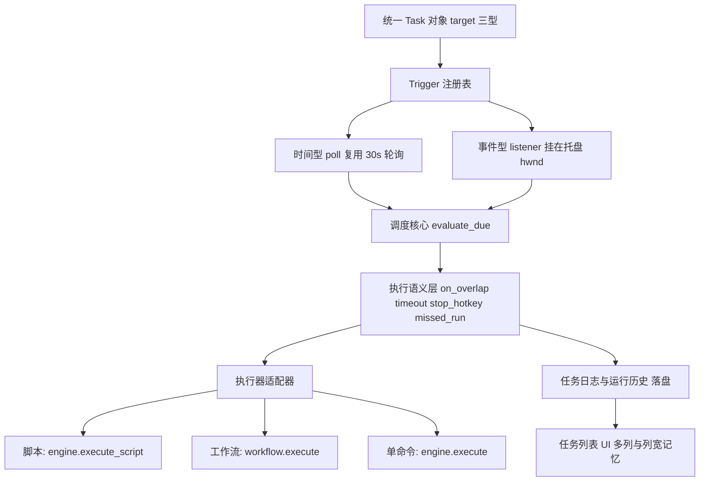

# 参考分析：zTasker 2.3.11 借鉴与 ACRPA 优化方案

> 分析对象：**zTasker 2.3.11**（原生 C++ / MSVC + DuiLib + WTL，OpenCV 2.4.10，内嵌 AutoHotkey v1/v2）
> 对照基线：**ACRPA v0.1.29**（MIT · Python 3.8+ / Windows x64 · PyInstaller onefile ≈14.3 MiB）
> 分析方式：zTasker 侧为**编译产物 + 纯文本数据文件 + 许可文件**的静态与运行时实测（无源码）；ACRPA 侧为源码只读核对，所有引用均带 `文件:行号`。
> 相关文档：`docs/ACRPA-完善路线图.md`、`docs/参考分析-AutoClicker借鉴要点.md`、`docs/参考分析-AutoHotkey借鉴与插件可行性.md`、`docs/工作流界面美化设计方案.md`、`docs/执行控制tab设计方案.md`

---

## 1. 摘要与结论先行

### 1.1 五条核心判断

| # | 判断 | 依据 |
| - | ---- | ---- |
| **①** | **ACRPA 与 zTasker 是两个物种，借鉴必须"错峰"** | ACRPA = 低代码 RPA 脚本 + 工作流 + 多机协同（`commands.py` 68 条命令、`browser_backend.py`、`netlink/`、`workflow.py`）；zTasker = 单机任务型定时自动化 + 284 个原子动作。**交集只有"定时 + 执行"这一层**，而这一层恰恰是 ACRPA 最薄的地方 |
| **②** | **ACRPA 的最大能力洼地不是"动作少"，而是"调度器太弱"** | `src/scheduler.py` 全文 460 行，任务模型只有 8 个字段（`scheduler.py:151-160`），只认 `once/daily/weekly/interval` 四种 `period_type`（`scheduler.py:201-249`），**只能调度脚本文件**，无错过补偿、无生效区间、无次数上限、运行中静默跳过（`scheduler.py:359-377`） |
| **③** | **最该抄的是"任务对象 + 触发器 + 执行语义"三件套的建模方式，不是 284 个动作，也不是 C++/DuiLib** | zTasker 的 `<TaskItem>` 用 `Ver` 做结构升级、用扁平 `Param` 做向后兼容（缺字段即取默认）；执行语义字段化（`cmbEcecType` / `cmbExecExitType` / `edtExecTimeout` / `StopHotkey`）。这三样是**零体积成本、纯架构收益** |
| **④** | **性价比最高的三件事都在 1 人日内，且用户当场可感知** | 单实例互斥（现在连 `CreateMutex` 都没有，全库 grep 为 0）、任务库自动备份（现在 `save_config()` 失败被吞，`state.py:404`）、CLI `--exec-task <id>`（现在 `cli.py:71-79` 只有 5 个开关）。详见 §9 |
| **⑤** | **合规红线：只能"读、学、抄结构"，一个字节资产都不能进发行包** | zTasker `License.txt` 明示禁止打包/捆绑/集成等二次制作、禁止分发最终包的任何单独一部分、禁止反编译或复制其子集。因此 exe/dll/图标(`Res.dll`)/音频(`Data\Sound\` ≈5.7 MB)/语言包文案/任务模板文案**一律禁止拷贝**。详见 §4.3、§4.4 |

### 1.2 本次方案"净新增 vs 与既有路线图重叠"对照表

| 本方案条目 | 性质 | 与 `docs/ACRPA-完善路线图.md` / 其他既有文档的关系 | 处理结论 |
| --- | --- | --- | --- |
| 单实例互斥 + 二次启动唤起主窗 | **净新增** | 路线图无此条 | 新增，v0.1.30 |
| 任务库自动备份（zip + 保留 N 份 + 启动清理） | **净新增** | 路线图 P0-6 只讲"脚本单文件保存原子化"，未涉及 `config.json` 全量任务库 | 新增，v0.1.30 |
| CLI `--exec-task <id>` / `--workflow <path>` | **合并** | 路线图阶段三「CLI / 无头模式」已起步，`src/cli.py` 已存在（424 行），但无任务/工作流入口 | 并入既有 CLI 项，v0.1.31 |
| 触发器插件化（`Trigger` 基类 + 注册表） | **净新增** | 路线图未涉及调度架构 | 新增，v0.1.31（L0 前置） |
| 统一 `Task` 抽象（脚本 / 工作流 / 单条命令） | **净新增** | 与路线图 §11.3「脚本与工作流是同一 CFG 的两个粒度」同构但**不同层**：那条讲执行模型，本条讲调度对象 | 新增，v0.1.31 |
| 错过执行补偿 `missed_run` | **净新增** | 路线图无 | 新增，v0.1.30（P0 触发器首项） |
| 倒计时 / 整点半点 / 生效起止 / 次数上限 | **净新增** | 路线图无 | 新增，v0.1.31 |
| 执行语义字段化（`on_overlap` / `timeout` / `pre/post` / `stop_hotkey`） | **部分合并** | 路线图 P0-5「停止语义」**已落地**（`engine.py:1110-1124` 已改为抛 `AbortSignal`）；剩余"任务级超时 / 重入策略"为净新增 | 合并 P0-5 收尾 + 新增，v0.1.31 |
| 动作库扩充（20 条文件/进程/HTTP/电源等） | **净新增** | 路线图未列；`参考分析-AutoClicker借鉴要点.md` 的色匹配/ROI/分辨率自适应是**另一批**命令，另立 | 新增，v0.1.32 |
| 统一占位符 `{var:}`/`{env:}`/`{date:}`/`{arg:}` | **合并** | 路线图 §6.7 已诊断"`${var}` 只对 `如果`/`循环开始`/`数学运算` 生效（`engine.py:617-633`、`:2089-2098`）" | 并入该缺陷修复，v0.1.32 |
| 托盘菜单升级为一级操作入口 | **净新增** | 路线图 §5 只覆盖主窗 UI；`src/tray.py` 已有完整 `Shell_NotifyIcon` + `WNDPROC` 能力（`tray.py:296-307`） | 新增，v0.1.32 |
| 托盘悬停显示 CPU/内存/磁盘/上下行 | **净新增** | 同上 | 新增，v0.2.0 |
| 任务列表多列 + 列宽/排序记忆 | **合并** | 路线图 §5.4「数据表 → 真 DataGrid」已规划；本文只补**调度任务列表**的 5 列 + `ActionListHeader*` 式记忆 | 并入 §5.4，v0.1.32 |
| 任务编辑窗四页签（任务/计划/热键/执行） | **需协调** | 与 `docs/执行控制tab设计方案.md` 有交集 | 先协调后做，v0.2.0 |
| 提醒浮窗（位置/透明度/倒计时模板/打盹三态） | **净新增** | `src/mini_bar.py` 有悬浮窗能力可复用，但无"提醒"语义 | 新增，v0.2.0 |
| 拼音搜索 / 空格多关键词 / 日期搜索 | **净新增** | 路线图 §5.3 有「命令库 Ctrl+K」，但无任务搜索增强 | 新增，v0.2.0（体积需评估） |
| 结构化启动日志 / `faulthandler` | **净新增** | 路线图 §8 只讲日志轮转与脱敏 | 新增，v0.1.31 |
| 静默更新强制校验 + 失败回滚 | **合并** | 路线图 §7 安全 #1（`updater.py:589` 条件性校验） | 并入安全项，v0.1.32 |
| 绿色便携标记 `portable.flag` | **净新增** | 路线图无 | 新增，v0.2.0 |
| 语言包外部化（覆盖式 i18n + 未命中回退原文） | **合并** | 路线图 §5.6 第一刀**已完成**：`src/i18n.py` 已是内嵌 dict 目录（`i18n.py:39-48`）；本文补"外部 JSON 化 + 覆盖式回退" | 并入 i18n 第二阶段，v0.2.0 |
| 运行历史持久化 | **合并** | `docs/执行控制tab设计方案.md` 遗留项；`scheduler.py:272-286` 目前只有内存环形 500 条 | 并入该设计，v0.1.32 |
| 危险动作二次确认 | **净新增** | 路线图无 | 新增，v0.1.32 |

### 1.3 一个必须先讲清的战略判断

**ACRPA 不该变成 zTasker，zTasker 也不该变成 ACRPA。**

| 维度 | zTasker 2.3.11 | ACRPA v0.1.29 | 结论 |
| --- | --- | --- | --- |
| 形态 | 单机任务型定时自动化工具箱 | 低代码 RPA 脚本 + 工作流 + 多机协同 | 不同物种 |
| 技术栈 | C++ / DuiLib / WTL / 内嵌 AHK | Python / tkinter / Playwright / PaddleOCR | 各有所长，**不换栈** |
| 分发体积 | 安装包 + `Data\Sound\` ≈5.7 MB 音频 + `Res.dll` 图标 | PyInstaller onefile ≈14.3 MiB，`build.py:2` 目标 **<15 MB** | 体积预算是 ACRPA 的硬约束 |
| 动作数 | 284（exe 内 `Total task types:304`） | 68 条命令（`commands.py:301-384`） | **不追数量**，追"组织方式" |
| 调度 | 30+ 种触发器，任务库为一级公民 | 4 种 `period_type`，任务库是 `config.json` 的一个键 | **这是差距的主战场** |
| 强项 | 触发器体系、执行语义、工程化 | 工作流、浏览器、OCR、NetLink、AI、市场 | 互补 |

因此本文的借鉴权重分配为：**触发器体系 40% · 执行语义 20% · 数据模型 20% · 工程化 15% · UI 交互 5% · 动作库 0%（只借"原子化"思路，不借清单）**。

---

## 2. zTasker 优点剖析

> 每节给出「原文依据（字段 / 文件名）」与「对 ACRPA 的启示」两列。所有字段名均为 `User\Tasks.dat` / `User\Config.dat` / `Data\*.init` 中的**实测原文**。

### 2.1 数据模型

| # | 机制 | 原文依据 | 对 ACRPA 的启示 |
| - | ---- | -------- | --------------- |
| 1 | **扁平「控件名即字段名」**：无嵌套、无 schema 文件，`chk*` 勾选 / `edt*` 输入 / `cmb*` + `cmb*_text` 成对 / `sld*` 滑块 / `opt*` 单选 / `tabBtn*` 页签 / `_*` 内部辅助 | `<TaskItem>` 下 `<Param>chkDayLimit1 ... edtFlowLoopCount</Param>` | **与 ACRPA `.acrpas` 的 args 扁平化思路一致**（`script_io.py:19-22`），说明这条路是对的。差异：zTasker 靠"缺字段取默认"实现兼容，ACRPA 靠 `schema` 版本 + `MIGRATIONS`（`script_io.py:46-50`）——**ACRPA 的方案更强，应保持** |
| 2 | **结构版本号 `Ver`**：每个 `<TaskItem>` 自带版本，升级时按版本补字段 | `ID / TaskType / Stopped / HKStopped / SchType / StartDateTime / EndDateTime / NextRunDateTime / LastRunTime / Fav / Ver / Param / Actions` | ACRPA 的 `.acrpas` 是**整文档**版本（`SCHEMA_VERSION = 1`），任务库没有版本概念。建议给「任务」单独加 `ver` 字段，与文档 `schema` 解耦（文档结构变了不等于任务的语义变了） |
| 3 | **`NextRunDateTime` 落库预计算**：下次运行时间持久化到任务上，进程重启后不需要重算（仅补偿时重算） | `NextRunDateTime` 字段 | ACRPA 的 `_task_next_runs` 是**纯内存 dict**（`scheduler.py:20`），重启即丢，靠 `start_multi_scheduler` 在启动时全量重算（`scheduler.py:449-452`）——**这正是"漏跑"的根因**。落库即可同时拿到"列表直显/排序"和"错过补偿"两个能力 |
| 4 | **动作序列与任务同构**：`<Actions>` 内 `<Tasker>`（整个子任务当动作，自带 ID/TaskType/Param）与 `<Action>`（流程控制节点）混排 | `User\Tasks.dat` 复合任务 | 概念上等价于 ACRPA 的「工作流节点可以是脚本」（`workflow.py` 的 `script` 节点）。**验证了 ACRPA 工作流方向正确**；可借鉴的是"节点内联一整个任务"而非只引用路径 |
| 5 | **任务级元信息极简，不塞 UI 状态**：`Fav`（收藏）、`Stopped`（启用/禁用）、`HKStopped`（热键禁用）分开 | 同上 | ACRPA 任务模型把"启用"和"有热键"混在一层，建议拆成 `enabled`（计划）/ `hotkey_enabled`（热键）两个独立开关 |
| 6 | ⚠ 反面：**单文件全量 XML、无 encoding 声明** | `User\Tasks.dat` 为 GBK 文本、根 `<Tasks>` 全量覆盖 | 见 §7「明确否决」第 5、6 条。ACRPA 应保持 JSON + 迁移表 + 强制 UTF-8 |

### 2.2 触发器体系

| # | 机制 | 原文依据 | 对 ACRPA 的启示 |
| - | ---- | -------- | --------------- |
| 1 | **`SchType` + 字段族**：触发器不是"枚举 + 一个值"，而是"类型 + 一组平铺字段"，天然支持多条件组合 | `SchType` / `chkDayLimit1..7` / `ZeroFulls` / `ZeroHalfs` | ACRPA 现在是 `period_type: str` + `period_value: str`（`scheduler.py:201-249`），`weekly` 甚至把星期与时间塞进 `"0,1,2|09:00"` 字符串（`scheduler.py:231-233`）。**应改为 `trigger: {type, ...具名字段}`** |
| 2 | **整点 / 半点白名单**：`ZeroFulls` / `ZeroHalfs` 用小时间白名单表达"每天 9/12/18 点整执行" | 同上 | ACRPA 只能靠 `interval` 硬凑，精度还只有分钟。属于 P0 触发器 |
| 3 | **倒计时专用类型**：`chkTimer` / `CountDownHour/Min/Sec` / `_dtRmdCntFormat`（模板化倒计时显示） | 同上 | ACRPA 无。适合"提醒/番茄钟/限时脚本"场景，实现成本极低（一个 `due_at` 字段） |
| 4 | **生效起止 + 执行次数上限**：`StartDateTime` / `EndDateTime` / `HasEndDateTime` / `chkSchLimitCount` | 同上 | ACRPA 完全没有"这个任务只在本月内每 10 分钟跑一次，最多 100 次"的表达能力 |
| 5 | **开机 / 唤醒 / 解锁后计时重算 + 延迟**：`chkResetTimeBootMin` / `chkResetTimeWakeMin` / `chkResetTimeUnlockMin` / `edtDelayBoot` | 同上 | 这是"笔记本用户"的核心体验：合盖一晚上，早上一开就要跑。ACRPA 无 |
| 6 | **错过执行补偿**：`chkRunMiss` / `chkWakeRunMiss`，原文语义"如果因为意外原因软件退出，本任务未执行，则启动后将会执行"，可选"无延迟立即运行 / 延迟 N 秒" | 同上 | **最高性价比的触发器功能**。ACRPA 现在的行为恰好相反：重启后 `_calc_task_next_run` 以 `now` 为基准重算（`scheduler.py:449-452`），错过的窗口被**静默吞掉** |
| 7 | **触发条件"且"组合**：仅当窗口存在 / 进程存在时才生效（`chkSKWinExists` / `chkSKProcExists`） | 同上 | ACRPA 的 `time_slots`（`scheduler.py:307-331`）已经是"且"的一种。可泛化为 `precondition` 谓词列表 |

### 2.3 执行语义

| # | 机制 | 原文依据 | 对 ACRPA 的启示 |
| - | ---- | -------- | --------------- |
| 1 | **同步 / 异步**：`cmbEcecType` | 同上 | ACRPA 调度线程固定 `_root.after(0, main_run_fn)`（`scheduler.py:369-370`），语义为"异步投递到主线程"，但**没有任何地方表达它是异步**；任务列表上看不出"这次跑的是哪一次" |
| 2 | **防重入策略**：`cmbExecExitType`——上次未结束时"跳过执行" | 同上 | ACRPA 只有"跳过"一种，且是硬编码：`if not state.running`（`scheduler.py:359`），跳过时只写一行日志（`scheduler.py:375-377`）→ **用户完全不知道自己的任务被跳过了几次**。应字段化 `on_overlap: skip / queue / terminate` |
| 3 | **超时与退出等待**：`edtExecTimeout` / `edtExecExitWaitTime`（默认 60） | 同上 | ACRPA 只有全局 `MAX_EXECUTION_MINUTES`（`engine.py:2811` 附近，路线图 §6.1 已诊断"仅 autorun 外层检查"）→ 任务级 `timeout` 是净新增 |
| 4 | **前后置动作**：`chkExecPre` / `cmbExecPre` / `chkExecPost` / `cmbExecPost` | 同上 | ACRPA 有 `engine.register_script_hook` 的 before/after（`cli.py:47-49` 注释提到），但**没有在任务层暴露**给用户配置 |
| 5 | **任务级停止热键 `StopHotkey`** | 同上 | ACRPA 的全局热键只能绑 3 个内建动作（`ACRPA.py:3828-3838` 遍历 `_HOTKEY_ACTIONS`），**无法"给这个任务单独配一个停止键"** |
| 6 | **执行前提示窗 `chkExecDlg` + 退出条件（失焦/全屏/前置进程退出）+ 执行后自删除 `chkSelfDelete`** | 同上 | 前两条是"带人确认"与"别打扰用户"，ACRPA 全无；`chkSelfDelete` 是"一次性小工具"思路，与 ACRPA 的桌面快捷方式能力互补 |

### 2.4 动作体系

| # | 机制 | 原文依据 | 对 ACRPA 的启示 |
| - | ---- | -------- | --------------- |
| 1 | **284 个动作标识，但每个都极小**：一个动作 = 一个 `TaskType` + 一组平铺 `Param` | exe 内 `Total task types:304`，284 个可识别标识 | ACRPA 的 `commands.register(name, desc, params, handler, schema, requires)`（`commands.py:109`）已经是同构的"原子动作注册表"。**结构上 ACRPA 已经对了，缺的是"注册多少"** |
| 2 | **流程控制节点与业务动作同列**：循环/条件/正则判断/列表框/对话框都是动作 | `edtFlowLoopCount`(1..10000) / `JudgeType` / `cmbJudgeMatch` / `edtVarRegGroup` / `cmbListSrc` / `edtListBoxSrcV` / `edtMsgBoxBtn` | ACRPA 的流程控制是**引擎内建**（`如果/否则/结束如果/循环开始/循环结束/跳出循环`，`cli.py:75`），不是命令 → 所以**无法在工作流里复用**。建议把流程控制保留在引擎、但对工作流暴露等价节点（`workflow.py` 已有 `condition`/`loop`） |
| 3 | **变量占位符贯穿所有动作参数**：`{var:名称}` / `{date:格式}` / `{arg:参数名}` | 全部动作的 `Param` 取值 | ACRPA 的 `${var}` 只对 3 类命令生效（`engine.py:617-633`、`:2089-2098`）→ 见 §5 L3 |
| 4 | **自管理动作（元能力）**：任务可启用/禁用其它计划、开关热键、调用其它任务（`ttRunTask`）、退出/重启程序、切换语言 | 同上 | ACRPA 有 `运行工作流` / `工作流变量` 两条（`commands.py:353-354`），**没有"启用/禁用某计划任务"**。这类"元命令"是任务型产品的必备逃生口 |
| 5 | **安全护栏**：危险动作二次确认；结束进程白名单 `chkProcSafe`；循环次数/间隔下限硬约束 | 同上 | ACRPA 对 `结束进程` 完全空白（无此命令）；对 `删除文件` 也空白 → 补命令时**必须同时补护栏**，见 §5 L2 |

### 2.5 UI 交互

| # | 机制 | 原文依据 | 对 ACRPA 的启示 |
| - | ---- | -------- | --------------- |
| 1 | **任务列表 5 列可排序 + 列宽记忆**：任务 / 参数 / 计划 / 下次运行 / 最后运行 | `Config.dat [Stat] ActionListHeader0..4` | ACRPA 的调度任务 Treeview 有 7 列（`scheduler.py:423-431`），但**列宽与排序不持久化**，且刷新是全量 `delete + insert`（`scheduler.py:413-433`）。最小改动：把 5 列语义 + 列宽存 `state.py` 的配置键（已有 `win_geometry` / `mini_bar_pos` 先例，`state.py:47-48`、`:143-144`） |
| 2 | **任务编辑窗 4 页签**：任务 / 计划 / 热键 / 执行（`tabBtnTask` / `tabBtnSch` / `tabBtnHK` / `tabBtnExec`） | 同上 | ACRPA 主窗只有 2 个 Tab（`ACRPA.py:4131-4139`）；任务编辑目前散在设置窗口的 `sched` 卡片（`src/ui/settings/cards/sched.py`）。四页签是"信息架构正确"的信号：**触发器、热键、执行策略是三件正交的事，不该挤在一个表单里** |
| 3 | **托盘菜单即一级操作入口**：新提醒 / 快速提醒 5·15·30 分钟 / 定时关机 / 关机 / 重启 / 注销 / 待机 / 休眠 / 锁定 / 静音 / 选项 / 退出 | 托盘右键菜单 | ACRPA 的 `src/tray.py` 已有完整托盘（`tray.py:322-335`），但菜单只是"显示主窗/退出"级。**托盘菜单是零学习成本的功能发现入口**，且这些动作全都只需要 ctypes |
| 4 | **鼠标指向托盘图标即显示 CPU/GPU/内存/磁盘/上传/下载** | 托盘 tooltip | ACRPA 的 `tray.py` 已有 `NIM_MODIFY` + `szTip` 更新路径（`tray.py:214-216`）→ 技术上零障碍 |
| 5 | **提醒浮窗**：位置 / 透明度 / 自动关闭 / 倒计时模板 / 打盹三态（稍后提醒·彻底关闭·不再提醒） | 同上 | ACRPA 的 `src/mini_bar.py`（881 行）已有三形态悬浮窗，可复用其几何/透明度/置顶能力，只缺"提醒"语义 |
| 6 | **拖放程序/快捷方式/脚本到主窗即打开对应新建任务对话框**；粘贴路径；任务右键生成桌面快捷方式 | 同上 | ACRPA 无拖放即新建。这是"从零到第一个任务"的最短路径，转化率相关 |
| 7 | **搜索增强**：空格分隔多关键词、可输日期、**拼音搜索**（LevelDB `pinyin.db`） | 同上 | ACRPA 无任务搜索。拼音方案的体积代价需评估（见 §8.2） |

### 2.6 工程化与稳定性

| # | 机制 | 原文依据 | 对 ACRPA 的启示 |
| - | ---- | -------- | --------------- |
| 1 | **单实例 appid `27488` + 二次启动唤起已有窗口** | 进程/窗口实测 | ACRPA **全库无 `CreateMutex`**（grep `Mutex` = 0 命中）。双击两次 = 两个调度器 = **同一任务被执行两次**。这是数据正确性缺陷，不是体验问题 |
| 2 | **崩溃守护进程 `CrashCatch.exe`** | 分发布局 | ACRPA 零遥测、无 `faulthandler`、无 minidump（`utils.py:577` 的 `log1` 是唯一痕迹）。建议先上 `sys.excepthook` + `faulthandler`（零依赖），再谈 dump |
| 3 | **任务库自动备份**：`User\TasksBackup\YYYY-MM-DD_HH-mm-ss.zip`，保留多份 + 启动时清理 | 目录实测 | ACRPA 的 `save_config()` 失败被吞（`state.py:404`），任务库丢失=全部计划消失。备份是**最低成本的灾备** |
| 4 | **结构化启动日志**：启动每步一条 | `User\Logs\YYYY-MM-DD.log` | ACRPA 的 `ThreadSafeLog` 已是按天 + 批量写盘 + 保留 7 天（`utils.py:622`、`:738-741`、`:763-774`），**只缺"启动分步留痕"** |
| 5 | **绿色便携标记**：`Data\.green` 零字节文件 → 用户数据写 `User\` 而非 `%LOCALAPPDATA%` | 目录实测 | ACRPA 用户数据固定在 `%APPDATA%` 或程序目录（需确认）。`portable.flag` 是 U 盘用户的刚需，实现只需 3 行 |
| 6 | **静默更新**：`User\Temp\ver.ini` 元数据 + 已下载 `2.3.12.exe` 就地升级 | 目录实测 | ACRPA 的 `updater.py` 能力更强（多源探测 + sha256 + 原子替换），但 `_verify_file` 是**条件性**校验（`updater.py:589`，路线图 §7 #1）→ 重点不是"加静默"，是"把校验变强制 + 失败回滚" |
| 7 | **运行时 CRT 全私有化** | 分发布局 | Python 打包本身满足，无需借鉴 |

---

## 3. 能力差距矩阵

> 差距级别定义：**空白** = 完全没有；**受限** = 有但表达力不足；**缺失语义** = 有对应机制但缺关键字段/语义。
> 证据列均为 ACRPA 侧实测位置；"路线图"指 `docs/ACRPA-完善路线图.md`。

| 能力域 | zTasker | ACRPA 现状（含证据） | 差距级别 | 优先级 | 落地落点 |
| --- | --- | --- | --- | --- | --- |
| 计划触发器全集 | 一次性 / 固定间隔秒分时天 / 每周几 / 月 / 年 / 倒计时 / 整点半点 / 时间段 / 空闲 / 阈值 | 仅 `once/daily/weekly/interval`（`scheduler.py:201-249`）；`interval` 精度被 `strftime("%Y-%m-%d %H:%M")` 截到分钟（`scheduler.py:216-217`） | **受限** | P0 | `scheduler.py` 新增 `src/scheduler/triggers/` |
| 错过执行补偿 | `chkRunMiss` / `chkWakeRunMiss` | 无；启动时 `_calc_task_next_run` 以 `now` 重算，错过窗口被吞（`scheduler.py:449-452`） | **空白** | P0 | `scheduler.py` + `state.py`（`next_run_at` 落库） |
| 生效起止 / 次数上限 | `StartDateTime` / `EndDateTime` / `chkSchLimitCount` | 无 | **空白** | P0 | `scheduler.py` |
| 倒计时 | `chkTimer` / `CountDownHMS` / 模板 | 无 | **空白** | P0 | `scheduler.py` |
| 整点 / 半点 | `ZeroFulls` / `ZeroHalfs` | 无 | **空白** | P0 | `scheduler.py` |
| 开机 / 唤醒 / 解锁重算 | `chkResetTimeBootMin` / `Wake` / `Unlock` + `edtDelayBoot` | 无 | **空白** | P1 | `scheduler.py` + `tray.py`（消息钩子） |
| 开机执行某任务 | 触发器组合可得 | 无（调度器启动后按 next_run 算，非"开机即跑"） | **空白** | P0 | `scheduler.py` |
| 进程监视 | `chkSKProcExists` + `edtWndChkSec` / `edtWndChkTimes` | 无（`bound_window_title` 只是执行期绑定窗口，`state.py` 配置项） | **空白** | P1 | 新 `src/triggers/procwatch.py` |
| 窗口监视 | 存在/不存在/存在且激活/变为可见/变为隐藏 | 无；`等待窗口` 是一次性命令（`commands.py:335`），不是触发器 | **空白** | P1 | 同上 |
| 文件变化 | ReadDirectoryChangesW + 类型过滤 + 子目录 | 无 | **空白** | P1 | 新 `src/triggers/fswatch.py` |
| 系统空闲 | 有 | 无 | **空白** | P1 | `GetLastInputInfo`（纯 ctypes） |
| CPU / 内存阈值 | 统计方式温和/严格 | 无 | **空白** | P1 | `GetSystemTimes` + `GlobalMemoryStatusEx` |
| 网络上下线 / Ping / U 盘 / 盖子 / 屏幕四角 | 全有 | 无 | **空白** | P2 | 复用 `tray.py` 的 hwnd |
| 热键指向具体任务 | 热键即"无计划任务"的一种建模（`Data\Hotkeys.init`） | **只能绑 3 个内建动作** run/pause/stop（`ACRPA.py:3828-3838` 遍历 `_HOTKEY_ACTIONS`），且是 200 ms `GetAsyncKeyState` 轮询（`ACRPA.py:3799-3840`） | **受限** | P0 | `ACRPA.py:3799` + `scheduler.py` |
| 执行语义：同步/异步 | `cmbEcecType` | 固定 `_root.after(0, ...)`（`scheduler.py:369-370`），无语义字段 | **缺失语义** | P1 | `scheduler.py` 任务模型 |
| 执行语义：重入策略 | `cmbExecExitType`（跳过） | 硬编码 `if not state.running`（`scheduler.py:359`），跳过仅写日志（`:375-377`） | **受限** | P0 | `scheduler.py` + 任务日志 |
| 执行语义：任务级超时 | `edtExecTimeout` | 仅全局 `MAX_EXECUTION_MINUTES`；`_chk()` 已抛 `AbortSignal`（`engine.py:1110-1124`）→ **中断能力已具备**，只缺"到点自动中断" | **缺失语义** | P1 | `engine.py` + `scheduler.py` |
| 执行语义：前后置动作 | `chkExecPre` / `cmbExecPre` | 引擎有 `register_script_hook`（见 `cli.py:47-49`），任务层未暴露 | **缺失语义** | P2 | `scheduler.py` + `src/ui/settings/cards/sched.py` |
| 执行语义：任务级停止热键 | `StopHotkey` | 只有全局 stop（`ACRPA.py:3828-3838`） | **空白** | P1 | `ACRPA.py:3799` |
| 变量体系 | `{var:}` / `{date:}` / `{arg:}` 贯穿全部动作参数 | `${var}` 仅对 `如果`/`循环开始`/`数学运算` 生效（`engine.py:617-633`、`:2089-2098`）；`输入,${x}` 会字面输入（路线图 §6.7） | **受限** | P0 | 新 `src/interp.py` + `engine.py` |
| 动作库：文件/目录族 | 有（复制/移动/删除/建目录/列目录/读写文本） | **全空白**，只能靠 `Python` 命令绕行 | **空白** | P0 | `commands.py` 追加 |
| 动作库：启动程序 / 结束进程 | 有 + 白名单保护 `chkProcSafe` | **全空白** | **空白** | P0 | `commands.py` + `psapi` ctypes |
| 动作库：HTTP / 邮件 | 有（libcurl） | **全空白**（`urllib` 可用，但无命令） | **空白** | P1 | `commands.py`；邮件需改 `ACRPA.spec:13` |
| 动作库：系统面板 / 电源 / 音量 / 亮度 / 磁盘 | 全有 | 全空白 | **空白** | P1 | `commands.py`（ctypes） |
| 任务列表 UI（多列 + 排序 + 列宽记忆） | 5 列 + `ActionListHeader0..4` | 7 列但全量重建、无列宽/排序持久化（`scheduler.py:408-437`） | **受限** | P1 | `src/ui/settings/cards/sched.py` + `state.py` |
| 托盘菜单一级入口 | 全功能菜单 | 仅显示/退出级（`tray.py:322-335` 只做图标生命周期） | **受限** | P1 | `tray.py` |
| 托盘悬停性能 | CPU/GPU/内存/磁盘/上下行 | 固定 `szTip = "A/C RPA"`（`tray.py:333`） | **空白** | P2 | `tray.py` |
| 单实例 + 二次启动唤起 | appid 27488 | **全库无 `CreateMutex`**（grep 0 命中）→ 两个实例 = 同一任务跑两次 | **空白** | **P0** | `run.py` / `src/app.py` |
| 任务库自动备份 | zip + 保留 N 份 + 启动清理 | 无；`save_config()` 失败被吞（`state.py:404`） | **空白** | **P0** | `state.py` |
| 运行历史持久化 | `LastRunTime` 落库 + 按天日志 | `_task_logs` 纯内存环形 500（`scheduler.py:22`、`:272-286`），重启即空 | **空白** | P1 | `scheduler.py` |
| CLI 直接触发任务 | `-exec:<任务ID>`（未启动则启动后执行） | `cli.py` 仅 `--script/--var/--json-report/--exit-code/--quiet`（`cli.py:71-79`） | **空白** | **P0** | `cli.py` |
| 可调度对象 | 任务 / 复合任务 / 热键 三种入口 | **只能调度脚本文件**（`scheduler.py:360-368` 只认 `script`），工作流不可调度 | **空白** | P0 | `scheduler.py` 统一 `Task.target` |
| 语言包机制 | 覆盖式"原文=译文"，未命中回退原文，外部文件 | 内嵌 Python dict（`i18n.py:39-48`），`str.format` 插值，运行期不可加载 | **受限** | P2 | `i18n.py` → `res/i18n/*.json` |
| 静默更新 | `ver.ini` + 就地升级 | `updater.py` 更强，但 `_verify_file` 条件性校验（`updater.py:589`；路线图 §7 #1） | **缺失语义** | P1 | `updater.py` |
| 崩溃守护 / 最小 dump | `CrashCatch.exe` | 无 `faulthandler`、无 `excepthook`、零遥测 | **空白** | P1 | `run.py` / `src/app.py` |
| 绿色便携 | `Data\.green` | 无 | **空白** | P2 | `state.py` 路径解析 |
| 危险动作二次确认 | 有 | 无（且无"危险动作"概念） | **空白** | P1 | `dialogs.py` + `commands.py` 元数据 |

---

## 4. 可复用资产清单

### 4.1 第一档：可直接复用（合规无风险）

| 资产 | 原文路径 | 体积 | 内容 | 转换后落点 | 用途 |
| --- | --- | --- | --- | --- | --- |
| `LangID.csv` | `<ZTASKER_HOME>\Data\Asset\LangID.csv` | 9,792 B | Windows 标准 **LCID 表**（语言代码 ↔ 名称） | `src/data/langid.json` | 语言选择下拉、`i18n` 语言元数据、`Accept-Language` 生成 |
| `WinMsg.txt` | `<ZTASKER_HOME>\Data\Asset\WinMsg.txt` | 小 | Windows `WM_*` 消息常量表 | `src/data/wm_messages.json` | 窗口监视 / 消息钩子的可读名称 |

**两点说明（重要）**：

1. 这两份都是**微软公开的常量表**，不含 zTasker 的独创内容，属"数据事实"而非"作品表达"——这是它们可以复用的法理基础。
2. `WinMsg.txt` **建议以微软官方文档（`winuser.h`）重新生成**，仅把 zTasker 的表当作"需要哪些消息"的清单参考。理由：避免任何"来源可追溯性"争议，且官方表更全、更新。
3. 转换后**必须写入 ACRPA 自己的文件头注释**，注明"数据来源：Microsoft Windows SDK `winuser.h` / LCID 公开文档"，**不得出现 zTasker 字样**。

### 4.2 第二档：仅结构参考（可读、可学、不可拷贝）

| 文件 | 参考什么 | ACRPA 侧对应落地建议 |
| --- | --- | --- |
| `Data\Tasks.init`（40 个任务模板的 XML） | `<TaskItem>` 的字段组织；`Param` 扁平化命名法；`Ver` 版本号用法 | ① `.acrpas` 保持扁平 args（`script_io.py:19-22`）② 给任务加 `ver` ③ **模板文案一行都不能抄**，ACRPA 的模板另写（`src/templates.py` 已有） |
| `User\Tasks.dat` | 复合任务的 `<Actions>` 序列化范式（`<Tasker>` + `<Action>` 混排） | `src/workflow.py` / `src/flow_graph.py`：把"节点内联一整个任务"纳入 `flow_graph` 的节点类型；**不要把 XML 结构搬成 JSON 字段名** |
| `Data\Hotkeys.init` | "热键即无计划任务"的建模（热键本身是一种触发器） | `scheduler.py` 的 `Trigger` 基类把 `hotkey` 实现为第五种触发器 → 一次性解决"热键只能绑 3 个动作" |
| `User\Config.dat` | 全局设置项**清单**（有哪些配置维度） | 对照 `src/state.py` 的配置 schema 补键（`state.py:46-49`、`:143-144` 已有几何类先例） |
| `Data\Asset\JudgeAHK.txt` | 条件脚本的 `JudgeResult:=1/0` **契约**（布尔结果约定） | `src/safe_eval.py`：统一"条件表达式求值 → bool"契约，供触发器 `precondition` 与 `如果` 共用一份实现 |
| `Data\Asset\Tips+.txt` | 命令行参数说明的**组织方式**（`-m` / `-exec:` / `-import:` / `-p0:`） | `src/cli.py` 的 `_USAGE`（`cli.py:71-72`）+ `--help` 文本结构 |
| `Data\Bundle\UIA.ahk` / `Chrome.ahk` / `ImagePut.ahk` | 社区开源 AHK 库的**能力边界**（UIA 遍历、Chrome 自动化、图像写入剪贴板） | 仅作"该有什么能力"的对照；**若要复用代码，必须先核对各库上游许可（多为 MIT/GPL 混合），且 GPL 与本项目 MIT 不兼容** |
| `Data\Asset\LangID.csv` 之外的语言包目录 | 语言文件的**目录形态**（一语言一文件） | `i18n.py` 外部化：`res/i18n/zh-CN.json` / `en-US.json`，覆盖式回退 |

### 4.3 第三档：明令禁止（一律不得进入 ACRPA 发行包）

| 禁止对象 | 原文路径 | 理由 |
| --- | --- | --- |
| 主程序与所有二进制 | `<ZTASKER_HOME>\zTasker.exe`、`*.dll`（含 `OpenCV` 相关、`sqlite`、`leveldb`、`openssl`、`libcurl`、`bass`） | License 禁止"分发最终包的任何单独一部分" |
| 图标与资源 DLL | `<ZTASKER_HOME>\Res.dll` | 同属最终包组成部分；且图标为美术作品 |
| 音频素材 | `<ZTASKER_HOME>\Data\Sound\`（≈5.7 MB，含"明星语音"） | 音源可能涉及第三方肖像/声音授权，风险最高 |
| 崩溃守护与工具 | `CrashCatch.exe`、`RegFileType.exe` | 同属二进制 |
| 语言包文案 | `<ZTASKER_HOME>\Data\Asset\Lang*` 及各语言文件 | 文案是受版权保护的表达，且与"任务模板文案"高度绑定 |
| 任务模板文案 | `Data\Tasks.init` 内的任务名称 / 描述 / 提示文字 | 文案受版权保护；只能参考结构 |
| 帮助文档 / FAQ 文本 | 各 `*.txt` / `*.htm` 帮助 | 同上 |

**`License.txt` 条款要点（原文语义，非逐字引用）**：

1. 允许**原样完整分发**（即整包、不改动、不拆分）；
2. **严禁打包 / 捆绑 / 集成等二次制作**，严禁商业销售；
3. **未经书面许可，不得分发最终包的任何单独一部分**；
4. **不得修改、反编译、反向工程，或复制其子集**。

### 4.4 合规结论（一句话版）

> **zTasker 只能"读、学、抄结构"——读它的纯文本数据文件，学它的字段组织与语义设计，抄它的架构思路；不得拷贝任何二进制、图标、音频、语言包文案、任务模板文案进 ACRPA，也不得在 ACRPA 中内联其代码子集。**
>
> 落到工程上只有两条硬规则：
> ① `ACRPA.spec` 的 `datas` 里**永远不会出现**任何取自 zTasker 的路径（当前 `ACRPA.spec:8`）；
> ② 代码注释与文档里提到 zTasker 时，只描述**机制**，不粘贴**原文段落**。

---

## 5. 优化方案（分层设计）

### 5.0 分层总览

| 层 | 名称 | 目标 | 与 zTasker 的关系 | ACRPA 的差异化取舍 |
| --- | --- | --- | --- | --- |
| **L0** | 数据模型与调度架构 | 让"任务"成为一级公民，让"触发器"可插拔 | 抄建模，不抄 XML | 保留 JSON + `schema`/`MIGRATIONS`；任务比 zTasker 多一层"目标类型" |
| **L1** | 触发器扩展清单 | 把 30+ 种触发器按 ROI 分批落地 | 抄分类与字段语义 | 纯 ctypes/标准库，不引入三方依赖；复用现有 30 s 轮询与托盘 hwnd |
| **L2** | 动作库扩充 | 补 20 条 P0 命令，覆盖"文件/进程/网络/系统"四大空档 | 抄"原子化"思路，**不抄清单** | 数量克制（68 → ≈90），每条必带 `requires()` 与危险等级 |
| **L3** | 变量与表达式体系 | 统一占位符 + 全命令插值 | 抄占位符语法 | 与既有 `${var}` 并存迁移，不破坏存量脚本 |
| **L4** | UI / 交互 | 托盘一级入口、任务列表多列、四页签编辑、提醒浮窗 | 抄信息架构 | 纯 tkinter，复用 `mini_bar` / `dialogs` / `log_dock` |
| **L5** | 工程化与稳定性 | 单实例、备份、崩溃守护、CLI、便携、更新 | 抄"必备件清单" | 优先零依赖方案（`faulthandler` 而非 minidump） |



---

### L0 数据模型与调度架构

#### L0 目标

把 `src/scheduler.py`（460 行、`period_type` if-else、只能跑脚本）重构为**"统一 Task + 可插拔 Trigger + 字段化执行语义"**三段式，使后续 20 多种触发器成为**注册项**而不是新分支。

#### L0-① 统一 `Task` 模型（解决"调度器只能跑脚本"）

现状问题（证据）：`scheduler.py:360-368` —— 触发后只做 `state.filename = script` / `state.has_script = True` / `_root.after(0, main_run_fn)`，**任务与"一个脚本文件路径"强绑定**；`run_task_now`（`scheduler.py:289-304`）同样如此。工作流（`workflow.py`）与单条命令（`engine.execute`）都无法被调度。

设计要点：

| 字段 | 类型 | 说明 |
| --- | --- | --- |
| `id` | str | 稳定 ID（沿用 `str(int(time.time()*1000))` 但加随机后缀，避免同毫秒冲突） |
| `name` | str | 任务名 |
| `ver` | int | **任务结构版本号**（对齐 zTasker `Ver`），与 `.acrpas` 的 `schema` 解耦 |
| `enabled` / `hotkey_enabled` | bool | **拆两个开关**（对齐 zTasker `Stopped` / `HKStopped`） |
| `target` | dict | `{"type":"script","path":...}` / `{"type":"workflow","path":...}` / `{"type":"command","cmd":"...","args":{...}}` |
| `triggers` | list[dict] | 触发器数组（见 L0-③），**不再有 `period_type`** |
| `exec` | dict | 执行语义（见 L0-④） |
| `next_run_at` | str(ISO) | **预计算并落库**（对齐 zTasker `NextRunDateTime`） |
| `last_run_at` / `last_result` | str / str | 运行历史（解决"内存环形 500 条重启即空"） |
| `run_count` / `max_runs` | int / int\|null | 执行次数上限 |
| `active_from` / `active_to` | str\|null | 生效起止 |

涉及文件：`src/scheduler.py`（模型 + 计算 + 循环）、`src/state.py`（`SCHED_TASKS` 迁移 + 新配置键默认值）、`src/script_io.py`（若走文件存储则复用其 `_migrate` 思路）。

验收标准：

- 存量 `config.json` 中的 `SCHED_TASKS`（8 字段旧模型）**能无损加载**：`period_type`/`period_value` 在读取时自动转换为等价 `triggers[0]`，写回时落新模型；旧字段保留一个版本周期后删除。
- 三个 `target.type` 各有一条端到端用例（脚本任务 / 工作流任务 / 单命令任务），且"运行中"状态与 `state.running` 语义不冲突。
- `next_run_at` 在进程重启后**不重算**（除非处于错过补偿判定）。

#### L0-② `Param` 扁平化 + `Ver` + `NextRunAt` 预计算

| 借鉴点 | zTasker 做法 | ACRPA 落法 |
| --- | --- | --- |
| 扁平参数 | `<Param>` 内控件名即字段名，无嵌套 | 保持 `.acrpas` 的 `args` 为扁平 `dict`（`script_io.py:19-22` 已是），**不要引入嵌套 args**；但触发器的 `triggers[i]` 允许扁平，**不允许**再嵌一层 `options` |
| 结构版本 | `Ver` 每任务一个 | `task["ver"]` + `TASK_MIGRATIONS = {1: fn}`，与 `script_io.py:50` 的 `MIGRATIONS` 同风格 |
| 缺字段即默认 | 无 schema，缺就取默认 | `state.py` 的配置 schema 已有 `(key, default, type)` 三元组（`state.py:46-49`）→ 任务字段复用同一张默认值表，**读取时补默认，写入时不写默认值**（减小文件、天然向前兼容） |
| NextRunAt 落库 | `NextRunDateTime` | `next_run_at` 写进任务；任务列表直接渲染与排序，**无需每 30 s 重算全表** |

验收标准：任务列表 100 条时，`evaluate_due` 单次耗时 < 5 ms；`next_run_at` 为空或早于 `now - poll_interval` 时**必须**进入补偿判定分支，不得静默跳过。

#### L0-③ 触发器插件化（把 scheduler 从 if-else 重构为组合）

```
Trigger（基类）
├── 元信息：type_id / 显示名 / 字段 schema / 是否需要独立线程
├── poll(now, task) -> datetime|None    # 时间型：返回下次到期时间
├── should_fire(now, task) -> bool      # 事件型：由事件回调置脏，poll 时消费
└── describe(task) -> str               # 任务列表"计划"列的人类可读文本
```

- **注册表**：`TRIGGERS: dict[str, Trigger]`，启动时注册内建触发器，扩展/插件可追加（与 `commands.register` 同构，`commands.py:109`）。
- **两种运行模式**：
  - **poll 模式**（时间型：一次性 / 间隔 / 每日 / 每周 / 整点半点 / 倒计时）：复用现有 `multi_task_loop` 的 30 s 轮询（`scheduler.py:394-397`），**零新增线程**。
  - **listener 模式**（事件型：文件变化 / 设备插拔 / 电源事件）：`src/tray.py` 已有隐藏窗口 + `WNDPROC` 子类化 + 事件队列 + `root.after` 消费（`tray.py:296-307`、`:141`）→ **消息直接挂到同一 hwnd，零新增线程**。需要阻塞等待的（如 `ReadDirectoryChangesW`）才开 1 个守护线程。
- **组合语义**：`triggers` 为**或**关系（任一满足即触发）；`precondition` 为**且**关系（全部为真才允许触发，对齐 zTasker 的"仅当窗口存在时生效"）。

验收标准：新增一种触发器 = 新增 1 个文件 + 1 行注册，**不改 `scheduler.py` 主循环**；`scheduler.py` 净行数不因触发器增加而增长（目标 ≤ 520 行）。

#### L0-④ 执行语义字段化

```json
"exec": {
  "sync": false,
  "on_overlap": "skip",          // skip | queue | terminate
  "timeout_sec": 0,              // 0 = 用全局 MAX_EXECUTION_MINUTES
  "pre": [], "post": [],         // 前置/后置动作（命令名 + args）
  "stop_hotkey": "",             // 任务级停止热键
  "missed_run": "run_now",       // ignore | run_now | run_delay
  "missed_delay_sec": 30,
  "require_confirm": false       // 危险任务执行前二次确认
}
```

与现状的对应：

| 字段 | 现状 | 改动 |
| --- | --- | --- |
| `on_overlap` | 硬编码 `if not state.running`（`scheduler.py:359`） | 改为读字段；`queue` 需一个待执行队列（见下）；`terminate` 复用 `AbortSignal`（`engine.py:1118-1119`） |
| `timeout_sec` | 仅全局 `MAX_EXECUTION_MINUTES` | 到点置 `state.quit2` → `_chk()` 抛 `AbortSignal` **自动中断**（因果链已具备，`engine.py:1110-1124`） |
| `missed_run` | 无 | 启动时比对 `next_run_at` 与 `now`，按策略补跑一次（**不补多次**，避免雪崩） |
| `stop_hotkey` | 只有全局 stop | `_HOTKEY_ACTIONS` 从"固定 3 项"改为"动态表"（`ACRPA.py:3828-3838` 已是遍历，只需允许追加） |

**`on_overlap=queue` 的实现要点（重要）**：`state.running` 是**全局**单例（引擎单线程串行），所以 `queue` 的语义是"排队等当前脚本跑完再跑本任务"，需要一个 `_pending: deque[(task_id, due_at)]`；队列长度上限（建议 32）+ 去重（同一 task 只保留最新一次）+ 过期丢弃（`due_at` 早于 `now - 10min` 不入队）。**不要试图并行执行两个脚本**——`state.running` 的语义决定了一次只能跑一个，改成并行是另一个量级的工程（路线图 §6.4 的"并发执行"）。

验收标准：`on_overlap` 三态各有一条用例；跳过/排队/终止都会在任务日志写一条**带原因的**记录（现状只写 "脚本正在运行，跳过"，`scheduler.py:376-377`）。

#### L0-⑤ 任务库自动备份 + 按天日志（已有，只差备份与运行历史）

| 能力 | 现状 | 差距 | 落点 |
| --- | --- | --- | --- |
| 按天日志 | `ThreadSafeLog` 按天 `acrpa_YYYYMMDD.log` + 保留 7 天（`utils.py:622`、`:738-741`、`:763-774`） | **已具备** | — |
| 任务库备份 | 无 | 全缺 | `state.py:404` `save_config()` 成功后：`tasks_backup/YYYY-MM-DD_HH-mm-ss.zip`（含 `config.json` + 所有 `.acrpas`），保留 N=10 份，启动时清理 |
| 运行历史持久化 | 内存环形 500（`scheduler.py:22`、`:272-286`） | 全缺 | 落 `tasks_history.jsonl`（追加写，按天切分，复用 `utils.py` 的清理策略） |

验收标准：手动损坏 `config.json` 后重启，能从备份恢复且提示"已从 <时间> 的备份恢复"；任务历史在重启后仍可查最近 500 条。

---

### L1 触发器扩展清单

> **落地顺序二维判据**：用户价值（能否被用户"看见"）/ 实现成本（是否需要新线程、新依赖、新 UI）。
> **通用原则**：全部优先用 **ctypes + 标准库**；不引入 `psutil` / `watchdog` / `pywin32`。

#### P0（价值高 / 成本低 — 全部可复用 30 s 轮询）

| 触发器 | 需求语义 | 实现方案 | 复用轮询 or 独立线程 | 涉及文件 | 验收标准 |
| --- | --- | --- | --- | --- | --- |
| **错过执行补偿** | 意外退出/休眠导致未执行，启动后补跑 | 启动时 `now - next_run_at > poll_interval` 判定为错过 → 按 `missed_run` 策略处理；**只补一次** | 轮询（启动时一次性判定） | `scheduler.py:449-452` | 关掉进程 2 小时后启动，间隔 10 分钟的任务补跑 1 次且日志写明"补偿执行"；`missed_run=ignore` 时不补跑 |
| **倒计时** | N 小时 M 分后执行一次 | `trigger={"type":"countdown","seconds":N}` → 首次 poll 时算 `due_at = now + N`，到点即 fire 并自动禁用 | 轮询 | `scheduler.py` + `src/ui/settings/cards/sched.py` | 设 90 秒倒计时，误差 ≤ poll 间隔（30 s 可配，最小 5 s，`advanced.py:367`）；任务详情可显示剩余时间 |
| **整点 / 半点** | 每天 9/12/18 点整执行 | `trigger={"type":"hourly","minute":0,"hours":[9,12,18]}` → `_calc_task_next_run` 按白名单求下一个候选 | 轮询 | `scheduler.py:197-249` | 白名单为 `[9,12,18]`、`minute=0` 时，下次运行时间精确到 `09:00`；跨天边界正确 |
| **生效起止 + 次数上限** | 只在本月内跑、最多 100 次 | `active_from`/`active_to` 判定 + `run_count`/`max_runs` 计数；超限自动 `enabled=False` 并写日志 | 轮询 | `scheduler.py` | 到达 `active_to` 后任务自动静默（列表显示"已过期"而非"已禁用"）；`run_count` 重启后继续累加 |
| **热键指向具体任务** | 给任意任务配一个热键 | `_HOTKEY_ACTIONS` 动态化：任务 `hotkey` 字段 → 轮询表追加一项；边沿检测逻辑**原样复用**（`ACRPA.py:3828-3838`） | 轮询（已有 200 ms，`ACRPA.py:3840`） | `ACRPA.py:3799-3840` + `scheduler.py` | 给任务 A 配 `Ctrl+Alt+1`，按下即触发 `run_task_now(A)`；与内建 run/pause/stop 冲突时提示并要求改键 |
| **开机执行任务** | 登录后立即跑一次 | `trigger={"type":"on_boot","delay_sec":30}` + 首次 poll 标记 `_boot_done` | 轮询 | `scheduler.py` | 开机后 `delay_sec` 秒触发且仅触发一次；重启进程不重复触发（用文件锁/注册表标记） |

#### P1（价值中高 / 需要监听能力）

| 触发器 | 实现方案 | 线程模型 | 涉及文件 | 验收标准 |
| --- | --- | --- | --- | --- |
| **进程监视** | `CreateToolhelp32Snapshot`（kernel32，纯 ctypes）枚举 `PROCESSENTRY32W`，按 `exe` 名匹配；`chkProcExists` 语义 = 存在/不存在；带 `edtWndChkSec` 检查间隔（最小 5 s） | 轮询：每 N 个 tick 才真正快照一次（避免 30 s×N 开销） | 新 `src/triggers/procwatch.py` | 打开/关闭记事本，任务在 ≤ 检查间隔内触发一次；存在性抖动（快速开关）不重复触发 |
| **窗口监视** | `EnumWindows` + `GetWindowTextW` / `IsWindowVisible` / `GetForegroundWindow` → 支持 存在/不存在/存在且激活/变为可见/变为隐藏 | 轮询 | 同文件 | 五个语义各一条用例；"变为隐藏"在最小化时**不**误判 |
| **文件变化** | `ReadDirectoryChangesW`（子目录可选、`FILE_NOTIFY_CHANGE_*` 过滤）→ 事件入队；若 API 不可用则退化为"目录 mtime + 文件数"轮询 | **独立守护线程**（阻塞式）+ `root.after` 回流 | 新 `src/triggers/fswatch.py` | 新建/修改/删除/重命名四类事件各触发一次；1000 文件目录下 CPU 占用 < 1% |
| **系统空闲** | `GetLastInputInfo` → `(GetTickCount() - lii.dwTime)` 空闲毫秒 | 轮询 | 新 `src/triggers/idle.py` | 设"空闲 5 分钟后执行"，鼠标键盘停止 5 分钟后触发；轻微移动即重置 |
| **CPU / 内存阈值** | `GetSystemTimes` 两次采样求差值；`GlobalMemoryStatusEx` 取 `dwMemoryLoad` | 轮询（采样间隔与触发判定解耦，建议 5 s 采样 / 30 s 判定） | 新 `src/triggers/resmon.py` | 设"CPU > 80% 持续 60 s"，满载时触发、短时尖峰不触发；同一窗口内只触发一次（去抖） |

#### P2（价值明确但场景窄 / 需要特殊消息）

| 触发器 | 实现方案 | 关键约束 | 验收标准 |
| --- | --- | --- | --- |
| **网络上下线** | `InternetGetConnectedState`（wininet）或 `GetAdaptersAddresses` 判定 OperStatus | 只判定"有无连接"，不判定质量 | 拔网线 → 触发"离线"；插回 → 触发"上线"，各一次 |
| **Ping** | `IcmpSendEcho`（iphlpapi）或 `subprocess` 调系统 `ping`（**优先 `IcmpSendEcho`，不产生子进程**） | 需处理 ICMP 被拦截 | 目标不可达时触发"异常"，恢复后触发"恢复" |
| **U 盘插入/拔出** | **复用 `tray.py` 的隐藏窗口**：在 `_wnd_proc`（`tray.py:297-307`）里捕获 `WM_DEVICECHANGE` + `DBT_DEVICEARRIVAL/REMOVEVOLUMECOMPLETE`，按卷标/序列号匹配 | **零新增线程** | 插入指定卷标的 U 盘触发一次；拔出触发一次；其他设备不误触发 |
| **笔记本盖子** | `RegisterPowerSettingNotification(hwnd, GUID_LIDSWITCH_STATE_CHANGE)` 挂到同一 hwnd | 需处理"无该设备"的失败 | 合盖触发"合盖"、开盖触发"开盖"；台式机上注册失败不崩 |
| **屏幕四角 / 四边热键** | 复用 200 ms 热键轮询（`ACRPA.py:3840`）读 `GetCursorPos`，与屏幕工作区边界比对 + 停留时长判定 | 多显示器需先算 `EnumDisplayMonitors` 工作区 | 鼠标停左上角 300 ms 触发一次；移开后再停留再触发 |
| **农历 / 节气** | 内置节气表 + 农历换算表（约 30–60 KB 静态数据） | 体积与正确性成本高，价值窄 | **建议不做**，除非有明确用户诉求 |

**L1 总体验收**：所有 P0 触发器上线后，`scheduler.py` 主循环不含任何 `if period_type == ...` 分支；新增触发器不触发主循环改动（可用 `git diff --stat` 验证）。

---

### L2 动作库扩充

#### 设计原则：用"命令原子化"对齐 zTasker 的 284 动作思路，但数量克制

| 维度 | zTasker | ACRPA 应采取 |
| --- | --- | --- |
| 粒度 | 每个动作极小（一个动作 ≈ 一个 `Param` 组） | **一致**：一条命令只做一件事（`commands.register` 已是这个粒度，`commands.py:109`） |
| 数量 | 284 | **不追**。68 → 目标 ≈ 88–92 条，只补"用户必须用 `Python` 命令绕行"的空档 |
| 组织 | 13 个分类 | 已有 `res/help/command_groups.json` 分组机制，直接扩展 |
| 元数据 | 无（靠控件名约定） | **ACRPA 更强**：`schema()` / `requires()` / `validate()` 已有（`commands.py:174`、`:136`、`:226`），新命令必须三样齐全 |

**为什么不追 284**：① 每条命令要写 handler + schema + requires + 帮助文案 + 回归用例，边际成本 ≈ 0.5 人日；② 284 条里有大量"通知/播放/正则/列表"等 ACRPA 用 `Python` 命令更灵活的场景；③ 体积不是问题，**维护与测试才是**。

#### P0 命令清单（20 条，落在 `src/commands.py`）

| # | 命令名 | 参数（按顺序） | 实现要点 | `requires()` | 危险等级 |
| - | --- | --- | --- | --- | --- |
| 1 | `复制文件` | 源路径, 目标路径, 覆盖(是/否), 目标变量名(可选) | `shutil.copy2`；目标为目录则拼 basename；失败不抛，写回 `ok`/`err` 变量 | `()` | 中 |
| 2 | `移动文件` | 源路径, 目标路径, 覆盖(是/否), 目标变量名(可选) | `shutil.move`；跨盘自动退化为 copy+remove | `()` | 中 |
| 3 | `删除文件` | 路径, 递归(是/否), 送回收站(是/否) | 优先 `shell32.SHFileOperationW` 送回收站；**默认送回收站**，直接删需显式选择 | `()` | **高**（需二次确认） |
| 4 | `创建目录` | 路径, 已存在则忽略(是/否) | `os.makedirs(exist_ok=)` | `()` | 低 |
| 5 | `列出目录` | 路径, 匹配(通配), 排序(名/时间/大小), 目标变量名 | `os.scandir` + `fnmatch`；结果以 `\n` 连接写入变量（与 `设置变量` 的字符串语义一致） | `()` | 低 |
| 6 | `读取文本文件` | 路径, 编码(utf-8/gbk/auto), 目标变量名 | `auto` = 先 utf-8 再 gbk；**强制显式编码不猜 BOM 之外的东西** | `()` | 低 |
| 7 | `写入文本文件` | 路径, 内容, 模式(覆盖/追加), 编码 | 原子写：临时文件 + `os.replace`（复用 `script_package.py:552-593` 已验证的模式） | `()` | 中 |
| 8 | `文件是否存在` | 路径, 目标变量名 | 返回 `1/0`（与 `JudgeResult:=1/0` 契约一致，见 §4.2） | `()` | 低 |
| 9 | `启动程序` | 程序路径, 参数, 工作目录, 等待结束(是/否), 隐藏窗口(是/否) | `subprocess.Popen`；`等待结束` 时读 `returncode` 写变量；**禁止 shell=True** | `()` | 中 |
| 10 | `结束进程` | 进程名/EXE名, 强制(是/否), 保护白名单(是/否) | `OpenProcess` + `TerminateProcess`；**内置白名单**（explorer.exe / winlogon.exe / csrss.exe / services.exe / lsass.exe / svchost.exe / System）→ 命中即拒绝并写日志 | `("proc.kill",)` | **高**（需二次确认） |
| 11 | `HTTP 请求` | 方法(GET/POST/PUT/DELETE/HEAD), URL, 请求头(JSON或多行 k:v), 请求体, 超时秒, 响应变量名, 状态码变量名 | `urllib.request`；**HTTP→HTTPS 白名单**：默认只允许 `https://`，`http://` 需显式开启；响应体上限 4 MB；不自动跟随跨域重定向（防 SSRF，见 §8.6） | `("net.http",)` | 中 |
| 12 | `JSON 取值` | 源变量或文件, 路径表达式(点分/`[n]`), 默认值, 目标变量名 | `json.loads` + 自写路径解析（不引入 `jmespath`）；缺失返回默认值不抛 | `()` | 低 |
| 13 | `Base64 编解码` | 模式(编码/解码), 源变量, 目标变量名 | `base64.b64encode/decode`，容错 `+/-` `_` 变体 | `()` | 低 |
| 14 | `URL 编解码` | 模式(编码/解码), 源变量, 目标变量名 | `urllib.parse.quote/unquote` | `()` | 低 |
| 15 | `哈希值` | 算法(md5/sha1/sha256), 源(文本/文件), 目标变量名 | `hashlib`；与 `script_package.compute_sha256` 分块哈希共用实现（路线图 §8.5「消除重复实现」顺手收敛） | `()` | 低 |
| 16 | `打开系统面板` | 面板(控制面板/设备管理器/服务/任务管理器/网络连接/电源选项/系统属性) | `subprocess.Popen` 固定命令表（**只有白名单内的 7 项**，不接受任意命令） | `()` | 低 |
| 17 | `电源操作` | 动作(关机/重启/注销/锁屏/待机/休眠), 延迟秒, 强制(是/否) | `InitiateSystemShutdownExW` / `ExitWindowsEx` / `LockWorkStation` / `SetSuspendState`；**默认 60 s 延迟且 UI 显示可取消** | `("power",)` | **高**（需二次确认） |
| 18 | `音量控制` | 动作(设置/静音切换/静音开/静音关), 音量(0-100) | ctypes 调 `IAudioEndpointVolume`（COM）或退化为 `keybd_event(VK_VOLUME_*)` 步进；**优先 COM** | `("audio",)` | 低 |
| 19 | `磁盘空间` | 盘符, 总容量变量名, 可用容量变量名, 使用率变量名 | `GetDiskFreeSpaceExW`（纯 ctypes，无需 psutil） | `()` | 低 |
| 20 | `设置窗口样式` | 窗口标题, 透明度(0-255, 可空), 置顶(是/否, 可空) | `SetLayeredWindowAttributes` / `SetWindowPos(HWND_TOPMOST)`；与既有 `激活窗口` 等同族 | `("win32",)` | 低 |

**未列入 P0 但必须解释的两条**：

| 命令 | 为什么不在 P0 | 若要做的前置条件 |
| --- | --- | --- |
| `发送邮件` | `ACRPA.spec:13` 的 `excludes` 目前排除了 `smtplib`（及 `email` 相关）；体积影响极小（≈300 KB），但需要同步改 spec 并加打包门禁校验 | ① 从 `excludes` 移除 `smtplib`/`email`；② 体积门禁复测仍 < 15 MB；③ 凭据走 Windows 凭据库（`state.py` 已有机制） |
| `取色 / 色匹配` | 属 `docs/参考分析-AutoClicker借鉴要点.md` §3.1 的独立批次（Pillow 即可），与本批"系统交互"不同域 | 在该文档的 P1 项里实施，避免两处重复开工 |

**注册位置**：`src/commands.py` 末尾新增分节，紧接现有浏览器命令块之后（`commands.py:379-384` 之后），保持"按域分节 + 注释标题"的现有风格（如 `# ── 文件与目录命令 ──`）。

**验收标准**：

- 每条命令具备 `register()` + `schema()` 可解析参数 + `requires()` 声明 + `res/help/command_schema.json` 同步；
- 20 条全部有 `tools/_test_new_commands.py` 覆盖（至少"参数校验 + 正常路径 + 失败路径"三例）；
- `复制文件`/`结束进程`/`电源操作` 三条在 UI 上有危险标识且需二次确认（`dialogs.py` 统一确认框）；
- `ACRPA.exe` 体积复测仍 < 15 MB。

---

### L3 变量与表达式体系

#### 现状

| 事实 | 证据 |
| --- | --- |
| `${var}` 只在条件求值里被解析 | `engine.py:617-633`（`_VAR_REF_RE.sub`）、`engine.py:2089-2098`（数学运算） |
| 普通命令参数不做插值 | `输入, ${x}` 会字面输入 `${x}`（路线图 §6.7 第 1 行） |
| 变量存储是 `engine.variables` dict | `cli.py:38-43` 注释已确认 |

#### 设计要点

1. **新增 `src/interp.py`（单一插值入口）**

   ```
   interp(text, vars_, *, args=None, now=None) -> str
   ```

   支持的占位符（**与 `${var}` 并存，不废弃**）：

   | 占位符 | 语义 | 示例 |
   | --- | --- | --- |
   | `${名称}` | 既有语法，保留（存量脚本兼容） | `${count}` |
   | `{var:名称}` | 变量，未定义返回空串并记一次 warning | `{var:count}` |
   | `{env:名称}` | 环境变量 | `{env:USERNAME}` |
   | `{date:格式}` | 当前时间，`strftime` 格式 | `{date:%Y%m%d_%H%M%S}` |
   | `{arg:名称}` | CLI/调用方传入参数（对齐 zTasker `-p0:` → `{arg:p0}`） | `{arg:order_id}` |
   | 双左花括号 / 双右花括号 | 转义为字面 `{` 与 `}` | 双括号包裹 `literal` → `{literal}` |

2. **全命令参数统一插值（关键改动）**：在 `engine.execute()` 取参数**之前**统一过一次 `interp`，而不是在各 handler 内部各自处理。落点建议：`engine.py` 中构造命令参数列表的位置（`engine.execute_script` 取 `row[i].value` 的聚合点），**一处生效**。

3. **兼容策略（硬约束）**：
   - `${var}` 优先解析，`{...}` 后解析；**解析顺序不影响结果**（两套语法不重叠）。
   - 未闭合 `{` 原样保留（不能把用户的 JSON 参数吃掉）。
   - 插值**不做二次展开**（防止注入与无限递归）。
   - `如果`/`循环开始`/`数学运算` 改为调用同一 `interp`（去掉 `_VAR_REF_RE` 的两处私有实现）。

4. **`{arg:}` 与 CLI 的关系**：`cli.py` 现有的 `--var k=v` 写入 `engine.variables`（`cli.py:38-43`）；新增 `--arg k=v` 写入独立的 `args` 命名空间 → 两者不互相污染（`--var` 影响脚本逻辑，`--arg` 只影响文本替换）。

#### 涉及文件

`src/interp.py`（新）、`src/engine.py`（取参点 + 移除两处私有正则）、`src/cli.py`（`--arg`）、`src/help_content.py`（帮助文案）、`res/help/02-脚本编辑.md`。

#### 单测点（`tools/_test_interp.py`）

| # | 用例 | 期望 |
| - | --- | --- |
| 1 | `interp("a${x}b", {"x":1})` | `a1b` |
| 2 | `interp("a{var:x}b", {"x":1})` | `a1b` |
| 3 | `interp("{var:missing}", {})` | `""` 且记 warning |
| 4 | 把双花括号包裹的 `literal` 交给 `interp` | `{literal}` |
| 5 | `interp("{date:%Y}", {}, now=fixed)` | `2026` |
| 6 | `interp("{\"a\":1}", {})` | 原样（未闭合不误伤） |
| 7 | 嵌套 `{var:{var:x}}` | **不做二次展开**，原样返回 |
| 8 | 100 个变量 × 1000 次插值 | < 50 ms（性能护栏） |

**验收标准**：`输入` 命令输入 `{var:name}` 得到变量值；存量含 `${x}` 的脚本**行为不变**；`res/help/02-脚本编辑.md` 更新占位符表格。

---

### L4 UI / 交互

| # | 交互项 | 设计要点 | 复用现有能力 | 涉及文件 | 验收标准 |
| - | --- | --- | --- | --- | --- |
| 1 | **托盘菜单升级为一级操作入口** | 菜单结构对齐 zTasker：`新建任务` / `快速提醒 5/15/30 分钟` / 分隔线 / `立即运行 <最近任务>` / 分隔线 / `屏幕`（关机/重启/注销/锁屏/待机/休眠）/ `静音切换` / 分隔线 / `打开主窗` / `设置` / `退出`。所有项直连已有命令（L2 的 17/18 号） | `tray.py` 已有 `Shell_NotifyIcon` + 原生菜单（`tray.py:322-335`）；命令已有 handler | `src/tray.py` | 托盘菜单 13 项全部可用；关机类项弹二次确认 |
| 2 | **托盘悬停显示实时性能** | tooltip 更新为 `CPU 12% · 内存 43% · C: 68% · ↓1.2 ↑0.3 MB/s`，1 s 更新一次（仅悬停时更新，避免常态开销） | `tray.py:214-216` 的 `NIM_MODIFY` + `szTip` 路径已存在 | `src/tray.py` + `src/triggers/resmon.py` | 悬停即显示；数值与任务管理器偏差 < 5%；不在悬停时 CPU 占用 ≈ 0 |
| 3 | **任务列表升级为多列 + 列宽/排序记忆** | 列 = `任务 / 目标（脚本·工作流·单命令）/ 计划（触发器人类可读）/ 下次运行 / 最后运行 / 上次结果`。排序：点击列头切换，箭头指示；列宽与排序列、排序方向持久化 | `ttk.Treeview`（`scheduler.py:408-437`）；`state.py` 已有 `win_geometry`/`mini_bar_pos` 持久化先例（`state.py:47-48`、`:143-144`） | `src/ui/settings/cards/sched.py`、`src/scheduler.py`、`src/state.py` | 重启后列宽/排序保持；100 条任务刷新 < 100 ms；`上次结果` 显示 ✔/✘ 且可点开看原因 |
| 4 | **任务编辑窗四页签** | `任务`（名称/目标/启用）/ `计划`（触发器列表，可加多个）/ `热键`（启用 + 按键捕获）/ `执行`（on_overlap/timeout/confirm/前后置）。**与 `docs/执行控制tab设计方案.md` 先对齐再实施** | `src/dialogs.py`（通用对话框）；`src/ui/settings/cards/sched.py`（现有任务表单） | `src/ui/task_editor.py`（新） | 四页签均可独立保存；取消不落盘；触发器可增删多条 |
| 5 | **提醒浮窗** | 位置（四角/跟随鼠标/自定义）/ 透明度 50–100% / 自动关闭秒数 / 倒计时模板 `还差 {var:remain}` / 三态按钮（稍后 5 分钟·彻底关闭·今天不再提醒） | `src/mini_bar.py`（881 行，已有三形态、置顶、透明度、位置持久化） | `src/ui/reminder_popup.py`（新）+ `mini_bar.py` 抽公共悬浮基类 | 三种按钮行为正确；"今天不再提醒"写入配置并在次日零点失效 |
| 6 | **搜索增强** | 空格分隔多关键词（AND）；可输日期（`2026-10` 命中该月创建的任务）；**拼音首字母搜索** | 现有任务列表无搜索 | `src/ui/settings/cards/sched.py` + 新 `src/data/pinyin_index.py` | `"jd bg"` 能命中"定时 报告"；输入 `2026-10` 命中该月任务 |
| 7 | **拖放文件到主窗即新建任务** | 拖入 `.acrpas`/`.xls`/`.exe`/`.lnk` → 打开新建任务对话框并预填目标 | `src/dialogs.py`；`tkinterdnd2` **不可用**（三方 GUI 依赖，违反纯 tkinter 约束）→ 用 `WM_DROPFILES` + 托盘式 `WNDPROC` 子类化在主窗 HWND 上实现 | `src/ACRPA.py`（主窗 hwnd 获取）+ `src/tray.py`（复用子类化模式） | 拖入 `.exe` 弹出新建任务对话框且目标已填；拖入不支持的扩展名给出提示 |

**拼音方案取舍（必须明写）**：

| 方案 | 体积影响 | 结论 |
| --- | --- | --- |
| `pypinyin` | +≈1.5–2 MB（含数据表），且需在 `ACRPA.spec` 增 `hiddenimports` | **不推荐**（吃掉 15 MB 预算的 10%+） |
| 自建"首字母映射表"（只支持首字母，不支持全拼） | ≈120 KB（Unicode 区间表 + 412 个音节映射） | **推荐** |
| 不做拼音，只做子串 + 拼音别名（用户给任务起英文名） | 0 | 备选 |

---

### L5 工程化与稳定性

| # | 项 | 设计要点 | 涉及文件 | 验收标准 |
| - | --- | --- | --- | --- |
| 1 | **单实例互斥 + 二次启动唤起主窗** | `CreateMutexW(None, False, "Global\\ACRPA.SingleInstance")` → `GetLastError()==ERROR_ALREADY_EXISTS` 时走唤起分支；唤起：`FindWindowW(None, "ACRPA")`（或已持久化的 hwnd 文件）→ `ShowWindow(SW_RESTORE)` + `SetForegroundWindow`；**已在 CLI 有活时不得抢焦点** | `run.py`、`src/app.py` | 双击两次只有一个进程；第二次启动使已有窗口前置；`--exec-task` 模式下第二实例**不**唤窗而是把任务转发给第一实例（见 #6） |
| 2 | **任务库自动备份** | `save_config()` 成功后（节流：≥ 1 次/小时或任务数变化时）打包 `config.json` + 所有引用到的 `.acrpas` → `tasks_backup/YYYY-MM-DD_HH-mm-ss.zip`；保留 10 份；启动时清理超期 | `src/state.py:404`、新 `src/backup.py` | 手动损坏 `config.json` 后重启能恢复；备份目录体积 < 50 MB（10 份 × 100 任务） |
| 3 | **结构化启动日志** | 启动各阶段各写一条 `[boot] step=<n> name=<...> ok=<0/1> cost=<ms>`：`依赖检查 → 单实例 → 配置加载 → 主题 → 主窗构建 → 调度器启动 → 托盘 → NetLink` | `run.py`、`src/app.py`、`src/utils.py`（`log1` 加 `tag="boot"`，`utils.py:577` 已支持 tag） | 冷启动日志恰好 8 条 boot 记录且顺序固定；任一步失败能定位到 step |
| 4 | **崩溃守护 / 最小 dump** | 第一刀：`faulthandler.enable(file=崩溃日志)` + `sys.excepthook` 记录完整 traceback + `threading.excepthook`；第二刀（可选）：`minidump`（需 `ctypes` 调 `MiniDumpWriteDump`，体积 0） | `run.py`、`src/app.py` | 人为 `os.abort()` 后崩溃日志含 Python 栈；未捕获异常写日志且 UI 提示"已记录崩溃信息" |
| 5 | **静默更新增强** | `_verify_file` 的 sha256 校验**强制化**（缺失即拒绝，不再 `if expect_sha256`）；下载前备份旧 exe，替换失败自动回滚；静默模式 = 不弹窗但更新后首次启动显示一条 toast | `src/updater.py:589`、`src/dialogs.py` | 构造一个无 sha256 的假清单 → 拒绝安装并提示原因；模拟替换失败 → 旧 exe 仍可启动 |
| 6 | **CLI 支持 `--exec-task <id>` / `--workflow <path>`** | 语义对齐 zTasker `-exec:<任务ID>`：**主程序未运行 → 启动后执行该任务**；**已运行 → 通过本地 IPC（命名管道或 `WM_COPYDATA` 到托盘 hwnd）转发给第一实例执行**。`--workflow <path>` 直接跑工作流并复用 `--json-report` | `src/cli.py`（加开关，`cli.py:71-79`）、`run.py`、`src/tray.py`（`WM_COPYDATA` 接收） | `acrpa.exe --exec-task 1749...` 在未启动时启动并执行一次后不退出；在已启动时立即执行且不新开进程；`--json-report` 正确产出 |
| 7 | **绿色便携标记** | 程序目录下存在 `portable.flag`（零字节）→ 用户数据（`config.json` / 日志 / 备份 / 脚本）全部写 `.\data\`；否则写 `%APPDATA%\ACRPA\` | `src/state.py`（路径解析集中点） | 拷整个目录到 U 盘，`portable.flag` 存在时在 U 盘生成 `data\`；不存在时不污染程序目录 |
| 8 | **危险动作二次确认** | 命令元数据增加 `danger="high"`；执行前统一拦截 → `dialogs.py` 确认框（显示命令名 + 关键参数 + "10 分钟内不再提示"） | `src/commands.py`（元数据）、`src/engine.py`（拦截点）、`src/dialogs.py` | `删除文件`（直接删）/`结束进程`/`电源操作` 三条必弹确认；"不再提示"按命令+参数指纹记忆 |
| 9 | **运行历史持久化** | 任务历史追加写 `history.jsonl`，字段 `ts / task_id / name / trigger / result / duration_ms / reason`；按天切分 + 保留 30 天 | `src/scheduler.py:272-286`、`src/utils.py`（复用清理策略） | 重启后仍可查上次运行结果；UI 列"上次结果"来自该文件 |

---

## 6. 分阶段实施计划

> 版本节奏沿用路线图：`v0.1.30`（稳定化）→ `v0.1.31`（调度现代化）→ `v0.1.32`（动作与工程化）→ `v0.2.0`（UI 与体验）。
> **每一项都标注与 `docs/ACRPA-完善路线图.md` 的关系**：`[净新增]` / `[合并: 路线图 X]`。

### 6.1 v0.1.30 —— 三件"半天可感知"的事 + 错过补偿

**为什么这个顺序**：这四项全部**不触碰执行引擎语义**，可独立发布、可随时回滚，且其中三项是用户当场就能感知的缺陷（双开导致任务跑两次、任务库丢失、无法脚本化调用任务）。

| # | 项 | 目标 | 涉及文件 | 工作量（人日） | 依赖 | 风险 | 验收标准 |
| - | --- | --- | --- | --- | --- | --- | --- |
| 1 | 单实例互斥 + 二次唤起 `[净新增]` | 消除"同一任务被执行两次" | `run.py`、`src/app.py` | 0.5 | 无 | 低（多用户/远程会话下 `Global\` vs `Local\` 命名需选对） | 双开只剩一进程；第二次启动前置已有窗口 |
| 2 | 任务库自动备份 `[净新增]` | 任务库可灾备 | `src/state.py`、新 `src/backup.py` | 0.5 | 无 | 低（备份写盘失败必须不影响保存） | 损坏 `config.json` 后重启可恢复；备份失败仅 warning 不阻断 |
| 3 | CLI `--exec-task <id>` `[合并: 路线图 阶段三 CLI]` | 脚本化/外部触发任务 | `src/cli.py`、`run.py`、`src/tray.py` | 1.0 | #1（转发需单实例） | 中（IPC 通道需选型：`WM_COPYDATA` 最轻） | 未启动→启动并执行；已启动→即时执行不新开进程 |
| 4 | 错过执行补偿 `[净新增]` | 解决"漏跑" | `src/scheduler.py`、`src/state.py` | 1.0 | L0-②（`next_run_at` 落库） | 中（补跑策略不当会雪崩） | 见 L1 P0 首项验收；同一任务只补一次 |
| 5 | `next_run_at` 落库 `[净新增]` | 重启不重算，支撑 #4 与列表直显 | `src/scheduler.py`、`src/state.py` | 0.5 | 无 | 低 | 重启后 `next_run_at` 保持不变（除补偿场景） |
| 6 | 结构化启动日志 `[净新增]` | 启动问题可定位 | `run.py`、`src/app.py` | 0.5 | 无 | 低 | 冷启动恰 8 条 boot 记录 |

**验收（版本级）**：上述 6 项全绿；`ACRPA.exe` 体积仍 < 15 MB；`git diff --stat` 不涉及 `engine.py` / `workflow.py` 执行逻辑。

### 6.2 v0.1.31 —— L0 调度架构重构 + 触发器 P0 剩余项

**为什么这个顺序**：L0 是后续所有触发器的**容器**。若不先做 L0 而直接加触发器，`scheduler.py` 会从 460 行膨胀到 1500 行的 if-else，之后每次加触发器都要改主循环 —— 这是路线图 §3.2 已经反对的模式。

| # | 项 | 目标 | 涉及文件 | 工作量（人日） | 依赖 | 风险 | 验收标准 |
| - | --- | --- | --- | --- | --- | --- | --- |
| 1 | 统一 `Task` 模型（三型 target + `ver` + 迁移）`[净新增]` | 工作流/单命令可调度 | `src/scheduler.py`、`src/state.py` | 2.0 | v0.1.30 #5 | 中（存量 `SCHED_TASKS` 迁移必须无损） | 三型各一条 E2E；旧配置无损加载 |
| 2 | `Trigger` 基类 + 注册表 + 重构主循环 `[净新增]` | 触发器可插拔 | `src/scheduler.py`、新 `src/triggers/__init__.py` | 2.0 | #1 | **高**（重构主循环） | 新增触发器不改主循环；主循环 ≤ 520 行 |
| 3 | 倒计时 / 整点半点 / 生效起止 / 次数上限 `[净新增]` | 触发器 P0 剩余 4 项 | `src/triggers/time_based.py`、`src/ui/settings/cards/sched.py` | 2.0 | #2 | 低 | 各一条用例（见 L1 P0） |
| 4 | 热键指向具体任务 + 任务级 `stop_hotkey` `[净新增]` | 解除"热键只能绑 3 动作"限制 | `src/ACRPA.py:3799-3840`、`src/scheduler.py` | 1.0 | #2 | 中（冲突检测） | 冲突时阻止保存并提示 |
| 5 | 执行语义字段化（`on_overlap` / `timeout_sec` / `missed_run`）`[合并: 路线图 P0-5 收尾]` | 执行策略可配 | `src/scheduler.py`、`src/engine.py` | 2.0 | #1 | 中（`queue` 语义需队列） | 三态各一条；`timeout_sec` 到点真中断（复用 `AbortSignal`） |
| 6 | `faulthandler` + `excepthook` + 线程钩子 `[净新增]` | 崩溃留痕 | `run.py`、`src/app.py` | 0.5 | 无 | 低 | 见 L5 #4 验收 |

**验收（版本级）**：`scheduler.py` 中不再出现 `period_type` 分支；触发器从 4 种增至 10 种；任务可在运行中按 `timeout_sec` 被真正中断。

### 6.3 v0.1.32 —— 动作库 + 变量插值 + 工程化收尾

**为什么这个顺序**：动作库与插值是**互相成就**的一对——没有统一插值，新命令的路径参数无法用变量；没有新命令，插值的价值体现不出来。工程化三项（备份已完成、更新强制校验、便携）都是发布前的必办项。

| # | 项 | 目标 | 涉及文件 | 工作量（人日） | 依赖 | 风险 | 验收标准 |
| - | --- | --- | --- | --- | --- | --- | --- |
| 1 | `src/interp.py` + 全命令插值 `[合并: 路线图 §6.7 缺陷]` | `${var}` 缺陷根治 | `src/interp.py`、`src/engine.py`、`src/cli.py` | 2.0 | 无 | 中（不得破坏存量脚本） | 8 条单测（L3 表）+ 存量脚本回归 |
| 2 | 动作库 P0 第一批 10 条（文件/目录族 1–8 + 启动程序 + 结束进程）`[净新增]` | 消除 `Python` 绕行 | `src/commands.py` | 3.0 | #1（参数插值） | 中（危险命令护栏） | 每条 3 例 + 危险命令二次确认 |
| 3 | 动作库 P0 第二批 10 条（HTTP/JSON/编码/系统面板/电源/音量/磁盘/窗口样式）`[净新增]` | 系统交互闭环 | `src/commands.py`、`ACRPA.spec` | 3.0 | #1、#2 | 中（SSRF/权限） | 每条 3 例 + `ACRPA.spec` 体积复测 |
| 4 | 更新强制校验 + 失败回滚 `[合并: 路线图 §7 #1]` | 供应链可信 | `src/updater.py:589` | 1.0 | 无 | 中（老版本清单无 sha256 会拒装，需公告） | 无 sha256 清单被拒；回滚可用 |
| 5 | 危险动作二次确认（命令元数据 `danger`）`[净新增]` | 防误操作 | `src/commands.py`、`src/engine.py`、`src/dialogs.py` | 1.0 | #2、#3 | 低 | 三条高危命令必弹框 |
| 6 | 运行历史持久化 + 任务列表多列/列宽记忆 `[合并: 执行控制tab设计方案 遗留 + 路线图 §5.4]` | 可查、可读 | `src/scheduler.py`、`src/ui/settings/cards/sched.py`、`src/state.py` | 2.0 | v0.1.31 #1 | 低 | 重启后历史可查；列宽/排序保持 |

**验收（版本级）**：命令数 68 → 88；`输入, {var:x}` 生效；体积 < 15 MB；高危命令全部有确认。

### 6.4 v0.2.0 —— 事件型触发器 + UI 交互 + 语言包外部化

**为什么这个顺序**：事件型触发器（进程/窗口/文件/空闲/阈值）需要稳定的 `Trigger` 注册表（v0.1.31）与落盘的任务历史（v0.1.32）才有意义；UI 交互（托盘、四页签、浮窗）需要"有多条触发器可配"才不显得空。

| # | 项 | 目标 | 涉及文件 | 工作量（人日） | 依赖 | 风险 | 验收标准 |
| - | --- | --- | --- | --- | --- | --- | --- |
| 1 | 事件型触发器 P1 五项（进程/窗口/文件/空闲/CPU·内存）`[净新增]` | 从"定时"到"事件驱动" | 新 `src/triggers/*.py`、`src/tray.py` | 4.0 | v0.1.31 #2 | **高**（线程模型 + `root.after` 回流） | 每项一条用例；无 Tk 跨线程调用告警 |
| 2 | 托盘菜单一级入口 + 悬停性能 `[净新增]` | 零学习成本入口 | `src/tray.py` | 2.0 | v0.1.32 #3（电源/音量命令） | 低 | 13 项菜单可用；tooltip 数值偏差 < 5% |
| 3 | 任务编辑窗四页签 `[需协调 执行控制tab设计方案]` | 信息架构正确 | 新 `src/ui/task_editor.py` | 3.0 | v0.1.31 #3、#5 | 中（与既有设计文档冲突需先对齐） | 四页签独立保存；触发器可多条 |
| 4 | 提醒浮窗 `[净新增]` | 提醒场景闭环 | 新 `src/ui/reminder_popup.py`、`src/mini_bar.py` | 2.0 | 无 | 低 | 三态按钮行为正确；模板占位符生效 |
| 5 | 搜索增强（多关键词/日期/拼音首字母）`[净新增]` | 任务可找 | `src/ui/settings/cards/sched.py`、新 `src/data/pinyin_index.py` | 2.0 | 无 | 中（体积 +120 KB） | 三类查询各一条用例；体积复测 |
| 6 | i18n 外部化（`res/i18n/*.json` + 覆盖式回退）`[合并: 路线图 §5.6 第二刀]` | 加语言不重编译 | `src/i18n.py`、`res/i18n/` | 2.0 | 无 | 中（须保证 zh 文案逐字不变） | 切换语言免重启（或明确提示重启）；未命中回退原文 |
| 7 | 拖放文件即新建任务 `[净新增]` | 转化率 | `src/ACRPA.py`、`src/tray.py`（子类化模式） | 1.5 | 无 | 中（需主窗 HWND 子类化，注意恢复原 WNDPROC） | 拖 `.exe`/`.acrpas` 弹新建任务对话框 |
| 8 | 绿色便携 `portable.flag` `[净新增]` | U 盘场景 | `src/state.py` | 0.5 | 无 | 低 | 见 L5 #7 验收 |

**验收（版本级）**：触发器 ≥ 15 种；托盘可完成全部高频操作；语言文件可外部替换；体积仍 < 15 MB。

### 6.5 与既有路线图的合并/去重结论（速查）

| 既有项 | 位置 | 本文处理 |
| --- | --- | --- |
| P0-1 找图缓存 | 路线图 §2 | **已落地**（`engine.py:1127-1141` 缓存键含 confidence/region/grayscale）→ 不重复 |
| P0-2 DD 驱动门禁 | 路线图 §2 | **已落地**（`engine.py:1355-1357`）→ 不重复 |
| P0-5 停止语义 | 路线图 §2 | **已落地**（`engine.py:1110-1124` 抛 `AbortSignal`）→ 本文只追加"任务级 `timeout_sec`"，不重复 |
| P0-6 脚本保存原子化 | 路线图 §2 | 独立项，本文的 `写入文本文件` 命令**复用同一模式**（`script_package.py:552-593`） |
| P0-A cv2 显式降级 / P0-B DD 移出打包 / P0-C 打包门禁 | 路线图 §12 | 独立项；本文仅在 §8.2 提及体积门禁配合。**注：`ACRPA.spec:8` 的 `datas` 目前仍含 `dd63330.dll` → P0-B 未落地** |
| 命令 schema 驱动参数表单 | 路线图 阶段二 | 本文 L2 新命令**必须**同时提供 `schema()`，直接喂给 `src/ui/param_form.py`（已存在） |
| 工作流 F 期图解释器 | 路线图 §11.11 | 本文 L0 只动"调度对象"，**不动执行器**；F 期依赖保持不变 |
| `${var}` 只对 3 类命令生效 | 路线图 §6.7 | **并入** 本文 L3 |
| i18n 第一刀（40 条承重串） | 路线图 §5.6 | **已完成**（`src/i18n.py`）→ 本文 L4 #6 是第二刀 |
| CLI / 无头模式 | 路线图 阶段三 | **已起步**（`src/cli.py`）→ 本文 #3 是增量 |
| 更新强制校验 | 路线图 §7 #1 | **并入** 本文 v0.1.32 #4 |
| 运行历史持久化 | `docs/执行控制tab设计方案.md` | **并入** 本文 v0.1.32 #6 |
| 色匹配 / 全局 ROI / 分辨率自适应 / 参数解释字段 | `参考分析-AutoClicker借鉴要点.md` §3.1、§4.1 | **不重复**，留在该文档批次 |
| 热字串 / 上下文热键 / `ahk_exe` 窗口定位 / `CoordMode` | `参考分析-AutoHotkey借鉴与插件可行性.md` | **不重复**；本文 L1 的"窗口监视"只做触发器，不做窗口定位表达式 |

---

## 7. 不建议借鉴 / 明确否决项

| # | 否决项 | 理由 | 若坚持要做的代价 |
| - | --- | --- | --- |
| **1** | **内嵌 AHK 引擎** | ACRPA 已有 `Python`/`代码` 命令 + `src/safe_eval.py` + `src/py_sandbox.py`（AST 预检 + 超时 + 审计），功能是 AHK 的超集（能调 Playwright/PaddleOCR）。引入 AHK = 多一个二进制 + 一套语法 + 一条新的任意代码执行面 | 体积 +2–4 MB；许可证需再评估（AHK 为 GPL）；沙箱被绕过 |
| **2** | **移植 DuiLib / 改 C++** | 技术栈冲突：Python 生态（PaddleOCR / Playwright / AI）是 ACRPA 的核心竞争力。改 C++ = 放弃这些 + 重写 35,500 行 + 体积预算重来 | 工程量以"人月×N"计；且 `build.py:2` 的 <15 MB 目标不可能达成（DuiLib + OpenCV + CRTP 私有化 > 30 MB） |
| **3** | **照搬 284 个动作与 13 分类** | 每条命令的真实成本是 handler + schema + requires + 帮助 + 回归 ≈ 0.5 人日；284 条里有大量 ACRPA 用 `Python` 更灵活的场景（正则、列表、播放、通知）。**维护与测试成本 >> 功能收益** | 命令表膨胀 4 倍；`commands.get_handler` 现状是 O(n) 线性扫描（路线图 §6.4），需先 dict 化；帮助文档与 i18n 同步成本翻倍 |
| **4** | **拷贝音频素材与图标** | License 明确禁止分发最终包任何单独部分；`Data\Sound\` 含"明星语音"，可能叠加第三方声音/肖像授权 | 法务风险（不可量化）+ 体积 +5.7 MB |
| **5** | **GBK + XML 无 encoding 声明的存储方式** | 无 encoding 声明的 XML 在跨区域设置下会误解析；与 ACRPA 全链路 UTF-8 冲突（`i18n.py`、`script_io.py`、`res/help/*.md` 均为 UTF-8） | 一旦引入，需要全链路 BOM/编码嗅探，且 `.acrpas` 的 JSON 迁移表要再加一层兼容 |
| **6** | **任务库"单文件全量 XML"整体覆写** | ACRPA 已有 `schema` + `MIGRATIONS` 逐级迁移（`script_io.py:46-50`），且任务库现在是 `config.json` 的一个键。改成"单文件全量覆写"会**丢掉版本化迁移能力**，且写坏一次丢全部任务 | 与 §L5 #2 的备份机制冲突；不如"JSON + 原子写 + 备份"三件套 |
| **7** | **内嵌 OpenCV 2.4.10 级别的老版本** | ACRPA 已选择"外置 cv2 + Pillow 降级"（`engine.py:188-190`）；内嵌老版本 OpenCV 既增体积又带回已知 CVE | 与路线图 §12 的可选依赖插件化方向相反 |
| **8** | **`LevelDB` 做拼音索引** | 为一个搜索功能引入嵌入式 KV 库（+ 二进制 + 崩溃恢复语义）不划算；120 KB 静态映射表即可 | 体积与维护成本双增 |

---

## 8. 风险与合规

### 8.1 许可风险

| 风险 | 触发场景 | 控制措施 |
| --- | --- | --- |
| 资产误入发行包 | 有人把 `Res.dll` / `Data\Sound\` 拷进 `res/` | ① `.gitignore` 增加 `**/zTasker*`；② `build.py` 打包前校验 `res/` 内文件清单（白名单），出现未知二进制即失败 |
| 文案抄袭 | 任务模板/帮助文案直接复述 zTasker 原文 | 代码评审时对"新增长段中文文案"抽查；模板一律由 `src/templates.py` 自写 |
| 代码子集复制 | 从 `Data\Bundle\UIA.ahk` 等借鉴代码 | 明确规则：AHK/JS 代段**一行都不许进仓库**；只允许"能力清单对照" |

### 8.2 体积预算（`build.py:2` 目标 < 15 MB）

| 变更 | 体积影响（估） | 累计判断 |
| --- | --- | --- |
| `LangID.csv` → JSON | +10 KB | 可忽略 |
| `wm_messages.json` | +15 KB | 可忽略 |
| 拼音首字母映射表 | +120 KB | 可接受（替代 `pypinyin` 的 −1.8 MB） |
| 新命令 20 条（纯标准库 `shutil`/`urllib`/`hashlib`/`base64`/`ctypes`） | ≈ +50 KB | 可忽略 |
| `smtplib` + `email`（若做邮件） | ≈ +300 KB | 需从 `ACRPA.spec:13` 的 `excludes` 移除并复测 |
| `ReadDirectoryChangesW` 等 ctypes 封装 | 0 | — |
| `faulthandler` | Python 内建 | 0 |
| `pypinyin`（若采用） | **+1.5–2 MB** | **否决**（见 §7 #8 与 L4 取舍表） |
| `psutil` / `watchdog` / `pywin32`（若采用） | +1–3 MB 一个 | **全部否决**，一律 ctypes |

**门禁要求**：每次版本发布前跑体积门禁（路线图 P0-C 项）——`ACRPA.exe` > 15 MB 即构建失败；`excludes` 列表出现"被新命令需要"的模块时，必须显式复核。

### 8.3 纯 tkinter 约束

| 诱惑 | 为什么不能用 | 替代 |
| --- | --- | --- |
| `tkinterdnd2`（拖放） | 三方 GUI 依赖，违反选型约束，且需额外 hook | `WM_DROPFILES` + 主窗 HWND 子类化（复用 `tray.py:296-307` 的成熟模式） |
| `ttkbootstrap` / `customtkinter`（四页签更好看） | 同上 | 现有 `utils.apply_theme` 的 `Action/Success/Danger.TButton`（路线图 §5.2 已备好） |
| `pywin32`（托盘/电源/音量） | 体积 + 需打包 hook | 纯 ctypes（`tray.py` 已是范例：零依赖、零后台线程） |

### 8.4 线程模型（最需要写清的一条）

| 现状 | 约束 | 本方案的遵守方式 |
| --- | --- | --- |
| 引擎单线程串行，`state.running` 是全局单例 | **一次只能执行一个脚本** | `on_overlap=queue` 用"待执行队列"表达并发意图，**不真的并行** |
| 调度器在后台线程（`scheduler.py:456`） | Tk 调用必须回流主线程 | 现有约定：`_root.after(0, fn)`（`scheduler.py:369-370`、`:390`）→ 新增监听线程**一律遵守** |
| `tray.py` 零后台线程，`WNDPROC` 只记录事件、由 `root.after` 轮询消费（`tray.py:5-8`、`:141`） | 这是全库最好的线程模型范例 | **事件型触发器优先挂在托盘 hwnd 上**（U 盘/电源/盖子），完全避开新线程 |
| GIL | 无法用线程加速 CPU 计算 | CPU/内存采样用"低频采样 + 缓存"（5 s 一次），不做实时计算 |

**必须写进代码评审清单的三条**：

1. 监听线程内**禁止**直接触碰任何 Tk 对象（只能 `root.after`）。
2. 所有共享结构（`_task_next_runs`、待执行队列）必须走 `_task_lock`（`scheduler.py:23` 已有锁）。
3. 监听线程必须是 `daemon=True`，且在 `state._closing` 时能 ≤ 1 s 退出（对齐现有 `_stop_event` 模式，`scheduler.py:394-397`）。

### 8.5 向后兼容

| 对象 | 兼容要求 | 具体做法 |
| --- | --- | --- |
| `.acrpas` | `schema` 保持 1；新增字段可选 | 新字段（如 `ver`）读取时缺省补默认，写入时**不写默认值** |
| `config.json` 的 `SCHED_TASKS` | 8 字段旧模型无损加载 | 读取时 `period_type`/`period_value` → `triggers[0]` 转换；写回新模型；旧键保留 1 个版本周期 |
| `config.json` 新键 | 缺键用默认值 | 复用 `state.py` 的 `(key, default, type)` schema（`state.py:46-49`） |
| 命令参数 | 新命令只追加，不改既有 68 条的参数顺序 | `register()` 的 `schema=` / `requires=` 均为可选参数（`commands.py:109`），天然向后兼容 |
| 占位符 | `${var}` 永久保留 | L3 兼容策略（见 §L3-3） |
| 任务列表列 | 列数变化 | 列宽按"列 ID"记忆而非索引（列顺序变了也不错位） |

### 8.6 安全

| 风险 | 场景 | 控制措施 |
| --- | --- | --- |
| **`结束进程` 误杀系统进程** | 用户填 `svchost.exe` | 内置白名单（`explorer/winlogon/csrss/services/lsass/svchost/System`）**硬拒绝**，不可配置绕过；其余进程需二次确认 |
| **`删除文件` 误删** | 通配或递归 | 默认送回收站；直接删需显式选择 + 二次确认；**禁止** `os.remove` 走通配 |
| **`HTTP 请求` SSRF** | 用户在脚本里请求内网地址 / 被市场脚本利用 | ① 默认只允许 `https://`；② `http://` 需在设置中显式开启；③ **禁止**自动跟随跨协议重定向；④ 响应体上限 4 MB；⑤ 不自动携带任何凭据（Cookie/Auth 必须由用户在参数里显式给出）；⑥ 目标为私网地址时提示确认（不做硬阻断，企业内网自动化是合法场景） |
| **`HTTP 请求` 凭据泄漏** | Token 写进任务参数 → 落到 `config.json` 明文 | 参数支持 `{env:TOKEN}` 语法（L3），并推荐用户用环境变量；`config.json` 中出现疑似 Token 的字符串时给一次 warning |
| **`电源操作` 误关机** | 参数填错 / 市场脚本恶意 | 默认 60 s 延迟 + 可取消倒计时 + 二次确认；市场分发脚本中的 `电源操作` 加载时高亮标记 |
| **`启动程序` 命令注入** | 参数拼接 | 禁止 `shell=True`；参数以列表形式传 `Popen` |
| **市场脚本带来的新命令滥用** | 市场包内含高危命令 | 市场安装时静态扫描命令清单（`script_validate.py` 已有静态校验骨架）→ 出现 `danger="high"` 命令即在安装确认页列出 |
| **单实例 IPC 被伪造** | 第三方程序向托盘 hwnd 发 `WM_COPYDATA` 触发任务 | `COPYDATASTRUCT` 载荷带会话密钥（启动时生成，写 `%APPDATA%\ACRPA\.ipc_key`，仅当前用户可读）；密钥不符直接忽略 |

---

## 9. 立即可做的 10 个高性价比任务

> 前 3 项均为**半天到 1 人日、用户可感知、零架构风险**。

| # | 任务 | 改哪个文件 | 做什么 | 验收标准 | 预估人日 |
| - | --- | --- | --- | --- | --- |
| 1 | **单实例互斥 + 二次唤起** | `run.py`、`src/app.py` | `CreateMutexW` 判定 + `FindWindowW`/`SetForegroundWindow` 唤起 | 双击两次只有一进程；第二个实例把已有窗口前置后退出 | 0.5 |
| 2 | **任务库自动备份** | `src/state.py:404`、新 `src/backup.py` | `save_config()` 成功后节流打包 zip，保留 10 份，启动清理 | 损坏 `config.json` 后重启能恢复并提示恢复时间；备份失败仅 warning | 0.5 |
| 3 | **CLI `--exec-task <id>`** | `src/cli.py:71-79`、`run.py` | 解析新开关；未运行则启动执行，已运行则 `WM_COPYDATA` 转发 | `acrpa.exe --exec-task <id>` 两种情况都执行且不新开进程 | 1.0 |
| 4 | **`next_run_at` 落库** | `src/scheduler.py`（`_calc_task_next_run`、`add_task`）、`src/state.py` | 下次运行时间写进任务并持久化 | 重启后 `next_run_at` 不变；任务列表"下次运行"列直接读该字段 | 0.5 |
| 5 | **结构化启动日志** | `run.py`、`src/app.py`、`src/utils.py` | 8 个启动阶段各写一条 `[boot] step=N name=... ok=... cost=...` | 冷启动日志恰 8 条且顺序固定 | 0.5 |
| 6 | **`faulthandler` + `excepthook`** | `run.py`、`src/app.py` | 启用 `faulthandler` 写崩溃日志；`sys.excepthook` + `threading.excepthook` 落 traceback | 人为 `os.abort()` 后崩溃日志含 Python 栈 | 0.5 |
| 7 | **任务列表列宽/排序记忆** | `src/ui/settings/cards/sched.py`、`src/state.py` | 列宽 + 排序列 + 方向存配置，重启恢复 | 重启后列宽与排序保持 | 1.0 |
| 8 | **`文件是否存在` + `列出目录` 两条命令** | `src/commands.py`（末尾分节） | 两条最常用的文件命令，纯标准库 | 各 3 条用例通过；`res/help/command_schema.json` 同步 | 1.0 |
| 9 | **`src/interp.py` 最小版（`{var:}` + `${var}` + `{date:}`）** | 新 `src/interp.py`、`src/engine.py`（取参点） | 先只接 3 个占位符与统一入口，不改既有三处私有实现 | `输入, {var:x}` 生效；含 `${x}` 的存量脚本行为不变 | 1.5 |
| 10 | **`危险动作` 元数据 + 确认框** | `src/commands.py`、`src/engine.py`、`src/dialogs.py` | `register(danger="high")`；执行前统一拦截弹确认 | 给 `删除文件` 标 high 后执行前必弹框；"10 分钟不再提示"生效 | 1.0 |

**合计约 8 人日**，可在两个小版本内完成，且**没有一项触碰 `engine.execute_script` 的控制流**（#9 只改"取参"这一层）。

---

## 10. 附录

### 10.1 zTasker 证据文件清单

> **路径替换说明**：分析机上的 zTasker 2.3.11 安装根目录在本文中以 **`<ZTASKER_HOME>`** 表示（形如 `F:\path\to\zTasker`，即包含 `zTasker.exe` 与 `Data\`、`User\` 的那一级目录）。下表"相对路径"列拼在根目录之后即得绝对路径。
>
> 例：`Data\Asset\LangID.csv` 的绝对路径为 `<ZTASKER_HOME>\Data\Asset\LangID.csv`。

| 相对路径 | 内容 | 用途 | 处置标注 |
| --- | --- | --- | --- |
| `License.txt` | 许可条款 | §4.3 合规依据 | **只读引用，禁止摘录进发行包** |
| `Data\Asset\LangID.csv` | Windows LCID 表（9,792 B） | 语言元数据 | **可复用**（建议注明来源为微软公开文档） |
| `Data\Asset\WinMsg.txt` | `WM_*` 消息常量表 | 窗口监视/消息钩子可读名 | **可复用**（建议按 SDK `winuser.h` 重生成） |
| `Data\Tasks.init` | 40 个任务模板的 XML | `TaskItem`/`Param`/`Ver` 结构 | **仅参考结构，文案禁止拷贝** |
| `User\Tasks.dat` | 实际任务库（纯文本 XML） | 复合任务 `<Actions>` 序列化范式 | **仅参考结构** |
| `Data\Hotkeys.init` | 热键配置 | "热键即无计划任务"建模 | **仅参考结构** |
| `User\Config.dat` | 全局配置（含 `[Stat] ActionListHeader0..4`） | 设置项清单、列宽记忆做法 | **仅参考结构** |
| `Data\Asset\JudgeAHK.txt` | 条件脚本 | `JudgeResult:=1/0` 布尔契约 | **仅参考结构** |
| `Data\Asset\Tips+.txt` | 命令行说明 | CLI 参数组织方式 | **仅参考结构** |
| `Data\Bundle\UIA.ahk` | 社区 AHK 库 | UIA 遍历能力边界 | **仅能力对照；复用代码须先核上游许可（GPL 与本项目 MIT 不兼容）** |
| `Data\Bundle\Chrome.ahk` | 社区 AHK 库 | Chrome 自动化能力边界 | 同上 |
| `Data\Bundle\ImagePut.ahk` | 社区 AHK 库 | 图像写入剪贴板能力 | 同上 |
| `Data\.green` | 零字节绿色标记 | 便携模式做法 | **仅参考机制** |
| `User\TasksBackup\` | 任务库备份目录 | 备份命名与保留策略 | **仅参考机制** |
| `User\Logs\YYYY-MM-DD.log` | 按天日志 | 日志组织 | **仅参考机制** |
| `zTasker.exe` | 主程序 | 技术栈/动作数事实（`Total task types:304`） | **禁止拷贝** |
| `Res.dll` | 图标与资源 | — | **禁止拷贝** |
| `CrashCatch.exe` / `RegFileType.exe` | 守护/工具 | 能力事实 | **禁止拷贝** |
| `Data\Sound\`（≈5.7 MB） | 音频素材（含"明星语音"） | — | **禁止拷贝（最高风险）** |
| `Data\Asset\Lang*`（各语言文件） | 语言包文案 | — | **禁止拷贝** |
| `Data\Asset\` 其余 `*.txt` 帮助文案 | 帮助/FAQ | — | **禁止拷贝** |

### 10.2 术语对照表

| zTasker 术语 | ACRPA 建议术语 | 说明 |
| --- | --- | --- |
| 计划 / 计划任务 | **触发器**（Trigger） | zTasker 里"计划"= 一个任务的调度配置；ACRPA 建议把"调度配置"拆成可组合的触发器数组 |
| 热键 | **热键触发器**（Hotkey Trigger） | zTasker 用 `Hotkeys.init` 单独建模"无计划的任务"；ACRPA 建议把热键当成一种触发器，从而"任意任务可绑热键" |
| 复合任务 | **工作流**（Workflow） | 现成对应：`src/workflow.py` + `src/flow_graph.py` |
| 动作 / 动作序列 | **命令**（Command）/ **脚本行**（Row） | `src/commands.py` 68 条即"动作库" |
| 触发条件 | **前置条件**（Precondition） | 与触发器是"且"关系；ACRPA 建议的实现是 `precondition` 谓词列表 |
| 错过任务 / 错过执行补偿 | **补跑**（missed_run） | 策略 `ignore / run_now / run_delay` |
| 参数（`Param`） | **args** | 保持扁平 `dict`（`script_io.py:19-22`） |
| 结构版本 `Ver` | **任务版本 `ver`** | 与 `.acrpas` 的 `schema` 解耦 |
| 下次运行时间 `NextRunDateTime` | **`next_run_at`** | 落库预计算 |
| 同步 / 异步执行 `cmbEcecType` | **`exec.sync`** | ACRPA 实际只有"投递到主线程"一种，字段用于表达与未来扩展 |
| 上次未结束则跳过 `cmbExecExitType` | **`exec.on_overlap`** | `skip / queue / terminate` |
| 执行超时 `edtExecTimeout` | **`exec.timeout_sec`** | 0 = 用全局值 |
| 前后置动作 `chkExecPre/Post` | **`exec.pre` / `exec.post`** | 命令数组 |
| 任务级停止热键 `StopHotkey` | **`exec.stop_hotkey`** | — |
| 执行前提示 `chkExecDlg` | **`exec.require_confirm`** | 与"危险动作二次确认"共用一套 |
| 动作分类（13 类） | **命令分组** | `res/help/command_groups.json` 已是分组机制 |
| 整点 / 半点 `ZeroFulls/ZeroHalfs` | **`hourly` 触发器**（hours 白名单 + minute） | — |
| 倒计时 `chkTimer` | **`countdown` 触发器** | — |
| 开机重算 `chkResetTimeBootMin` | **`on_boot` 触发器** + `delay_sec` | — |

### 10.3 与既有文档的关系

| 文档 | 分工 | 本文的处理 |
| --- | --- | --- |
| `docs/ACRPA-完善路线图.md` | **总纲**：代码体检、P0 缺陷、结构性重构（上帝模块拆分、model/view、事件总线、`.acrpas`）、工作流 CFG 化 A–G 期、安全 Top 6、工程基建、三阶段路线图 | 本文**不重述**其结论，只做两件事：① 把本文条目与路线图逐项对照（§1.2、§6.5）；② 修正若干"已落地/未落地"的事实（P0-1/P0-2/P0-5 已落地；`ACRPA.spec:8` 的 DD 仍打包 → P0-B 未落地）。**调度器现代化与触发器体系是路线图的空白区，本文首次提出。** |
| `docs/参考分析-AutoClicker借鉴要点.md` | **单机连点器对照**：参数表单组件化、分辨率自适应、全局 ROI、色匹配、`XxxExplanation` 数据化、UGC 路线否决 | 无重叠。本文的「动作库扩充」是**系统交互类**命令（文件/进程/HTTP/电源），该文档的是**视觉/输入类**能力（色匹配/ROI/分辨率）。两批命令在 `commands.py` 里可以并行追加，但**排期不要撞车**。 |
| `docs/参考分析-AutoHotkey借鉴与插件可行性.md` | **AHK 语言与插件机制对照**：热字串、上下文热键、`ahk_exe`/`class`/`pid` 窗口定位、`CoordMode` 多参考系、插件可行性 | 无重叠。本文 §7 #1 明确否决"内嵌 AHK 引擎"（理由与该文档的插件结论一致：Python 侧已有等价物）。本文 L1 的「窗口监视」只做**触发器**（存在/不存在/可见性），不做窗口定位表达式。 |
| `docs/工作流界面美化设计方案.md` | **工作流画布的视觉与布局** | 无重叠。本文 L0-① 只改"任务能调度什么对象"，不碰画布；`flow_graph` 的图示与执行器分工保持路线图 §11.4 的结论（图只作视图，降级为树执行）。 |
| `docs/执行控制tab设计方案.md` | **执行控制区信息架构 + 运行历史** | 有交集。本文 v0.1.32 #6 的「运行历史持久化」**并入**该设计；v0.2.0 #3 的「任务编辑窗四页签」需**先与该文档对齐**（它与执行控制区的边界要划清：任务编辑管"策略配置"，执行控制管"本次运行的观测与干预"）。 |

**一句话总结分工**：路线图管"把现有的东西做对"，AutoClicker/AutoHotkey 参考分析管"输入与视觉能力怎么补"，工作流美化方案管"图怎么画"，执行控制 tab 方案管"跑的时候看什么"——**本文管"任务与时间：谁来触发、触发后按什么策略执行"**。
