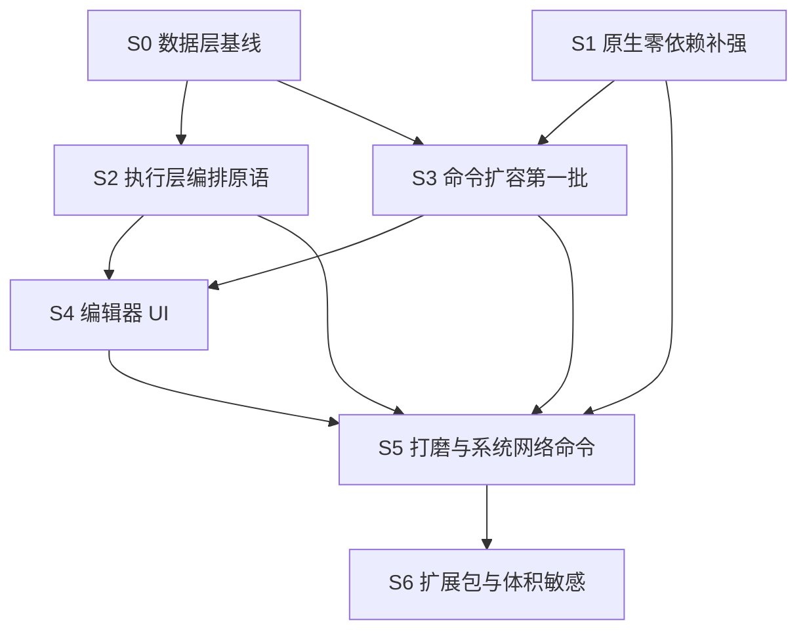

# ACRPA 逐级开发计划（统一执行序列）

> **定位**：本文件是 [`docs/方案-Quicker截图驱动的功能与工作流拓展.md`](方案-Quicker截图驱动的功能与工作流拓展.md)（下称「Quicker 篇」，2092 行）、[`docs/参考分析-zTasker-DLL复用判定与能力补强方案.md`](参考分析-zTasker-DLL复用判定与能力补强方案.md)（下称「DLL 篇」，1476 行）、[`docs/落地总清单-ACRPA能力补强与工作流拓展.md`](落地总清单-ACRPA能力补强与工作流拓展.md)（下称「总清单」，59 条 A-01~A-59）三份文档的**单一执行序列**。
> **判明性质**：总清单一文经核对为**待执行清单**（其 §8 明确记载"未改动任何源码"），且其条目与两份方案一一对应，**不是已完成记录**；本计划因此可以把它作为条目编号的权威索引复用，而不会重复造轮子。
> **核对方式**：本计划全部结论来自本轮**只读**代码/json 实读；文档行号与实际不符者一律以代码为准，并在 §0 记录。
> **写作约束**：全篇简体中文；只写「做什么 / 改哪个文件 / 依赖谁 / 怎么验收 / 排在哪一级」；不复述方案细节（细节回查原文章节）；不使用人日，只用 S/M/L 相对档位。
> **本轮未修改任何源码 / 配置 / json / spec / build 脚本**。

---

## §0 基线校正表

> 只列**与代码事实不符**或**会误导执行**的条目。判定口径：以 `文件:行号` 实读为准。

| # | 文档记载（出处） | 代码 / 文件事实 | 影响 | 本计划采用 |
| --- | --- | --- | --- | --- |
| 1 | `MAX_EXE_MB = 15.0` 在 [`build.py:21`](build.py:21)（DLL 篇 §6.1、总清单 §5） | 实际在 [`build.py:23`](build.py:23)；`:22` 是注释、`:2` 是 docstring 里的 `<15 MB` 目标 | 引用错行，不影响结论 | `build.py:23` |
| 2 | `check_exe_volume()` 在 [`build.py:32-48`](build.py:32) | 实际 [`build.py:34`](build.py:34)-[`50`](build.py:50) | 同上 | `build.py:34-50` |
| 3 | `exe_candidates()` 在 `build.py:24-29` | 实际 [`build.py:26`](build.py:26)-[`31`](build.py:31) | 同上 | `build.py:26-31` |
| 4 | `_PROJECT_MODULES` 在 `build.py:58-102` | 实际 [`build.py:60`](build.py:60)-[`104`](build.py:104) | **新增模块漏加会被静默排除**，行号错会漏看尾部 13 个 UI 模块 | `build.py:60-104` |
| 5 | 7-Zip 路径探测在 `build.py:50-55` | 实际 `_7Z_PATHS` 在 [`build.py:53`](build.py:53)-[`57`](build.py:57) | 轻微 | `build.py:53-57` |
| 6 | `cv2` 排除在 `build.py:206-207` | 实际 [`build.py:209`](build.py:209)（`:208` 是注释行） | 轻微 | `build.py:209` |
| 7 | `smtplib/imaplib/poplib` 排除在 `build.py:219` | 实际 [`build.py:221`](build.py:221) | **邮件解禁要改的行不是 219**，按错行号改会漏 | `build.py:221` |
| 8 | `cryptography/cffi/bcrypt/paramiko` 排除在 `build.py:232-234` | 实际 [`build.py:235`](build.py:235)-[`236`](build.py:236) | 轻微 | `build.py:235-236` |
| 9 | `bz2/lzma` 排除在 `build.py:264` | 实际 [`build.py:266`](build.py:266) | 轻微 | `build.py:266` |
| 10 | 「`tools/gen_command_schema.py` **需新建**」（Quicker 篇 §7.1 W0-2、总清单 A-16） | **已存在等价工具**：[`tools/export_command_schema.py`](tools/export_command_schema.py:1)（78 行，`build()` 直接遍历 `commands.list_all()`，默认写出 [`res/help/command_schema.json`](tools/export_command_schema.py:31)） | 直接新建会**重复造轮子**（本任务要防的就是这个） | W0-2 改为「**复用现有生成器 + 重跑 + 加 `--check` 漂移门禁**」，见 S0-05 |
| 11 | 「`command_schema.json` 的 `stats.commands = 68` 是现状基线」 | 文件确为 [`command_schema.json:5`](res/help/command_schema.json:5) `"commands": 68`，但生成器早已能导出 88 条 → **json 已漂移、未重跑**（`app_version` 也停在 `0.1.29-beta`，[`:2`](res/help/command_schema.json:2)） | 说明"生成器存在 ≠ 有人跑"，故 W0-2 的核心价值在**校验门禁**而非生成能力 | S0-05 先重跑再建门禁 |
| 12 | `register()` 签名写作 `register(name, description, params, handler, schema, requires)`（Quicker 篇 §3.1.3） | 实际 [`src/commands.py:110`](src/commands.py:110)：`register(name, description, params, handler=None, schema=None, requires=())` | 无实质影响（位置参数一致） | 按实际签名 |
| 13 | Quicker 篇 §4.16 `找色` 参数表为 10 项（颜色/容差/左/上/宽/高/步长/超时/动作/目标变量名） | 参数槽位硬上限 9（`.xls` 位置式；见 [`src/workflow.py:394`](src/workflow.py:394) 的 `[:9]`、[`src/scheduler.py:641`](src/scheduler.py:641) 的 `[:9]`、[`src/ui/param_form.py:62`](src/ui/param_form.py:62) 的 `_norm9`） | 按原表实现必然丢参数 | **合并 左/上/宽/高 为单个「区域」参数**（括号内逗号被 [`_split_params`](src/commands.py:40) 的深度计数保护），见 §2.7 表 |
| 14 | Quicker 篇 §5.3.1「节点类型清单（19 种）」把 `dep_check` 列为第 19 种节点类型 | `dep_check`（`检查依赖`）在 §4.6 自身定义为**命令**（走 `register`），不是步骤类型；另外 `start`/`end` 是"视图态、可选" | 演进表「节点类型 8→13→17→19」口径失真 | 修正为 **8 → 17**（含新增 9 种步骤语义：`comment`/`group`/`if`/`break`/`continue`/`return`/`call`/`subprogram`/`try`），`start`/`end` 另计为 2 个视图态，`dep_check` 归命令 |
| 15 | 演进表目标「命令数 88 → 118 → 158 → ~200」（Quicker 篇 §3.3.3） | 两份文档**明确写出参数契约的新命令共 61 条**（见 §2.7 表），其余到 200 的部分**没有任何章节给出参数表** | 200 不可验收、不可派发 | 修正为 **88 → 149（+61 条全部落地）**；`200` 降级为"未详细设计的低优先项上限"，不进本计划承诺 |
| 16 | Quicker 篇 §7.3 W2-1 判据「模块库显示 88 条（W1 后 ~110 条）」 | 与同文 §3.3.3 的「W1 后 118」自相矛盾 | 判据不可同时成立 | 统一为"模块库条目数 == `len(commands.list_names())`"，不写死数字 |
| 17 | DLL 篇 §5.4 命令注册示例 `register("控件点击", ..., "控件句柄变量 或 窗口标题+名称", ...)` | 该串无逗号 → [`_parse_param`](src/commands.py:60) 会解析成**一个**名为「控件句柄变量 或 窗口标题+名称」的参数 | schema 退化 + 验收无法写 | 按 `名称/参数(枚举)` 规范改写成 5 个具名参数（§2.7 表） |
| 18 | 总清单 A-16 判据「改注册表却不重跑生成器 → CI 失败」 | CI 现状 [`ci.yml`](.github/workflows/ci.yml:40)-[`49`](.github/workflows/ci.yml:49) 只有 `compileall` + `bump_version --verify` + `run_tests --safe`，**没有任何 schema 一致性步骤** | 该判据当前**必然为假**，需先把门禁落地 | S0-05 显式产出该 CI 步骤的插入点与脚本 |
| 19 | 总清单 §5「剩余预算 ≈ 0.7 MB」 | 推算依据是旧文档 14.3 MiB，本轮**未能核对** `dist/` 产物（工作区未见打包产物） | 体积余量属**未实测推算** | 全篇体积数字均标「推算，未实测」，并以 `build.py` 门禁为最终判据 |

**核对后确认成立的关键事实（不需要修正，作为全篇基线）**

| 事实 | 证据 |
| --- | --- |
| 注册表实际 **88** 条 = 主块 68 + L2 20 | [`src/commands.py:302`](src/commands.py:302)-[`385`](src/commands.py:385)（68）+ [`786`](src/commands.py:786)-[`830`](src/commands.py:830)（20） |
| `command_groups.json` 仅 9 组 68 条，兜底组规则在 `:3` | [`command_groups.json:3`](res/help/command_groups.json:3)、[`4`](res/help/command_groups.json:4)-[`48`](res/help/command_groups.json:48) |
| `NO_INTERP` **恰好 88 条全量登记**（含 6 条块命令登记为 `None`） | [`src/commands.py:900`](src/commands.py:900)-[`972`](src/commands.py:972)，逐条清点 = 88 |
| `_EXTERNAL_REQUIRES` 覆盖 34 条命令、9 个能力 id | [`src/commands.py:838`](src/commands.py:838)-[`865`](src/commands.py:865)；[`src/capabilities.py:341`](src/capabilities.py:341)-[`381`](src/capabilities.py:381) |
| 工作流可用步骤类型 **8** 种 | [`src/workflow.py:343`](src/workflow.py:343)-[`373`](src/workflow.py:373)（script/parallel/condition/loop/command/variable/log/wait） |
| `CONTAINER_TYPES` 只有 2 个、`K_BRANCHES` 不存在 | [`src/flow_graph.py:55`](src/flow_graph.py:55)、[`49`](src/flow_graph.py:49)-[`53`](src/flow_graph.py:53) |
| `_execute_step` 无显式返回值（隐式 `None`） | [`src/workflow.py:334`](src/workflow.py:334)-[`373`](src/workflow.py:373) |
| 模块库硬编码 8 分类 **45** 动作 + **44** 个 lambda | [`src/ui/workflow_view.py:291`](src/ui/workflow_view.py:291)-[`300`](src/ui/workflow_view.py:300)、[`596`](src/ui/workflow_view.py:596)-[`641`](src/ui/workflow_view.py:641) |
| 回归样例文件存在且无 `schema` 字段（等价 schema2） | [`template/workflow001.json`](template/workflow001.json:1)（89 行，顶层仅 `name` + `steps`） |
| CI 用 Python **3.9**、跑 `compileall` + `bump_version --verify` + `run_tests --safe` | [`ci.yml:41`](.github/workflows/ci.yml:41)、[`44`](.github/workflows/ci.yml:44)、[`49`](.github/workflows/ci.yml:49) |
| 测试自动发现规则：`tools/` 下 `_test_*.py` 与 `_smoke_*.py` | [`tools/run_tests.py:69`](tools/run_tests.py:69)-[`77`](tools/run_tests.py:77)，GUI 豁免白名单 `SAFE_HEADLESS_SMOKE` 在 [`46`](tools/run_tests.py:46) |
| `_execute_step` / `_run_loop` / `_run_parallel` / `_run_condition` / `_eval_condition` 行号全部命中 | [`442`](src/workflow.py:442)、[`534`](src/workflow.py:534)、[`556`](src/workflow.py:556)、[`569`](src/workflow.py:569)、[`593`](src/workflow.py:593)、[`615`](src/workflow.py:615) |
| `capabilities` 四态 + 9 个 probe 行号全部命中 | [`src/capabilities.py:187`](src/capabilities.py:187)、[`225`](src/capabilities.py:225)、[`236`](src/capabilities.py:236)、[`255`](src/capabilities.py:255)、[`277`](src/capabilities.py:277)、[`289`](src/capabilities.py:289)、[`301`](src/capabilities.py:301)、[`313`](src/capabilities.py:313)、[`326`](src/capabilities.py:326) |

> **未能核对项（不编造）**：`src/ACRPA.py` 全文未在本次核对中打开（体量 >4000 行），故 DLL 篇 §5.1 的 `ACRPA.py:3745/3748/3752/3756/3827-3874/3918-3977` 五处引用**沿用文档**，标为"待执行时二次核对"；`dist/` 体积未实测。

---

## §1 总览

### 1.1 统一分级（S0–S6）

> 合并规则：Quicker 篇 W0/W1/W2/W3 与 DLL 篇 P0/P1/P2 交错为**一条串行序列**；同一层内允许并行（标"并行"的条目无共享文件）。
> `S0` 的**范围以用户已确认口径为准**：数据层三件事——命令分组补齐 + schema 外置（可生成可校验）+ 模块库数据源 `module_catalog`；**不含工作流引擎改造、不含卡片视图**。故总清单的 A-34（module_catalog）提前到 S0，而 `flow_graph` 常量（A-18）顺延到 S2。

| 层 | 名称 | 目标（一句话） | 包含条目 | 依赖前置 | 触及文件 | 回归范围 | 体积预算变化（推算） | 完成判据 |
| --- | --- | --- | --- | --- | --- | --- | --- | --- |
| **S0** | 数据层基线（W0） | 让 88 条命令"分得清组、生成得出 schema、模块库读得到" | A-15 / A-16（改为复用+校验）/ A-17 / A-19 / A-34 + 新增一致性测试 + 打包清单同步（S0-01~S0-08） | 无 | [`res/help/command_groups.json`](res/help/command_groups.json:1)、[`res/help/command_schema.json`](res/help/command_schema.json:1)、`tools/`（新增门禁）、`src/ui/module_catalog.py`（新）、[`src/ui/workflow_view.py`](src/ui/workflow_view.py:291)、[`build.py:60`](build.py:60)、[`ACRPA.spec:9`](ACRPA.spec:9) | 88 条命令；`template/workflow001.json` 往返；help/palette 一致性 | 源码 +≈10 KB；json 增量 ≈+8 KB | 兜底组为空、分组=11、生成器漂移可拦、模块库条目数 == `len(list_names())` |
| **S1** | 原生能力零依赖补强（DLL P0） | 把"假就绪探测"与"零依赖缺失能力"一次清干净 | A-01~A-14 + A-21（S1-01~S1-10） | 无（与 S0 无共享文件，可并行） | `src/native_check.py`/`hotkey_win.py`/`archive_ops.py`/`priv_ops.py`/`audio_ops.py`/`screen_ops.py`（均新建）、[`src/capabilities.py`](src/capabilities.py:236)、[`src/paddle_dll.py`](src/paddle_dll.py:1)、[`src/sys_ops.py`](src/sys_ops.py:1)、[`src/commands.py`](src/commands.py:786) | 88 条命令 + 9 条新命令；四类构造环境探测 | 源码 +≈120 KB（DLL 篇口径 <150 KB） | `requirements.txt` 零改动；9 条新命令冻结版可用；无 READY-但必失败项 |
| **S2** | 执行层：编排原语与作用域（W1） | 把"线性步骤表"升级为可组合的编排语言 | A-18 / A-20 / A-22~A-30（S2-01~S2-11） | S0（分组与 schema 已可表达） | [`src/flow_graph.py`](src/flow_graph.py:46)、[`src/workflow.py`](src/workflow.py:334)、[`src/interp.py`](src/interp.py:171)、[`src/engine.py:220`](src/engine.py:220) | 旧 schema2 文件逐条不变 + 8 类节点单测 | 源码 +≈40 KB | 8 类新节点各 1 单测 + 组合用例；schema2 日志与 `_step_results` 序列零差异 |
| **S3** | 命令扩容第一批 | 补齐"薄封装即可交付"的高频命令并统一输入后端 | A-31 / A-32 / A-33 + 新增命令分组回填（S3-01~S3-05） | S0（S0-05 生成器）、S1（能力 id 已就绪） | `src/input_router.py`/`str_ops.py`/`list_ops.py`（新）、[`src/net_ops.py`](src/net_ops.py:1)、[`src/commands.py`](src/commands.py:786)、[`src/engine.py`](src/engine.py:1583) | 9 条输入命令在无 pyautogui 下可用；JSON 旧路径行为不变 | 源码 +≈25 KB | 新增命令全部进分组且过 `NO_INTERP` 门禁；旧 `a.b.c` 路径结果不变 |
| **S4** | 编辑器 UI：三栏与卡片（W2） | 参数表单从弹窗搬到常驻右栏，模块库可搜索可拖拽 | A-35~A-42（S4-01~S4-08） | S0（module_catalog）、S2（schema3 与容器结构） | [`src/ui/workflow_view.py`](src/ui/workflow_view.py:498)、`src/ui/inspector_panel.py`/`ui_bridge.py`/`form_dialog.py`/`progress_window.py`/`pane_window.py`/`step_card_view.py`/`recorder_convert.py`（均新建） | 三视图切换数据不丢；关窗脏拦截；GUI 命令非主线程不卡死 | 源码 +≈60 KB | 300 节点重绘 <16 ms；4 类节点右栏渲染与 schema 一致 |
| **S5** | 打磨与系统/网络命令 | 把"系统性缺口命令"与"运行体验"补齐 | A-43~A-50 / A-52（S5-01~S5-09） | S1（能力探测）、S2（作用域/checkpoint）、S4（GUI 基础设施） | `src/fs_watch.py`/`http_serve.py`/`mail_ops.py`（新）、[`src/workflow.py`](src/workflow.py:534)、[`src/flow_graph.py:616`](src/flow_graph.py:616)、[`build.py:221`](build.py:221)、[`ACRPA.spec:13`](ACRPA.spec:13) | 全量命令回归；真并行并发度 >1；checkpoint 可续跑 | 源码 +≈370 KB（含邮件 250 KB）→ **余量最紧的一层** | 每完成一条跑一次体积门禁仍为 0；邮件密码日志脱敏 |
| **S6** | 扩展包与体积敏感项 | 一切"装不下主包"的能力只走 `extensions_src/` | A-51 / A-53~A-59（S6-01~S6-08） | S5（邮件解禁已定调）、S1（扩展机制探测） | `extensions_src/uia/`、`ocr_rapid/`、`screen_record/`、`audio_io/`、`excel/`、`ws/`、`qrcode/`、`voice/`（均新建）+ 宿主侧 4 条命令壳 | 主包零 import 报错；未装扩展时 `probe=MISSING` | **主包增量 0**（扩展包体积不计入门禁） | 8 个扩展未装时主包 `import` 零报错、`probe` 全 MISSING |

### 1.2 依赖图

**并行说明**：`S0` 与 `S1` **无任何共享文件**（S0 只碰 `res/help/*.json`、`tools/`、`ui/module_catalog.py`、`ui/workflow_view.py`；S1 只碰 `src/*.py` 新模块 + `capabilities.py`），可同时开工；但**汇合点在 S3**：S1 新增的 9 条命令必须由 S0-05 的生成器 + S0-01 式分组回填才能进模块库。

### 1.3 层级 × 命令数 × 节点类型 × 体积增量演进（与代码核对后修正）

| 指标 | 现状（实测） | S0 后 | S1 后 | S2 后 | S3 后 | S4 后 | S5 后 | S6 后 | 文档原目标 | 修正说明 |
| --- | --- | --- | --- | --- | --- | --- | --- | --- | --- | --- |
| 注册表命令数 | **88** | 88 | 97（+9） | 97 | 107（+10） | 118（+11） | 135（+17） | **150**（+15） | 88→118→158→~200 | 200 无参数表支撑；改按 §2.7 有参数契约的 **62 条**计 → 150 |
| 已进 `command_groups.json` 的命令 | **68**（20 条裸奔在兜底组） | **88**（100%） | 97 | 97 | 107 | 118 | 135 | 150（100%） | 68→118→158→200 | S0 一次做到 100%，后续每加命令同批回填 |
| 分组数 | **9** | **11** | 11 | 11 | 13 | 13 | 15 | 16 | 11→… | S0 增 `文件与系统`/`数据与编码`；S3 增 2 组；S5 增 2 组；S6 增 `界面与剪贴板` |
| 工作流可用步骤类型 | **8** | 8 | 8 | **17** | 17 | 17 | 17 | 8→13→17→19 | 19 中含 `dep_check`（实为命令）与 `start`/`end`（视图态）→ 修正为 17 个语义类型 + 2 视图态 |
| `CONTAINER_TYPES` | **2**（parallel/loop） | 2 | 2 | **7**（+group/if/try/call/subprogram） | 7 | 7 | 7 | — | `call`/`subprogram` 为容器语义，一并计入 |
| `analyze()` code 数 | 现有 code 数**未能核对**（未逐条清点 [`analyze`](src/flow_graph.py:616) 体内 code） | 不变 | 不变 | +4（`CTRL_OUT_OF_SCOPE`/`PARALLEL_GUI`/`BAD_CONDITION`/`SUBPROGRAM_MISSING`） | 同 | 同 | 同 | 8→12 | 只承诺"增量 4 个 code"，不引用未核对的现有条数 |
| 主包体积增量（推算，未实测） | 基线 ≈14.3 MiB（旧文档） | +≈18 KB | +≈120 KB | +≈40 KB | +≈25 KB | +≈370 KB | **0** | 余量 0.7 MB | 累计 ≈573 KB → 余量 **<130 KB**，S5 逐条过门禁 |

### 1.4 硬约束声明（全层级有效，任何单条任务卡不得违反）

| # | 约束 | 判据 / 落点 |
| --- | --- | --- |
| H1 | **体积 15 MB 门禁不可破** | [`build.py:23`](build.py:23) `MAX_EXE_MB = 15.0`；[`build.py:34`](build.py:34)-[`50`](build.py:50) `check_exe_volume()` 超限返回 1 → 构建失败；S1~S5 **每一层结束必须跑一次** [`tools/_check_volume.py`](tools/_check_volume.py:1) |
| H2 | **零新增依赖优先** | `requirements.txt` 在 S0~S4 **零改动**；S5 只允许"解禁 stdlib 模块"（`smtplib`/`imaplib`/`poplib`，[`build.py:221`](build.py:221)）；任何第三方包**只准进 `extensions_src/`** |
| H3 | **schema 3 迁移不得静默** | 迁移必须用户显式触发 + 先备份 `<name>.json.bak`；旧文件（如 [`template/workflow001.json`](template/workflow001.json:1)）读入后行为逐字节不变 |
| H4 | **注册三件套齐全** | 每条新命令 = `register`（[`commands.py:110`](src/commands.py:110)）+ `requires`（[`838`](src/commands.py:838) 或 core）+ `NO_INTERP`（[`900`](src/commands.py:900)）三处齐备，缺一视为未完成（S0-06 门禁会拦） |
| H5 | **参数 ≤ 9 且写法合规** | 位置式 9 槽（[`workflow.py:394`](src/workflow.py:394)、[`scheduler.py:641`](src/scheduler.py:641)、[`param_form.py:62`](src/ui/param_form.py:62)）；枚举必须写成 `名称(A/B)`，默认值 `名称(默认X)`，可选 `名称(可选)`，否则 [`_parse_param`](src/commands.py:60) 解析退化 |
| H6 | **唯一插值入口** | 禁止新建求值通道：数据参数只走 [`engine._render_args`](src/engine.py:1151) → [`interp.interpolate`](src/interp.py:442)；条件只走 [`safe_eval.safe_eval_condition`](src/safe_eval.py:117) |
| H7 | **唯一 ctx 构造点** | 作用域改造只改 [`engine.make_interp_ctx`](src/engine.py:220)，不得旁路构造 `interp.Context` |
| H8 | **纯逻辑模块无副作用** | 新模块放在 `src/` 且 `import` 时不得拉 tkinter/pyautogui/engine（既有硬约束，校验脚本 [`tools/_test_import_side_effect_free.py`](tools/_test_import_side_effect_free.py:1) 必须仍通过） |
| H9 | **打包双清单同步** | 新模块必须同时加进 [`build.py:60`](build.py:60) `_PROJECT_MODULES` 与 [`ACRPA.spec:9`](ACRPA.spec:9) `hiddenimports`；excludes 改一处必须同步另一处（[`build.py:177`](build.py:177) ↔ [`ACRPA.spec:13`](ACRPA.spec:13)） |
| H10 | **测试必须进 CI 可见集** | 新测试按 `tools/_test_*.py` 命名（[`run_tests.py:75`](tools/run_tests.py:75) 自动发现），且不得依赖真实窗口/网络（否则只能靠 `--all`，CI 等于没跑） |

---

## §2 任务卡

> **字段定义**：层级 / 档位(S/M/L) / 依赖前置 · 目标 · 落点 · 具体改动 · 禁止事项 · 验收断言 · 回归风险与回归清单。
> **S0 粒度要求**：单次可完成、可独立验收。**S1 及以后**允许稍粗，但**每条新命令必须在 §2.7 有参数表行**。

### 2.1 S0 —— 数据层基线（第一级，W0）

#### S0-01 命令分组补齐：20 条 L2 入组 + 新增 2 组

- **层级** S0（W0-1）/ **档位 S** / **依赖前置** 无
- **目标**：`command_groups.json` 收录全部 88 条已注册命令，兜底组「其他命令」为空，分组数 11。
- **落点**：[`res/help/command_groups.json:4`](res/help/command_groups.json:4)-[`48`](res/help/command_groups.json:48)（唯一改动文件）
- **具体改动**
  1. 既有 9 组（`基础操作` … `浏览器自动化`）**组名、顺序、组内命令顺序一律不动**。
  2. 追加第 10 组 `文件与系统`（15 条，顺序照 [`commands.py:786`](src/commands.py:786)-[`830`](src/commands.py:830)）：`复制文件` `移动文件` `删除文件` `创建目录` `列出目录` `读取文本文件` `写入文本文件` `文件是否存在` `启动程序` `结束进程` `打开系统面板` `电源操作` `音量控制` `磁盘空间` `设置窗口样式`
  3. 追加第 11 组 `数据与编码`（5 条）：`HTTP 请求` `JSON 取值` `Base64 编解码` `URL 编解码` `哈希值`
  4. 命令名必须**逐字**一致，包括 `HTTP 请求` / `JSON 取值` 中的半角空格（`help_content` 对拼写不一致的名字是**静默丢弃**，见 [`src/help_content.py:450`](src/help_content.py:450)）
  5. 不改 `_comment`(`:2`) 与 `_fallback_title`(`:3`)
- **禁止事项**：不改 `src/commands.py`；不改 `command_schema.json`（由 S0-05 生成）；不重命名既有分组；不调整既有组内顺序（顺序承载"常用在前"的产品意图）；不新增除上述 2 组外的任何组。
- **验收断言**
  1. `python -c "import sys,json,io;sys.path.insert(0,'src');import commands;d=json.load(io.open('res/help/command_groups.json',encoding='utf-8'));g=[c for x in d['groups'] for c in x['commands']];print(len(g),len(set(g)),len(commands.list_names()),set(g)==set(commands.list_names()),len(d['groups']))"` → 期望 `88 88 88 True 11`
  2. `python tools/_test_help_consistency.py` 退出码 0，且**输出中不出现**"其他命令"兜底分组条目
  3. `python tools/_test_command_palette.py` 退出码 0
- **回归风险与回归清单**：风险=拼写不一致 → 命令从速查/模块库消失（不报错）。回归=`tools/_test_help_consistency.py`、`tools/_test_command_palette.py`、`tools/gen_script_template_xlsx.py`（读同一 json，需能跑通）、`tools/_smoke_help_window.py`（`--all`）。

#### S0-02 分组元数据扩展：`icon` / `tier` / `order`

- **层级** S0（W0-3）/ **档位 S** / **依赖前置** S0-01
- **目标**：每个分组带 `icon`/`tier`/`order` 三个新键，旧读取方零异常。
- **落点**：[`res/help/command_groups.json:4`](res/help/command_groups.json:4)-[`48`](res/help/command_groups.json:48)（在每组对象内追加键）
- **具体改动**
  1. 每个分组 dict 增加：`"icon"`（单个 Unicode 字符，**禁止用 emoji 图片资源**，避免打包体积）、`"tier"` ∈ `core|advanced|expert`、`"order"`（整数，与数组顺序一致）。
  2. 默认分层（S4 之前只做数据、不做隐藏行为）：`基础操作`/`流程控制`/`变量与数据处理`/`OCR 文字识别`/`文件与系统` = `core`；`窗口管理`/`代码执行`/`工作流`/`浏览器自动化`/`数据与编码` = `advanced`；`AI 增强` = `expert`。
  3. **不改** `title` / `commands` 两个既有键。
- **禁止事项**：不新增"分组级 `commands` 之外的键"（如 `subgroups`）；不改 `help_content` / `command_palette` 的读取逻辑（本卡是纯数据扩展）。
- **验收断言**
  1. `python -c "import json,io;d=json.load(io.open('res/help/command_groups.json',encoding='utf-8'));[print(x['title'],x.get('icon'),x.get('tier'),x.get('order')) for x in d['groups']]"` → 11 行全部三键非空，`order` 递增
  2. `tier` 取值集合 ⊆ `{'core','advanced','expert'}`
  3. `python tools/_test_help_consistency.py` 与 `python tools/_test_command_palette.py` 仍退 0
- **回归风险与回归清单**：风险=增加键被某个"严格校验键名"的脚本判失败。回归=`tools/_test_help_consistency.py` 的 `check_groups_json`（[`tools/_test_help_consistency.py:124`](tools/_test_help_consistency.py:124)）、`tools/gen_script_template_xlsx.py`。

#### S0-03 `src/ui/module_catalog.py`：模块库数据源适配器

- **层级** S0（原 A-34 前半）/ **档位 M** / **依赖前置** S0-01、S0-02
- **目标**：提供纯逻辑函数，把 `command_groups.json` + `command_schema.json` 转成三级树数据结构；**不 import tkinter**。
- **落点**：新建 `src/ui/module_catalog.py`（职责边界：只做"json → 树结构"的纯变换 + 失败兜底，**不碰任何 Tk 控件、不读 state、不写盘**）
- **具体改动**
  1. 新增 `load_catalog(groups_json=None, schema_json=None)` → `list[{group, icon, tier, order, items:[{cmd, desc, sig, params}]}]`；路径缺省走 `res/help/`。
  2. 新增 `iter_commands(catalog)` → 扁平 `[(group, cmd)]`，供搜索用（不在本卡接 UI）。
  3. 新增 `FALLBACK_CATEGORIES`：把现有 [`_WF_LIB_CATEGORIES`](src/ui/workflow_view.py:291)-[`300`](src/ui/workflow_view.py:300) 的 8 分类 45 动作**原样搬入**作为兜底常量（**不删** `workflow_view` 里那份，本卡不动 `workflow_view`）。
  4. 兜底规则：json 缺失/JSON 解析失败/结构非法 → 返回基于 `FALLBACK_CATEGORIES` 的等价结构，且**不抛异常**。
  5. 组内排序：**按 json 声明顺序**，不排序（`order` 只用于分组间排序）。
- **禁止事项**：不 import `tkinter` / `engine` / `workflow` / `state`；不改 `workflow_view.py`（S0-04 才改）；不引入第三方 json 库；不在本模块做 i18n。
- **验收断言**
  1. 新建 `tools/_test_module_catalog.py`：`import ui.module_catalog` 后 `sys.modules` 中无 `tkinter`（复用 [`_test_import_side_effect_free.py`](tools/_test_import_side_effect_free.py:1) 的断言写法）
  2. `len(iter_commands(load_catalog())) == 88`
  3. 分组数 11，且每个分组的 `items` 非空
  4. 把 `groups_json` 指向一个不存在路径 → 返回兜底结构、条目数 = 45 分类动作数、无异常
  5. 把 `groups_json` 指向一个内容为 `{` 的临时文件 → 同上
- **回归风险与回归清单**：风险=模块被 `ui/__init__.py` 或打包清单遗漏导致冻结版 `ModuleNotFoundError`。回归=`tools/_test_import_side_effect_free.py`、`python -m compileall -q src tools`、S0-08 的打包清单断言。

#### S0-04 模块库改数据源（`workflow_view` 接入 `module_catalog`）

- **层级** S0（原 A-34 后半）/ **档位 M** / **依赖前置** S0-03
- **目标**：模块库条目数 == `len(commands.list_names())`（当前 88），且 JSON 损坏时回退硬编码不崩。
- **落点**：[`src/ui/workflow_view.py:291`](src/ui/workflow_view.py:291)（`_WF_LIB_CATEGORIES`，保留为兜底）、[`752`](src/ui/workflow_view.py:752)（`_wf_populate_library`）、[`596`](src/ui/workflow_view.py:596)-[`641`](src/ui/workflow_view.py:641)（`_WF_LIB_ACTIONS`）
- **具体改动**
  1. `_wf_populate_library` 的数据来源改为 `module_catalog.load_catalog()`；`_WF_LIB_CATEGORIES` **保留但降级为兜底常量**（注释标明"仅当 module_catalog 失败时使用"）。
  2. 树结构从两级改为三级：`分组 → 命令`；命令节点 `iid` 改为 `"{group}|{cmd}"`（现有 `"{category}_{act}"` 格式含下划线，与命令名不会有歧义风险，但新格式显式分隔更稳）。
  3. `_WF_LIB_ACTIONS`（44 个手写 lambda）**不删除、不改动**，仅作用于"兜底路径 + 既有 44 个显示名"；新命令走**通用节点构造器**：`{"type":"command","cmd":<命令名>,"params":[""]*9}`（默认参数留空，由右栏/S4 编辑）。
  4. 命令节点右键/双击行为保持现状（`_wf_add_from_library`）。
  5. 命令名与 `_WF_LIB_ACTIONS` 显示名冲突时（如 `等待`/`循环`），**优先走 `_WF_LIB_ACTIONS` 的构造器**，否则走通用构造器。
- **禁止事项**：不改 `_wf_filter_library` 的过滤语义（S4-01 才加去抖）；不删 `_WF_LIB_CATEGORIES` 与 `_WF_LIB_ACTIONS`；不改 `_wf_add_recent` / `recent_workflow.json` 结构；不动卡片视图（S4 才建）。
- **验收断言**
  1. `python tools/_smoke_ui_introspect.py`（或 `--all` 下同类 GUI 冒烟）中，模块库叶子节点数 == 88
  2. 手工把 `command_groups.json` 临时改名为 `.bak` 启动 → 模块库仍显示 45 个兜底动作、无异常栈
  3. 双击 `复制文件` → `_wf_data["steps"]` 末项为 `{"type":"command","cmd":"复制文件","params":[9 个 ""]}`
  4. 双击 `等待` → 仍产生 `{"type":"wait","seconds":1}`（走 `_WF_LIB_ACTIONS`）
- **回归风险与回归清单**：风险=① `iid` 格式变化打破 `_wf_library_action_name`([`779`](src/ui/workflow_view.py:779)-[`782`](src/ui/workflow_view.py:782)) 的反查；② 最近使用列表按显示名记录，与新 `cmd` 对齐可能错位。回归=`_wf_add_from_library`/`_wf_library_context_menu` 手测、`tools/_test_command_palette.py`、`tools/_smoke_help_window.py`。

#### S0-05 schema 重生成 + 漂移门禁（复用既有生成器）

- **层级** S0（W0-2，**修正后口径**）/ **档位 S** / **依赖前置** S0-01（分组稳定后 json 才有意义）
- **目标**：`command_schema.json` 与注册表 88 条逐条一致，且**改注册表不重跑 → 校验失败**。
- **落点**：[`tools/export_command_schema.py:53`](tools/export_command_schema.py:53)（`main()` 加 `--check`）、[`res/help/command_schema.json`](res/help/command_schema.json:1)（重生成）、[`.github/workflows/ci.yml:46`](.github/workflows/ci.yml:46)（插入校验步骤）
- **具体改动**
  1. **不新建** `tools/gen_command_schema.py`（已存在等价实现，见 §0-10）；在 [`export_command_schema.py`](tools/export_command_schema.py:1) 增加 `--check` 子模式：`build()` 后与磁盘 json 做**结构化比对**（忽略 `app_version`），不一致打印首个差异并 `return 1`。
  2. 重跑 `python tools/export_command_schema.py`，把 `stats.commands` 从 68 更新为 88、`app_version` 更新为当前版本。
  3. CI 在「核心回归测试」步骤**之前**插入一步：`python tools/export_command_schema.py --check`。
  4. 文档头注释补一句"本文件由生成器产出，禁止手改"。
- **禁止事项**：不改 `src/commands.py` 的注册内容（生成器只读）；不改 schema 的字段名/结构（`name/description/params_text/signature/params/has_handler` 六个键是消费方契约）；不删除 `params_text`（文档直出依赖它）。
- **验收断言**
  1. `python tools/export_command_schema.py` 输出 `[OK] 已导出 88 条命令`
  2. `python -c "import json,io;d=json.load(io.open('res/help/command_schema.json',encoding='utf-8'));print(d['stats']['commands'],len(d['commands']))"` → `88 88`
  3. `python tools/export_command_schema.py --check` 退 0；随后临时删除 json 中任一命令再跑 → 退 1 且打印差异命令名
  4. `python tools/_test_command_schema.py` 退 0
- **回归风险与回归清单**：风险=json 变大后 `gen_script_template_xlsx.py`（读该 json 生成 xlsx 模板）耗时/格式变化。回归=`tools/_test_command_schema.py`、`tools/gen_script_template_xlsx.py`（若有产物校验一并跑）、`--check` 自身。

#### S0-06 `NO_INTERP` 覆盖率门禁单测

- **层级** S0（W0-6）/ **档位 S** / **依赖前置** S0-05
- **目标**：注册表每条命令都必须在 [`NO_INTERP`](src/commands.py:900) 出现；漏登记即测试失败。
- **落点**：新建 `tools/_test_no_interp_coverage.py`
- **具体改动**
  1. 断言 `set(commands.list_names()) == set(commands.NO_INTERP.keys())`，差额分别打印"缺登记"/"多余项"。
  2. 断言每条登记的**下标值**在 `0..8` 范围内（`None` 例外），且 `frozenset(spec)` 可构造（复用 [`get_no_interp`](src/commands.py:978) 的异常路径）。
  3. 断言 6 条块结构命令（`如果`/`否则`/`结束如果`/`循环开始`/`循环结束`/`跳出循环`）登记为 `None`（设计意图不可被悄悄改成 `()`）。
  4. 断言 `get_no_interp("不存在的命令")` 返回 `(False, frozenset())`（失败开放语义）。
- **禁止事项**：不改 `NO_INTERP` 内容（本卡只加测试；若测试发现真的漏登记，**先向父任务报告**再改）；不把断言写进 `src/`。
- **验收断言**
  1. `python tools/_test_no_interp_coverage.py` 退 0，输出 `88/88`
  2. 临时把 `NO_INTERP` 中 `"磁盘空间"` 注释掉 → 该测试退 1 并打印 `缺登记: ['磁盘空间']`；恢复后复跑退 0
- **回归风险与回归清单**：风险=无（纯新增测试）。回归=`tools/run_tests.py --safe` 全绿。

#### S0-07 一致性测试增强（兜底组为空 + 分组覆盖）

- **层级** S0（新增，补 W0-1 的机器判据）/ **档位 S** / **依赖前置** S0-01、S0-05
- **目标**：把"兜底组必须为空""11 组每条命令归属唯一"变成可自动执行的断言（现有 `_test_help_consistency.py` 只做**双向集合一致**，允许命令落兜底组，见其 check A）。
- **落点**：[`tools/_test_help_consistency.py:123`](tools/_test_help_consistency.py:123)（`check_groups_json` 追加断言）
- **具体改动**
  1. 新增断言：`get_command_groups()` 返回的分组标题集合中**不得出现** `_fallback_title` 值（`其他命令`）。
  2. 新增断言：每条命令在 11 组中**恰好出现一次**（不许重复、不许遗漏）。
  3. 新增断言：每个分组对象含 `icon`/`tier`/`order`（S0-02 的机器验收）。
  4. 保持既有 A/B/C 三段断言语义不变（只追加，不改）。
- **禁止事项**：不改 `check()`/`warn()`/`ok()` 输出格式（CI 日志解析依赖 `[OK]/[WARN]/[FAIL]` 前缀）；不降低既有断言强度。
- **验收断言**
  1. `python tools/_test_help_consistency.py` 退 0，且新断言以 `[OK]` 输出
  2. 临时从 json 删掉 `哈希值` → 退 1 并报"命令未归属任何分组"
- **回归风险与回归清单**：风险=该测试是 CI `--safe` 集成员，失败即 CI 红。回归=`tools/run_tests.py --safe`。

#### S0-08 打包清单同步 + 体积门禁（S0 收口）

- **层级** S0 / **档位 S** / **依赖前置** S0-03（新模块存在）
- **目标**：`ui.module_catalog` 进双清单；`python build.py` 通过且体积门禁为 0。
- **落点**：[`build.py:96`](build.py:96) 附近（`_PROJECT_MODULES` 的 UI 段，实际范围 [`60`](build.py:60)-[`104`](build.py:104)）、[`ACRPA.spec:9`](ACRPA.spec:9)（`hiddenimports`）
- **具体改动**
  1. `build.py` 的 `_PROJECT_MODULES` UI 段追加 `"ui.module_catalog"`（紧邻 `"ui.param_form"`）。
  2. `ACRPA.spec` 的 `hiddenimports` 列表同位置追加 `'ui.module_catalog'`（**两份清单必须同序同内容**）。
  3. 不改 `EXCLUDE_MODULES`（[`build.py:177`](build.py:177)）与 `ACRPA.spec:13` 的 excludes。
- **禁止事项**：不跑"顺手优化"（如把 `pyautogui` 移出依赖、解禁邮件）；不改 `MAX_EXE_MB`；不改 `hookspath`。
- **验收断言**
  1. `python tools/_check_spec_excludes.py` 退 0（spec 与 build 的 excludes/hiddenimports 对齐校验）
  2. `python build.py` 退 0，且 `python tools/_check_volume.py` 退 0（若本机无打包环境，则记录"未执行"并在 §3 检查点补跑）
  3. 冻结版启动后模块库仍显示 88 条（人工一次）
- **回归风险与回归清单**：风险=漏加 `ACRPA.spec` → 源码可用、冻结版空白（历史已踩过，见 `build.py:92`-`95` 注释）。回归=`tools/_check_spec_excludes.py`、`tools/_test_packaging_imports.py`、`tools/_check_volume.py`。

### 2.2 S1 —— 原生能力零依赖补强（DLL 篇 P0）

> 本层**与 S0 无共享文件**，可并行开工。每张卡收口时**必须**追加：新模块进 [`build.py:60`](build.py:60) + [`ACRPA.spec:9`](ACRPA.spec:9)、新命令在 `command_groups.json` 对应组回填、重跑 [`export_command_schema.py`](tools/export_command_schema.py:1)、跑 [`tools/_check_volume.py`](tools/_check_volume.py:1)。

| 编号 | 标题 | 档位 | 依赖 | 落点 | 关键改动 | 验收断言（可执行） | 禁止事项 |
| --- | --- | --- | --- | --- | --- | --- | --- |
| S1-01 | `native_check.py`（`pe_machine`/`is_x64`/`dll_loadable`/`dir_ascii_only`） | S | — | 新建 `src/native_check.py` | 读 PE `0x3C → e_lfanew+4` 得 `Machine`；`dll_loadable` 只做依赖**静态存在性**检查，绝不 `WinDLL` | 32 位样本 `pe_machine==0x14C`；x64 样本 `==0x8664`；非 PE 返回 `None`；`is_x64(32位)` 返回 `(False, 含"32 位")`；全模块 `ctypes.WinDLL` 调用计数 0 | 不加载任何 DLL；不 import tkinter |
| S1-02 | 四个 probe 改写（消除假阳性 READY） | S | S1-01 | [`src/capabilities.py:187`](src/capabilities.py:187)/[`225`](src/capabilities.py:225)/[`236`](src/capabilities.py:236)/[`255`](src/capabilities.py:255) | `_probe_paddle_dll` 增依赖+模型目录+ASCII 路径检查并在 reason 列出缺失文件名；`_probe_input_dd` 增 `is_x64`；`_probe_cv_match` 增 `sys.frozen` 判断（冻结版不再 import cv2）；`_probe_playwright` 增浏览器可执行文件检查 | 只放裸 `PaddleOCR.dll` → `BROKEN` 且 reason 含 4 个缺文件名；32 位 `dd63330.dll` → `BROKEN`；冻结环境 `cv.match` reason 含"冻结版不含 cv2"；playwright 包装了但浏览器未装 → `BROKEN`；[`tools/_test_import_side_effect_free.py`](tools/_test_import_side_effect_free.py:1) 仍退 0 | 不在 probe 里加载 DLL；不 import `paddle_dll`（保持 `capabilities` 零重依赖）；不改四态框架与 `degraded` 语义 |
| S1-03 | `ocr_consts.py` + `paddle_dll.self_check()` + OCR 自检 UI | M | S1-01/S1-02 | 新建 `src/ocr_consts.py`；改 [`src/paddle_dll.py`](src/paddle_dll.py:1)；改 `src/ui/settings/cards/advanced.py`（`_refresh_ocr_status` 行号**待执行时核对**） | 依赖/模型清单下沉单一定义（两处 `import` 同一对象）；`self_check()` 返回 `(state, reason, missing[])` 且不 `WinDLL`；设置页渲染"当前后端 + 失败原因 + 一键自检" | `paddle_dll.DEP_DLLS is capabilities.PADDLE_DEP_DLLS`；全库 grep 无第二份字面量清单；缺依赖返回 `("broken", …, [4 文件名])` | 不在 `self_check` 里加载 DLL（避免 AV 打死进程）；不动 OCR 分派顺序 |
| S1-04 | `hotkey_win.py`（`RegisterHotKey` + 三步迁移）与热字串 | L | — | 新建 `src/hotkey_win.py`；改 [`src/ACRPA.py`](src/ACRPA.py:3745) 区（行号**待执行时二次核对**）；改 `src/state.py`（加 `hotkey_backend`） | `HotkeyManager` 专用 daemon 线程跑 `GetMessage`；`WM_HOTKEY(0x0312)` → 回调 `root.after(0, …)`；`state.HOTKEY_BACKEND="poll"` 可整体回退；热字串默认关闭 | 绑 `Ctrl+Shift+F9` 触发脚本且前台记事本收不到该键；非主线程 `register` 仍能触发；`HOTKEY_BACKEND="poll"` 时日志序列与改造前逐字节等价；被占用时 UI 显示"已被其他程序占用，已退回轮询" | 不在 Tk 主线程调 `register`；钩子回调内不做 IO/日志；不引入任何 pip 依赖 |
| S1-05 | `archive_ops.py` 3 条命令（压缩/解压/列表） | M | — | 新建 `src/archive_ops.py`；注册追加在 [`src/commands.py:830`](src/commands.py:830) 之后 | `(ok,msg,value)` 契约不抛异常；**必须**实现 Zip-Slip 逐条 `realpath` 前缀校验 + `MAX_RATIO/MAX_EXTRACT/MAX_ENTRIES` 三道炸弹防护；仅 `zipfile`/`tarfile`/`gzip` | 压缩→解压后逐文件哈希一致；含 `../../evil.txt` 的恶意 zip 被拒且目标目录外零文件；1 KB→4 GB 炸弹被拦 | 不支持 `.7z`（S6-05 走本机 `7z.exe`）；不支持 `.tar.bz2/.xz`（`bz2/lzma` 在 [`build.py:266`](build.py:266) 被排除）；不实现 zip 密码为"加密级安全"的暗示 |
| S1-06 | `priv_ops.py`（「以管理员运行」+ `is_admin()`） | S | — | 新建 `src/priv_ops.py` | `ShellExecuteW(None,"runas",…)` 启动**新进程**（不提升自身）；返回后二次校验目标进程是否出现 | UAC 出现、确认后为提权进程；取消时 5 s 内返回 `(False,"用户取消了提权")` 不挂死 | 不尝试 `AdjustToken` 提权当前进程；不静默提权 |
| S1-07 | `audio_ops.py` 播放声音 + `screen_ops.py` 连续截图 | S | — | 新建 `src/audio_ops.py`、`src/screen_ops.py` | `winsound` 只支持 WAV（非 WAV 返回可读失败）；连续截图用 `PIL.ImageGrab` + `time.monotonic` 累加防漂移 + 接 `AbortSignal` | 2 s WAV 播放成功且 `async` 立即返回；`.mp3` 返回 `(False,"仅支持 WAV…")` 不抛；间隔 1 s×5 张、相邻帧差 1.0±0.15 s；中途停止 1 个间隔内终止且保留已产出文件 | 不引入 `mss`/`imageio-ffmpeg`（S6-03）；不引入 `bass.dll`；不改既有 `截屏`([`commands.py:320`](src/commands.py:320)) |
| S1-08 | `sys_ops` 追加 3 条命令（蓝牙/校时/连通性） | M | S1-01 | [`src/sys_ops.py`](src/sys_ops.py:1)（追加）+ [`src/commands.py`](src/commands.py:830) | 蓝牙走 `ctypes bthprops` 回退 PowerShell；校时**只读** SNTP（`socket`+`struct`，48 字节）；连通性 TCP 优先、DNS 次之、ICMP 可选 | 无蓝牙机器返回 `(False,"未检测到蓝牙无线电")` 且 <3 s；校时前后系统时间未被修改；TCP 开放端口 ok / 未开放 False | 永不写系统时间；不用 WinRT（违背零依赖）；「文件版本号」只做 `sys_ops` 工具函数，**不注册命令**（随 S5-08 交付） |
| S1-09 | 能力体检卡片 + 启动期 BROKEN 汇总日志 | S | S1-02 | `src/ui/settings/cards/extensions.py`（刷新链路行号**待执行时核对**）+ `src/app.py` 或 [`src/crashlog.py`](src/crashlog.py:1) | 卡片列 `label/state/reason` 与 `probe_all()` 逐条一致；启动只把 BROKEN 写**一条**汇总日志，MISSING 不吵 | 卡片内容与 `capabilities.probe_all()` 逐条一致；启动日志 BROKEN 汇总有且仅 1 条；MISSING 零日志 | 不在启动期同步跑重探测（放 daemon 线程）；不改四态语义 |
| S1-10 | S1 收口：9 条新命令分组回填 + 打包同步 + 体积门禁 | S | S1-05~S1-08 | [`res/help/command_groups.json`](res/help/command_groups.json:4)、[`build.py:60`](build.py:60)、[`ACRPA.spec:9`](ACRPA.spec:9)、[`tools/export_command_schema.py`](tools/export_command_schema.py:1) | 9 条命令按语义入组（压缩/解压/列表 → `文件与系统`；播放声音/连续截图/以管理员运行 → `文件与系统`；蓝牙/校时/连通性 → `数据与编码` 或新组）；重跑生成器；跑体积门禁 | 分组总数 == 97 且兜底组为空；`python tools/export_command_schema.py --check` 退 0；`python tools/_check_volume.py` 退 0；冻结版 9 条命令可用 | 不新增依赖；不改 `MAX_EXE_MB`；不解禁 `smtplib`（S5-06 才解禁） |

### 2.3 S2 —— 执行层：控制流与作用域（Quicker 篇 W1）

| 编号 | 标题 | 档位 | 依赖 | 落点 | 关键改动 | 验收断言 | 禁止事项 |
| --- | --- | --- | --- | --- | --- | --- | --- |
| S2-01 | `flow_graph` 节点类型常量 + `CONTAINER_TYPES` 扩项 + `K_BRANCHES` | S | S0 | [`src/flow_graph.py:46`](src/flow_graph.py:46)-[`57`](src/flow_graph.py:57) | 新增 `NODE_TYPES`；`CONTAINER_TYPES` 扩为 `("parallel","loop","group","if","try","call","subprogram")`；新增 `K_BRANCHES="__fg_branches__"` 并**必须**同时加入 `_RESERVED`([`53`](src/flow_graph.py:53))，否则 `demote` 剥键时误删 | 旧样例 `demote(promote(x))==x` 全绿（[`tools/_test_flow_graph.py`](tools/_test_flow_graph.py:1) 退 0）；新增 `group`/`if` 样例往返等价；`K_BRANCHES in fg._RESERVED` | 不改 `GRAPH_SCHEMA=2`（升 3 在 S2-10）；不改 `promote/demote` 既有 condition 分支逻辑；不引入 `node_path`（S5-03） |
| S2-02 | `_execute_step` 返回控制流信号契约 | L | S2-01 | [`src/workflow.py:334`](src/workflow.py:334)-[`373`](src/workflow.py:373) | 返回值域扩展为 `None/"break"/"continue"/"return"`；**第一步先 grep 全部 `_execute_step(` 调用点并列表记录**（已知 [`484`](src/workflow.py:484)、[`560`](src/workflow.py:560)、[`611`](src/workflow.py:611)、[`307`](src/workflow.py:307) 四处，须确认无遗漏） | 加断言 `sig in (None,"break","continue","return")`；双层循环 + group 穿透 + 子程序 return 三组用例通过；`_run_parallel` 仍显式丢弃信号 | 不在本卡实现任何新节点（只改契约与调用点）；不改 `run_workflow` 的外层循环语义 |
| S2-03 | `group` 节点（步骤组） | M | S2-02 | [`src/workflow.py`](src/workflow.py:334) 新增 `_run_group` + `_push_frame/_pop_frame` | 字段 `name/collapsed/enabled/steps/comment/variables`；`enabled=False` 整组跳过并记 1 条日志；子节点用 `K_CHILDREN` 承载 | `enabled=False` 的组内 3 步全跳过且日志含 1 条"跳过已禁用步骤组"；组级变量组外不可见；组内 `break` 穿透到外层 `loop` | 不新增保留键；不改 `_run_parallel` |
| S2-04 | `if` 节点（多分支 if/elif/else） | M | S2-02 | `src/workflow.py` 新增 `_run_if` | `branches[{when,steps}]` + `else_steps` + `exhaustive`；条件**必须**复用 [`_eval_condition`](src/workflow.py:615) | 三分支对 3 组输入各命中一次且每分支 5 步全执行；非法表达式走 else + warning 不抛；旧 `condition` 文件行为逐条不变 | 不新开 eval 通道；不改 `condition` 的 then/else 单节点语义（[`flow_graph.py:17`](src/flow_graph.py:17)-[`18`](src/flow_graph.py:18)） |
| S2-05 | `break` / `continue` / `return` 三节点 | M | S2-02 | `src/workflow.py` | 三节点返回信号串；`loop` 消费 break/continue，`subprogram` 消费 return，`group`/`if`/`try` 透传；顶层孤立信号 → 忽略 + warning | 内层 `break` 只退内层；子程序 `return 42` → 调用方 `out` 拿到 42；顶层孤立 `break` 不抛异常且检查面板列 `CTRL_OUT_OF_SCOPE` | 不在 `parallel` 内消费信号（静态检查报 error，运行时忽略）；不改行式引擎的 `跳出循环` 语义 |
| S2-06 | `loop` 三形态（`count`/`while`/`foreach`） | M | S2-02 | [`src/workflow.py:442`](src/workflow.py:442)-[`486`](src/workflow.py:486) | `mode` 分派；`foreach` 切 `items`（`splitlines` / 逗号）；`item_var`/`index_var` 写 iteration 帧；`max_iter` 保留为三重保险 | `foreach` 遍历 5 行执行 5 次且 `{var:index}` 为 0..4；空序列 0 次 + info 日志；`count`/`while` 与现状逐条一致 | 不改 [`462`](src/workflow.py:462) 的 1000 上限默认值；不改 `times` 字符串兼容性 |
| S2-07 | `subprogram` 定义 + `call` 节点 | L | S2-05 | `src/workflow.py`：`parse_workflow`([`63`](src/workflow.py:63)) 填充 `self._subprograms`；新增 `_run_call` | 调用压 `program` 帧；形参绑定 + `returns` 回写调用方 `out`；递归深度上限 16 | 传参互不污染；子程序内 `return` 后调用方继续；递归 17 层报"子程序递归过深"；子程序内设变量调用方不可见 | 不实现跨文件子程序（复用既有 `运行工作流`）；不改 `_run_script` 的全量注入语义 |
| S2-08 | 五层变量作用域 + `ScopedContext` | L | S2-03~S2-07 | [`src/interp.py:171`](src/interp.py:171)（`Context`）+ [`src/engine.py:220`](src/engine.py:220)（唯一 ctx 构造点） | 查找链 `iteration → frame → program → global`；写入"就近"；`get_var` 改为沿链查找 | 5 层查找链单测通过；旧脚本变量行为零变化（回归基线逐条一致） | 不在 `engine` 之外构造 ctx；不改 `interp.Context` 的既有 `vars/args/getenv/now` 四接口 |
| S2-09 | `try` 节点（重试 + `on_error` 三档） | M | S2-04 | `src/workflow.py` | `retry`/`retry_delay`/`on_error(停止/继续/跳到)`/`fallback_steps`；信号穿透时先跑 fallback 再冒泡（等价 `try/finally`） | 重试 2 次后成功/失败两态正确；`跳到` 执行 fallback 并跳过本 try 剩余步骤 | 不改 [`state.STOP_ON_ERROR`](src/workflow.py:312) 的默认行为；不改 `RETRY_MAX` 语义 |
| S2-10 | `schema:3` 读写与迁移（四步） | M | S2-03~S2-09 | `src/workflow.py`（`parse_workflow`/`_normalize_step`）+ [`src/flow_graph.py:46`](src/flow_graph.py:46) | ①`schema<3` 只标 `_legacy=True` 不改结构；②`promote` 把 `condition` 展开为 `if` 视图、`demote` 压回；③用户显式"升级"才改写 + 先备份 `.bak`；④`schema:3` 被旧版打开不得崩（沿用 [`workflow.py:373`](src/workflow.py:373) 的未知类型 warning） | [`template/workflow001.json`](template/workflow001.json:1) 迁移前后 `demote(promote(x))` 字段等价；schema2 文件日志与 `_step_results` 序列逐条一致；schema3 过 `_normalize_step` 不出现"未知步骤类型" | **不得静默迁移**（H3）；不改 `GRAPH_SCHEMA` 与 `flow_graph.schema` 字段的兼容读法 |
| S2-11 | `analyze()` 静态检查扩 4 个 code | M | S2-03~S2-07 | [`src/flow_graph.py:616`](src/flow_graph.py:616) | 新增 `CTRL_OUT_OF_SCOPE`（error）/`PARALLEL_GUI`（error）/`BAD_CONDITION`（warning）/`SUBPROGRAM_MISSING`（error） | 4 个各一条构造用例能报出对应 code；既有 code 行为不变（[`tools/_test_flow_analyze.py`](tools/_test_flow_analyze.py:1) 退 0） | 不改 `analyze` 返回结构 `[{code,level,nodes,message}]`；不改既有 code 名称 |

### 2.4 S3 —— 命令扩容第一批

| 编号 | 标题 | 档位 | 依赖 | 落点 | 关键改动 | 验收断言 |
| --- | --- | --- | --- | --- | --- | --- |
| S3-01 | `input_router.py` 双后端（DD + SendInput） | L | — | 新建 `src/input_router.py`；分批替换 [`src/engine.py`](src/engine.py:1583) 等 `get_pyautogui()` 调用点 | 12 动词；`resolve()` 给可解释理由（日志一次）；`_SendInputAdapter` 自己实现（含 `KEYEVENTF_UNICODE` 中文输入 + `move_to` 渐变以保 `duration` 语义）；**保留** [`get_pyautogui`](src/engine.py:308) 不删 | 未装 pyautogui 时 9 条输入命令全可用；「写入」中文不依赖剪贴板；悬停 500 px/0.5 s 实测 0.5±0.1 s 且为渐变；`input_mode=dd` 但 DLL 缺失时日志出现"回退 SendInput" |
| S3-02 | JSONPath 子集增强「JSON 取值」 | S | — | [`src/net_ops.py`](src/net_ops.py:1) | 纯函数 `json_path()`；支持 `$.k` / `$.k[i]` / `$[*]` / `$..k` / `$[?(k=值)]`；**只增强不新增命令**，保持 4 个参数位置 | 5 种语法各 1 单测；旧 `a.b.c`（无 `$`）行为不变；10 MB JSON < 300 ms；未命中写默认值（兼容现状） |
| S3-03 | `str_ops.py` 薄封装命令族（8 条） | S×8 | S0-05 | 新建 `src/str_ops.py`；注册追加 + 分组回填 | `生成GUID`/`随机数`/`计算时间`/`字符信息`/`正则提取`/`文本模板`/`文本转列表`/`列表转文本`（参数见 §2.7） | 每条 1 单测：GUID 1000 次无重复；随机数区间闭包；`{date:}` 全表（[`interp.DATE_MAP`](src/interp.py:54)-[`67`](src/interp.py:67)）可用；非法正则返回 `BAD_REGEX` 不抛栈；往返转换幂等 |
| S3-04 | `list_ops.py` 列表操作（含 9 种操作） | M | S3-03 | 新建 `src/list_ops.py`；注册「列表操作」 | 9 种操作按 `操作(枚举)` 分派；列表表示与 `列出目录`([`commands.py:794`](src/commands.py:794)) 一致（`\n` 分行） | 9 种操作各 1 单测；10 万元素排序 < 300 ms；去重保序；删除不存在元素不失败只记 info |
| S3-05 | S3 收口：分组回填 + 生成器重跑 + 门禁 | S | S3-01~S3-04 | 同 S0-01/S0-05 的落点 | 新增 10 条命令入组（新增 2 组：`文本与数据变换`、`输入与设备`）；重跑生成器；跑 `NO_INTERP` 覆盖门禁与体积门禁 | 命令数 107、分组 13、兜底组为空；`--check` 退 0；`_test_no_interp_coverage.py` 退 0 |

### 2.5 S4 —— 编辑器 UI：三栏与卡片

| 编号 | 标题 | 档位 | 依赖 | 落点 | 关键改动 | 验收断言 |
| --- | --- | --- | --- | --- | --- | --- |
| S4-01 | 模块库交互增强（`Ctrl+F`/悬停/拖拽/折叠持久化/去抖） | M | S0-04 | [`src/ui/workflow_view.py:517`](src/ui/workflow_view.py:517)（`wf_lib_tree`）、[`774`](src/ui/workflow_view.py:774)（`_wf_filter_library`）、[`2100`](src/ui/workflow_view.py:2100)（tooltip 助手） | 5 项增强；搜索 `<KeyRelease>` 加 120 ms 去抖；搜索态强制全展开且**不写回**折叠状态 | 5 项各有可测行为；折叠状态重启后保持；搜索后折叠偏好未被覆盖 |
| S4-02 | `ui_bridge.py`（GUI 主线程回投基础设施） | M | — | 新建 `src/ui/ui_bridge.py` | `call(fn)` 经 `root.after(0,…)` + `threading.Event` 阻塞等待；`root` 不可用统一返回 `NO_GUI`；范式对齐 [`set_danger_confirm_hook`](src/engine.py:126) | 非主线程调用不卡死；无 GUI 时返回 `NO_GUI` 而非异常；连续 1000 次调用无线程泄漏 |
| S4-03 | `inspector_panel.py` 右栏（复用 `build_arg_form`） | L | S0-04、S4-02 | 新建 `src/ui/inspector_panel.py`；改 [`workflow_view.py:1443`](src/ui/workflow_view.py:1443)（`_wf_edit_step` 改为"定位右栏"） | 六区块：选中摘要/`title`/`comment`/`build_arg_form`([`param_form.py:187`](src/ui/param_form.py:187))/变量三层/外观（可选延后）；选中变化 `frame.destroy()` 重建而非 update | `group`/`if`/`call`/`command` 四类各渲染正确；控件与 [`commands.schema`](src/commands.py:175) 一致；切换选中无残留控件 |
| S4-04 | 拾取器族：`表单`/`弹出菜单`/`屏幕拾取`/`等待按键` | L | S4-02 | 新建 `src/ui/form_dialog.py`；`屏幕拾取` 用全屏 `Toplevel`；`等待按键` 复用 [`src/recorder.py:349`](src/recorder.py:349) 钩子范式 | 全部经 `ui_bridge`；`Esc` 取消；多显示器用**虚拟屏坐标**；`等待按键` 必须 `finally` 卸载钩子 | 并行步骤中调用不卡死（各 1 用例）；副屏（负坐标）拾取正确；`Esc` 后无残留置顶窗；`等待按键` 连续 100 次无句柄泄漏 |
| S4-05 | 进度条 + 操作窗 | M | S4-02 | 新建 `src/ui/progress_window.py`、`src/ui/pane_window.py` | 三合一动作 `显示/更新/关闭`；句柄注册表；`STALE_HANDLE` 不崩；可取消时置 `state.quit2` 由 [`_chk`](src/workflow.py:256) 打断 | 确定模式推进到 100% 自动关闭；用户关窗后 `更新` 返回 `STALE_HANDLE`；点取消 3 s 内中断；`模式=滚动` + `关闭=是` 即等待窗（不单列命令） |
| S4-06 | `step_card_view.py` 卡片视图（第三视图） | L | S4-03、S2-10 | 新建 `src/ui/step_card_view.py`；改 [`workflow_view.py:891`](src/ui/workflow_view.py:891) 渲染入口 | 三视图共享同一 `Graph`，卡片视图走 `_wf_data → promote → 渲染` 单向流；单 Canvas 自绘 + 可视区虚拟化；类型色复用 [`_FLOW_COLORS`](src/ui/workflow_view.py:218) / [`_FLOW_ICONS`](src/ui/workflow_view.py:228)；必须实现 `refresh_theme` | 300 节点滚动重绘 < 16 ms；三视图切换数据不丢；卡片类型色与 `_FLOW_COLORS` 同源；换肤后颜色更新 |
| S4-07 | 录制 → 步骤树（`rows_to_steps`/`compress_steps`/`suggest_groups`） | M | S2-10 | 新建 `src/recorder_convert.py` | 纯函数；`suggest_groups` **只产建议不改结构** | 录制 50 步 → 转树 → 运行，`_step_results` 序列与直接跑行式脚本一致；`suggest_groups` 未自动改动数据 |
| S4-08 | 脏标记 + 快捷键（含 `10-快捷键.md` 只追加 5 行） | S | S4-06 | [`workflow_view.py:1386`](src/ui/workflow_view.py:1386)（`_wf_save`）、[`res/help/10-快捷键.md`](res/help/10-快捷键.md:27) | 关窗 `WM_DELETE_WINDOW` 三选一；页签 `•` 前缀；`Ctrl+F`/`Ctrl+S`/`Esc`/`Ctrl+Shift+G`/`Ctrl+Shift+R`；撤销栈 100 步 | 关窗脏数据拦截生效；5 键可用且无冲突（`Ctrl+K` 已在 [`ACRPA.py:2036`](src/ACRPA.py:2036) 占用，**不得**绑到卡片视图）；`10-快捷键.md` 既有行一处未改 |

### 2.6 S5 / S6 —— 打磨、系统网络命令、扩展包

| 编号 | 标题 | 档位 | 依赖 | 落点 | 验收要点 |
| --- | --- | --- | --- | --- | --- |
| S5-01 | 系统类命令族 6 条（`文件监控`/`查找窗口`/`服务控制`/`进程信息`/`输入法状态`/`系统路径`） | M×6 | S3-05 | 新建 `src/fs_watch.py`；其余追加到 [`src/sys_ops.py`](src/sys_ops.py:1) + [`src/commands.py`](src/commands.py:830)；`查找窗口` **复用** [`_find_window_by_pattern`](src/engine.py:2501) | 各条按 §2.7 参数表 + 原文验收；`文件监控`/`屏幕拾取`/`等待按键`/`HTTP服务` 四条各含"连续调用 N 次无句柄增长"；`服务控制` 拒绝 `RpcSs`/`Winlogon` 等受保护服务 |
| S5-02 | 网络类命令 3 条（`HTTP服务`/`AI对话`/`HTML取值`） | M×3 | S3-05 | 新建 `src/http_serve.py`；`AI对话` 追加到 `src/ai_enhance.py`/`commands.py` | `HTTP服务`：`curl` 返回文件、URL 编码的 `../../` 返 403、端口占用 `PORT_BUSY`、默认仅绑 127.0.0.1、`启动` 立即返回；`AI对话` 无 key 时成功且空串 + warning，`失败即停=是` 时失败；`HTML取值` 用 stdlib `html.parser` 子集 |
| S5-03 | 断点续跑（checkpoint + `node_path`） | L | S2-10 | 新建 `src/wf_checkpoint.py`；[`src/flow_graph.py`](src/flow_graph.py:616) 加 `node_path()` | 每完成一个**顶层**节点落 1 次 checkpoint；重启可从失败节点继续；`parallel` 内节点不可续跑（UI 明示）；`node_path` 用下标链不用节点 id |
| S5-04 | 真并行（变量快照 + join + 冲突告警） | L | S2-08 | [`src/workflow.py:534`](src/workflow.py:534)-[`591`](src/workflow.py:591) | 去掉 [`556`](src/workflow.py:556) 的全局 `lock` 串行化；分支 copy-on-write 快照；同名变量冲突按 `steps` 顺序覆盖 + warning 列冲突键；日志时间戳证明并发度 >1 |
| S5-05 | 专家层收纳（tier 分层隐藏） | S | S4-01 | `src/ui/module_catalog.py` + `workflow_view.py` | `core` 默认展开 / `advanced` 折叠 / `expert` 默认隐藏；搜索时忽略 tier |
| S5-06 | 邮件（`mail_ops.py` + 解禁 3 个 stdlib 模块） | M | S1-02 | 新建 `src/mail_ops.py`；改 [`build.py:221`](build.py:221) **删除** `smtplib`/`imaplib`/`poplib`；同步 [`ACRPA.spec:13`](ACRPA.spec:13) | StartTLS 发纯文本 + 1 附件成功；日志密码 `***`（复用 [`interp.redact`](src/interp.py:144)）；密码不落 `config.json` 明文；`_check_volume.py` 退 0 |
| S5-07 | 气泡通知 + 注册表读/写 | S | S1-06 | [`src/commands.py`](src/commands.py:830)（复用 `src/tray.py` 的 `Shell_NotifyIconW`） | 托盘气泡弹出；标题/内容过长截断不报错；写注册表必须二次确认（复用 [`set_danger_confirm_hook`](src/engine.py:126)）且默认限 `HKCU` |
| S5-08 | 帮助文档同步 | M | 各条完成 | [`res/help/01-命令速查.md`](res/help/01-命令速查.md:1)（运行时生成，无需手改）、[`04-工作流.md`](res/help/04-工作流.md:1)（按节点类型分节）、[`10-快捷键.md`](res/help/10-快捷键.md:27)（S4-08 已追加） | 命令速查随注册表自动更新（[`sections.json:3`](res/help/sections.json:3) `dynamic:"commands"`）；`04-工作流.md` 覆盖 17 类节点 |
| S5-09 | S5 收口：分组回填 + 生成器 + 体积门禁 + 全量回归 | S | S5-01~S5-08 | 同 S0-01/S0-05 | 命令 135、分组 15；每完成一条跑一次 `_check_volume.py` 仍为 0；`run_tests.py --safe` 全绿 |
| S6-01 | `uia` 扩展包 + 宿主侧 4 条命令壳 | L | S5-09 | 新建 `extensions_src/uia/`、`src/uia_backend.py`；[`src/capabilities.py`](src/capabilities.py:381) 追加 `uia` 能力 | 未装 `comtypes` 时 4 条命令带 ⚠ 且提示可读；`probe("uia")` 未装=MISSING、装但 `GetModule` 失败=BROKEN；UIA 调用必须 worker 线程 + 超时 |
| S6-02 | `rapidocr` 第 5 后端（代码支持、默认不打包） | M | S6-01 | [`src/ocr_backend.py`](src/ocr_backend.py:210) 分派 + `extensions_src/ocr_rapid/` | 未装时 `_backend_order` 与改造前**逐元素相同**；装后 + 偏好设为 rapidocr 时「识别文字」返文本 |
| S6-03 | 真录屏扩展（`mss` + `imageio-ffmpeg`） | L | S6-01 | 新建 `extensions_src/screen_record/` | 未装时 `probe("screen.record")=MISSING` 且主包零 import 报错；扩展说明明示 ffmpeg 为 GPL 构建、不得随发行包分发 |
| S6-04 | 录音扩展（`sounddevice`） | M | S6-01 | 新建 `extensions_src/audio_io/` | 同上（未装 MISSING、主包零 import 报错） |
| S6-05 | `.7z` 支持（`subprocess` 调本机 `7z.exe`） | S | S1-05 | `src/archive_ops.py` 扩展；复用 [`build.py:53`](build.py:53)-[`57`](build.py:57) 的 `_7Z_PATHS` | 打包/解包往返一致；无 `7z.exe` 时给可读提示；不引入 `py7zr`（LGPL 争议） |
| S6-06 | 找色 + 找图 ROI/多分辨率自适应 | M | S1-07 | [`src/screen_ops.py`](src/screen_ops.py:1) 扩展（**不新建 `src/find_color.py`**） | 全屏找 `#FF0000` 1920×1080 步长 2 < 150 ms；容差 0 不误命中邻近色；冻结版（无 cv2）可用 |
| S6-07 | 上下文敏感热键（等价 `#HotIf`） | M | S1-04 | `src/hotkey_win.py` 扩展 | 记事本前台时热键生效、浏览器前台时不生效 |
| S6-08 | 扩展包族（Excel / Websocket / 二维码 / 语音） | L | S6-01 | `extensions_src/excel/`、`ws/`、`qrcode/`、`voice/` | 各扩展未装时对应命令 `MISSING`、主包零 import 报错；`openpyxl`/`websocket-client`/`qrcode`/`pyzbar`/`sounddevice` **一律不进主包** |

### 2.7 新增命令参数契约总表（61 条，全部 ≤ 9 参）

> 列说明：**参数串**可直接作为 `register()` 第 3 个实参（写法必须触发 [`_parse_param`](src/commands.py:60) 的枚举/默认值/可选识别）；**NO_INTERP** 是 0 基下标元组（`None`=整条禁插值）；**requires** 为能力 id（`core` 表示主包内置）。
> **每条命令交付时必须同时**：`register` + `_EXTERNAL_REQUIRES`（非 core 时）+ `NO_INTERP` 登记 + `command_groups.json` 入组 + 重跑生成器。

| # | 命令 | 参数串 | NO_INTERP | requires | 落点 | 首交付层 |
| --- | --- | --- | --- | --- | --- | --- |
| 1 | `压缩文件` | `源路径, 输出路径, 格式(zip/tar.gz), 覆盖(是/否), 密码(可选)` | `(2, 3)` | core | `src/archive_ops.py` | S1-05 |
| 2 | `解压文件` | `压缩包路径, 目标目录, 覆盖(是/否), 目标变量名(可选)` | `(2, 3)` | core | `src/archive_ops.py` | S1-05 |
| 3 | `压缩包列表` | `压缩包路径, 目标变量名` | `(1,)` | core | `src/archive_ops.py` | S1-05 |
| 4 | `以管理员运行` | `程序路径, 参数(可选), 工作目录(可选), 等待结束(是/否), 超时秒(默认30)` | `(3,)` | `win32` | `src/priv_ops.py` | S1-06 |
| 5 | `播放声音` | `文件路径(可选), 频率(默认800), 时长毫秒(默认200), 循环(是/否), 等待结束(是/否)` | `(3, 4)` | `audio.play` | `src/audio_ops.py` | S1-07 |
| 6 | `连续截图` | `保存目录, 间隔秒(默认2), 张数(默认30), 左(可选), 上(可选), 宽(可选), 高(可选), 前缀(可选)` | `()` | core | `src/screen_ops.py` | S1-07 |
| 7 | `蓝牙设备` | `目标变量名(默认bt_devices)` | `(0,)` | `bluetooth` | `src/sys_ops.py` | S1-08 |
| 8 | `校时检查` | `NTP服务器(可选), 目标变量名(默认ntp_offset)` | `(1,)` | `net.http` | `src/sys_ops.py` | S1-08 |
| 9 | `连通性检测` | `模式(tcp/ping/dns), 主机, 端口(可选), 超时秒(默认5), 目标变量名(默认conn)` | `(0, 4)` | `net.http` | `src/sys_ops.py` | S1-08 |
| 10 | `生成GUID` | `格式(标准/无横线/带花括号), 大写(是/否), 目标变量名(默认guid)` | `(0, 1, 2)` | core | `src/str_ops.py` | S3-03 |
| 11 | `随机数` | `类型(整数/小数/字符串), 最小值, 最大值, 长度(可选), 目标变量名(默认rand)` | `(0, 4)` | core | `src/str_ops.py` | S3-03 |
| 12 | `计算时间` | `基准(now/变量名), 偏移量(默认0), 单位(秒/分/时/天), 格式(可选), 目标变量名(默认datetime)` | `(0, 2, 4)` | core | `src/str_ops.py` | S3-03 |
| 13 | `字符信息` | `源变量, 模式(字符/字/行/词), 目标变量名(默认char_info)` | `(0, 1, 2)` | core | `src/str_ops.py` | S3-03 |
| 14 | `正则提取` | `源变量, 表达式, 分组序号或名(可选), 全部匹配(是/否), 目标变量名(默认regex_result)` | `(0, 3, 4)` | core | `src/str_ops.py` | S3-03 |
| 15 | `文本模板` | `模板, 目标变量名(默认text)` | `(1,)` | core | `src/str_ops.py` | S3-03 |
| 16 | `文本转列表` | `源变量, 分隔符(可选), 目标变量名(可选)` | `(0, 2)` | core | `src/list_ops.py` | S3-03 |
| 17 | `列表转文本` | `源变量, 分隔符(可选), 目标变量名(可选)` | `(0, 2)` | core | `src/list_ops.py` | S3-03 |
| 18 | `输入框` | `提示文字, 默认值(可选), 目标变量名(默认input_value), 超时秒(默认0)` | `(2,)` | core | `src/ui/form_dialog.py` | S4-04 |
| 19 | `确认框` | `标题, 内容, 类型(提示/确认/警告), 默认按钮(是/否), 目标变量名(默认confirm_result)` | `(2, 3, 4)` | core | `src/ui/form_dialog.py` | S4-04 |
| 20 | `选择项` | `提示, 候选, 目标变量名(默认choice), 多选(是/否)` | `(2, 3)` | core | `src/ui/form_dialog.py` | S4-04 |
| 21 | `选择文件` | `初始目录(可选), 过滤器(可选), 多选(是/否), 目标变量名(默认file_path)` | `(2, 3)` | core | `src/ui/form_dialog.py` | S4-04 |
| 22 | `选择文件夹` | `初始目录(可选), 标题(可选), 目标变量名(默认folder_path)` | `(2,)` | core | `src/ui/form_dialog.py` | S4-04 |
| 23 | `表单` | `标题(可选), 字段定义, 目标变量前缀(默认form), 宽(默认420), 校验(无/必填), 超时秒(默认0), 取消变量名(默认form_cancelled)` | `(2, 4, 6)` | core | `src/ui/form_dialog.py` | S4-04 |
| 24 | `弹出菜单` | `菜单项, 标题(可选), 目标变量名(默认menu_result), 超时秒(默认0), 位置(光标/居中/指定), 坐标(可选)` | `(2, 4, 5)` | core | `src/ui/workflow_view.py` 之外的 `src/ui/menu_popup.py`（新建） | S4-04 |
| 25 | `屏幕拾取` | `模式(坐标/颜色/窗口/区域), 目标变量名(默认picked), 提示文字(可选), 显示放大镜(是/否), 超时秒(默认0)` | `(0, 1, 3)` | core | `src/ui/picker.py`（新建） | S4-04 |
| 26 | `等待按键` | `允许键(可选), 超时秒(默认30), 目标变量名(默认wait_key), 吞掉按键(是/否), 修饰键(可选)` | `(2, 3)` | core | `src/recorder.py`（复用钩子）+ `commands.py` | S4-04 |
| 27 | `进度条` | `动作(显示/更新/关闭), 标题(可选), 当前值(默认0), 最大值(默认100), 模式(确定/滚动), 可取消(是/否), 句柄变量名(默认progress_handle)` | `(0, 4, 5, 6)` | core | `src/ui/progress_window.py` | S4-05 |
| 28 | `操作窗` | `动作(打开/更新/关闭), 标题(可选), 内容(可选), 按钮(可选), 位置(居中/右上/右下/跟随鼠标), 结果变量名(默认pane_result), 句柄变量名(默认pane_handle)` | `(0, 4, 5, 6)` | core | `src/ui/pane_window.py` | S4-05 |
| 29 | `文件监控` | `目录, 事件(新增/删除/修改/重命名/全部), 过滤(可选), 递归(是/否), 超时秒(默认60), 目标变量名(默认fs_event), 忽略已有(是/否)` | `(1, 5, 6)` | core | `src/fs_watch.py` | S5-01 |
| 30 | `查找窗口` | `标题(可选), 类名(可选), 进程名(可选), 模式(首个/全部/前台), 仅可见(是/否), 句柄变量名(默认win_hwnd), 详情变量名(默认win_info)` | `(3, 4, 5, 6)` | core | `src/sys_ops.py`（复用 `engine._find_window_by_pattern`） | S5-01 |
| 31 | `服务控制` | `动作(查询/启动/停止/重启), 服务名, 超时秒(默认30), 目标变量名(默认svc)` | `(0, 3)` | `win32` | `src/sys_ops.py` | S5-01 |
| 32 | `进程信息` | `模式(是否存在/PID/内存/启动时间/前台/列表), 进程名(可选), 目标变量名(默认proc), 详情变量名(默认proc_list)` | `(0, 2, 3)` | `proc.kill` | `src/sys_ops.py` | S5-01 |
| 33 | `输入法状态` | `动作(读取/切英文/切中文/切全角/切半角), 目标变量名(默认ime), 窗口句柄变量名(可选)` | `(0, 1, 2)` | `win32` | `src/sys_ops.py` | S5-01 |
| 34 | `系统路径` | `类型(桌面/文档/下载/临时/程序/用户/AppData), 目标变量名(默认sys_path)` | `(0, 1)` | core | `src/sys_ops.py` | S5-01 |
| 35 | `HTTP服务` | `动作(启动/停止/查询), 端口(默认8765), 根目录(可选), 绑定地址(默认127.0.0.1), 允许上传(是/否), 令牌(可选), 句柄变量名(默认http_handle), 日志变量名(默认http_last)` | `(0, 1, 2, 3, 4, 6, 7)` | core | `src/http_serve.py` | S5-02 |
| 36 | `AI对话` | `提示词, 系统提示(可选), 模型(可选), 温度(默认0.3), 超时秒(默认60), 目标变量名(默认ai_reply), 失败即停(是/否)` | `(5, 6)` | core | `src/ai_enhance.py` | S5-02 |
| 37 | `HTML取值` | `源, 选择器, 属性(可选), 目标变量名(默认html_value), 超时秒(默认30)` | `(2, 3)` | `net.http` | `src/net_ops.py` | S5-02 |
| 38 | `发送邮件` | `SMTP服务器, 端口(默认587), 加密(ssl/starttls/无), 用户名, 密码变量名, 收件人, 主题, 正文, 附件路径(可选)` | `(2, 4)` | `net.smtp` | `src/mail_ops.py` | S5-06 |
| 39 | `气泡通知` | `标题, 内容, 图标(info/warning/error), 停留毫秒(默认5000)` | `(2,)` | `win32` | `src/commands.py`（复用 `src/tray.py`） | S5-07 |
| 40 | `读注册表` | `键路径, 值名(可选), 目标变量名(默认reg_value)` | `(2,)` | `win32` | `src/sys_ops.py` | S5-07 |
| 41 | `写注册表` | `键路径, 值名, 值, 类型(string/dword/expand), 确认(是/否)` | `(3, 4)` | `win32` | `src/sys_ops.py` | S5-07 |
| 42 | `检查依赖` | `依赖项, 缺失时(报错/下载/跳过), 下载目录(可选), 超时秒(默认30), 校验(无/大小/SHA256), 目标变量名(默认dep_result)` | `(1, 2, 4, 5)` | `net.http` | `src/dep_ops.py`（新建） | S5-02 |
| 43 | `数据库查询` | `数据库路径, SQL, 参数(可选), 最大行数(默认1000), 输出格式(JSON/CSV/竖线), 目标变量名(默认db_rows), 超时秒(默认30)` | `(0, 1, 4, 5)` | core | `src/db_ops.py`（新建） | S5-02 |
| 44 | `列表操作` | `源变量, 操作(追加/插入/删除/排序/去重/过滤/切片/计数/反转), 参数(可选), 目标变量名(可选)` | `(0, 1, 3)` | core | `src/list_ops.py` | S3-04 |
| 45 | `多步骤输入` | `序列, 按键间隔(默认0.02), 模式(auto/direct/simulate), 出错即停(是/否)` | `(2, 3)` | core | `src/input_seq.py`（新建） | S3-01 |
| 46 | `屏幕取色` | `x(可选), y(可选), 格式(HEX/RGB/HSV), 目标变量名(默认color)` | `(2, 3)` | core | `src/screen_ops.py` | S6-06 |
| 47 | `颜色转换` | `源颜色, 目标格式(HEX/RGB/HSV/HSL), 容差(默认0), 对比色(可选), 目标变量名(默认color2)` | `(1, 4)` | core | `src/screen_ops.py` | S6-06 |
| 48 | `找色` | `颜色, 容差(默认10), 区域(左,上,宽,高 可空), 步长(默认1), 超时秒(默认10), 动作(返回坐标/点击/悬停), 目标变量名(默认color_pos)` | `(5, 6)` | core | `src/screen_ops.py`（**不新建 `find_color.py`**） | S6-06 |
| 49 | `图片信息` | `源, 目标变量前缀(默认img)` | `(1,)` | core | `src/img_ops.py`（新建） | S6-08 |
| 50 | `显示图片` | `源, 标题(可选), 最大宽高(默认800x600)` | `()` | core | `src/ui/img_view.py`（新建） | S6-08 |
| 51 | `写入剪贴板` | `内容, 类型(文本/文件列表), 追加(是/否)` | `(1, 2)` | core | `src/clip_ops.py`（新建） | S6-08 |
| 52 | `剪贴板文件` | `目标变量名(默认clip_files), 分隔符(可选)` | `(0, 1)` | core | `src/clip_ops.py` | S6-08 |
| 53 | `文件放入剪贴板` | `路径, 操作(复制/剪切)` | `(1,)` | `win32` | `src/clip_ops.py` | S6-08 |
| 54 | `等待剪贴板变化` | `原内容(可选), 超时秒(默认30), 目标变量名(默认clip)` | `(2,)` | `win32` | `src/clip_ops.py` | S6-08 |
| 55 | `定位文件` | `路径` | `()` | core | `src/commands.py`（`explorer /select,`） | S6-08 |
| 56 | `获取选中文本` | `目标变量名(默认sel_text), 还原剪贴板(是/否)` | `(0, 1)` | `win32` | `src/clip_ops.py` | S6-08 |
| 57 | `停止工作流` | `名称(可选)` | `()` | core | [`src/workflow.py:244`](src/workflow.py:244) 的 `workflow_engine.stop` | S5-02 |
| 58 | `获取浏览器网址` | `目标变量名(默认browser_url)` | `(0,)` | `browser.playwright` | `src/browser_backend.py` | S5-02 |
| 59 | `控件查找` | `窗口标题, 名称(可选), AutomationId(可选), 控件类型(可选), 超时秒(默认5), 目标变量名(默认控件)` | `(3, 5)` | `uia` | `src/uia_backend.py` | S6-01 |
| 60 | `控件点击` | `窗口标题, 名称(可选), AutomationId(可选), 控件类型(可选), 超时秒(默认5)` | `(3,)` | `uia` | `src/uia_backend.py` | S6-01 |
| 61 | `控件赋值` | `窗口标题, 名称(可选), AutomationId(可选), 值, 超时秒(默认5)` | `(2,)` | `uia` | `src/uia_backend.py` | S6-01 |
| 62 | `控件取文本` | `窗口标题, 名称(可选), AutomationId(可选), 目标变量名(默认控件文本), 超时秒(默认5)` | `(3,)` | `uia` | `src/uia_backend.py` | S6-01 |

**已有命令的增强（不新增命令，不走本表计数）**

| 命令 | 增强 | 参数是否变 | 落点 | 层 |
| --- | --- | --- | --- | --- |
| `JSON 取值` | 支持 JSONPath 5 种子集，旧 `a.b.c` 行为不变 | **不变**（4 参） | [`src/net_ops.py`](src/net_ops.py:1) | S3-02 |
| `Base64 编解码` | 加 `类型(文本/文件)`，覆盖"图片 ↔ Base64" | 3→4 参（需同步 `NO_INTERP` 下标） | `src/net_ops.py` | S3-02 |
| `找图` / `区域找图` / `点图` / `区域点图` | ROI + 多分辨率自适应（冻结版无 cv2 → Pillow / `cv.match` 扩展） | 不变 | [`src/engine.py`](src/engine.py:2501) 附近 | S6-06 |

> **计数口径（逐层，与 §1.3 一致）**：本表 **62 行 = 62 条新命令**，分布如下——**S1 = 9 条**（#1-#9）、**S3 = 10 条**（#10-#17 + #44 + #45）、**S4 = 11 条**（#18-#28）、**S5 = 17 条**（#29-#43 + #57 + #58）、**S6 = 15 条**（#46-#56 + #59-#62）。故 88 + 62 = **150**（S0/S2 不新增命令，只做数据层与执行层）。
> **与文档原目标的差异**：Quicker 篇 §3.3.3 写「~200」，但该文 **没有任何章节为第 151~200 条命令给出参数表**；本计划只承诺**有参数契约的 62 条**，其余列为"未详细设计的低优先项"，不派发、不验收（见 §0-15）。

---

## §3 逐级执行顺序与中断点

> **规约**：**每一级（S0~S6）全部任务卡完成 → 必须停下来汇报**，汇报内容固定为 5 项（见下），父任务确认后才进入下一级。禁止跨级连环改。

### 3.1 中断点与回归基线

| 检查点 | 触发时机 | 必跑回归（回归基线） | 汇报必含 5 项 |
| --- | --- | --- | --- |
| **CP0**（S0 结束） | S0-08 完成 | ① `python tools/run_tests.py --safe`（**88 条命令回归**，CI 用 Python 3.9，本机同版本优先）② `python -m compileall -q src tools` ③ `python tools/_test_help_consistency.py` ④ `python tools/_test_command_palette.py` ⑤ `python tools/export_command_schema.py --check` ⑥ `python tools/_test_no_interp_coverage.py` ⑦ `python tools/_test_flow_graph.py`（`template/workflow001.json` 往返不变）⑧ `python tools/_check_volume.py` | 1) 任务卡完成清单 2) 各回归命令退出码 3) 命令数/分组数/兜底组状态 4) 体积门禁结果 5) 偏离计划的偏差项 |
| **CP1**（S1 结束） | S1-10 完成 | CP0 全部 + ⑨ 四类构造环境探测（裸 `PaddleOCR.dll` / 32 位 `dd63330.dll` / 冻结环境 / playwright 无浏览器）⑩ 冻结版 9 条新命令可用 | 同上 + 探测四态输出 |
| **CP2**（S2 结束） | S2-11 完成 | CP1 全部 + ⑪ `tools/_test_flow_analyze.py` ⑫ `tools/_debug_workflow.py`（8 类新节点用例）⑬ **schema2 旧文件逐条不变**：`template/workflow001.json` 运行后 `_step_results` 序列与 S1 基线逐元素相同 | 同上 + schema2/schema3 双跑对比表 |
| **CP3**（S3 结束） | S3-05 完成 | CP2 全部 + ⑭ 无 pyautogui 环境 9 条输入命令 ⑮ JSONPath 5 语法单测 | 同上 |
| **CP4**（S4 结束） | S4-08 完成 | CP3 全部 + ⑯ 三视图切换数据不丢 ⑰ 并行步骤调 GUI 命令不卡死 ⑱ `10-快捷键.md` diff 只增 5 行 | 同上 + UI 手测截图清单 |
| **CP5**（S5 结束） | S5-09 完成 | CP4 全部 + ⑲ **每条命令落地即跑一次** `python tools/_check_volume.py`（余量 <130 KB，是本计划最紧的一层）⑳ 真并行并发度证据（日志时间戳） | 同上 + 逐条体积增量表 |
| **CP6**（S6 结束） | S6-08 完成 | CP5 全部 + ㉑ 8 个扩展"未安装"态：主包零 import 报错、`probe` 全 MISSING | 同上 |

### 3.2 回归基线的三条硬定义

| 基线 | 定义 | 不可变更的理由 |
| --- | --- | --- |
| **B-命令（88 条）** | `set(commands.list_names())` 在 S0~S1 期间恒为 88 条，S1 收口后为 97；**既有 88 条的命令名、参数串、`NO_INTERP` 下标、`requires` 一个都不许变** | `.xls` 位置式 9 参数布局依赖既有顺序（[`commands.py:785`](src/commands.py:785) 上方注释明示） |
| **B-工作流（schema2）** | [`template/workflow001.json`](template/workflow001.json:1)（89 行，无 `schema` 字段）作为 schema2 代表样本：读入后 **① 字段结构逐键不变 ② `_step_results` 序列不变 ③ 日志顺序不变** | 它是 [`tools/_test_flow_graph.py`](tools/_test_flow_graph.py:19) 明文引用的样例，破坏它等于破坏既有测试 |
| **B-体积（15 MB）** | 每一层结束 `check_exe_volume()` 必须 0；基线 14.3 MiB 为**旧文档记载、本轮未实测** | [`build.py:23`](build.py:23) 门禁失败即构建失败 |

---

## §4 交叉引用去重表（唯一实施归属）

> 原则：**一条能力只归一处**，另一侧只留引用。归属判定依据"实现落在哪个文件层"：原生/ctypes 能力 → S1/S5/S6（DLL 系）；命令组织与编排 → S0/S2/S3（Quicker 系）。

| # | 重叠项 | DLL 篇说法 | Quicker 篇说法 | **唯一归属** | 另一侧保留 |
| --- | --- | --- | --- | --- | --- |
| 1 | **找色** | P2-5「纯 Pillow 找色」 | §4.16 `找色`（建议新建 `src/find_color.py`） | **S6-06**，落点 [`src/screen_ops.py`](src/screen_ops.py:1)；**废弃 `src/find_color.py`** | Quicker 篇只保留参数契约（§2.7 #48） |
| 2 | **屏幕取色 / 颜色转换** | P0-8 只提连续截图 | §4.11 两条命令 | **S6-06**（与找色同批，取色是找色的标定工具） | DLL 篇 §5.6 只保留"连续截图" |
| 3 | **连续截图** | P0-8 `screen_ops.grab_sequence` | N5「`截屏` 已有，连续截图见 P0-8」 | **S1-07**（唯一落点 `src/screen_ops.py`） | Quicker 篇不重做 `截屏`([`commands.py:320`](src/commands.py:320)) |
| 4 | **JSONPath** | P1-3 并入 `net_ops` | §4.21 增强「JSON 取值」 | **S3-02**（实现归 [`src/net_ops.py`](src/net_ops.py:1)） | Quicker 篇只保参数契约（4 参不变） |
| 5 | **气泡通知 / 提示消息** | P1-5「气泡通知」 | G4「提示消息」 | **S5-07**（统一命令名 `气泡通知`） | Quicker 篇 G4 只留引用 |
| 6 | **注册表读/写** | P1-5 | K5 只写"见 DLL 篇" | **S5-07**（与气泡通知同卡） | — |
| 7 | **压缩 / 解压** | P0-6 `archive_ops.py` 3 条 | K10 只写"压缩缺口见 P0-6" | **S1-05** | `.7z` 单列 **S6-05** |
| 8 | **音频（播放 / 录音）** | P0-8 播放、P2-2 录音扩展 | K16 / K17 只写"见 P0-8" | 播放 → **S1-07**；录音 → **S6-04** | Quicker 篇不设方案 |
| 9 | **音量能力归属** | 已有，在 [`src/sys_ops.py:7`](src/sys_ops.py:7) `IAudioEndpointVolume` | K15 原写"`audio_ops.py` 已含音量"（**事实错误**） | **不新增**；`audio` 能力 id 已注册（[`capabilities.py:374`](src/capabilities.py:374)） | Quicker 篇 K15 已改为指向 `sys_ops.py` |
| 10 | **邮件（SMTP）** | P1-2 `mail_ops.py` + 解禁 [`build.py:221`](build.py:221) | J11 只写"见 P1-2" | **S5-06** | Quicker 篇不设方案 |
| 11 | **UIA 控件级自动化** | P1-4 扩展包 + 4 条命令壳 | F8 / K3 只写"见 P1-4" | **S6-01** | Quicker 篇不设方案 |
| 12 | **提权 / 以管理员运行** | P0-7 `priv_ops.py` | §4.23 `服务控制` 的 `NO_ADMIN` 提示指向它 | 命令 → **S1-06**；消费方 `服务控制` → **S5-01** | Quicker 篇 §4.23 只留引用 |
| 13 | **能力体检 vs 检查依赖** | P0-10（系统自动探测 + UI 卡片） | §4.6 `检查依赖`（脚本显式声明） | **两者都保留、分层**：体检 → **S1-09**；`检查依赖` → **S5-02** | 两侧互不覆盖 |
| 14 | **输入后端（DD + SendInput）** | P1-1 `input_router.py` | §4.13 `多步骤输入` 的 `模式` 参数依赖它 | **S3-01** | Quicker 篇 `多步骤输入` 只消费 `input_router` |
| 15 | **进度条 / 等待窗口** | — | §4.8 合并 M13 到 M12 | **S4-05**（`模式=滚动`+`关闭=是` 即等待窗，**不单列命令**） | — |
| 16 | **找图 ROI / cv2 冻结版排除** | P2-5 找图 ROI；cv2 在 [`build.py:209`](build.py:209) 排除 | N2 / N6 | **S6-06**（Pillow 或 `cv.match` 扩展，永不依赖 cv2） | 两篇均不得新增 cv2 依赖 |
| 17 | **热键注册机制** | P0-4 `RegisterHotKey` | L10「热键已支持，勿重复列缺口」 | **S1-04**（换注册机制）；上下文敏感 → **S6-07** | Quicker 篇不新增触发机制 |

---

## §5 明确不做清单（防止后续层级反复讨论）

| # | 条目 | 结论 | 理由（一句话） | 出处 |
| --- | --- | --- | --- | --- |
| 1 | `Quicker操作`（K1） | **不做** | 需目标机装 Quicker 并依赖其私有 IPC，ACRPA 定位是替代而非寄生 | Quicker §9.2 |
| 2 | `临时图床`/`临时云存储`/`第三方云存储`（N7/J2/J6） | **不做** | 未经审计的第三方上传，隐私合规不可控 | Quicker §9.2 |
| 3 | `云状态存取`（J13） | **不做** | 依赖 Quicker 自有账号云，自建等于新增后端服务 | Quicker §9.2 |
| 4 | `f(x)公式识别`（J3） | **不做（延后）** | 在线依赖 + 成本高，且基础 OCR 后端尚未修好（S1-02/S1-03 优先） | Quicker §9.2 |
| 5 | `运行C#代码`（L5） | **不做** | 需 Roslyn/.NET 运行时，与 15 MB 门禁正面冲突 | Quicker §9.2 |
| 6 | `WebView2浏览器窗口`（M3） | **不做** | WebView2 Runtime 无法随包分发；22 条 playwright 命令已覆盖 | Quicker §9.2 |
| 7 | `手写板`（N1） | **不做** | 场景极窄，需整套画板交互 | Quicker §9.2 |
| 8 | `自定义窗口`（M8） | **延后** | 由 `表单`(S4-04) + `操作窗`(S4-05) 组合覆盖，全自定义等于再造 Tk 设计器 | Quicker §9.2 |
| 9 | Office/AutoCAD/Rhino/Adobe COM 系列（F2/F3/F5/F7/F11） | **不做** | 需 COM + 目标软件 + pywin32；Excel 文件级读写走 S6-08 扩展包 | Quicker §9.2 |
| 10 | `录制声音/语音识别`（K17） | **延后** | `sounddevice` 扩展包（S6-04），语音识别还需在线服务 | Quicker §9.2 |
| 11 | `识别二维码`/`生成二维码`（N4/N10） | **延后（扩展包）** | 需 `pyzbar`/`qrcode`，不进主包 | Quicker §9.2 |
| 12 | `Websocket`（J7） | **延后（扩展包）** | stdlib 无 WS 客户端 | Quicker §9.2 |
| 13 | `机器翻译/词典`（J1） | **延后** | 需第三方 key；`AI对话`(S5-02) 已覆盖 | Quicker §9.2 |
| 14 | 对称加解密（AES 侧） | **不做（保持不提供）** | `cryptography` 3–12 MB 挤爆预算；自实现密码学是最危险反模式；需加密请用「Python」命令 + 自装库 | DLL §5.5(c)、§8.3 |
| 15 | 独立 JS 引擎（L8 完整形态） | **不做** | 内嵌 JS 解释器体积不可控；浏览器上下文已够用 | Quicker §9.2 |
| 16 | `bass.dll` / `AutoHotkey2.exe` / UIA-v2.ahk / zTasker 任何二进制与资源 | **永不采用** | 商业授权 / GPLv2 传染 / `License.txt` 禁止分发子集（含图标、音频、语言包、任务模板文案） | DLL §8.1、§8.2 |
| 17 | `py7zr` + 4 个 C 扩展 | **不引入** | LGPL 静态结合争议 + 3–4 MB；改用本机 `7z.exe`（S6-05） | DLL §5.5(d) |
| 18 | `.tar.bz2` / `.tar.xz` | **不支持** | `bz2/lzma` 已在 [`build.py:266`](build.py:266) 排除；收益低 | DLL §5.5 |
| 19 | 把 `pyautogui` 移出依赖（S3 之后的瘦身） | **本计划不做** | 需先确认 `recorder`/`acrpa_api` 全部走 `input_router`，属独立决策，不在 S0~S6 内 | DLL §5.3 |
| 20 | 修改 `MAX_EXE_MB` / 放宽体积门禁 | **永不做** | 门禁是唯一的体积护栏 | H1 |

---

## §6 W0（第一级）执行清单

> **范围（用户已确认口径）**：数据层——① 命令分组补齐 ② schema 外置（可生成可校验）③ 模块库数据源（`module_catalog`）。**不含**工作流引擎改造（`flow_graph` 常量、`_execute_step` 契约、新节点）与卡片视图。
> **交付顺序固定**（后者依赖前者，不可重排）：

| 序 | 任务卡 | 标题 | 依赖 | 产出物 | 独立验收命令 | 完成标志 |
| --- | --- | --- | --- | --- | --- | --- |
| 1 | **S0-01** | 命令分组补齐：20 条 L2 入组 + 新增 2 组 | — | [`command_groups.json`](res/help/command_groups.json:4) 11 组 88 条 | `python -c "…len/set 断言…"` → `88 88 88 True 11` | 兜底组为空 |
| 2 | **S0-02** | 分组元数据扩展：`icon`/`tier`/`order` | S0-01 | 同文件每组 3 个新键 | 三键非空 + tier 取值合法 | 旧读取方零异常 |
| 3 | **S0-03** | `src/ui/module_catalog.py`：模块库数据源适配器 | S0-01、S0-02 | 新模块 + `tools/_test_module_catalog.py` | 新测试退 0；`len(iter_commands(load_catalog()))==88` | 纯逻辑、无 tkinter |
| 4 | **S0-04** | 模块库改数据源（`workflow_view` 接入） | S0-03 | [`workflow_view.py:752`](src/ui/workflow_view.py:752) 改数据源 + 兜底 | 模块库叶子数 88；json 损坏仍显示 45 兜底动作 | 模块库 100% 可见 |
| 5 | **S0-05** | schema 重生成 + 漂移门禁（复用 `export_command_schema.py`） | S0-01 | `--check` 模式 + 重生成 json + CI 插入点 | `--check` 退 0；改注册表不重跑 → 退 1 | json 与注册表一致且可拦漂移 |
| 6 | **S0-06** | `NO_INTERP` 覆盖率门禁单测 | S0-05 | `tools/_test_no_interp_coverage.py` | 退 0（88/88）；注释掉一条 → 退 1 | 漏登记即红 |
| 7 | **S0-07** | 一致性测试增强（兜底组为空 + 分组覆盖） | S0-01、S0-02、S0-05 | [`_test_help_consistency.py:123`](tools/_test_help_consistency.py:123) 追加 3 条断言 | 退 0；删一条命令 → 退 1 | 三条断言进 CI |
| 8 | **S0-08** | 打包清单同步 + 体积门禁（S0 收口） | S0-03 | [`build.py:60`](build.py:60) + [`ACRPA.spec:9`](ACRPA.spec:9) 各加 1 项 | `_check_spec_excludes.py` 退 0；`build.py` 通过；`_check_volume.py` 退 0 | 冻结版模块库仍 88 条 |

### W0 收口判据（CP0，8 条全绿才算完成）

1. `len(set(json 全部命令)) == len(commands.list_names()) == 88`，分组数 = 11
2. `get_command_groups()` 返回集合中**不含** `其他命令`
3. `command_schema.json` 的 `stats.commands == 88` 且 `--check` 通过
4. `NO_INTERP` 覆盖率 88/88（含 6 条块命令为 `None`）
5. `tools/_test_module_catalog.py` 通过，且 `import ui.module_catalog` 不引入 tkinter
6. 模块库叶子节点数 == 88；json 损坏时回退 45 个兜底动作不崩
7. `python -m compileall -q src tools` 通过；`python tools/run_tests.py --safe` 全绿
8. `python tools/_check_volume.py` 退 0（若本机无打包环境，记为"未执行"并在 CP1 补跑）

### W0 明确不做（越界即返工）

- ❌ 不改 [`src/flow_graph.py`](src/flow_graph.py:46) 的任何常量（`CONTAINER_TYPES`/`K_BRANCHES` 属 S2-01）
- ❌ 不改 [`src/workflow.py`](src/workflow.py:334) 的任何一行（属 S2）
- ❌ 不新建 `src/ui/step_card_view.py` / `inspector_panel.py` / `ui_bridge.py`（属 S4）
- ❌ 不新增任何命令（`register` 调用数在 W0 保持 88）
- ❌ 不改 `src/commands.py` 的任何一行
- ❌ 不跑打包优化（不动 `EXCLUDE_MODULES`、不动 `requirements.txt`）
