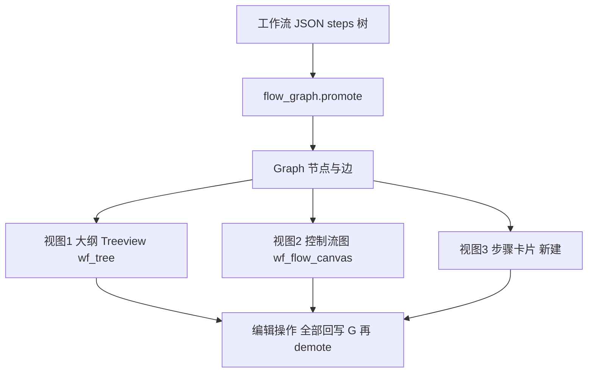

# 方案：Quicker 截图驱动的 ACRPA 功能与工作流拓展

> **一手素材**：[`docs/截图分析-OCR原始文本-ac.md`](截图分析-OCR原始文本-ac.md)（对 `F:/（8）Desktop/temp/ac/1.bmp ~ 5.bmp` 的 OCR + 坐标重建结果）
> **代码基线**：`src/` 只读核对，全部结论带 `文件:行号`
> **姊妹文档**：[`docs/参考分析-zTasker-DLL复用判定与能力补强方案.md`](参考分析-zTasker-DLL复用判定与能力补强方案.md)（以下简称「DLL 篇」）
> **写作约束**：本文不重复 DLL 篇的「底层原生能力补强」，只回答**命令体系 + 工作流编排 + 编辑器 UI**三件事。

---

## 1. 本文定位

本文基于 Quicker「编辑动作」窗口截图暴露出的**能力面**（12 分组、128 条可在 OCR 文本中逐条核对的功能模块），对照 ACRPA 当前**命令注册表 + 工作流引擎 + 工作流 Tab** 的真实实现，产出「命令体系 / 工作流编排 / 编辑器 UI」三方面的可执行拓展方案；凡 DLL 篇已覆盖的底层能力（probe 修复、RegisterHotKey、压缩包、音频、注册表、UIA、邮件等）只做交叉引用，不重写方案。

### 1.1 与 DLL 篇的分工表

| 维度 | DLL 篇（zTasker） | 本文（Quicker 截图） |
| --- | --- | --- |
| 关注对象 | zTasker 安装目录的 82 个 DLL / 9 个 exe | Quicker 动作编辑器的**模块库清单 + 布局形态** |
| 回答的问题 | 哪些二进制能复用、缺失的**原生能力**用什么重建 | 缺失的**命令**怎么注册、缺失的**编排原语**怎么表达、**编辑器**怎么摆 |
| 主要落点 | `src/native_check.py`、`src/hotkey_win.py`、`src/archive_ops.py`、`src/priv_ops.py`、`src/audio_ops.py`、`src/screen_ops.py`、`src/sys_ops.py`、`src/capabilities.py` | `res/help/command_groups.json`、`res/help/command_schema.json`、`src/commands.py`、`src/workflow.py`、`src/flow_graph.py`、`src/ui/workflow_view.py`、`src/ui/param_form.py` |
| 交付形态 | 新模块 + 新命令 + probe 修正 + 路线图 P0/P1/P2 | 分组与 schema 扩展 + 节点类型与执行语义 + 三栏 UI 改造 + 路线图 W0/W1/W2/W3 |
| 重叠项处理 | — | 本文对重叠项一律只写「见 DLL 篇 §7.1 P0-x」并标注合并方式（见本文 §8） |
| 明确不碰 | UI 布局、命令分组、工作流 JSON | 任何 DLL/PE/许可判定、任何 probe 实现细节 |

### 1.2 一句话结论

> ACRPA 的命令**数量**不缺（实际注册 **88** 条），缺的是**结构化编排原语**（步骤组 / 结构化 if-else / 三形态循环 / 子程序 / return-continue）和**模块库的组织与检索**；
> 因此 W0 必须先做「数据层可表达」，否则任何 UI 先行的改造都会在执行层返工。

### 1.3 ⚠️ 本次核对发现的与既有描述不一致之处

| # | 既有描述（任务基线 / 旧文档 / 他人结论） | 代码与文件事实 | 影响 |
| --- | --- | --- | --- |
| ① | 「ACRPA 现有约 **68** 条命令、9 个分组」 | `res/help/command_schema.json:5` 写 `"commands": 68`，`res/help/command_groups.json:4-48` 确为 9 组 68 条；但 `src/commands.py:786-830` **另有 20 条 L2 命令已注册**（`复制文件` … `设置窗口样式`），注册表实际 **88** 条 | 20 条命令**没有**进 `command_groups.json` → 按 `command_groups.json:3` 的 `_fallback_title` 规则全部落到「其他命令」兜底组；命令速查分组因此长期失真。本文 §3.1、§7 W0 把「补齐分组」列为数据层第一件事 |
| ② | 「Quicker 模块库约 **170** 个模块项」 | OCR 文档 §3.1 F~P 去重后**可逐条核对的是 128 条**（11 个分组有内容）；`系统操作` 分组在 1.bmp/2.bmp 中处于折叠态、**零模块项可见**；`键鼠输入` 分组在 5.bmp 底部被裁、仅 `多步骤输入` 1 条可见（OCR 文档 §4.2 已列为「已知空白」） | 本文 §3.2 全量表为 **128 行**，不凑数、不编造；差额约 40 条属 OCR 未覆盖区域，列为待人工补录（§10.2） |
| ③ | 「ACRPA 工作流只有树形步骤列表」 | 工作流 Tab 已有**双视图**：树状大纲 `wf_tree`（`src/ui/workflow_view.py:544`）+ 控制流图 Canvas `wf_flow_canvas`（`src/ui/workflow_view.py:567`），并有 `promote/demote` 图模型（`src/flow_graph.py:309/346`）与静态检查 `analyze()`（`src/flow_graph.py:616`） | 本文 §6.2 的「步骤卡片视图」是**第三视图**，不是从零画布；改造必须复用 `flow_graph` 的节点/边模型，避免第三套数据结构 |
| ④ | 「ACRPA 有 8 种分类命令库，靠近 Quicker」 | 现有操作库 `_WF_LIB_CATEGORIES`（`src/ui/workflow_view.py:291-300`）是**硬编码 8 分类 / 45 个动作**，且 `_WF_LIB_ACTIONS`（`src/ui/workflow_view.py:596-641`）是手写 lambda，**完全不读** `command_groups.json` / `command_schema.json` | 新增任何命令都要改两处 Python 字面量 → 这是「命令数涨到 200 会失控」的根因，本文 §6.1 的核心改造就是把它改成 **schema 驱动** |

---

## 2. 截图还原的界面模型

### 2.1 四区结构（源自 `1.bmp`，OCR 文档 §2.1.2 / §2.1.3）

| 区 | 位置（1.bmp 坐标） | 控件清单（OCR 原文） | 职责 | 在 ACRPA 中的对应 |
| --- | --- | --- | --- | --- |
| **A. 左栏 模块库** | x 19–232, y 85–1560 | `筛选模块(Ctrl+F)..` 占位符搜索框 + 三级缩进树（L1 分组 12 个，L2 模块项 128 条） | 检索/拖放取用模块 | **已有骨架**：`wf_lib_frame`(`src/ui/workflow_view.py:498`)、`wf_lib_search`(`:510`)、`wf_lib_tree`(`:517`)、`_wf_populate_library`(`:752`)；**需新建**：`src/ui/module_catalog.py`（把 `command_groups.json` + `command_schema.json` 转成三级树，替代硬编码 `_WF_LIB_CATEGORIES`） |
| **B. 中央 画布** | x 500–2000, y 85–1500 | 页签 `主程序步骤：` + 空状态 `拖放模块到这里` | 把模块串成步骤、嵌套表达控制流 | **已有两视图**：树状大纲 `wf_tree`(`:544`)、控制流图 `wf_flow_canvas`(`:567`)；**需新建**：`src/ui/step_card_view.py`（步骤卡片纵向视图，见 §6.2） |
| **C. 右栏 属性与变量** | x 2040–2380, y 90–1560 | `变量定义↑`、变量项 `ABCtext默认的文本变量`、`外观选项关联`、`标题`、`功能/用途说明`、`＆×`（疑图标按钮组，未能识别） | 编当前选中模块的参数与元数据 | **已有能力但打散在弹窗里**：参数表单 `build_arg_form`(`src/ui/param_form.py:187`) 目前只在双击节点的模态对话框 `_wf_edit_step`(`src/ui/workflow_view.py:1443`) 内出现；变量管理是独立弹窗 `_wf_open_variable_manager`(`:1976`)；**需新建**：`src/ui/inspector_panel.py`（常驻右栏，内嵌 `build_arg_form` + 标题/说明 + 变量列表） |
| **D. 底部按钮** | x 2226–2379, y 1507–1543 | `保存(S)` / `取消` | 提交或放弃本次编辑 | **形态不同**：ACRPA 工作流是 **Notebook 的一个 Tab**（`src/ui/workflow_view.py:401`），不是模态窗口，保存走工具栏 `_wf_save`(`:1386`)；**结论：不照搬模态**，只借用 `Ctrl+S` / 脏标记 / 取消回滚语义（见 §6.4） |

### 2.2 形态差异与采纳结论

| 项 | Quicker（截图） | ACRPA 现状 | 采纳结论 |
| --- | --- | --- | --- |
| 编辑器载体 | 模态「编辑动作」窗口（标题 `--编辑动作`） | Notebook 内 Tab（`src/ui/workflow_view.py:400-401`） | **不改为模态**。模态化会与既有 `docs/执行控制tab设计方案.md` 的运行控制条、`docs/底部常驻日志面板重构设计方案.md` 的常驻日志冲突 |
| 属性区 | 常驻右栏 | 双击弹窗 | **改为常驻右栏**（§6.3），双击仅做「定位到右栏」 |
| 变量定义 | 右栏顶部可折叠列表 `变量定义↑` | 独立弹窗 + 折叠摘要 | **右栏折叠列表 + 弹窗做批量编辑**，两者并存 |
| 页签 `主程序步骤：` | 多页签（动作内子程序） | 单工作流文件 | **新增「子程序」多页签**（§5.3 `subprogram` 节点 + §6.2 tab） |
| 空状态文案 | `拖放模块到这里` | 无空状态提示 | 新增空状态占位（与既有 UI 方案的 `empty state` 规范一致，见 `docs/工作流界面美化设计方案.md` §4） |

---

## 3. 命令体系差距分析

### 3.1 ACRPA 现有命令清单（真实数据）

**来源**：`res/help/command_groups.json`（分组，9 组）+ `res/help/command_schema.json`（schema，68 条）+ `src/commands.py`（注册表，88 条）。

#### 3.1.1 `command_groups.json` 的 9 个分组（68 条，权威分组定义）

| 分组 | 条数 | 命令（原文） | 出处 |
| --- | --- | --- | --- |
| 基础操作 | 19 | `找图` `区域找图` `点图` `区域点图` `按键` `热键` `输入` `写入` `等待` `坐标` `悬停` `拖拽` `滚轮` `相移` `按下` `释放` `复制` `粘贴` `截屏` | `command_groups.json:6-9` |
| 流程控制 | 6 | `如果` `否则` `结束如果` `循环开始` `循环结束` `跳出循环` | `command_groups.json:13` |
| 窗口管理 | 7 | `激活窗口` `关闭窗口` `最小化窗口` `最大化窗口` `获取窗口位置` `等待窗口` `窗口坐标` | `command_groups.json:17-18` |
| 变量与数据处理 | 4 | `设置变量` `读取剪贴板` `字符串处理` `数学运算` | `command_groups.json:22` |
| 代码执行 | 2 | `代码` `Python` | `command_groups.json:26` |
| OCR 文字识别 | 3 | `识别文字` `等待文字` `点击文字` | `command_groups.json:30` |
| AI 增强 | 3 | `AI找图` `AI识别界面` `AI优化建议` | `command_groups.json:34` |
| 工作流 | 2 | `运行工作流` `工作流变量` | `command_groups.json:38` |
| 浏览器自动化 | 22 | `打开网页` `浏览器点击` `浏览器输入` `等待元素` `浏览器截图` `浏览器执行JS` `执行JS` `浏览器读取Cookie` `浏览器设置Cookie` `切换框架` `返回主框架` `新建标签页` `切换标签页` `关闭标签页` `等待下载` `浏览器上传` `连接已开浏览器` `接管浏览器` `开始监听` `等待数据包` `停止监听` `启动浏览器录制` | `command_groups.json:42-46` |
| **合计** | **68** | | `command_schema.json:5` |

#### 3.1.2 注册表里另有 20 条「未进分组」的 L2 命令

`src/commands.py:786-830` 追加注册、但 `command_groups.json` **未收录** → 按 `command_groups.json:3` 的 `_fallback_title` 全部落入「其他命令」：

| 族 | 条数 | 命令（`src/commands.py` 行号） |
| --- | --- | --- |
| 文件 / 目录 | 8 | `复制文件`(786) `移动文件`(788) `删除文件`(790) `创建目录`(792) `列出目录`(794) `读取文本文件`(796) `写入文本文件`(798) `文件是否存在`(800) |
| 进程 | 2 | `启动程序`(802) `结束进程`(804) |
| 网络 / 数据 | 2 | `HTTP 请求`(806) `JSON 取值`(811) |
| 编码工具 | 3 | `Base64 编解码`(813) `URL 编解码`(815) `哈希值`(817) |
| 系统 | 5 | `打开系统面板`(819) `电源操作`(822) `音量控制`(824) `磁盘空间`(826) `设置窗口样式`(828) |
| **合计** | **20** | 注册表实际 **68 + 20 = 88 条** |

#### 3.1.3 命令注册机制的三个关键事实（决定后续所有新增命令怎么加）

| 事实 | 代码证据 | 对新增命令的约束 |
| --- | --- | --- |
| 命令名 + 描述 + **逗号分隔的参数说明串**即 schema，参数类型/枚举/默认值都由 `_parse_param` 从文本里猜 | `register()`(`src/commands.py:110`)、`_parse_param`(`:60`)、`_parse_params`(`:106`) | 新命令的参数说明必须写成 `名称(枚举1/枚举2)` / `名称(默认X)` / `名称(可选)` 的既有形态，否则 schema 会退化 |
| 参数槽位**固定 9 个**（`.xls` 位置式布局） | 两处运行期截断：`workflow._run_command`(`src/workflow.py:394` 的 `[:9]`) 与调度器单命令目标(`src/scheduler.py:641` 的 `[:9]`)；UI 侧归一：`param_form._norm9`(`src/ui/param_form.py:62`) | 新命令**参数不得超过 9 个**；超出必须用「分号分隔的复合参数」或拆成两条命令 |
| 外部能力必须声明 `requires`，且 `NO_INTERP` 必须登记（漏登记 = 变量名参数会被插值） | `_EXTERNAL_REQUIRES`(`src/commands.py:838-865`)、`NO_INTERP`(`src/commands.py:900-972`)、`get_no_interp`(`:978`) | 每条新命令必须同时补三处：`register` + `_EXTERNAL_REQUIRES`(或 core) + `NO_INTERP` |

> **由此得出一条硬结论**：新增 100+ 条命令时，若继续用「一行一个 `register(...)` 字面量 + 两张大 dict 手工维护」，维护成本是 O(3N)。
> 因此 §7 的 W0 必须先做 **schema 外置**（把 `res/help/*.json` 变成可写、可生成、可校验的真源），否则 W2 的模块库改造没有数据源可读。

### 3.2 Quicker 128 模块 × ACRPA 现状 全量映射表

**读表说明**

- 「Quicker 模块」列严格照抄 OCR 文档 §3.1 的去重文本；OCR 已知误识别处**原样保留并标注修正**（修正依据：OCR 文档中的 `（疑为：xxx）`）。
- 「现状」三态定义：
  - **已有** = ACRPA 注册表中存在语义等价的命令，且能力覆盖主要用法；
  - **部分** = 存在相关命令但缺关键子能力（只能绕过实现，或缺参数形态）；
  - **缺失** = 注册表中无任何对应命令（判定依据：`res/help/command_groups.json` + `res/help/command_schema.json` + `src/commands.py:302-830` 全量比对未命中）。
- 「难度」档位沿用 DLL 篇口径：`S` 单文件独立可验收 / `M` 跨 2–3 模块需回归 / `L` 引新依赖或改打包形态。
- 「依赖」= `stdlib`（含 ctypes）/ `pip:xxx` / `扩展包` / `不做`。

#### 3.2.1 第三方软件交互（11 条）

| # | Quicker 模块（OCR 原文 → 修正） | 语义 | 现状 | ACRPA 对应命令 | 缺失时的建议命令 / 要点 / 难度 / 依赖 |
| --- | --- | --- | --- | --- | --- |
| F1 | `田Excel区域操作`（`田` 为图标误识 → **Excel区域操作**） | 读写 Excel 单元格区域 | 缺失 | — | `Excel读取区域` / `Excel写入区域`；openpyxl 读写、二维列表 ↔ 变量；**M / pip:openpyxl（走扩展包）** |
| F2 | `Office软件辅助` | 通过 COM 驱动 Office 全家桶 | 缺失 | — | **不做**（COM 需 pywin32，打包与体积风险高），见 §9.2 |
| F3 | `用Excel对象操作`（`用` 可能为图标误识，OCR 文档 §4.3-2 存疑） | 持有 Excel COM 会话、对象级操作 | 缺失 | — | **不做**，与 F2 同因；仅保留 F1 的文件级读写 |
| F4 | `窗口界面控制` | 窗口查找/激活/移动/控件级操作 | 部分 | `激活窗口` `关闭窗口` `最小化窗口` `最大化窗口` `获取窗口位置` `等待窗口` `窗口坐标` `设置窗口样式`（8 条） | 补 `查找窗口`（返回 hwnd/pid/类名/矩形，见 §4.15）；控件级操作走 DLL 篇 §7.2 P1-4 `extensions_src/uia/` |
| F5 | `AutoCAD控制` | COM 驱动 AutoCAD | 缺失 | — | **不做**（垂直行业软件，无通用价值） |
| F6 | `Excel文件读写` | 直接读写 `.xlsx` 文件 | 缺失 | — | 与 F1 合并为同一族（同一 openpyxl 依赖）；**M / pip:openpyxl** |
| F7 | `Rhino软件控制` | COM 驱动 Rhino | 缺失 | — | **不做** |
| F8 | `窗口界面控制(FlaUI)` | 基于 .NET FlaUI 的 UIA 自动化 | 缺失 | — | 走 DLL 篇 §7.2 **P1-4**（`extensions_src/uia/` + `src/uia_backend.py`），本文不另设方案 |
| F9 | `浏览器控制` | 浏览器自动化（点击/输入/等待/Cookie/多标签/抓包） | **已有** | `打开网页` `浏览器点击` `浏览器输入` `等待元素` `浏览器截图` `浏览器执行JS` `执行JS` `浏览器读取Cookie` `浏览器设置Cookie` `切换框架` `返回主框架` `新建标签页` `切换标签页` `关闭标签页` `等待下载` `浏览器上传` `连接已开浏览器` `接管浏览器` `开始监听` `等待数据包` `停止监听` `启动浏览器录制`（22 条） | 无需新增。注意全部声明 `requires=("browser.playwright",)`（`src/commands.py:843-853`），冻结版需扩展包（`src/capabilities.py:345`） |
| F10 | `获取浏览器网址` | 取当前活动页 URL | 部分 | `浏览器执行JS`（可 `return location.href` 写变量） | 补 `获取浏览器网址`（0 参数，写 `browser_url` 变量）；**S / stdlib**。理由：这是最高频动作，用 JS 绕过对普通用户是不可发现路径 |
| F11 | `AAdobe系列软件控制`（`A` 为图标误识 → **Adobe系列软件控制**） | COM/脚本驱动 Adobe 系列 | 缺失 | — | **不做** |

#### 3.2.2 基础（14 条）

| # | Quicker 模块（OCR 原文 → 修正） | 语义 | 现状 | ACRPA 对应命令 | 缺失时的建议命令 / 要点 / 难度 / 依赖 |
| --- | --- | --- | --- | --- | --- |
| G1 | `运行脚本` | 执行一个脚本文件 | 已有 | `代码`（执行脚本目录下 txt/Python，`src/commands.py:321`） | — |
| G2 | `2用户输入` / `用户输入`（`2` 为图标误识 → **用户输入**） | 弹单字段输入框拿用户输入 | 缺失 | — | `输入框`：参数 `提示文字, 默认值, 目标变量名, 超时秒(0=不限)`；Tk `simpledialog` 在 UI 线程外需经 `root.after` 回投；**S / stdlib** |
| G3 | `模拟按键B（参数）` / `模拟按键B(参数)` | 按参数发按键 | 已有 | `按键`（`src/commands.py:306`） | — |
| G4 | `提示消息` | 弹轻提示（toast） | 缺失 | — | 与 DLL 篇 §7.2 **P1-5**「气泡通知」是同一能力 → **合并，见 DLL 篇 P1-5**，本文只补 `NO_INTERP` 与分组登记 |
| G5 | `模拟按键A（录入）` / `模拟按键A (录入)` | 逐字输入文本 | 已有 | `写入`（逐字输入，支持 DD，`src/commands.py:309`） | — |
| G6 | `注释` | 流程中的说明文字，不执行 | 部分 | 无命令；`steps` 元素有 `comment` 字段（`src/flow_graph.py:33`）、有 `log` 节点（`src/workflow.py:361`） | 补 `注释`**节点**（type=`comment`，不产生日志、不计入耗时）；**S / stdlib** |
| G7 | `获取选中的文本` | 取当前前台应用里选中的文字 | 缺失 | — | `获取选中文本`：先发 Ctrl+C 再读剪贴板并恢复原剪贴板；参数 `目标变量名, 还原剪贴板(是/否)`；**S / stdlib** |
| G8 | `等待时间`（2.bmp 原文 `①等待时间`，`①` 为图标误识） | 延时 | 已有 | `等待`（`src/commands.py:310`） | — |
| G9 | `鼠标输入` | 鼠标点击/移动/拖拽/滚轮 | 已有 | `坐标` `悬停` `拖拽` `滚轮` `相移`（5 条） | — |
| G10 | `发送文本到窗口` | 向指定窗口投递文本（不抢焦点） | 部分 | `输入`（剪贴板方式，需目标已聚焦）+ `激活窗口` | 补 `发送文本`：`WM_SETTEXT/WM_CHAR` 定向投递；参数 `窗口标题, 内容, 方式(消息/剪贴板)`；**M / ctypes** |
| G11 | `弹窗提示或确认` | 模态提示 / 是-否确认 | 缺失 | — | `确认框`：参数 `标题, 内容, 类型(提示/确认/警告), 默认按钮, 目标变量名(是/否)`；引擎已有 `set_danger_confirm_hook`（`src/engine.py:126`）可复用同一 GUI 回投机制；**S / stdlib** |
| G12 | `运行或打开` | 启动程序/文档/URL | 已有 | `启动程序`（`src/commands.py:802`） | — |
| G13 | `目用户选择` / `用户选择`（`目` 为图标误识 → **用户选择**） | 从候选列表里选一项 | 缺失 | — | `选择项`：参数 `提示, 候选(竖线分隔), 目标变量名, 多选(是/否)`；**S / stdlib** |
| G14 | `打开网址` | 用默认浏览器打开 URL | 已有 | `启动程序`（传 URL，`src/commands.py:802`）/ `打开网页`（playwright，`src/commands.py:358`） | — |

#### 3.2.3 文本处理（11 条）

| # | Quicker 模块（OCR 原文 → 修正） | 语义 | 现状 | ACRPA 对应命令 | 缺失时的建议命令 / 要点 / 难度 / 依赖 |
| --- | --- | --- | --- | --- | --- |
| H1 | `拆分文本为列表` | 按分隔符把文本切成列表 | 缺失 | — | `文本转列表`：`源变量, 分隔符, 去空白(是/否), 目标变量名`；产出用 `\n` 连接的中间表示（与 `列出目录` 一致，`src/commands.py:794`）；**S / stdlib** |
| H2 | `列表合并成文本` | 列表按分隔符拼成一段文本 | 缺失 | — | `列表转文本`：`源变量, 分隔符, 目标变量名`；**S / stdlib** |
| H3 | `盆加密/解密/哈希`（`盆` 为图标误识 → **加密/解密/哈希**）/ `加密/解密/哈希` | 哈希与对称加解密 | 部分 | `哈希值`（md5/sha1/sha256，`src/commands.py:817`） | 哈希已有；补 `对称加解密`（`hashlib.scrypt` 派生 + AES 需 pip）→ **延后**，仅登记缺口，见 §9.2 |
| H4 | `组合成文本` | 模板拼接多个变量 | 缺失 | — | `文本模板`：`模板, 目标变量名`，模板直接用既有插值语法 `{var:名称}`（`src/interp.py:25`），不需要新求值通道；**S / stdlib** |
| H5 | `文本处理`（2.bmp y923 二级同名项；OCR 文档 §4.3-4 存疑，疑为**二级子分组名**而非模块） | — | 不适用 | — | 判定为分组名重复：1.bmp 同一位置亦为一级标题 `文本处理`（y906 一级 / y1044 二级），本文按「非独立模块」处理，**不编造其功能** |
| H6 | `A获取字符信息` / `A 获取字符信息`（`A` 为图标误识 → **获取字符信息**） | 字符数 / 字节数 / 编码信息 | 缺失 | — | `字符信息`：`源变量, 目标变量前缀`，产出 `len`/`bytes`/`非ASCII数`；**S / stdlib** |
| H7 | `替换文本` | 文本替换 | 已有 | `字符串处理`（操作类型含「替换」，`src/commands.py:340`） | — |
| H8 | `正则提取` | 正则匹配 / 分组捕获 | 缺失 | — | `正则提取`：`源变量, 表达式, 分组序号或名, 全部匹配(是/否), 目标变量名`；必须 `re` + 超时保护；**S / stdlib** |
| H9 | `字数统计` | 字数/行数/词数统计 | 缺失 | — | 与 H6 合并到 `字符信息`（参数加 `模式(字符/字/行/词)`），不单列命令 → **S** |
| H10 | `文本窗口` | 只读大文本查看器 | 缺失 | — | `文本窗口`：`内容或变量名, 标题, 是否可编辑(是/否)`；**M / stdlib**（需处理非 UI 线程调用） |
| H11 | `提取JSON内容` | 按路径取 JSON 值 | 已有 | `JSON 取值`（`src/commands.py:811`） | 增强见 §4.21（JSONPath 子集，DLL 篇 §7.2 P1-3 已列） |

#### 3.2.4 计算与比较（14 条）

| # | Quicker 模块（OCR 原文 → 修正） | 语义 | 现状 | ACRPA 对应命令 | 缺失时的建议命令 / 要点 / 难度 / 依赖 |
| --- | --- | --- | --- | --- | --- |
| I1 | `生成Guid` | 生成 GUID/UUID | 缺失 | — | `生成GUID`：`格式(标准/无横线/带花括号), 大写(是/否), 目标变量名`；`uuid` stdlib；**S / stdlib** |
| I2 | `目数据库查询` / `数据库查询`（`目` 为图标误识 → **数据库查询**） | 对 SQLite/ODBC 执行查询 | 缺失 | — | `数据库查询`：`数据库路径, SQL, 参数(分号分隔), 目标变量名, 超时秒`；`sqlite3` stdlib，只读连接 + 参数绑定防注入；**M / stdlib**，详见 §4.17 |
| I3 | `三管理和排序列表` / `管理和排序列表`（`三` 为图标误识 → **管理和排序列表**） | 列表增删/排序/去重/过滤 | 缺失 | — | `列表操作`：`源变量, 操作(追加/插入/删除/排序/去重/过滤/切片/长度), 参数, 目标变量名`；**M / stdlib**，详见 §4.18 |
| I4 | `数字转换与处理` | 进制转换/取整/格式化 | 部分 | `数学运算`（safe_eval 四则与函数，`src/commands.py:341`） | 补 `数字格式`：`源变量, 模式(四舍五入/取整/进制/千分位/百分比), 参数, 目标变量名`；**S / stdlib** |
| I5 | `留计算`（`留` 为图标误识） / `计算` | 通用表达式计算 | 已有 | `数学运算`（`src/commands.py:341`，走 `safe_eval`） | — |
| I6 | `赋值` | 变量赋值 | 已有 | `设置变量`（`src/commands.py:338`） | — |
| I7 | `田表格数据操作`（`田` 为图标误识 → **表格数据操作**） | 表格（二维）取值/写入 | 缺失 | — | `表格取值`：`源(CSV 文件或变量), 行, 列(名或序号), 目标变量名, 是否有表头`；csv stdlib；**M / stdlib** |
| I8 | `词典操作` | 字典取键/设键/合并 | 缺失 | — | `字典操作`：`源变量, 操作(取值/设值/删键/键列表/合并), 键, 值, 目标变量名`；**M / stdlib** |
| I9 | `屏幕取色/颜色转换与计算` | 屏幕取色 + RGB↔HEX↔HSV | 缺失 | — | `屏幕取色`（ctypes `GetPixel`）+ `颜色转换`（纯算术）；**S / ctypes**；与 DLL 篇 §7.3 **P2-5** 的找色能力配套（找色需要取色器做标定） |
| I10 | `生成随机数` | 随机数/随机字符串 | 缺失 | — | `随机数`：`类型(整数/小数/字符串), 最小值, 最大值, 长度, 目标变量名`；`random` stdlib；**S / stdlib** |
| I11 | `圖比较文本` / `比较文本`（`圖` 为图标误识 → **比较文本**） | 文本相等/包含/模糊比较 | 部分 | `如果`（条件表达式走 `safe_eval`，`src/engine.py:753`） | 无需新命令；但需在 `res/help/01-命令速查.md` 明确「条件里可用的比较算子清单」（`safe_eval` 白名单） |
| I12 | `①计算时间` / `计算时间`（`①` 为图标误识 → **计算时间**） | 时间加减/差值/格式化 | 部分 | 插值 `{date:格式}`（`src/interp.py:27`）+ `数学运算` | 补 `计算时间`：`基准(now/变量), 偏移量, 单位, 格式, 目标变量名`；`datetime` stdlib；**S / stdlib** |
| I13 | `三列表操作` / `列表操作`（`三` 为图标误识 → **列表操作**） | 列表基础操作 | 缺失 | — | **与 I3 合并为同一条 `列表操作`**（OCR 中两者同分组同义，仅命名粒度不同） |
| I14 | `比较数字` | 数值比较 | 部分 | `如果`（`safe_eval` 条件） | 同 I11，补文档而非命令 |

#### 3.2.5 网络服务（13 条）

| # | Quicker 模块（OCR 原文 → 修正） | 语义 | 现状 | ACRPA 对应命令 | 缺失时的建议命令 / 要点 / 难度 / 依赖 |
| --- | --- | --- | --- | --- | --- |
| J1 | `机器翻译/词典` | 调用翻译/词典 API | 缺失 | — | **延后**（需第三方 key，无 key 即不可用），见 §9.2 |
| J2 | `临时云存储` | 把文件临时传到云端 | 缺失 | — | **不做**（隐私/合规，见 §9.2） |
| J3 | `f(x)公式识别` | 数学公式 OCR → LaTeX | 缺失 | — | **不做/延后**（成本 + 网络依赖，且与 OCR 后端现状冲突，OCR 文档 §4.4） |
| J4 | `下载文件` | 下载 URL 到本地 | 已有 | `HTTP 请求`（含「保存路径」参数，`src/commands.py:806-808`） | — |
| J5 | `HTTP服务器` | 起一个本地 HTTP 服务 | 缺失 | — | `HTTP服务`：`端口, 根目录, 处理脚本(可选), 启动/停止, 阻塞(是/否)`；`http.server` + `ThreadingHTTPServer`；**M / stdlib**，详见 §4.20 |
| J6 | `第三方云存储/图床` | 上传到第三方图床 | 缺失 | — | **不做**（见 J2） |
| J7 | `Websocket` | WS 客户端收发 | 缺失 | — | **延后**：stdlib 无 WS 客户端，需 `websocket-client`；建议做成 `extensions_src/ws/` 可选扩展包；**L / 扩展包**。注：`src/netlink/` 有 WebUI 通道（`src/netlink/webui.py`），但**未以命令形态暴露**，本判定"缺失"仅指命令层 |
| J8 | `基础OCR` | 截图 OCR 出文字 | 已有 | `识别文字` `等待文字` `点击文字`（3 条） | 后端可用性有缺陷 → 见 DLL 篇 §7.1 **P0-3**、§7.2 **P1-6**，本文不重复 |
| J9 | `HTTP请求` | 发 HTTP 请求 | 已有 | `HTTP 请求`（`src/commands.py:806`） | 增强项（JSONPath 传参、证书忽略开关）见 DLL 篇 §7.2 P1-3 |
| J10 | `AI调用` | 通用大模型对话 | 部分 | `AI找图` `AI识别界面` `AI优化建议`（3 条，均为固定用途，`src/commands.py:349-351`） | 补 `AI对话`：`提示词, 系统提示, 模型(可空), 温度, 目标变量名, 超时秒`；复用 `src/ai_client.py`；**M / stdlib(urllib)**，详见 §4.19 |
| J11 | `SMTP发送邮件` | 发邮件 | 缺失 | — | 与 DLL 篇 §7.2 **P1-2**（`src/mail_ops.py` + `smtplib`）同一能力 → **合并，见 DLL 篇 P1-2** |
| J12 | `提取HTML内容` | 按选择器取 HTML 中的文本/属性 | 缺失 | — | `HTML取值`：`源(变量/URL/文件), 选择器(CSS 子集), 属性(可空=取文本), 目标变量名`；`html.parser` stdlib 实现子集；**M / stdlib** |
| J13 | `云状态存取` | 跨设备存取键值状态 | 缺失 | — | **不做**（依赖 Quicker 自己的账号云，ACRPA 无对应服务；且 `src/accounts.py` 是本地账号，不是云 KV），见 §9.2 |

#### 3.2.6 Windows系统（22 条）

| # | Quicker 模块（OCR 原文 → 修正） | 语义 | 现状 | ACRPA 对应命令 | 缺失时的建议命令 / 要点 / 难度 / 依赖 |
| --- | --- | --- | --- | --- | --- |
| K1 | `Quicker操作` | 调用 Quicker 自身的动作/面板 | 缺失 | — | **不做**（跨软件互操作：需装 Quicker、依赖其 IPC/COM，且与我们替代它的定位冲突），结论与理由见 §9.2 |
| K2 | `获取资源管理器路径/跳转路径` | 取资源管理器当前目录 / 跳转到指定目录 | 缺失 | — | `资源管理器路径`：通过 Shell COM（`Shell.Application` 的 `Windows()`/`Document.Folder.Self.Path`，经 `comtypes` 或 `ctypes` + `IDispatch` 调用）；**M / 扩展包**（避免 pywin32 进主包） |
| K3 | `获取窗口信息/查找窗口` | 按标题/类名/进程查窗口并取详情 | 部分 | `激活窗口` `获取窗口位置` `等待窗口` `窗口坐标`（均按标题模糊匹配） | 补 `查找窗口`：返回 hwnd/pid/类名/矩形/是否前台，支持 `标题/类名/进程名` 三条件与「枚举全部」；**S / ctypes**，详见 §4.15 |
| K4 | `按键操作` | 按键/组合键/按住松开 | 已有 | `按键` `热键` `按下` `释放`（4 条） | 注册机制缺口见 DLL 篇 §7.1 **P0-4** |
| K5 | `Windows服务和注册表` | 启停服务 / 读写注册表 | 部分 | `打开系统面板`（可打开「服务」「注册表」面板，`src/commands.py:819`）——只能"打开界面"不能"操作" | 注册表读/写：见 DLL 篇 §7.2 **P1-5**；服务启停：本文补 `服务控制`（`sc.exe` 或 `ctypes advapi32`）**M / ctypes**，详见 §4.23 |
| K6 | `激活进程主窗口` | 按进程名激活其主窗口 | 部分 | `激活窗口`（按标题）+ `结束进程`（按进程名） | 与 K3 合并：`查找窗口` 支持 `进程名` 条件 + `激活` 动作即可覆盖，不单列命令 |
| K7 | `窗口操作` | 窗口移动/缩放/置顶/透明 | 已有 | `窗口管理` 组 7 条 + `设置窗口样式`（置顶/透明度/隐藏，`src/commands.py:828`） | — |
| K8 | `四输入法状态` / `输入法状态`（`四` 为图标误识 → **输入法状态**） | 取/切中英文、全半角状态 | 缺失 | — | `输入法状态`：`动作(读取/切英文/切中文/切全角/切半角), 目标变量名`；`ctypes` 调 `imm32.ImmGetConversionStatus` / `ImmSetConversionStatus`；**S / ctypes**，详见 §4.22 |
| K9 | `①获取日期时间` / `获取日期时间`（`①` 为图标误识 → **获取日期时间**） | 取当前时间到变量 | 部分 | 插值 `{date:格式}`（`src/interp.py:27`）可直接用，但**没有写入变量的命令形态** | 并入 I12 `计算时间`（`基准=now, 偏移=0`）；不单列命令 |
| K10 | `Shell文件操作` | 复制/移动/删除/建目录等 | 已有 | `复制文件` `移动文件` `删除文件` `创建目录` `列出目录` `读取文本文件` `写入文本文件` `文件是否存在`（8 条，`src/commands.py:786-801`） | 压缩/解压缺口见 DLL 篇 §7.1 **P0-6** |
| K11 | `在资源管理器中定位文件` | 打开资源管理器并选中文件 | 缺失 | — | `定位文件`：`explorer /select,"路径"`；**S / stdlib** |
| K12 | `文件系统监控` | 监听目录增删改 | 缺失 | — | `文件监控`：`目录, 事件(增/删/改/全部), 超时秒, 目标变量名, 递归(是/否)`；`ReadDirectoryChangesW` + 后台线程 + 事件队列（复用 `src/triggers.py:492-505` 的线程安全队列范式）；**L / ctypes**，详见 §4.14 |
| K13 | `向窗口发送消息` | PostMessage/SendMessage 定向消息 | 缺失 | — | `发送消息`：`窗口标题, 消息号, wParam, lParam, 同步(是/否)`；白名单限制 + 禁用危险消息族；**M / ctypes** |
| K14 | `获取系统或动作信息` | 系统信息聚合（内存/CPU/分辨率等） | 部分 | `磁盘空间`（`src/commands.py:826`） | 补 `系统信息`：`项目(分辨率/内存/CPU核数/系统版本/开机时长/当前用户), 目标变量名`；`ctypes` + `os`；**S / ctypes**；蓝牙/校时/连通性见 DLL 篇 §7.1 **P0-9** |
| K15 | `音频设备` | 枚举/切换音频设备 | 缺失 | — | 见 DLL 篇 §7.1 **P0-8**（音量能力已在 `src/sys_ops.py`，`audio_ops.py` 只做 WAV 播放；设备枚举建议追加到 `src/sys_ops.py`）；**M / ctypes** |
| K16 | `月播放声音` / `播放声音`（`月` 为图标误识 → **播放声音**） | 播放音频文件/系统音 | 缺失 | — | 见 DLL 篇 §7.1 **P0-8**（`src/audio_ops.py`「播放声音」命令），本文不重复 |
| K17 | `录制声音/语音识别` | 录麦克风 / 语音转文字 | 缺失 | — | **延后**：见 DLL 篇 §7.3 **P2-2**（`sounddevice` 录音扩展包）+ 语音识别需在线服务 |
| K18 | `恢复活动窗口` | 回到上一个前台窗口 | 部分 | `激活窗口`（按标题） | 无需新命令：`查找窗口`(K3) 取前台链后 `激活窗口` 即可；把用法写进 `res/help/01-命令速查.md` |
| K19 | `吕获取选择的文件(夹)/选择特定文件`（`吕` 为图标误识 → **获取选择的文件(夹)/选择特定文件**） | 取资源管理器里选中的文件 / 让用户挑文件 | 部分 | 无命令（GUI 内部用 `filedialog`，未暴露） | 拆两条：`选择文件`（见 M7）+ `获取选中文件`（Shell COM，与 K2 同依赖）；**M / 扩展包** |
| K20 | `检查程序已启动/获取进程信息` | 判断进程是否在跑 / 取进程信息 | 部分 | `结束进程`（按名，`src/commands.py:804`）—— 只能杀不能查 | 补 `进程信息`：`进程名, 模式(是否存在/PID列表/内存/CPU/启动时间), 目标变量名`；`ctypes` + `EnumProcesses` 或 `subprocess tasklist`；**M / ctypes**，详见 §4.24 |
| K21 | `获取前台进程信息` | 当前前台窗口所属进程 | 缺失 | — | 并入 `进程信息`（`模式=前台`），不单列命令 |
| K22 | `获取系统路径` | 桌面/下载/临时/程序目录 | 缺失 | — | `系统路径`：`类型(桌面/文档/下载/临时/程序/用户/AppData), 目标变量名`；`ctypes SHGetKnownFolderPath` 或 `os.environ`；**S / ctypes** |

#### 3.2.7 程序流程（13 条）

| # | Quicker 模块（OCR 原文 → 修正） | 语义 | 现状 | ACRPA 对应命令 | 缺失时的建议命令 / 要点 / 难度 / 依赖 |
| --- | --- | --- | --- | --- | --- |
| L1 | `步骤组` | 把 N 个步骤折叠成一个可整体启停/移动的组 | 缺失 | 无对应命令，也无对应节点类型（`CONTAINER_TYPES = ("parallel","loop")`，`src/flow_graph.py:55`） | **新增节点 `group`**（不是命令）；字段/语义见 §5.3、§4.1；**M / stdlib** |
| L2 | `检查和下载依赖` | 运行前检查外部依赖是否就绪，缺则下载/提示 | 缺失 | 无命令；近似能力是 `capabilities` 探测（`src/capabilities.py:341-379`）+ 引擎执行前门禁 `_check_capabilities`（`src/engine.py:971`） | **新增 `检查依赖`**：`依赖项(URL|本地路径|说明), 缺失时(报错/下载/跳过), 目标变量名`；**M / stdlib**，详见 §4.6 |
| L3 | `如果` | 单条件判断 | 部分 | `如果` `结束如果`（行式块命令，`src/commands.py:323/325`）；工作流 `condition` 节点（`src/workflow.py:593`） | 缺口：**then/else 只能是单节点**（`src/flow_graph.py:17-18` 明确锁定）→ 见 §5.3 `if` 节点 + §4.2 |
| L4 | `运行子程序` | 调用带参数与返回值的子程序 | 部分 | `运行工作流`（调子工作流文件，`src/commands.py:354`）+ `工作流变量`（`src/commands.py:355`）——只能传全局变量、无返回值契约 | **新增节点 `call`** + `subprogram` 定义（§5.3、§4.4）；**M / stdlib** |
| L5 | `运行C#代码` | 内嵌 C# 编译执行 | 缺失 | — | **不做**（需 Roslyn/.NET 运行时，体积与打包直接冲突，`build.py` 已有排除策略） |
| L6 | `[>跳出循环(break)`（`[>` 为图标误识 → **跳出循环(break)**） | 跳出最近一层循环 | 部分 | `跳出循环`（行式命令，`src/commands.py:328`）；工作流 `loop` 节点**无 break 语义**（`src/workflow.py:442-486` 循环体内无控制信号检查） | **新增节点 `break`**；语义与作用域见 §5.3 控制流表 |
| L7 | `如果/否则` | 双分支（含 elseif） | 部分 | `如果` + `否则` + `结束如果`（行式）；工作流 `condition`（then/else 单节点） | 无 elseif、无多分支 → 见 §5.3 `if` 节点的 `branches` 数组 + §4.2 |
| L8 | `运行Javascript代码` | 内嵌 JS 引擎执行 | 部分 | `浏览器执行JS` / `执行JS`（仅浏览器上下文，`src/commands.py:365-366`） | 独立 JS 引擎**不做**（引 Python-JS 解释器体积不可控）；文档明确「仅浏览器上下文可用」 |
| L9 | `D>跳过后续步骤(continue)`（`D>` 为图标误识 → **跳过后续步骤(continue)**） | 跳过本轮剩余步骤、进入下一轮 | 缺失 | 无命令、无节点 | **新增节点 `continue`**；§5.3、§4.5 |
| L10 | `运行或停止动作` | 启动/中止另一个动作（可外部触发） | 部分 | `运行工作流`（只运行不返回句柄）；停止靠全局 `AbortSignal`（`src/engine.py:148`）/`WorkflowEngine.stop`（`src/workflow.py:244`） | 补 `停止工作流`：`名称(可空=全部)`；**S / stdlib**；跨进程触发见 `src/scheduler.py` / `src/triggers.py:517` `HotkeyTrigger`（**热键已支持**，勿重复列缺口） |
| L11 | `停止(return)` | 从当前子程序/动作返回（可带返回值） | 缺失 | 无命令；只有全局停止（`quit2` / `AbortSignal`） | **新增节点 `return`**（带 `value`）；§5.3、§4.5 |
| L12 | `重复` | 计数循环 / 条件循环 / 遍历集合 | 部分 | `循环开始` `循环结束`（行式，`src/commands.py:326/327`）；工作流 `loop` 节点（`times` 为次数或条件，`src/workflow.py:442-486`） | 缺「遍历集合」形态 → §5.3 `loop.mode = count/while/foreach` + §4.3 |
| L13 | `2运行Python代码`（`2` 为图标误识 → **运行Python代码**） | 执行内联 Python | 已有 | `Python`（沙箱 + AST 预检 + 超时 + 审计，`src/commands.py:322`、`src/engine.py:1906`） | — |

#### 3.2.8 界面组件（13 条）

| # | Quicker 模块（OCR 原文 → 修正） | 语义 | 现状 | ACRPA 对应命令 | 缺失时的建议命令 / 要点 / 难度 / 依赖 |
| --- | --- | --- | --- | --- | --- |
| M1 | `录制键鼠操作` | 录制键鼠事件生成步骤 | **已有** | `src/recorder.py`：低级钩子 `_install_hooks`(`:349`) + 事件驱动 `recorder_thread`(`:463`)，产物写 `state.recorded_actions` | 缺的是「录制 → 步骤树」的转换，见 §5.5（`recorder_to_tree`） |
| M2 | `重放键鼠操作` | 回放录制的键鼠序列 | **已有** | 录制产物即 `ScriptData` 行，由 `engine.execute_script`（`src/engine.py:569`）顺序执行；含 `重放` 语义的还有 `浏览器录制`（`src/commands.py:385`） | 无需新增命令 |
| M3 | `WebView2浏览器窗口` | 内嵌 Chromium 窗口 | 缺失 | — | **不做**（WebView2 Runtime 无法随 <15MB 包分发；浏览器需求已由 `browser.playwright` 22 条命令覆盖） |
| M4 | `多字段表单` | 一次弹多个字段的输入表单 | 缺失 | — | `表单`：`标题, 字段定义(名称:类型:默认 用分号分隔), 目标变量前缀`；**M / stdlib**，详见 §4.7 |
| M5 | `选择文件夹` | 让用户挑目录 | 缺失 | 无命令（GUI 内部有 `filedialog`） | `选择文件夹`：`初始目录, 标题, 目标变量名`；**S / stdlib** |
| M6 | `三显示菜单`（`三` 为图标误识 → **显示菜单**） | 在光标处弹菜单选一项 | 缺失 | — | `弹出菜单`：`菜单项(竖线分隔), 标题, 目标变量名, 超时秒`；**S / stdlib**，详见 §4.10 |
| M7 | `选择文件` | 让用户挑文件 | 缺失 | 无命令 | `选择文件`：`初始目录, 过滤器(如 *.xlsx), 多选(是/否), 目标变量名`；**S / stdlib** |
| M8 | `自定义窗口` | 完全自定义布局的窗口 | 缺失 | — | **延后**（等价能力用 M4 `表单` + M11 `操作窗` 组合覆盖；全自定义窗口是"再造一个 Tk 设计器"，投入产出不划算） |
| M9 | `等待按键` | 阻塞等用户按下一个键 | 缺失 | — | `等待按键`：`允许键(可空=全部), 超时秒, 目标变量名, 是否吞掉按键`；`keyboard` 不可用 → 用 `WH_KEYBOARD_LL` 钩子（复用 `src/recorder.py:349` 的钩子范式）；**S / ctypes**，详见 §4.9 |
| M10 | `辅助选择工具` | 屏幕拾取（拾色/拾坐标/拾窗口） | 缺失 | — | `屏幕拾取`：`模式(坐标/颜色/窗口/控件), 目标变量名`；全屏半透明遮罩 + 十字光标；**M / ctypes**，详见 §4.12 |
| M11 | `三自定义操作窗`（`三` 为图标误识 → **自定义操作窗**） | 常驻浮窗，内含按钮/动态内容 | 缺失 | — | `操作窗`：`标题, 内容(变量或文本), 按钮(竖线分隔), 位置, 目标变量名`；**L / stdlib**，详见 §4.8 |
| M12 | `显示进度条` | 显示进度（确定/不确定） | 缺失 | — | `进度条`：`标题, 当前值, 最大值, 模式(确定/滚动), 关闭(是/否), 句柄变量名`；**M / stdlib**，详见 §4.8 |
| M13 | `》显示等待窗口`（`》` 为图标误识 → **显示等待窗口**） | 显示"请稍候"遮罩，结束时可关闭 | 缺失 | — | 并入 M12：`进度条` 的 `模式=滚动` + `关闭=是` 即为等待窗，不单列命令 |

#### 3.2.9 图片处理（10 条）

| # | Quicker 模块（OCR 原文 → 修正） | 语义 | 现状 | ACRPA 对应命令 | 缺失时的建议命令 / 要点 / 难度 / 依赖 |
| --- | --- | --- | --- | --- | --- |
| N1 | `手写板` | 手写输入/签名板 | 缺失 | — | **不做**（场景极窄，需要整套画板交互） |
| N2 | `屏幕找图/找色/找字` | 屏幕找图 / 找色 / 找字 | 部分 | 找图：`找图` `区域找图` `点图` `区域点图`；找字：`识别文字` `等待文字` `点击文字`。**找色完全缺失** | 补 `找色`（纯 Pillow 像素扫描 + 色差容差）；**M / stdlib(Pillow)**；与 DLL 篇 §7.3 **P2-5** 同一条目 → 合并到 P2-5，本文只补「命令形态与参数表」（§4.16）。注意 `cv2` 在冻结版被排除（`build.py:206-207`、`ACRPA.spec:13`），找图增强只能走 `cv.match` 扩展包或 Pillow |
| N3 | `图片/Base64转换` | 图片文件 ↔ Base64 字符串 | 部分 | `Base64 编解码`（仅文本/字节，`src/commands.py:813`） | 增强该命令：加 `类型(文本/文件)` 参数即可覆盖（不新增命令）；**S / stdlib** |
| N4 | `昌识别二维码` / `识别二维码`（`昌` 为图标误识 → **识别二维码**） | 从图片/屏幕识别二维码 | 缺失 | — | `识别二维码`：`源(文件/剪贴板/屏幕区域), 目标变量名`；纯解码需 pip（`pyzbar`/`opencv`）→ **延后 / 扩展包**；**M / 扩展包** |
| N5 | `屏幕截图` | 全屏/区域/窗口截图 | 已有 | `截屏`（`src/commands.py:320`）；连续截图见 DLL 篇 §7.1 **P0-8**（`src/screen_ops.py`） | — |
| N6 | `图片处理` | 缩放/裁剪/旋转/加水印/格式转换 | 部分 | `截屏`（仅保存）；`浏览器截图` | 补 `图片处理`：`源, 操作(缩放/裁剪/旋转/转格式/加水印), 参数, 目标路径`；Pillow 已在打包 hooks（`hooks_override/hook-PIL.Image.py`）；**M / stdlib(Pillow)** |
| N7 | `临时图床` | 上传图片到临时图床拿 URL | 缺失 | — | **不做**（隐私/合规，见 §9.2） |
| N8 | `读取图片信息` | 尺寸/格式/EXIF | 缺失 | — | `图片信息`：`源, 目标变量前缀`（宽/高/格式/EXIF 摘要）；Pillow；**S / stdlib(Pillow)** |
| N9 | `显示图片` | 弹窗显示图片 | 缺失 | — | `显示图片`：`源, 标题, 最大宽高`；Tk `PhotoImage`；**S / stdlib** |
| N10 | `昌生成二维码` / `生成二维码`（`昌` 为图标误识 → **生成二维码**） | 文本 → 二维码图片 | 缺失 | — | **延后**（需 pip `qrcode`，纯 Python 可打但增体积）；**M / 扩展包** |

#### 3.2.10 剪贴板操作（6 条）

| # | Quicker 模块（OCR 原文 → 修正） | 语义 | 现状 | ACRPA 对应命令 | 缺失时的建议命令 / 要点 / 难度 / 依赖 |
| --- | --- | --- | --- | --- | --- |
| O1 | `等待剪贴板内容改变` | 阻塞直到剪贴板变化 | 缺失 | — | `等待剪贴板变化`：`原内容(可空), 超时秒, 目标变量名`；`ctypes` 轮询 `GetClipboardSequenceNumber`（比读文本便宜得多）；**S / ctypes** |
| O2 | `获取剪贴板图片` | 取剪贴板里的位图 | 缺失 | — | `读取剪贴板图片`：`保存路径, 目标变量名`；`PIL.ImageGrab.grabclipboard()`（Pillow 已打包）；**S / stdlib(Pillow)** |
| O3 | `写入剪贴板` | 往剪贴板写文本/图片 | 部分 | `输入`（剪贴板方式输入，会写剪贴板但随后发送，`src/commands.py:308`） | 补 `写入剪贴板`：`内容, 类型(文本/文件列表), 追加(是/否)`；`pyperclip` 与 `ctypes` 双路径（`engine.get_pyperclip`，`src/engine.py:355`）；**S / stdlib** |
| O4 | `自获取剪贴板文件列表` / `获取剪贴板文件列表`（`自` 为图标误识 → **获取剪贴板文件列表**） | 取剪贴板里的文件路径列表 | 缺失 | — | `剪贴板文件`：`目标变量名, 分隔符`；`ctypes` 读 `CF_HDROP`（`DragQueryFileW`）；**M / ctypes** |
| O5 | `文件放入剪贴板` | 把文件放进剪贴板（可在资源管理器粘贴） | 缺失 | — | `文件放入剪贴板`：`路径(可多个), 操作(复制/剪切)`；`ctypes` 写 `CF_HDROP` + `Preferred DropEffect`；**M / ctypes** |
| O6 | `获取剪贴板文本` | 读剪贴板文本 | 已有 | `读取剪贴板`（`src/commands.py:339`） | — |

#### 3.2.11 键鼠输入（1 条可见，5.bmp 底部被裁）

| # | Quicker 模块（OCR 原文 → 修正） | 语义 | 现状 | ACRPA 对应命令 | 缺失时的建议命令 / 要点 / 难度 / 依赖 |
| --- | --- | --- | --- | --- | --- |
| P1 | `多步骤输入` | 一次发多键序列（含延时与文本段） | 部分 | `写入`（逐字）+ `热键`（单组合）+ `等待` | 补 `多步骤输入`：`序列(如 "ctrl+a;wait 0.2;{文本}"), 按键间隔, 模式`；**M / ctypes**，详见 §4.13 |
| — | （`键鼠输入` 分组其余模块） | — | 未能识别 | — | 5.bmp y1345–1365 贴底被裁（OCR 文档 §4.2），**不补全、不编造**；列入 §10.2 待人工补录 |

#### 3.2.12 系统操作（0 条可见）

| # | 分组 | 现状 | 说明 |
| --- | --- | --- | --- |
| — | `系统操作` | 未能识别 | 1.bmp（y880.9）与 2.bmp（y760）中 `系统操作` 与下一分组标题**紧邻出现、中间零模块项** → 处于**折叠态**（OCR 文档 §2.1.4-2 双样本一致）。该分组模块清单**在任何截图中都不可见**，按「不许编造」原则不填。列入 §10.2 待人工补录 |

### 3.3 差距统计

#### 3.3.1 分组合计表

| # | Quicker 分组 | 可核对条数 | 已有 | 部分 | 缺失 | 不适用 | 已有率 |
| --- | --- | --- | --- | --- | --- | --- | --- |
| 1 | 第三方软件交互 | 11 | 1 | 2 | 8 | 0 | 9.1% |
| 2 | 基础 | 14 | 6 | 2 | 6 | 0 | 42.9% |
| 3 | 文本处理 | 11 | 2 | 1 | 7 | 1 | 18.2% |
| 4 | 计算与比较 | 14 | 2 | 4 | 8 | 0 | 14.3% |
| 5 | 网络服务 | 13 | 3 | 1 | 9 | 0 | 23.1% |
| 6 | Windows系统 | 22 | 4 | 7 | 11 | 0 | 18.2% |
| 7 | 程序流程 | 13 | 1 | 6 | 6 | 0 | 7.7% |
| 8 | 界面组件 | 13 | 2 | 0 | 11 | 0 | 15.4% |
| 9 | 图片处理 | 10 | 1 | 3 | 6 | 0 | 10.0% |
| 10 | 剪贴板操作 | 6 | 1 | 1 | 4 | 0 | 16.7% |
| 11 | 键鼠输入（被裁） | 1 | 0 | 1 | 0 | 0 | 0.0% |
| 12 | 系统操作（折叠） | 0 | 0 | 0 | 0 | 0 | — |
| — | **合计** | **128** | **23** | **28** | **76** | **1** | **18.0%** |

#### 3.3.2 结论读法

1. **ACRPA 的强项是「输入 + 浏览器 + 窗口 + 文件」**：`基础`(42.9%) 与 `网络服务`(23.1%)、`Windows系统`(18.2%) 已有率最高；F9 浏览器 22 条把 `第三方软件交互` 的"唯一重头"直接补满。
2. **最弱的两个方向是「界面组件」(15.4% 已有，但 **0 条部分**，`缺失 11`) 与「程序流程」(7.7%)**：
   - `界面组件` 的 13 条几乎全是"给用户看的中间态"（表单/菜单/进度条/等待窗/拾取器）——这类能力的共同点是**不需要任何三方依赖，纯 Tkinter + ctypes 就能做**，因此是**投入产出比最高的一批**；
   - `程序流程` 的 13 条是"编排原语"，缺它不是缺功能，而是**缺表达能力**——这是本文 §5 的核心。
3. **`部分` 28 条集中在两处**：① `如果/重复/跳出循环/运行子程序`（有行式块命令，但工作流树里表达不足）；② `获取窗口信息/进程信息/日期时间/输入法`（有能力碎片但没有命令形态）。前者必须改执行层，后者只需加薄命令。
4. **76 条缺失中，"确认不做"约 12 条**（§9.2），"必须做且有明确落点"约 34 条（§4 + §8 W0/W1），其余 30 条为"可做但优先级低"（W3 之后）。

#### 3.3.3 目标值（本文方案全部落地后）

| 指标 | 现状 | W1 后 | W2 后 | W3 后（目标） |
| --- | --- | --- | --- | --- |
| 注册表命令数 | 88 | 118 | 158 | ~200 |
| 已进 `command_groups.json` 的命令 | 68（20 条裸奔在兜底组） | 118（100%） | 158（100%） | 200（100%） |
| 128 模块的「已有 + 部分」占比 | 39.8%（23+28） | 52% | 68% | ≥ 85% |
| 工作流可用节点类型 | 8（script/parallel/condition/loop/command/variable/log/wait） | 13 | 17 | 19 |

---

## 4. 新增命令的详细设计

**统一约定（所有条目共用，后文不再重复）**

| 项 | 约定 |
| --- | --- |
| 参数槽位 | 一律 ≤ 9 个（`.xls` 位置式布局硬约束，见 §3.1.3）。超出能力用「分号分隔的复合参数」承载 |
| 注册三件套 | 每条新命令必须同时补：`register()`(`src/commands.py:110`) + `_EXTERNAL_REQUIRES`(`:838`) + `NO_INTERP`(`:900`)，缺一即视为未完成 |
| 变量注入 | 数据类参数**允许**插值，走既有单遍扫描 `interpolate`(`src/interp.py:442`)，语法 `{var:名称}` / `${名称}` / `{date:格式}` / `{env:NAME}`（`src/interp.py:25-30`）；唯一接入点是 `engine._render_args`(`src/engine.py:1151`)，**不得新建求值通道** |
| 变量名类参数 | 必须在 `NO_INTERP` 登记下标（否则变量名会被替换成变量的值，命令直接失效 —— 见 `src/commands.py:889-897` 的设计说明） |
| 失败语义 | 统一返回 `ExecutionResult(ok, code, message, attempts, artifacts)`(`src/engine.py:245`)；`code` 取值见各条 |
| 能力门禁 | 需外部能力的命令必须在 `requires` 声明，由 `engine._check_capabilities`(`src/engine.py:971`) 执行前拦截 |

### 4.1 步骤组（`group` 节点）

| 项 | 内容 |
| --- | --- |
| **定位** | **不是命令，是节点类型**（组容器）。把 N 个步骤折叠成一个可整体启用/禁用/移动/复制的单元 |
| **用途** | 把「打开网站 → 登录 → 填表」折叠成一块，可整体禁用做灰度、整体复制做多账户、整体移动调整顺序 |
| **字段定义** | `type="group"`；`name`（组标题）；`collapsed`（bool，视图态）；`enabled`（bool，整体禁用 = 组内全部按禁用处理）；`steps`（list，子步骤）；`comment`（组说明）；`variables`（dict，组级局部变量，见 §5.3 五层作用域） |
| **返回值** | 无。组本身不产生值；组内 `variable` 节点写入组级作用域 |
| **实现路径** | `src/flow_graph.py`：把 `"group"` 加入 `CONTAINER_TYPES`(`:55`)（当前为 `("parallel","loop")`），复用保留键 `K_CHILDREN`(`:49`) 承载子节点 —— **不新增保留键**，因此 `demote(promote(x)) == x` 的幂等契约自动成立；`src/workflow.py`：在 `_execute_step`(`:334`) 增加 `elif step_type == "group": self._run_group(...)` |
| **伪代码（`_run_group`）** | ```python
def _run_group(self, step, base_dir):
    if step.get("enabled", True) is False:
        log1("  跳过已禁用步骤组: {}".format(step.get("name", "")))
        return
    frame = self._push_frame("group", step.get("variables") or {})   # §5.3 frame 层
    try:
        for sub in step.get("steps", []):
            if not self._chk():
                break
            sig = self._execute_step(sub, base_dir)   # 返回控制流信号
            if sig is not None:                       # break/continue/return 冒泡
                return sig
    finally:
        self._pop_frame(frame)
``` |
| **变量注入** | 子步骤参数照常走 `_render_args`；`group.variables` 内的值在**帧内可见**，查找链见 §5.3 |
| **错误语义** | 组内任一子步骤失败 → 按 `state.STOP_ON_ERROR`(`src/workflow.py:312`) 决定「中止整条工作流」或「继续下一个兄弟步骤」；组本身**不吞异常**，只在 `finally` 里退栈 |
| **验收标准** | ① `promote(demote(promote(x)))` 对含 2 层嵌套 `group` 的工作流仍同构；② 把 `enabled=False` 的组内 3 个步骤全部跳过，日志出现 1 条「跳过已禁用步骤组」；③ 组级变量在组外不可见（`{var:x}` 渲染为空串 + warning）；④ 组内 `break` 能穿透组到达外层循环 |

### 4.2 如果 / 否则（`if` 节点，支持多分支）

| 项 | 内容 |
| --- | --- |
| **定位** | 节点类型。替代现有 `condition`（其 `then`/`else` **只能是单节点**，`src/flow_graph.py:17-18` 明确锁定） |
| **用途** | 支持 `if / elif / elif / else` 多分支；每个分支可以是**步骤数组**而不只是一个节点 |
| **字段定义** | `type="if"`；`branches`（list，每项 `{"when": "条件表达式", "steps": [...]}`）；`else_steps`（list，可空）；`exhaustive`（bool，视图提示用，无分支命中是否告警） |
| **返回值** | 无；分支内 `variable` 写到当前帧 |
| **实现路径** | `src/workflow.py` 新增 `_run_if`；条件求值**必须**复用既有 `_eval_condition`(`:615`) → `safe_eval.safe_eval_condition`，不得新开 eval 通道（`src/interp.py:17-19` 的硬约束）；`src/flow_graph.py` 保留键新增 `K_BRANCHES = "__fg_branches__"`，`_COND_BRANCHES`(`:57`) 保持向后兼容（旧 `condition` 仍可 promote/demote） |
| **伪代码（`_run_if`）** | ```python
def _run_if(self, step, base_dir):
    for i, br in enumerate(step.get("branches") or []):
        cond = br.get("when", "")
        if not cond:
            continue
        ok = self._eval_condition(cond)          # 复用既有实现
        log1("条件 {}: {} → {}".format(i + 1, cond, ok))
        if ok:
            return self._run_steps(br.get("steps") or [], base_dir)
    if step.get("else_steps"):
        return self._run_steps(step["else_steps"], base_dir)
    if step.get("exhaustive", True):
        log1("  所有分支均未命中且无 else", "warning")
    return None
``` |
| **变量注入** | `when` 里的 `${x}` 由 `_eval_condition`(`:615`) 自行解析；**不经过** `_render_args`（避免把条件当普通参数插值，`NO_INTERP` 对 `如果` 已登记为 `None` 整条禁插值，`src/commands.py:910`） |
| **错误语义** | 表达式非法/求值异常 → `_eval_condition` 内部 `except` 返回 `False`（`src/workflow.py:633-636` 现状），记 `warning` 不中断；**新增**：`code="BAD_CONDITION"` 计数，静态检查 `analyze()`(`src/flow_graph.py:616`) 增加「条件恒假」提示 |
| **验收标准** | ① 三分支 `if/elif/else` 对 3 组输入分别命中正确分支；② 每分支 5 个步骤全部执行（不再受"单节点"限制）；③ 非法表达式（如 `${{{`）不抛异常、走 else、日志含 warning；④ 旧 `condition` 工作流文件打开后行为**逐条不变**（回归基线） |

### 4.3 重复（`loop` 三形态增强）

| 项 | 内容 |
| --- | --- |
| **定位** | 现有节点增强（`loop` 已在 `CONTAINER_TYPES`，`src/flow_graph.py:55`） |
| **用途** | 补齐「遍历集合」这一最常用形态；现有只支持 `times`（次数或条件表达式，`src/workflow.py:442-486`） |
| **字段定义** | `type="loop"`；`mode`（`count` / `while` / `foreach`）；`times`（count 用）；`while`（条件表达式）；`items`（foreach 用，变量名或字面量，按行/按分隔符切）；`item_var`（当前元素变量名）；`index_var`（序号变量名）；`max_iter`（安全上限，默认沿用 1000，`src/workflow.py:462`）；`steps` |
| **返回值** | 无；`item_var`/`index_var` 写在 **iteration 层**（每次迭代重建，§5.3） |
| **实现路径** | `src/workflow.py::_run_loop`(`:442`) 内按 `mode` 分派；`foreach` 用 `re.split` 或 `splitlines` 切 `items` 变量值；`max_iter` 保留作为三重保险 |
| **伪代码（foreach 分支）** | ```python
mode = step.get("mode", "count")
if mode == "foreach":
    raw = str(self._lookup(step.get("items", "")) or "")
    seq = raw.splitlines() if "\n" in raw else [s for s in raw.split(",") if s != ""]
    for idx, item in enumerate(seq):
        if idx >= max_iter:
            log1("foreach 触达上限 {}，提前结束".format(max_iter), "warning")
            break
        frame = self._push_frame("iter", {step.get("item_var", "item"): item,
                                          step.get("index_var", "index"): idx})
        try:
            sig = self._run_steps(step.get("steps") or [], base_dir)
        finally:
            self._pop_frame(frame)
        if sig == "break":
            break
        if sig == "continue":
            continue
        if sig == "return":
            return sig
``` |
| **变量注入** | 迭代变量必须能被 `{var:item}` 取到 → 需在 `interp.Context`(`src/interp.py:171`) 之外增加**作用域链查找**（§5.3），`Context.get_var`(`:192`) 改为沿链向上找 |
| **错误语义** | `items` 切出空序列 → 循环 0 次 + info 日志（不是错误）；`max_iter` 触顶 → warning 且**继续后续步骤**（不中止）；`count` 模式 `times` 非法 → 按 1 次（沿用现状 `src/workflow.py:459-460`） |
| **验收标准** | ① `foreach` 遍历 5 行文本，循环体执行 5 次且 `{var:index}` 依次为 0..4；② 循环体内 `continue` 跳过当次、`break` 提前结束，二者互不串味；③ 迭代变量在循环外不可见；④ `count/while` 形态行为与现状逐条一致 |

### 4.4 运行子程序（`call` 节点 + `subprogram` 定义）

| 项 | 内容 |
| --- | --- |
| **定位** | 节点类型 + 顶层定义块；把「多页签」落地为可复用单元 |
| **用途** | 带**入参**与**返回值**的子流程调用，替代现在只能靠全局变量传参的 `运行工作流`(`src/commands.py:354`) |
| **字段定义** | 调用方：`type="call"`；`target`（子程序名）；`args`（dict，形参名→表达式/变量）；`out`（dict，返回值名→目标变量名）。定义方：工作流文件顶层 `subprograms: [{"name":..., "params":[...], "returns":[...], "steps":[...]}]` |
| **返回值** | `returns` 声明的键值对，写回调用方**当前帧**的 `out` 映射变量 |
| **实现路径** | `src/workflow.py`：新增 `self._subprograms`（由 `parse_workflow`(`:63`) 填充）、`_run_call`；每个调用压一个新 `program` 帧（§5.3）；递归深度上限 16 防栈爆 |
| **伪代码（`_run_call`）** | ```python
def _run_call(self, step, base_dir):
    name = step.get("target", "")
    sp = self._subprograms.get(name)
    if sp is None:
        raise WorkflowError("子程序不存在: {}".format(name))
    if self._depth >= 16:
        raise WorkflowError("子程序递归过深(>16): {}".format(name))
    params = {k: self._render_one(v) for k, v in (step.get("args") or {}).items()}
    frame = self._push_frame("program", params, scope="program")
    self._depth += 1
    try:
        sig = self._run_steps(sp.get("steps") or [], base_dir)
    finally:
        self._depth -= 1
        rets = frame.get("__returns__", {})
        self._pop_frame(frame)
    for k, var in (step.get("out") or {}).items():
        self.set_var(var, rets.get(k, ""))
    return "return" if sig == "return" else None
``` |
| **变量注入** | `args` 值支持 `{var:}`/`${}` 插值；子程序内部**看不到调用方的局部变量**（program 帧隔离），只能看到 global 与自己的 params —— 这是与现状 `_run_script`(`:488`) 把 `self._variables` 全量注入的最大区别 |
| **错误语义** | 子程序不存在 / 递归过深 → `WorkflowError` 上抛，按 `STOP_ON_ERROR` 处理；子程序内 `return` 只退到调用方；子程序内未捕获异常 → 调用方视为该 `call` 节点失败 |
| **验收标准** | ① 定义 `add(a,b)` 返回 `sum`，调用两次得到不同结果且不互相污染；② 子程序内 `return` 后调用方继续执行下一节点；③ 递归 17 层报 `子程序递归过深`；④ 子程序内 `设置变量 x` 在调用方不可见（作用域隔离） |

### 4.5 控制流三件套：`break` / `continue` / `return`

| 项 | 内容 |
| --- | --- |
| **定位** | 三个节点类型（不是命令）。补 `src/workflow.py` 目前**完全没有**的控制流信号 |
| **用途** | 循环提前退出、跳过本轮、从子程序返回。行式脚本已有 `跳出循环`(`src/commands.py:328`)，但**工作流树里无对应语义** |
| **字段定义** | `{"type":"break"}`；`{"type":"continue"}`；`{"type":"return", "value": "表达式或变量"}` |
| **返回值** | 三者都返回一个**控制流信号字符串**（`"break"` / `"continue"` / `"return"`），由 `_execute_step`(`:334`) 的调用方逐层向上冒泡；`return` 附带 `value` |
| **实现路径** | 改造 `_execute_step` 的返回契约：现状返回 `None`（`src/workflow.py:334-373`），改为返回 `None | "break" | "continue" | "return"`；所有容器（`_run_group` / `_run_loop` / `_run_if` / `_run_parallel`）必须显式处理信号的**传递或消费** |
| **作用域规则（关键）** | 见 §5.3 控制流语义表：`break`/`continue` 作用于**最近一层 `loop`**；`return` 作用于**最近一层 `subprogram`**；跨界时信号原样冒泡（`group`/`if` 透明）；越过 `loop` 的 `break` 若外层无 `loop` → 降级为 info 日志 + 忽略（不报错） |
| **伪代码（消费点）** | ```python
# 在 _run_loop 内
sig = self._execute_step(sub, base_dir)
if sig == "break":
    log1("  break: 跳出循环")
    break
if sig == "continue":
    log1("  continue: 跳过本轮剩余步骤")
    break          # 跳出内层 for sub，继续下一轮 while
if sig == "return":
    return sig     # 原样上抛给 _run_call
``` |
| **变量注入** | `return.value` **允许**插值（它是数据不是变量名）；`break`/`continue` 无参 |
| **错误语义** | 顶层出现 `break`/`continue`（无外层 loop）→ 静态检查 `analyze()` 报 `error` 级问题（新增 code `CTRL_OUT_OF_SCOPE`），运行时按"忽略 + warning"兜底，**不崩溃**；`return` 在顶层 → 等价于结束整条工作流（`code="TOP_RETURN"`） |
| **验收标准** | ① 双层循环内层 `break` 只退内层；② `group` 内的 `break` 能穿透 group 到外层 loop；③ 子程序内 `return 42` 后调用方 `out` 拿到 42；④ 顶层孤立 `break` 不抛异常且检查面板列出该问题 |

### 4.6 检查和下载依赖（`检查依赖`）

| 项 | 内容 |
| --- | --- |
| **命令名** | `检查依赖`（建议英文标识：`dep_check`） |
| **用途** | 工作流运行前的**前置闸门**：检查文件/能力/网络可达性，缺失时按策略下载或中止，避免跑到中间才失败 |
| **参数表** | | 名 | 类型 | 必填 | 默认 | 说明 | | --- | --- | --- | --- | --- | | 依赖项 | string | 是 | — | `名称|类型|目标` 用分号分隔多条；类型 ∈ `文件`/`能力`/`URL` | | 缺失时 | 枚举(报错/下载/跳过) | 否 | 报错 | `下载` 仅对 `URL` 型有效 | | 下载目录 | string | 否 | 脚本目录 | 仅 `下载` 模式使用 | | 超时秒 | number | 否 | 30 | 单条检查超时 | | 校验 | 枚举(无/大小/SHA256) | 否 | 无 | 下载后校验 | | 目标变量名 | string | 否 | `dep_result` | 写入 JSON 明细 | |
| **返回值** | `{dep_result}` = JSON 字符串：`[{"name":..,"ok":true/false,"detail":..}]`；任一条不满足且策略为「报错」时命令返回失败 |
| **实现路径** | 新文件 `src/dep_ops.py`；`文件` 型用 `os.path.exists` + 可选 `hashlib`；`能力` 型复用 `capabilities`(`src/capabilities.py:341-379`) 的 `is_ready()`；`URL` 型复用 `net_ops` 已有下载能力（`HTTP 请求` 的保存路径实现，`src/commands.py:806`）；注册在 `src/commands.py` 的 L2 区块末尾，`requires=("net.http",)` |
| **伪代码** | ```python
def _cmd_dep_check(row, script_dir, api):
    specs = _split_specs(_arg(row, 0))            # "名|类型|目标;..."
    on_missing = _arg(row, 1) or "报错"
    detail, bad = [], []
    for name, kind, target in specs:
        ok, why = _probe(kind, target, timeout=_num(_arg(row, 3), 30))
        if not ok and on_missing == "下载" and kind == "URL":
            ok, why = _download(target, _arg(row, 2) or script_dir, _arg(row, 4))
        detail.append({"name": name, "ok": ok, "detail": why})
        if not ok:
            bad.append(name)
    _set_var(api, _arg(row, 5) or "dep_result", json.dumps(detail, ensure_ascii=False))
    return _report("检查依赖", not bad, "缺失: {}".format(bad), api=api)
``` |
| **变量注入** | 参数 0/1/2/4/5 禁止插值（枚举与变量名），参数 3 可插值；写入 `NO_INTERP`：`(0, 1, 2, 4, 5)` |
| **错误与失败语义** | 缺依赖 → **可停止流程**（返回 `ok=False`，由引擎按 `STOP_ON_ERROR` 决定是否中止）；`跳过` 策略永不失败；`能力` 型缺依赖同时写一条 `capabilities` BROKEN 日志，与 DLL 篇 §7.1 P0-10 的体检日志同源 |
| **验收标准** | ① 缺 1 个文件 + 策略=报错 → 命令失败、日志含文件名、后续步骤不执行；② 策略=跳过 → 命令成功且 `{var:dep_result}` 含 `ok:false`；③ `URL` 型 + 下载策略 → 文件落盘且 SHA256 校验通过；④ 全齐时耗时 < 50ms（能力探测有缓存） |

### 4.7 表单（`表单` / 多字段表单）

| 项 | 内容 |
| --- | --- |
| **命令名** | `表单`（`form_show`） |
| **用途** | 一次弹多字段输入表单，替代「串 5 个输入框」；是 Quicker `多字段表单` 的对应实现 |
| **参数表** | | 名 | 类型 | 必填 | 默认 | 说明 | | --- | --- | --- | --- | --- | | 标题 | string | 否 | 请输入 | 窗口标题 | | 字段定义 | string | 是 | — | `名称:类型:默认值` 用分号分隔；类型 ∈ `文本`/`数字`/`多行`/`勾选`/`下拉(a\|b\|c)`/`文件`/`目录` | | 目标变量前缀 | string | 否 | `form` | 结果写入 `{前缀_字段名}` | | 宽 | number | 否 | 420 | 像素 | | 校验 | 枚举(无/必填) | 否 | 无 | `必填` 时任一字段空则不允许提交 | | 超时秒 | number | 否 | 0 | 0=不超时 | | 取消变量名 | string | 否 | `form_cancelled` | 用户取消时写 `1` | |
| **返回值** | 每个字段一个变量；另有 `{form_cancelled}` = `0/1` |
| **实现路径** | 新文件 `src/ui/form_dialog.py`（纯 Tk，禁止 import 业务模块）；线程安全是**最大风险点**：`engine.execute` 可能在非主线程（见 `src/workflow.py:549` 并行子步骤）→ 必须经注入的 `root.after(0, ...)` 回投到 UI 线程并阻塞等待 `threading.Event`；已有同类范式可参考 `src/engine.py:126` `set_danger_confirm_hook` |
| **伪代码** | ```python
def _cmd_form(row, script_dir, api):
    root = _ui_root()
    if root is None:
        return _report("表单", False, "无 GUI，表单不可用", api=api)
    done, box = threading.Event(), {}
    def _ui():
        box.update(form_dialog.show(root, _arg(row, 0) or "请输入",
                                    _arg(row, 1), _arg(row, 4) or "无"))
        done.set()
    root.after(0, _ui)
    if not done.wait(_num(_arg(row, 5), 0) or None):
        return _report("表单", False, "表单超时", api=api)
    for k, v in box.get("values", {}).items():
        _set_var(api, "{}_{}".format(_arg(row, 2) or "form", k), v)
    _set_var(api, _arg(row, 6) or "form_cancelled", "1" if box.get("cancelled") else "0")
    return _report("表单", not box.get("cancelled"), "已提交", api=api)
``` |
| **变量注入** | 参数 1/2/4/6 禁插值；参数 0（标题）与默认值部分允许插值 → `NO_INTERP: (1, 2, 6)` |
| **错误与失败语义** | 无 GUI（CLI/服务模式）→ 命令失败但**不停止流程**（`code="NO_GUI"`，调用方可用 `如果` 兜底）；用户取消 → 命令失败（可停止）；超时 → 失败 |
| **验收标准** | ① 6 种字段类型各渲染正确控件；② 取消后 `{var:form_cancelled}` = `1`；③ 在并行步骤（非主线程）中调用不卡死不崩；④ `必填` 校验拦截空提交；⑤ CLI 模式下返回 `NO_GUI` 而非崩溃 |

### 4.8 操作窗 + 进度条（`操作窗` / `进度条`）

| 项 | 内容 |
| --- | --- |
| **命令名** | `进度条`（`progress_show`，`show`/`update`/`close` 三合一）、`操作窗`（`pane_show`） |
| **用途** | 长流程的中间态反馈。`进度条` 的 `模式=滚动` + `关闭=是` 即 Quicker 的 `显示等待窗口`，因此**不单列等待窗命令** |
| **参数表（进度条）** | | 名 | 类型 | 必填 | 默认 | 说明 | | --- | --- | --- | --- | --- | | 动作 | 枚举(显示/更新/关闭) | 是 | 显示 | 更新与关闭需传句柄 | | 标题 | string | 否 | 处理中 | — | | 当前值 | number | 否 | 0 | `模式=确定` 时有效 | | 最大值 | number | 否 | 100 | — | | 模式 | 枚举(确定/滚动) | 否 | 确定 | `滚动` = 无限等待动画 | | 可取消 | 是/否 | 否 | 否 | 点取消置 `state.quit2` | | 句柄变量名 | string | 否 | `progress_handle` | 显示时写入，更新/关闭时读取 | |
| **参数表（操作窗）** | | 名 | 类型 | 必填 | 默认 | 说明 | | --- | --- | --- | --- | --- | | 动作 | 枚举(打开/更新/关闭) | 是 | 打开 | — | | 标题 | string | 否 | 操作 | — | | 内容 | string | 否 | — | 支持 `{var:}` 插值 | | 按钮 | string | 否 | — | 竖线分隔 | | 位置 | 枚举(居中/右上/右下/跟随鼠标) | 否 | 居中 | — | | 结果变量名 | string | 否 | `pane_result` | 点击的按钮文本 | | 句柄变量名 | string | 否 | `pane_handle` | — | |
| **返回值** | `{progress_handle}` / `{pane_handle}`（整数句柄）；`{pane_result}`（按钮文本或空） |
| **实现路径** | 新文件 `src/ui/progress_window.py`、`src/ui/pane_window.py`；共用同一套「UI 线程回投 + 句柄注册表」骨架（与 §4.7 同一基础设施，**必须先抽 `src/ui/ui_bridge.py`**，否则三处重复实现会演化出三种死法） |
| **伪代码（update 路径）** | ```python
def _cmd_progress(row, script_dir, api):
    act = _arg(row, 0) or "显示"
    h = _get_var(api, _arg(row, 6) or "progress_handle")
    if act == "显示":
        h = ui_bridge.call(lambda: progress_window.open(
            _arg(row, 1) or "处理中", _arg(row, 4) == "滚动",
            _num(_arg(row, 3), 100), _arg(row, 5) == "是"))
        _set_var(api, _arg(row, 6) or "progress_handle", str(h))
        return _report("进度条", h is not None, "已显示", api=api)
    if not h:
        return _report("进度条", False, "句柄无效", api=api)
    ui_bridge.call(lambda: progress_window.update(h, int(_num(_arg(row, 2), 0))))
    return _report("进度条", True, "已更新", api=api)
``` |
| **变量注入** | 句柄变量名与枚举禁插值 → `NO_INTERP: (0, 4, 5, 6)`；内容/标题允许插值 |
| **错误与失败语义** | 句柄失效（窗口已被用户关闭）→ 失败 + `code="STALE_HANDLE"`，**不停止流程**；无 GUI → `NO_GUI`；可取消时点击取消 → 引擎 `_chk()`(`src/engine.py:1378`) 抛 `AbortSignal`(`:148`) 中断流程 |
| **验收标准** | ① 确定模式按 `update` 推进到 100% 后自动关闭；② 滚动模式显示不定进度动画；③ 用户手动关窗后再 `更新` 返回 `STALE_HANDLE` 而不崩；④ 点取消后 3 秒内流程中断 |

### 4.9 等待按键（`等待按键`）

| 项 | 内容 |
| --- | --- |
| **命令名** | `等待按键`（`key_wait`） |
| **用途** | 流程暂停，等用户按下一个键再继续；也可用于"按键确认"式交互 |
| **参数表** | | 名 | 类型 | 必填 | 默认 | 说明 | | --- | --- | --- | --- | --- | | 允许键 | string | 否 | — | 逗号分隔，空=任意键 | | 超时秒 | number | 否 | 30 | 0=永久 | | 目标变量名 | string | 否 | `wait_key` | 按键名 | | 吞掉按键 | 是/否 | 否 | 是 | 是否阻止按键传递到前台程序 | | 修饰键 | string | 否 | — | 需同时按住的修饰键（ctrl/alt/shift） | |
| **返回值** | `{wait_key}` = 键名（如 `enter`、`f5`、`a`） |
| **实现路径** | `ctypes` + `WH_KEYBOARD_LL` 低级钩子；**直接复用 `src/recorder.py:349 _install_hooks` / `:359 _uninstall_hooks` / `:321 _kbd_callback` 的既有实现范式**（含消息泵 `_message_pump`(`:370`)），不新写第二套钩子；`vk_to_name`(`:246`) 直接复用做键名归一 |
| **伪代码** | ```python
def _cmd_key_wait(row, script_dir, api):
    allow = {s.strip().lower() for s in (_arg(row, 0) or "").split(",") if s.strip()}
    box, ev = {}, threading.Event()
    def _on(vk, is_down):                       # 挂在既有 kbd 回调上
        if not is_down:
            return
        name = vk_to_name(vk).lower()
        if allow and name not in allow:
            return
        box["key"], _ = name, ev.set()
        return _arg(row, 3) != "否"             # True = 吞掉
    hooks = recorder.install_oneshot_key_hook(_on)
    try:
        got = ev.wait(_num(_arg(row, 1), 30) or None)
    finally:
        recorder.remove_oneshot_key_hook(hooks)
    _set_var(api, _arg(row, 2) or "wait_key", box.get("key", ""))
    return _report("等待按键", got, "超时" if not got else "key=" + box.get("key", ""), api=api)
``` |
| **变量注入** | 参数 2（变量名）禁插值；允许键支持插值以便动态白名单 → `NO_INTERP: (2,)` |
| **错误与失败语义** | 超时 → 失败（可停止流程，由调用方决定）；钩子安装失败（被安全软件拦）→ 失败 + `code="HOOK_DENIED"`；**必须**在 `finally` 卸载钩子，否则泄漏且系统变卡 —— 列为验收硬项 |
| **验收标准** | ① 按允许键返回正确键名；② 按非允许键被忽略且**不吞掉**（前台程序照常收到）；③ 超时返回失败且钩子已卸载（用 `GetAsyncKeyState` 对照验证）；④ 连续调用 100 次无句柄泄漏 |

### 4.10 弹出菜单（`弹出菜单` / 显示菜单）

| 项 | 内容 |
| --- | --- |
| **命令名** | `弹出菜单`（`menu_popup`） |
| **用途** | 在光标处弹一个菜单让用户选一项，结果写变量；常用于「选一个账户/选一个模式」 |
| **参数表** | | 名 | 类型 | 必填 | 默认 | 说明 | | --- | --- | --- | --- | --- | | 菜单项 | string | 是 | — | 竖线分隔；`-` 表示分隔线；`项名=值` 可指定返回值 | | 标题 | string | 否 | — | 菜单上方说明 | | 目标变量名 | string | 否 | `menu_result` | — | | 超时秒 | number | 否 | 0 | 0=不超时 | | 位置 | 枚举(光标/居中/指定) | 否 | 光标 | — | | 坐标 | string | 否 | — | `x,y`，位置=指定时有效 | |
| **返回值** | `{menu_result}` = 选中项的「值」（无 `=值` 时即项名）；取消为空串 |
| **实现路径** | `tkinter.Menu` + `post()` / `tk_popup()`；经 `ui_bridge` 回投；超时用 `root.after(ms, menu.unpost)`；**不能用 `tk_popup` 的默认 grab**（会阻塞消息泵），需 `post()` + 自管 grab |
| **伪代码** | ```python
def _cmd_menu(row, script_dir, api):
    items = _parse_menu(_arg(row, 0))
    if not items:
        return _report("弹出菜单", False, "菜单项为空", api=api)
    box = {}
    def _ui():
        m = tkinter.Menu(_ui_root(), tearoff=0)
        for label, val in items:
            if label == "-":
                m.add_separator()
            else:
                m.add_command(label=label, command=lambda v=val: (box.update(v=v), m.unpost()))
        x, y = _menu_xy(_arg(row, 4), _arg(row, 5))
        m.post(x, y); _ui_root().update()
        _arm_timeout(m, _num(_arg(row, 3), 0))
    ui_bridge.call(_ui)
    _set_var(api, _arg(row, 2) or "menu_result", box.get("v", ""))
    return _report("弹出菜单", "v" in box, "已选择" if box else "已取消", api=api)
``` |
| **变量注入** | 参数 2（变量名）与位置/坐标禁插值 → `NO_INTERP: (2, 4, 5)`；菜单项文本允许插值（`账户{var:n}` 这类用法） |
| **错误与失败语义** | 用户取消/超时 → 失败（`code="CANCELLED"`），不写脏值；无 GUI → `NO_GUI`；菜单项非法（空/仅分隔线）→ 失败 |
| **验收标准** | ① 5 项菜单正确显示并可选中，返回值与 `=值` 映射一致；② 分隔线不可选；③ 取消后变量为空串且命令失败；④ 超时 3 秒自动收起 |

### 4.11 屏幕取色 / 颜色转换（`屏幕取色` / `颜色转换`）

| 项 | 内容 |
| --- | --- |
| **命令名** | `屏幕取色`（`color_pick`）、`颜色转换`（`color_convert`） |
| **用途** | 取屏幕某点颜色；RGB/HEX/HSV 互转 + 色差计算。是 `找色`（§4.16）的标定工具，二者必须同批交付 |
| **参数表（屏幕取色）** | | 名 | 类型 | 必填 | 默认 | 说明 | | --- | --- | --- | --- | --- | | x | number | 否 | 光标 | 不填则取当前光标 | | y | number | 否 | 光标 | — | | 格式 | 枚举(HEX/RGB/HSV) | 否 | HEX | — | | 目标变量名 | string | 否 | `color` | — | |
| **参数表（颜色转换）** | | 名 | 类型 | 必填 | 默认 | 说明 | | --- | --- | --- | --- | --- | | 源颜色 | string | 是 | — | `#RRGGBB` 或 `R,G,B` | | 目标格式 | 枚举(HEX/RGB/HSV/HSL) | 是 | HEX | — | | 容差 | number | 否 | 0 | 与第二颜色比较时的色差阈值 | | 对比色 | string | 否 | — | 填则额外输出 `color_match` = `1/0` | | 目标变量名 | string | 否 | `color2` | — | |
| **返回值** | `{color}` / `{color2}`；`{color_match}` |
| **实现路径** | `ctypes.windll.gdi32.GetPixel` + `GetDC(0)`（**必须** `ReleaseDC`）；颜色换算纯算术，无需 Pillow；若已有 `src/screen_ops.py`（DLL 篇 P0-8）则并入该文件，避免新建第 N 个 `*_ops.py` |
| **伪代码** | ```python
def _get_pixel(x, y):
    user32, gdi32 = ctypes.windll.user32, ctypes.windll.gdi32
    hdc = user32.GetDC(0)
    try:
        v = gdi32.GetPixel(hdc, int(x), int(y))
    finally:
        user32.ReleaseDC(0, hdc)
    if v == -1:                      # CLR_INVALID
        raise RuntimeError("GetPixel 失败(坐标越界或受保护界面)")
    return (v & 0xFF, (v >> 8) & 0xFF, (v >> 16) & 0xFF)   # COLORREF 是 BGR
``` |
| **变量注入** | 目标变量名禁插值 → `NO_INTERP: (3,)` / `(4,)`；x/y 允许插值 |
| **错误与失败语义** | 坐标越界 / 受保护界面（UAC 黑屏）→ `GetPixel` 返回 `CLR_INVALID` → 失败（`code="PIXEL_INVALID"`），不停止流程；颜色串非法 → 失败（`code="BAD_COLOR"`） |
| **验收标准** | ① 取桌面已知颜色点，HEX 与截图取色工具一致；② `#FF0000` → HSV 输出 `0,100,100`；③ 容差 10 下 `#FF0000` 与 `#F80000` 判定匹配；④ 连续取色 1000 次无 GDI 句柄泄漏 |

### 4.12 屏幕拾取（`屏幕拾取` / 辅助选择工具）

| 项 | 内容 |
| --- | --- |
| **命令名** | `屏幕拾取`（`picker`） |
| **用途** | 十字光标拾取屏幕坐标 / 颜色 / 窗口，结果写变量。把"用户自己去量坐标"变成"点一下就填" |
| **参数表** | | 名 | 类型 | 必填 | 默认 | 说明 | | --- | --- | --- | --- | --- | | 模式 | 枚举(坐标/颜色/窗口/区域) | 是 | 坐标 | `区域` 返回 `x,y,w,h` | | 目标变量名 | string | 否 | `picked` | — | | 提示文字 | string | 否 | 请点击屏幕拾取 | 遮罩顶部提示 | | 显示放大镜 | 是/否 | 否 | 是 | 颜色模式下显示 8×8 放大与色值 | | 超时秒 | number | 否 | 0 | 0=不超时 | |
| **返回值** | `{picked}`：坐标=`x,y`；颜色=`#RRGGBB`；窗口=`标题`；区域=`x,y,w,h` |
| **实现路径** | 全屏 `Toplevel`（`-topmost`、`-alpha 0.25`）+ `Canvas` 十字线；`GetCursorPos` + `WindowFromPoint` + `GetWindowTextW`；区域模式用按下拖拽的矩形 |
| **伪代码** | ```python
def _pick(mode):
    box = {}
    def _ui():
        top = tkinter.Toplevel(_ui_root())
        top.attributes("-fullscreen", True); top.attributes("-alpha", 0.25)
        top.attributes("-topmost", True)
        cv = tkinter.Canvas(top, cursor="cross", bg="black"); cv.pack(fill="both", expand=True)
        cv.create_text(20, 20, text="请点击屏幕拾取 (Esc 取消)", fill="white", anchor="nw")
        st = {"x0": None}
        cv.bind("<Button-1>", lambda e: (st.update(x0=e.x_root, y0=e.y_root)
                                        if mode == "区域" else None))
        cv.bind("<ButtonRelease-1>", lambda e: _finish(top, box, mode, e, st))
        top.bind("<Escape>", lambda e: (box.update(v=""), top.destroy()))
    ui_bridge.call(_ui)
    return box.get("v", "")
``` |
| **变量注入** | 目标变量名禁插值 → `NO_INTERP: (1,)` |
| **错误与失败语义** | Esc 取消 → 失败（`code="CANCELLED"`）；多显示器下坐标必须用**虚拟屏坐标**（`GetSystemMetrics(SM_XVIRTUALSCREEN)`），否则副屏拾取全错 —— 列为验收硬项 |
| **验收标准** | ① 主屏拾取坐标与真实坐标误差 0px；② 副屏（负坐标）拾取正确；③ 区域模式返回正数 w/h；④ Esc 取消后全屏遮罩销毁、无残留置顶窗 |

### 4.13 多步骤输入（`多步骤输入`）

| 项 | 内容 |
| --- | --- |
| **命令名** | `多步骤输入`（`input_seq`） |
| **用途** | 一条命令发完整输入序列（按键、组合键、文本段、等待穿插），替代「热键+写入+等待」三件套 |
| **参数表** | | 名 | 类型 | 必填 | 默认 | 说明 | | --- | --- | --- | --- | --- | | 序列 | string | 是 | — | `ctrl+a;wait 0.2;hello;enter`；`wait N`=等待 N 秒，其余为按键名或文本段（含空格/中文的段用 `{}` 包裹） | | 按键间隔 | number | 否 | 0.02 | 每步之间的间隔 | | 模式 | 枚举(auto/direct/simulate) | 否 | auto | 与 `写入` 同口径（`src/commands.py:309`） | | 出错即停 | 是/否 | 否 | 是 | 单步失败是否中止整条序列 | |
| **返回值** | 无（成功/失败二态）；失败时 `artifacts` 带已执行步数 |
| **实现路径** | 复用 `engine._write`(`src/engine.py:1583`) 与 `engine._hotkey`(`:1676`) 的底层调用；解析器新写 `src/input_seq.py`（纯函数，可单测）；每步前调 `self._chk()` 保证可中断 |
| **伪代码** | ```python
def _cmd_input_seq(row, script_dir, api):
    steps = parse_seq(_arg(row, 0) or "")
    interval, mode = _num(_arg(row, 1), 0.02), _arg(row, 2) or "auto"
    for i, (kind, val) in enumerate(steps):
        eng = _engine_chk() or (lambda: True)
        eng()                                        # 停止闸门
        if kind == "wait":
            time.sleep(float(val))
        elif kind == "key":
            _send_key(val, mode)
        elif kind == "text":
            _send_text(val, mode)
        else:
            return _report("多步骤输入", False, "第 {} 步未知语法: {}".format(i + 1, kind), api=api)
        time.sleep(interval)
    return _report("多步骤输入", True, "共 {} 步".format(len(steps)), api=api)
``` |
| **变量注入** | 序列允许插值（`{var:密码}` 直接进序列）；模式禁插值 → `NO_INTERP: (2,)` |
| **错误与失败语义** | 语法错 → 失败且**不执行任何一步**（先全量解析再执行，避免半途出错留下脏输入）；发送失败 → 按「出错即停」处理；序列中若插值的变量为空 → info 日志 + 跳过该段 |
| **验收标准** | ① `ctrl+a;{文本};enter` 在记事本中正确替换文本；② 语法错时**零副作用**（前台窗口内容未变）；③ 100 步序列在 50ms 停止请求内中断；④ `wait 0.5` 实际延时误差 < 50ms |

### 4.14 文件系统监控（`文件监控`）

| 项 | 内容 |
| --- | --- |
| **命令名** | `文件监控`（`fs_watch`） |
| **用途** | 阻塞等待目录发生增/删/改事件，把变化写变量；让 ACRPA 能"等一个文件出现"再继续 |
| **参数表** | | 名 | 类型 | 必填 | 默认 | 说明 | | --- | --- | --- | --- | --- | | 目录 | string | 是 | — | 绝对或相对脚本目录 | | 事件 | 枚举(新增/删除/修改/重命名/全部) | 否 | 全部 | — | | 过滤 | string | 否 | `*` | 通配符 | | 递归 | 是/否 | 否 | 否 | — | | 超时秒 | number | 否 | 60 | 0=永久 | | 目标变量名 | string | 否 | `fs_event` | 写 `事件类型\|路径` | | 忽略已有 | 是/否 | 否 | 是 | 只报本次启动后的变化 | |
| **返回值** | `{fs_event}` = `新增|C:\a\b.txt`（多条用 `\n` 分隔） |
| **实现路径** | 新文件 `src/fs_watch.py`；`ctypes` 调 `ReadDirectoryChangesW` + `CreateFileW(FILE_LIST_DIRECTORY)`；回调在线程内累积到 `queue.Queue`，主流程 `queue.get(timeout=...)`；**复用 `src/triggers.py:492-505` 的线程安全队列范式**（`fire_hotkey`/`consume_hotkey`）而非自造 |
| **伪代码** | ```python
def watch(path, events, pattern, recursive, timeout):
    h = _open_dir(path)                    # CreateFileW(FILE_LIST_DIRECTORY)
    q, stop = queue.Queue(), threading.Event()
    th = threading.Thread(target=_reader, args=(h, q, stop, recursive), daemon=True)
    th.start()
    try:
        deadline = time.time() + timeout if timeout else None
        while True:
            wait = None if deadline is None else max(0.0, deadline - time.time())
            if deadline is not None and wait == 0:
                return None                 # 超时
            try:
                ev = q.get(timeout=wait if wait is not None else 0.2)
            except queue.Empty:
                continue
            if _match(ev, events, pattern):
                return ev
    finally:
        stop.set(); _close_dir(h); th.join(timeout=1.0)
``` |
| **变量注入** | 目标变量名与事件枚举禁插值 → `NO_INTERP: (1, 6)`；目录允许插值 |
| **错误与失败语义** | 目录不存在/无权限 → 失败（`code="DIR_DENIED"`）；超时 → 失败（`code="TIMEOUT"`，可停止流程）；**必须**在 `finally` 关句柄并停线程，否则句柄泄漏 |
| **验收标准** | ① 监控目录内新建文件 200ms 内返回；② `递归=否` 时不报子目录事件；③ 过滤 `*.txt` 生效；④ 超时后句柄数（`GetProcessHandleCount`）不增长；⑤ 停止执行时线程 1 秒内退出 |

### 4.15 查找窗口（`查找窗口` / 获取窗口信息）

| 项 | 内容 |
| --- | --- |
| **命令名** | `查找窗口`（`win_find`） |
| **用途** | 按标题/类名/进程名查窗口，返回 hwnd 与详情；补齐 `窗口管理` 组"只能按标题激活/关闭"的缺口（`src/commands.py:331-337`） |
| **参数表** | | 名 | 类型 | 必填 | 默认 | 说明 | | --- | --- | --- | --- | --- | | 标题 | string | 否 | — | 子串或通配符；三条件至少填一个 | | 类名 | string | 否 | — | 如 `Chrome_WidgetWin_1` | | 进程名 | string | 否 | — | 如 `notepad.exe` | | 模式 | 枚举(首个/全部/前台) | 否 | 首个 | `全部` 时 hwnd 变量为逗号分隔 | | 仅可见 | 是/否 | 否 | 是 | 过滤不可见窗口 | | 句柄变量名 | string | 否 | `win_hwnd` | — | | 详情变量名 | string | 否 | `win_info` | 写 JSON（标题/类名/pid/矩形/是否前台） | |
| **返回值** | `{win_hwnd}`、`{win_info}` |
| **实现路径** | **复用引擎已有窗口查找**：`engine._find_window_by_pattern`(`src/engine.py:2501`) 与 `commands._window_finder()`(`src/commands.py:537`) —— 文档已明示「复用，不另起窗口枚举实现」；扩展点只是增加类名/进程名条件与 `EnumWindows` 全量模式 |
| **伪代码** | ```python
def _cmd_win_find(row, script_dir, api):
    title, cls, proc = _arg(row, 0) or "", _arg(row, 1) or "", _arg(row, 2) or ""
    if not (title or cls or proc):
        return _report("查找窗口", False, "标题/类名/进程名至少填一个", api=api)
    finder = _window_finder()                     # commands._window_finder 已封装
    hits = finder(title=title, cls=cls, proc=proc,
                  only_visible=_arg(row, 4) != "否",
                  first=(_arg(row, 3) or "首个") == "首个")
    if not hits:
        _set_var(api, _arg(row, 5) or "win_hwnd", "")
        return _report("查找窗口", False, "未找到窗口", api=api)
    _set_var(api, _arg(row, 5) or "win_hwnd", ",".join(str(h[0]) for h in hits))
    _set_var(api, _arg(row, 6) or "win_info", json.dumps(hits, ensure_ascii=False))
    return _report("查找窗口", True, "命中 {} 个".format(len(hits)), api=api)
``` |
| **变量注入** | 句柄/详情变量名与模式、仅可见禁插值 → `NO_INTERP: (3, 4, 5, 6)` |
| **错误与失败语义** | 未找到 → 失败（可停止流程，配合 `如果` 做兜底）；三条件全空 → 失败且**不做全盘遍历**（避免误匹配桌面/输入法窗口） |
| **验收标准** | ① 按 `进程名=notepad.exe` 命中记事本；② 按类名命中 Chrome 主窗而非其子窗；③ `全部` 模式返回逗号分隔 hwnd 且每个都在 `win_info` 里；④ 与既有 `激活窗口` 用同一 finder（单测断言调用同一函数） |

### 4.16 找色（`找色` / 屏幕找图-找色-找字 增强）

| 项 | 内容 |
| --- | --- |
| **命令名** | `找色`（`color_find`） |
| **用途** | 在屏幕区域内找指定颜色（含容差与多点组合），返回坐标并可选点击。这是 `找图/找字` 之外唯一缺失的一极（§3.2.9 N2） |
| **参数表** | | 名 | 类型 | 必填 | 默认 | 说明 | | --- | --- | --- | --- | --- | | 颜色 | string | 是 | — | `#RRGGBB`，多色用竖线分隔表示"需同时命中" | | 容差 | number | 否 | 10 | 单通道最大色差（0–255） | | 左/上/宽/高 | number | 否 | 全屏 | 搜索区域 | | 步长 | number | 否 | 1 | 像素扫描步长（2–4 可提速 4–16 倍） | | 超时秒 | number | 否 | 10 | 轮询直到命中 | | 动作 | 枚举(返回坐标/点击/悬停) | 否 | 返回坐标 | — | | 目标变量名 | string | 否 | `color_pos` | 写 `x,y`；未命中空串 | |
| **返回值** | `{color_pos}`；命中后可选点击 |
| **实现路径** | 新文件 `src/find_color.py`；**纯 Pillow**（`ImageGrab.grab(bbox)` 取一次该区域，再在内存里按步长扫）——**不依赖 cv2**（冻结版 `build.py:206-207` 已排除 cv2，`ACRPA.spec:13` 同样排除）；命中判定 `max(|dr|,|dg|,|db|) <= 容差` |
| **伪代码** | ```python
def find_color(targets, tol, bbox, step=1, timeout=10):
    deadline = time.time() + timeout
    while True:
        img = ImageGrab.grab(bbox=bbox).convert("RGB")
        px = img.load()
        w, h = img.size
        for y in range(0, h, step):
            for x in range(0, w, step):
                r, g, b = px[x, y]
                if all(abs(r-tr) <= tol and abs(g-tg) <= tol and abs(b-tb) <= tol
                       for tr, tg, tb in targets):
                    return bbox[0] + x, bbox[1] + y
        if time.time() >= deadline:
            return None
        time.sleep(0.05)
``` |
| **变量注入** | 目标变量名与动作枚举禁插值 → `NO_INTERP: (6, 7)`；颜色/区域/容差允许插值 |
| **错误与失败语义** | 超时未命中 → 失败（`code="NOT_FOUND"`，可停止流程，与 `找图` 的 `ImageNotFound`(`src/engine.py:260`) 保持同一族语义）；颜色串非法 → 失败（`code="BAD_COLOR"`） |
| **验收标准** | ① 全屏找 `#FF0000` 在 1920×1080 下步长 2 的耗时 < 150ms；② 容差 0 时不误命中邻近色；③ 多色组合只在全部命中时返回；④ 冻结版（无 cv2）下可用（打包后实测） |

### 4.17 数据库查询（`数据库查询`）

| 项 | 内容 |
| --- | --- |
| **命令名** | `数据库查询`（`db_query`） |
| **用途** | 对本地 SQLite 执行只读查询，结果写变量；让"读一份数据再批量操作"不再必须写 Python |
| **参数表** | | 名 | 类型 | 必填 | 默认 | 说明 | | --- | --- | --- | --- | --- | | 数据库路径 | string | 是 | — | `.db`/`.sqlite`，相对脚本目录 | | SQL | string | 是 | — | 只允许 `SELECT`/`WITH` 开头（写操作走独立命令，不放这里） | | 参数 | string | 否 | — | 分号分隔，按 `?` 顺序绑定 | | 最大行数 | number | 否 | 1000 | 防爆内存 | | 输出格式 | 枚举(JSON/CSV/竖线) | 否 | JSON | — | | 目标变量名 | string | 否 | `db_rows` | — | | 超时秒 | number | 否 | 30 | 用 `set_progress_handler` 实现中断 | |
| **返回值** | `{db_rows}`（JSON 数组或 CSV 文本）+ `{db_rowcount}` |
| **实现路径** | 新文件 `src/db_ops.py`；`sqlite3` stdlib；连接串加 `mode=ro`（`file:...?mode=ro`）强制只读；`set_progress_handler` 做超时中断（SQLite 无 `statement_timeout`）；**禁止字符串拼 SQL**，参数一律 `?` 绑定 |
| **伪代码** | ```python
def query(path, sql, params, limit, timeout):
    if not re.match(r"^\s*(select|with)\b", sql, re.I):
        raise ValueError("只允许 SELECT/WITH")
    uri = "file:{}?mode=ro".format(path.replace("\\", "/"))
    conn = sqlite3.connect(uri, uri=True, timeout=5)
    try:
        deadline = time.time() + timeout
        conn.set_progress_handler(lambda: 1 if time.time() > deadline else 0, 10000)
        conn.row_factory = sqlite3.Row
        cur = conn.execute(sql, [p for p in params])
        return [dict(r) for r in cur.fetchmany(limit)]
    finally:
        conn.close()
``` |
| **变量注入** | 数据库路径/SQL/变量名/输出格式禁插值（SQL 注入面）→ `NO_INTERP: (0, 1, 4, 5)`；参数允许插值 |
| **错误与失败语义** | 非查询语句 → 失败（`code="NOT_READONLY"`）；文件不存在 → 失败（`code="NO_DB"`）；超时 → 失败（`code="TIMEOUT"`）；结果超限 → 成功但 warning + 截断 |
| **验收标准** | ① 查询 10 万行表返回前 1000 行且内存峰值 < 50MB；② 传 `DELETE FROM t` 被拒；③ 参数化查询对 `' OR 1=1--` 无注入；④ 超时 3 秒的慢查询 3.2 秒内中断 |

### 4.18 列表操作（`列表操作` / 管理和排序列表）

| 项 | 内容 |
| --- | --- |
| **命令名** | `列表操作`（`list_op`） |
| **用途** | 列表增删/排序/去重/过滤/切片/计数。合并 Quicker 的 `管理和排序列表` 与 `列表操作` 两条（§3.2.4 I3/I13） |
| **参数表** | | 名 | 类型 | 必填 | 默认 | 说明 | | --- | --- | --- | --- | --- | | 源变量 | string | 是 | — | 值按 `\n` 分行视为列表元素（与 `列出目录`(`src/commands.py:794`) 同一表示） | | 操作 | 枚举(追加/插入/删除/排序/去重/过滤/切片/计数/反转) | 是 | — | — | | 参数 | string | 否 | — | 按操作解释：`插入`=`idx:值`；`排序`=`asc/desc[:数字]`；`过滤`=子串或正则；`切片`=`start:end` | | 目标变量名 | string | 否 | 同源变量 | — | |
| **返回值** | `{目标变量名}`（新列表）+ `{目标变量名}_count` |
| **实现路径** | 新文件 `src/list_ops.py`（纯函数 + 单元测试）；命令壳注册在 `src/commands.py` L2 区块；**复用 H1/H2 的 `文本转列表`/`列表转文本` 切分口径**（同一分隔符约定，避免两套表示） |
| **伪代码** | ```python
def apply_op(items, op, arg):
    if op == "追加":
        return items + [arg]
    if op == "插入":
        idx, _, val = arg.partition(":")
        return items[:int(idx)] + [val] + items[int(idx):]
    if op == "删除":
        return [x for x in items if x != arg]
    if op == "排序":
        desc, _, key = arg.partition(":")
        return sorted(items, key=(float if key == "数字" else str), reverse=(desc == "desc"))
    if op == "去重":
        seen, out = set(), []
        for x in items:
            if x not in seen:
                seen.add(x); out.append(x)
        return out
    raise ValueError("未知操作: {}".format(op))
``` |
| **变量注入** | 源/目标变量名与操作枚举禁插值 → `NO_INTERP: (0, 1, 3)` |
| **错误与失败语义** | 追加/插入参数非法 → 失败（`code="BAD_ARG"`）；对空列表操作 → 成功但 info 日志；`排序:数字` 遇非数字 → 失败并列出行号 |
| **验收标准** | ① 9 种操作各一条单测；② 10 万元素排序 < 300ms；③ 去重保持原顺序；④ 删除不存在的元素 → 列表不变且 info 日志（不失败） |

### 4.19 AI 对话（`AI对话` / 通用 AI 调用）

| 项 | 内容 |
| --- | --- |
| **命令名** | `AI对话`（`ai_chat`） |
| **用途** | 通用大模型调用（提示词→文本），补现有 3 条 AI 命令只能"找图/列元素/给建议"的缺口（`src/commands.py:349-351`） |
| **参数表** | | 名 | 类型 | 必填 | 默认 | 说明 | | --- | --- | --- | --- | --- | | 提示词 | string | 是 | — | 支持插值 | | 系统提示 | string | 否 | — | — | | 模型 | string | 否 | 配置默认 | 空=用 `state` 里配置的模型 | | 温度 | number | 否 | 0.3 | 0–2 | | 超时秒 | number | 否 | 60 | — | | 目标变量名 | string | 否 | `ai_reply` | — | | 失败即停 | 是/否 | 否 | 否 | AI 失败默认不阻断流程 | |
| **返回值** | `{ai_reply}`（纯文本）+ `{ai_usage}`（tokens 摘要 JSON） |
| **实现路径** | **复用 `src/ai_client.py`**，不新建 HTTP 客户端。⚠️ `ai_client` **没有** `chat()` 这个模块级函数；可用入口是 `AIClient.chat_completions(model, messages, temperature=, max_tokens=, timeout=)`(`src/ai_client.py:46`)、`create_client_active()`(`:564`)、`resolve_model()`(`:467`)、`has_ai_key()`(`:517`)。命令壳走 `commands._guarded`(`src/commands.py:453`) 统一异常收口；`requires` 不声明外部能力（走 requests/stdlib），但**需在 `capabilities` 增一条 `ai.online` 软降级项**（无 key 时角标提示） |
| **伪代码** | ```python
def _cmd_ai_chat(row, script_dir, api):
    prompt = _arg(row, 0) or ""
    if not prompt:
        return _report("AI对话", False, "提示词为空", api=api)
    try:
        import ai_client
        client = ai_client.create_client_active()      # 按 state 的 provider/model/key 建客户端
        model = _arg(row, 2) or ai_client.resolve_model()
        messages = []
        if _arg(row, 1):
            messages.append({"role": "system", "content": _arg(row, 1)})
        messages.append({"role": "user", "content": prompt})
        res = client.chat_completions(model, messages,
                                      temperature=_num(_arg(row, 3), 0.3),
                                      timeout=_num(_arg(row, 4), 60))
        text = res.choices[0].message.content or ""
    except Exception as e:
        if _arg(row, 6) == "是":
            return _report("AI对话", False, "AI 调用失败: {}".format(e), api=api)
        _set_var(api, _arg(row, 5) or "ai_reply", "")
        return _report("AI对话", True, "已降级为空结果: {}".format(e), api=api)
    _set_var(api, _arg(row, 5) or "ai_reply", text)
    return _report("AI对话", True, "ok", api=api)
``` |
| **变量注入** | 目标变量名与失败即停禁插值 → `NO_INTERP: (5, 6)`；提示词允许插值（含敏感数据需在文档标注「会出网」） |
| **错误与失败语义** | 默认**不阻断流程**（AI 是增强不是主链路），失败写空串 + warning；`失败即停=是` 时失败可阻断；无网络/无 key → `code="AI_UNAVAILABLE"` |
| **验收标准** | ① 无 key 时命令成功且 `{var:ai_reply}` 为空 + warning；② `失败即停=是` 时同场景命令失败；③ 超时参数生效（3 秒超时实测 3.5 秒内返回）；④ 提示词中的 token 在日志里被 `interp.redact`(`src/interp.py:144`) 脱敏 |

### 4.20 HTTP 服务（`HTTP服务`）

| 项 | 内容 |
| --- | --- |
| **命令名** | `HTTP服务`（`http_serve`） |
| **用途** | 起/停一个本地 HTTP 服务；用于「本机提供回调地址」「局域网共享文件」「页面触发流程」 |
| **参数表** | | 名 | 类型 | 必填 | 默认 | 说明 | | --- | --- | --- | --- | --- | | 动作 | 枚举(启动/停止/查询) | 是 | 启动 | — | | 端口 | number | 否 | 8765 | 0=随机可用端口 | | 根目录 | string | 否 | 脚本目录 | 静态文件根 | | 绑定地址 | string | 否 | 127.0.0.1 | 默认仅本机，暴露局域网需显式填 `0.0.0.0` | | 允许上传 | 是/否 | 否 | 否 | `POST` 落盘开关 | | 令牌 | string | 否 | — | 非空则校验 `X-Token` 头 | | 句柄变量名 | string | 否 | `http_handle` | — | | 日志变量名 | string | 否 | `http_last` | 最近一次请求摘要 | |
| **返回值** | `{http_handle}`（端口号）；`{http_last}` = `方法 路径 来源IP` |
| **实现路径** | 新文件 `src/http_serve.py`；`http.server.ThreadingHTTPServer` + 自定义 `BaseHTTPRequestHandler`；服务线程 `daemon=True`；**必须**做路径穿越防护（`os.path.realpath` 前缀校验）+ 默认仅绑 `127.0.0.1` |
| **伪代码** | ```python
class _H(BaseHTTPRequestHandler):
    def do_GET(self):
        rel = urllib.parse.unquote(self.path.split("?")[0]).lstrip("/")
        full = os.path.realpath(os.path.join(ROOT, rel or "index.html"))
        if not full.startswith(os.path.realpath(ROOT)):
            self.send_error(403); return
        if not os.path.isfile(full):
            self.send_error(404); return
        data = open(full, "rb").read()
        self.send_response(200)
        self.send_header("Content-Length", str(len(data)))
        self.end_headers(); self.wfile.write(data)
    def log_message(self, fmt, *a):
        LAST.update(msg=fmt % a)
``` |
| **变量注入** | 动作/端口/根目录/绑定地址/允许上传/句柄名禁插值（安全面）→ `NO_INTERP: (0, 1, 2, 3, 4, 6)`；令牌允许插值 |
| **错误与失败语义** | 端口占用 → 失败（`code="PORT_BUSY"`）；根目录不存在 → 失败；`停止` 时句柄无效 → 失败（`STALE_HANDLE`）；**服务不得阻塞主流程**（`启动` 立即返回） |
| **验收标准** | ① 启动后 `curl http://127.0.0.1:8765/` 返回文件；② 请求 `../../etc/passwd`（URL 编码）返回 403；③ 端口占用返回 `PORT_BUSY` 并给出占用进程提示；④ `停止` 后端口立刻可复用；⑤ 默认绑定下从另一台机器访问失败 |

### 4.21 JSON 取值增强（`JSON 取值` / 提取JSON内容）

| 项 | 内容 |
| --- | --- |
| **命令名** | 沿用 `JSON 取值`（`src/commands.py:811`），**只增强不新增**，保持既有 4 个参数位置不变 |
| **用途** | 现有 `路径表达式` 能力未文档化；补齐 JSONPath 子集，让 `$.a[0].b` / `$..key` / `[*]` 可用（与 DLL 篇 §7.2 **P1-3** 同一条目 → 实施归 P1-3，本节只定契约） |
| **参数表（不变）** | 源(变量名或文件路径或JSON文本) / 路径表达式 / 默认值(可选) / 目标变量名 |
| **返回值** | `{目标变量名}`；多命中时用 `\n` 连接 |
| **实现路径** | `src/net_ops.py` 内实现 `json_path()` 纯函数（`src/commands.py:811` 的 handler 已在 `net_ops` 一侧，与 P1-3 合并实施）；支持 `$.k`、`$.k[i]`、`$[*]`、`$..k`、`$[?(k=值)]` 五种子集 |
| **伪代码** | ```python
def json_path(obj, expr):
    cur = [obj]
    for tok in _tokenize(expr):        # 只认 .k / [i] / [*] / ..k / [?(k=v)]
        nxt = []
        for node in cur:
            if tok[0] == "key" and isinstance(node, dict):
                nxt.append(node.get(tok[1], _MISS))
            elif tok[0] == "idx" and isinstance(node, list) and len(node) > tok[1]:
                nxt.append(node[tok[1]])
            elif tok[0] == "star" and isinstance(node, list):
                nxt.extend(node)
            elif tok[0] == "deep":
                nxt.extend(_deep(node, tok[1]))
            elif tok[0] == "filter" and isinstance(node, list):
                nxt.extend(x for x in node if isinstance(x, dict) and str(x.get(tok[1])) == tok[2])
        cur = [x for x in nxt if x is not _MISS]
    return cur
``` |
| **变量注入** | 保持现状 `NO_INTERP: (3,)`（仅目标变量名禁插值） |
| **错误与失败语义** | 表达式非法 → 失败（`code="BAD_PATH"`）；未命中 → 成功但写默认值（**兼容现状**，不改语义以免破坏既有脚本） |
| **验收标准** | ① 5 种语法各一条单测；② 旧表达式（`a.b.c` 无 `$` 前缀）行为不变；③ 10MB JSON 解析 < 300ms；④ 未命中时默认值生效 |

### 4.22 输入法状态（`输入法状态`）

| 项 | 内容 |
| --- | --- |
| **命令名** | `输入法状态`（`ime_state`） |
| **用途** | 读/切中英文、全半角；解决"输入中文时按键脚本失效"的经典问题（`按键` 在中文输入法下会走输入法） |
| **参数表** | 动作(读取/切英文/切中文/切全角/切半角) / 目标变量名(默认 `ime`) / 窗口句柄变量名(可空=前台) |
| **返回值** | `{ime}` = `english|half` 这类组合串 |
| **实现路径** | `ctypes`：`ImmGetContext(hwnd)` → `ImmGetConversionStatus`/`ImmSetConversionStatus` → `ImmReleaseContext`；hwnd 取自 `GetForegroundWindow` 或用户传入 |
| **伪代码** | ```python
def ime(action, hwnd=None):
    hwnd = hwnd or ctypes.windll.user32.GetForegroundWindow()
    himc = ctypes.windll.imm32.ImmGetContext(hwnd)
    if not himc:
        raise RuntimeError("无输入法上下文(该窗口不接受输入)")
    try:
        conv, sent = ctypes.c_uint32(), ctypes.c_uint32()
        ctypes.windll.imm32.ImmGetConversionStatus(himc, ctypes.byref(conv), ctypes.byref(sent))
        if action == "读取":
            return "english" if conv.value & 0x1 else "chinese", \
                   "full" if conv.value & 0x8 else "half"
        if action == "切英文":  conv.value |= 0x1
        if action == "切中文":  conv.value &= ~0x1
        if action == "切全角":  conv.value |= 0x8
        if action == "切半角":  conv.value &= ~0x8
        ctypes.windll.imm32.ImmSetConversionStatus(himc, conv.value, sent.value)
        return None
    finally:
        ctypes.windll.imm32.ImmReleaseContext(hwnd, himc)
``` |
| **变量注入** | 动作枚举与变量名禁插值 → `NO_INTERP: (0, 1, 2)` |
| **错误与失败语义** | 无输入法上下文 → 失败（`code="NO_IME"`），**不停止流程**（很多窗口无 IME） |
| **验收标准** | ① 在记事本里切英文后 `{var:ime}` 读回 `english`；② 目标窗口无 IME 时返回 `NO_IME` 不崩；③ 100 次切换无 GDI/IME 句柄泄漏 |

### 4.23 服务控制（`服务控制` / Windows服务和注册表 的服务侧）

| 项 | 内容 |
| --- | --- |
| **命令名** | `服务控制`（`svc_ctl`）；注册表读写侧见 DLL 篇 §7.2 **P1-5**（不在此重复） |
| **用途** | 查询/启停 Windows 服务；补 `打开系统面板`（`src/commands.py:819`）只能"打开服务界面"的缺口 |
| **参数表** | 动作(查询/启动/停止/重启) / 服务名 / 超时秒 / 目标变量名(默认 `svc`) |
| **返回值** | `{svc}` = `状态\|启动类型`（如 `running|auto`） |
| **实现路径** | `ctypes` + `advapi32`：`OpenSCManagerW` → `OpenServiceW` → `QueryServiceStatusEx`/`StartServiceW`/`ControlService`；**必须白名单**：只允许操作非系统关键服务（黑名单 `RpcSs`/`Winlogon`/`LSASS` 等），并复用引擎危险动作二次确认 `set_danger_confirm_hook`(`src/engine.py:126`) |
| **伪代码** | ```python
def svc_ctl(action, name, timeout=30):
    if name.lower() in _PROTECTED:                 # RpcSs/Winlogon/...
        raise PermissionError("受保护服务，拒绝操作: {}".format(name))
    scm = advapi32.OpenSCManagerW(None, None, SC_MANAGER_CONNECT)
    if not scm:
        raise OSError("OpenSCManager 失败(需管理员?)")
    try:
        h = advapi32.OpenServiceW(scm, name, SERVICE_ALL_ACCESS)
        if not h:
            raise OSError("服务不存在或无权限: {}".format(name))
        try:
            if action == "启动":
                advapi32.StartServiceW(h, 0, None)
            elif action == "停止":
                advapi32.ControlService(h, SERVICE_CONTROL_STOP, ctypes.byref(st))
            return _wait_state(h, timeout), _query_start_type(h)
        finally:
            advapi32.CloseServiceHandle(h)
    finally:
        advapi32.CloseServiceHandle(scm)
``` |
| **变量注入** | 动作与变量名禁插值 → `NO_INTERP: (0, 3)` |
| **错误与失败语义** | 无管理员权限 → 失败（`code="NO_ADMIN"`，提示「以管理员运行」可用 DLL 篇 §7.1 **P0-7** 的 `以管理员运行`）；受保护服务 → 失败（`code="PROTECTED"`）；状态未达预期超时 → 失败（`code="TIMEOUT"`） |
| **验收标准** | ① 查询 `Spooler` 返回状态；② 停止 `RpcSs` 被拒；③ 非管理员下返回 `NO_ADMIN` 而非抛栈；④ 启动一个已运行服务不报错 |

### 4.24 进程信息（`进程信息`）

| 项 | 内容 |
| --- | --- |
| **命令名** | `进程信息`（`proc_info`） |
| **用途** | 判断进程是否在跑、取 PID/内存/启动时间/前台进程；补 `结束进程`(`src/commands.py:804`) 只能杀不能查的缺口（§3.2.6 K20/K21） |
| **参数表** | 模式(是否存在/PID/内存/启动时间/前台/列表) / 进程名(可空) / 目标变量名(默认 `proc`) / 详情变量名(默认 `proc_list`) |
| **返回值** | `{proc}`：`是否存在`=`1/0`；`PID`=`1234`；`内存`=KB；`前台`=`notepad.exe`；`{proc_list}` = JSON 数组 |
| **实现路径** | 优先 `ctypes` + `CreateToolhelp32Snapshot`(`Process32FirstW/NextW`) 拿 pid+内存（**不引 pywin32**）；启动时间需 `OpenProcess`+`GetProcessTimes`，无权限时降级为空并 warning |
| **伪代码** | ```python
def procs(mode, name=""):
    snap = kernel32.CreateToolhelp32Snapshot(TH32CS_SNAPPROCESS, 0)
    if snap == INVALID_HANDLE_VALUE:
        raise OSError("CreateToolhelp32Snapshot 失败")
    out, e = [], PROCESSENTRY32W(); e.dwSize = ctypes.sizeof(e)
    try:
        ok = kernel32.Process32FirstW(snap, ctypes.byref(e))
        while ok:
            out.append({"name": e.szExeFile, "pid": e.th32ProcessID,
                        "mem": e.cntUsage, "ppid": e.th32ParentProcessID})
            ok = kernel32.Process32NextW(snap, ctypes.byref(e))
    finally:
        kernel32.CloseHandle(snap)
    if mode == "前台":
        hwnd = user32.GetForegroundWindow(); pid = ctypes.c_ulong()
        user32.GetWindowThreadProcessId(hwnd, ctypes.byref(pid))
        return [p for p in out if p["pid"] == pid.value]
    return [p for p in out if not name or p["name"].lower() == name.lower()]
``` |
| **变量注入** | 模式与两个变量名禁插值 → `NO_INTERP: (0, 2, 3)` |
| **错误与失败语义** | 进程不存在 → 成功且 `{proc}`=`0`（**不失败**，便于 `如果` 判断）；快照失败 → 失败；内存字段在部分进程上为 0 → warning 不失败 |
| **验收标准** | ① `存在=notepad.exe` 在未启动时返回 `0`、启动后返回 `1`；② `前台` 模式返回的 pid 与 `GetForegroundWindow` 一致；③ 200 个进程的列表耗时 < 100ms；④ 无管理员权限下不崩溃 |

### 4.25 薄封装命令族（一次性交付，单条成本 S 级）

> 这些命令**不需要独立章节**：实现都是 20–40 行、无新依赖、无跨模块影响，打包成一批交付。逐条给「参数 / 返回值 / 验收」。

| 命令名 | 参数（≤9） | 返回值 | 实现落点 | 验收断言 |
| --- | --- | --- | --- | --- |
| `输入框`（G2） | 提示文字, 默认值, 目标变量名, 超时秒 | `{目标变量名}` | `src/ui/form_dialog.py`（复用 §4.7 的 `ui_bridge`） | 取消返回 `CANCELLED` 且不写变量 |
| `确认框`（G11） | 标题, 内容, 类型(提示/确认/警告), 默认按钮(是/否), 目标变量名 | `{目标变量名}`=`1/0` | 同上 | 无 GUI 时返回 `NO_GUI` 不崩 |
| `选择项`（G13） | 提示, 候选(竖线分隔), 目标变量名, 多选(是/否) | `{目标变量名}` | 同 `弹出菜单`（§4.10） | 多选返回逗号分隔且顺序稳定 |
| `选择文件`（M7） | 初始目录, 过滤器, 多选(是/否), 目标变量名 | `{目标变量名}` | `tkinter.filedialog` | 取消返回空串 + 失败码 `CANCELLED` |
| `选择文件夹`（M5） | 初始目录, 标题, 目标变量名 | `{目标变量名}` | `tkinter.filedialog` | 同上 |
| `生成GUID`（I1） | 格式(标准/无横线/带花括号), 大写(是/否), 目标变量名 | `{目标变量名}` | `src/str_ops.py`（新，纯函数） | 1000 次生成无重复；格式三种各一条单测 |
| `随机数`（I10） | 类型(整数/小数/字符串), 最小值, 最大值, 长度, 目标变量名 | `{目标变量名}` | `src/str_ops.py` | 区间闭包断言；字符串只含 `A-Za-z0-9` |
| `计算时间`（I12/K9） | 基准(now/变量名), 偏移量, 单位(秒/分/时/天), 格式, 目标变量名 | `{目标变量名}` | `src/str_ops.py` | `{date:}` 格式串（`src/interp.py:54-67`）全表可用 |
| `系统路径`（K22） | 类型(桌面/文档/下载/临时/程序/用户/AppData), 目标变量名 | `{目标变量名}` | `ctypes SHGetKnownFolderPath` | 7 种类型全部返回存在的绝对路径 |
| `字符信息`（H6/H9） | 源变量, 模式(字符/字/行/词), 目标变量名 | `{目标变量名}` | `src/str_ops.py` | 中英文混排字数与 Word 统计一致（±1 容差） |
| `正则提取`（H8） | 源变量, 表达式, 分组序号或名, 全部匹配(是/否), 目标变量名 | `{目标变量名}` | `src/str_ops.py` | 非法正则返回 `BAD_REGEX` 不抛栈；超长文本有回溯保护 |
| `文本模板`（H4） | 模板, 目标变量名 | `{目标变量名}` | `src/str_ops.py` + `interp.interpolate` | 模板里的 `{var:}`/`{{`/`$$` 与 `src/interp.py:23-37` 行为一致 |
| `文本转列表` / `列表转文本`（H1/H2） | 源变量, 分隔符, 目标变量名 | `{目标变量名}` | `src/list_ops.py` | 往返转换幂等（`a\nb` → 列表 → `a\nb`） |
| `图片信息`（N8） | 源, 目标变量前缀 | `{前缀_w}` 等 | `src/img_ops.py`（新） | 5 种格式（png/jpg/bmp/gif/webp）尺寸正确 |
| `显示图片`（N9） | 源, 标题, 最大宽高 | 无 | `src/ui/img_view.py` | 超大图不撑破窗口（按最大宽高等比缩放） |
| `写入剪贴板`（O3） | 内容, 类型(文本/文件列表), 追加(是/否) | 无 | `src/clip_ops.py`（新，ctypes） | 写入后 `读取剪贴板` 能读回同一内容 |
| `剪贴板文件`（O4） | 目标变量名, 分隔符 | `{目标变量名}` | `src/clip_ops.py` | 资源管理器复制 3 个文件后返回 3 条路径 |
| `文件放入剪贴板`（O5） | 路径(可分号多条), 操作(复制/剪切) | 无 | `src/clip_ops.py` | 在资源管理器 Ctrl+V 能粘贴出文件 |
| `等待剪贴板变化`（O1） | 原内容(可空), 超时秒, 目标变量名 | `{目标变量名}` | `src/clip_ops.py`（轮询 `GetClipboardSequenceNumber`） | CPU 占用 < 1%；超时返回 `TIMEOUT` |
| `定位文件`（K11） | 路径 | 无 | `subprocess` `explorer /select,` | 打开后目标文件被选中 |
| `获取选中文本`（G7） | 目标变量名, 还原剪贴板(是/否) | `{目标变量名}` | `src/clip_ops.py` | 还原=是时原剪贴板内容不变 |
| `停止工作流`（L10） | 名称(可空=全部) | 无 | `src/workflow.py::workflow_engine.stop`(`:244`) | 停止后 `_chk()`(`:256`) 返回 False |
| `获取浏览器网址`（F10） | 目标变量名 | `{目标变量名}` | 复用 `browser_backend` 当前页对象 | 3 个标签页分别取到各自 URL |
| `查找窗口` 的补充用法（K18 恢复活动窗口） | — | — | §4.15 `模式=前台` + `激活窗口` | 见 §4.15 验收 |

---

## 5. 工作流引擎拓展设计

### 5.1 现状盘点（基于真实代码）

#### 5.1.1 并存的两套执行模型

| 维度 | 模型 A：行式脚本 | 模型 B：树式工作流 |
| --- | --- | --- |
| 数据结构 | `ScriptData(cmd_type, args[9])` 行序列（`.xls`/`.txt`） | `dict{"name","steps":[...]}`（JSON/YAML） |
| 执行器 | `engine.ExecutionEngine.execute_script`（`src/engine.py:569`） | `workflow.WorkflowEngine.run_workflow`（`src/workflow.py:266`） |
| 分支 | 块命令 `如果`/`否则`/`结束如果` + `_handle_if`(`src/engine.py:826`)、`_find_endif`(`:822`)、`_find_matching_block_end`(`:800`) | `condition` 步骤 + `_run_condition`(`src/workflow.py:593`)，**then/else 各只能是一个节点**（`src/flow_graph.py:17-18`） |
| 循环 | 块命令 `循环开始`/`循环结束`/`跳出循环` + `_handle_loop`(`src/engine.py:882`) | `loop` 步骤 + `_run_loop`(`src/workflow.py:442`)；`times` 为次数或条件表达式，条件循环上限 1000(`:462`) |
| 条件求值 | `_evaluate_condition`(`src/engine.py:753`) → `safe_eval` | `_eval_condition`(`src/workflow.py:615`) → 同一个 `safe_eval.safe_eval_condition` |
| 嵌套记录 | `CallStack`(`src/engine.py:498`)，`push/pop/peek/get_depth` | 无（靠 Python 递归栈隐式表达） |
| 并行 | 无 | `parallel` + `_run_parallel`(`src/workflow.py:534`)；**但用全局 `lock` 串行化**(`:556`) → 名并行实串行，注释已自承"虽牺牲部分并行度" |
| 错误处理 | `ExecutionResult`(`src/engine.py:245`) + 重试(`state.RETRY_MAX`) + 失败现场留存 `_save_failure_context`(`:1036`) | `state.STOP_ON_ERROR`(`src/workflow.py:312`)；无 try/catch、无重试、无降级 |
| 停止/暂停 | `AbortSignal`(`src/engine.py:148`) + `_chk()`(`:1378`) | `WorkflowEngine.stop/pause/resume`(`src/workflow.py:244-254`) + `_chk`(`:256`) |
| 变量模型 | `engine.variables` 单层 dict | `WorkflowEngine._variables` 单层 dict(`src/workflow.py:227`)，执行脚本时**全量注入** `engine.variables`(`:519`) 再**全量回写**(`:526`) |
| 可视化 | 行高亮（`running` tag，`src/ACRPA.py:4596`） | `_current_step` + `_step_results`(`src/workflow.py:232-233`) → `_wf_update_workflow_highlight`(`src/ui/workflow_view.py:2073`) |

#### 5.1.2 现状能表达什么 / 不能表达什么

| 能力 | 现状 | 结论 |
| --- | --- | --- |
| 顺序执行 | 两套模型都支持 | ✅ |
| 单条件双分支 | 支持（两边都是"单节点/单条块"粒度） | ⚠️ 粒度不足 |
| 多分支（elseif） | **不支持** | ❌ |
| 计数循环 / 条件循环 | 支持（`times` / `while` 表达式） | ✅ |
| 遍历集合 | **不支持** | ❌ |
| 嵌套循环 + break/continue | 行式支持 `跳出循环`；树式 **无 break/continue** | ⚠️ 树式缺失 |
| 步骤分组折叠 | **不支持** | ❌ |
| 子程序带参/带返回值 | **不支持**（只能 `运行工作流` + 共享变量） | ❌ |
| 从子程序 return | **不支持**（只有全局 stop） | ❌ |
| 错误捕获 / 重试策略 | **不支持**（只有 `STOP_ON_ERROR` 开关） | ❌ |
| 真并行 | **不支持**（lock 串行） | ❌ |
| 断点续跑 | **不支持** | ❌ |
| 变量作用域分层 | **不支持**（单层 dict，子脚本互相污染） | ❌ |
| 静态检查 | 支持（`flow_graph.analyze`(`:616`)，8 类问题） | ✅ |
| 图编辑 | 支持（视图级，执行仍走树，`res/help/04-工作流.md:18` 已明示） | ✅ |

> **关键判断**：ACRPA 的"工作流"目前是**「线性步骤表 + 两个特例容器」**，不是可组合的编排语言。截图中 `程序流程` 分组 13 个原语，正是把这种表升级为编排语言所需的最小集合。

### 5.2 Quicker 编排原语对 ACRPA 的启发

| Quicker 原语 | Quicker 的形态（截图/OCR 依据） | ACRPA 现状 | 本文采纳的设计决策 |
| --- | --- | --- | --- |
| `步骤组` | 把 N 个节点折叠成一个组（可整体启用/禁用/移动） | 无 | 采纳为 `group` 容器节点；**复用 `K_CHILDREN`** 承载子节点，不新增保留键（保证幂等契约） |
| `如果` / `如果/否则` | 条件表达式 + 双分支；截图里 `如果` 与 `如果/否则` **并列两条**，说明是两种形态 | 行式块命令 + 树式单节点 condition | 采纳为 `if` 节点 + `branches` 数组（支持任意多分支）；`when` 表达式语法 = 既有 `safe_eval` 白名单，**不引入新语法** |
| `重复` | 一条命令涵盖计数/条件/遍历 | 树式只有 `times` | 采纳 `loop.mode = count/while/foreach` 三形态；`foreach` 是新增能力 |
| `运行子程序` | 带参数与返回值的子流程调用 | 只能 `运行工作流` + 全局变量 | 采纳 `call` 节点 + `subprograms` 顶层定义；**先做「单文件内子程序」，跨文件子程序复用 `运行工作流` 不重造** |
| `跳出循环(break)` / `跳过后续步骤(continue)` / `停止(return)` | 三层控制流语义 | 行式只有 `跳出循环`；树式全无 | 采纳三个独立节点 + **信号冒泡契约**（见 §5.3.2）；这是本次改动中**风险最高**的一项，必须先在行式引擎里做出等价语义再迁树式 |
| `运行或停止动作` | 启动/中止另一个动作，可被外部触发 | `运行工作流` + 全局 `AbortSignal` + 调度器 + 热键触发器（**已有**） | 只补 `停止工作流` 命令（§4.25）；**不再新增触发机制** —— 热键任务绑定（`src/ACRPA.py:3748` `_TASK_HOTKEYS`、`src/triggers.py:517` `HotkeyTrigger`）与 8 种触发器 + 错过补偿（`src/triggers.py:246-542`、`src/scheduler.py:893`）**均已达标**，勿重复投入 |
| `检查和下载依赖` | 运行前前置检查 | `capabilities` 探测 + `_check_capabilities` 门禁（`src/engine.py:971`） | 采纳为独立 `检查依赖` **命令**（§4.6），因为它是"脚本作者显式声明"，与"系统自动探测"是两个层次 |

### 5.3 目标工作流模型设计

#### 5.3.1 节点类型清单（19 种）

| # | type | 状态 | 字段定义 | 容器? | 可含子步骤? |
| --- | --- | --- | --- | --- | --- |
| 1 | `start` | 新增（视图态，可选） | `{}` | — | — |
| 2 | `end` | 新增（视图态，可选） | `{}` | — | — |
| 3 | `script` | 已有 | `path` | — | — |
| 4 | `command` | 已有 | `cmd`, `params[9]` | — | — |
| 5 | `variable` | 已有 | `var_name`, `var_value`, `scope`(新增，默认 `frame`) | — | — |
| 6 | `log` | 已有 | `text` | — | — |
| 7 | `wait` | 已有 | `seconds` | — | — |
| 8 | `comment` | 新增（G6） | `text` | — | — |
| 9 | `group` | 新增（L1） | `name`, `collapsed`, `variables`, `steps` | ✅ | ✅ |
| 10 | `if` | 新增（L3/L7） | `branches[{when,steps}]`, `else_steps`, `exhaustive` | ✅ | ✅ |
| 11 | `loop` | 增强（L12） | `mode`(count/while/foreach), `times`, `while`, `items`, `item_var`, `index_var`, `max_iter`, `steps` | ✅ | ✅ |
| 12 | `break` | 新增（L6） | `{}` | — | — |
| 13 | `continue` | 新增（L9） | `{}` | — | — |
| 14 | `return` | 新增（L11） | `value` | — | — |
| 15 | `call` | 新增（L4） | `target`, `args{}`, `out{}` | — | — |
| 16 | `subprogram` | 新增（顶层定义，非步骤） | `name`, `params[]`, `returns[]`, `steps[]` | ✅ | ✅ |
| 17 | `try` | 新增（错误捕获） | `retry`(次数), `retry_delay`, `on_error`(停止/继续/跳到fallback), `fallback_steps` | ✅ | ✅ |
| 18 | `parallel` | 增强（真并行） | `steps`, `join`(全部/任一), `timeout`, `var_isolation`(默认 true) | ✅ | ✅ |
| 19 | `dep_check` | 新增（命令形态，见 §4.6） | 同 §4.6 参数表 | — | — |

> `condition` 保留为**兼容别名**：`promote()` 时把 `condition{then,else}` 自动升为 `if{branches:[{when,steps:[then]}],else_steps:[else]}`，`demote()` 反向压回单节点 —— 由此保证**旧文件 100% 可打开、可往返**（§5.6.2）。

#### 5.3.2 控制流语义表（break / continue / return）

| 信号 | 作用域（消费者） | 跨 `group` | 跨 `if` | 跨 `try` | 跨 `loop` | 跨 `subprogram` | 顶层孤立时 |
| --- | --- | --- | --- | --- | --- | --- | --- |
| `break` | 最近一层 `loop` | 透传 | 透传 | 透传（触发 `finally`） | **消费** | 不可达 | 忽略 + warning + 静态检查 `CTRL_OUT_OF_SCOPE` |
| `continue` | 最近一层 `loop` | 透传 | 透传 | 透传 | **消费** | 不可达 | 同上 |
| `return` | 最近一层 `subprogram` | 透传 | 透传 | 透传（触发 `finally`） | 透传（先 `break` 出循环再上抛） | **消费** | 等价结束整条工作流，`code="TOP_RETURN"` |

**嵌套规则（三条硬规则）**

1. **透传不等于吞掉**：容器节点（`group`/`if`/`try`）收到信号后必须**原样 `return sig`**，只有 `loop` 消费 `break`/`continue`、`subprogram` 消费 `return`。
2. **`try` 的 `finally` 优先**：信号穿透 `try` 时先执行 `fallback_steps`（若有）再冒泡，语义等价 Python `try/finally`。
3. **`parallel` 内禁止 `break`/`continue`/`return`**：静态检查报 `error`（并行分支不共享循环上下文），运行时降级为 warning + 忽略。

#### 5.3.3 变量作用域规则（五层 + 查找链）

| 层 | 名称 | 生命周期 | 写入者 | 典型用途 |
| --- | --- | --- | --- | --- |
| L1 | **global** | 整条工作流（含所有子程序） | 顶层 `variable` 节点、`工作流变量` 命令（`src/commands.py:355`） | 跨子程序共享的配置 |
| L2 | **program** | 一次 `call` 调用的存活期 | `call.args` 绑定 + 子程序内 `variable(scope=program)` | 子程序形参、子程序局部变量 |
| L3 | **frame** | 一次 `group` / `try` 块的存活期 | `group.variables` + `variable(scope=frame)` | 组内临时状态 |
| L4 | **iteration** | 一次循环迭代 | `loop.item_var` / `index_var` | 当前元素、序号 |
| L5 | **param** | 一次 `call` 的形参（L2 的特化只读视图） | `call.args` | 只读入参（写则落到 L2） |

**查找链（`get_var(name)`）**

```
iteration → frame → program → global → 未定义(空串 + warning)
```

**写入链（`set_var(name, v, scope)`）**：显式 `scope` 优先；未指定时**就近写入** —— 若名字已在链上某层存在则写该层，否则写当前最内层（`iteration` 在迭代内存活期最短，因此默认写 `frame`）。

**与现有代码的对接**：`interp.Context.get_var`(`src/interp.py:192`) 现在是 `self.vars.get(name, default)` 单层查表。改造为：

```python
class ScopedContext(Context):
    def __init__(self, frames, **kw):
        super().__init__(**kw)
        self.frames = frames          # [iteration, frame, program, global]，由内到外
    def get_var(self, name, default=None):
        for f in self.frames:
            if name in f:
                return f[name]
        return default
```

`engine.make_interp_ctx`(`src/engine.py:220`) 是项目内**唯一** ctx 构造点（其 docstring 已声明），只改这一处即全链路生效 —— 这是本设计能做到"低风险"的关键。

#### 5.3.4 错误传播与重试策略

| 层 | 机制 | 现状 | 目标 |
| --- | --- | --- | --- |
| 单命令 | `ExecutionResult.ok/code/message`(`src/engine.py:245`) | ✅ | 保留 |
| 单命令重试 | `state.RETRY_MAX` + `attempts` | ✅ | 保留，新增「仅对可重试 code 重试」白名单（如 `TIMEOUT`/`BUSY`） |
| 节点级 | 无 | ❌ | `try{retry, retry_delay, on_error, fallback_steps}` |
| 步骤组级 | 无 | ❌ | `group` 继承 `STOP_ON_ERROR`，但组内失败**不中断兄弟组**（受 `try` 控制） |
| 工作流级 | `state.STOP_ON_ERROR`(`src/workflow.py:312`) | ✅ | 保留为**默认**，`try` 可局部覆盖 |

**`on_error` 三档语义**

| 值 | 行为 |
| --- | --- |
| `停止` | 抛 `WorkflowError`，等价现状 |
| `继续` | 记 error 日志，执行 `fallback_steps`（若有），然后继续后续兄弟节点 |
| `跳到` | 直接执行 `fallback_steps` 并**跳过**本 `try` 剩余步骤 |

#### 5.3.5 执行栈与断点续跑

| 项 | 设计 | 落点 |
| --- | --- | --- |
| 执行栈 | 把现有 `CallStack`(`src/engine.py:498`) 的 `{type,row,iteration,condition}` 扩展为 `Frame{kind, node_id, scope_vars, entered_at}` | `src/workflow.py` 新增 `self._stack: list[Frame]` |
| 断点续跑 | 每执行完一个**顶层节点**落一次 checkpoint：`{file, node_path, variables, timestamp}`，写 `%LOCALAPPDATA%/ACRPA/checkpoints/<hash>.json`；启动时可选择"从上次失败节点继续" | 新文件 `src/wf_checkpoint.py` |
| 断点续跑的限制（必须写明） | ① `parallel` 内节点不可续跑（线程状态不可恢复）；② `call` 内部节点只能续到**该 `call` 之前**；③ 变量恢复依赖 checkpoint 里的快照，与外部系统状态可能已漂移 → UI 必须提示「请自行确认外部状态」 | `res/help/04-工作流.md` 增补 |
| 节点路径 | `node_path` 用 `steps[3].steps[1].branches[0].steps[2]` 这样的下标链表述（**不依赖节点 id**，因为视图编辑会重建 id） | `src/flow_graph.py` 新增 `node_path()` |

#### 5.3.6 并行节点（改造方向）

现状 `_run_parallel`(`src/workflow.py:534`) 的核心缺陷是「怕变量竞争 → 加全局 lock 串行化」，等于放弃并行。目标设计：

| 项 | 设计 |
| --- | --- |
| 变量隔离 | 每个分支拿 **copy-on-write 变量快照**（`dict(chain)` 浅拷贝即可，A CRPA 变量都是标量）；执行完按 `join` 策略合并 |
| 合并策略 | 分支间写同名变量 → 按 `steps` 顺序后者覆盖（与现状 `:582-584` 一致），但**冲突要记 warning 并列出冲突键** |
| 线程安全 | `state.quit2`/`AbortSignal` 是进程级 → 保留；`engine.variables` 不再被并行线程直接写，改为分支私有 dict |
| 与 UI 交互 | 并行分支内**禁止**调用 GUI 命令（表单/菜单/进度条）→ 静态检查新增 `PARALLEL_GUI` error（Tk 非线程安全） |
| 上限 | `max_workers` 维持 `min(n, 4)`(`:569`)，可配置 |

### 5.4 执行日志与可视化

#### 5.4.1 截图给的信息与差距

`1.bmp` 中央画布除 `拖放模块到这里` 外**完全无文本**（OCR 文档 §4.2）→ 说明 Quicker 在"未运行时"不显示状态。ACRPA 的既有能力其实更细：`_step_results` 已有 `running/ok/error` 三态（`src/workflow.py:233`），`_wf_update_workflow_highlight` 已在周期刷新（`src/ui/workflow_view.py:2073`）。

#### 5.4.2 卡片三态着色 + 就地信息

| 状态 | 视觉 | 数据来源 | 现状 |
| --- | --- | --- | --- |
| 待执行 | 中性描边，无填充 | 无 | 需新增 |
| 执行中 | 主题强调色左缘条 + 呼吸描边 + 卡片高亮 | `_current_step`(`src/workflow.py:232`) | 已有（`running` tag，`src/ACRPA.py:4596`） |
| 成功 | 左侧 2px 绿色条 + 耗时角标 `123ms` | `_step_results[i]=="ok"` + **新增** `_step_timings[i]` | 部分（缺耗时） |
| 失败 | 左侧 2px 红色条 + 失败原因首行（截断 40 字）+ 悬停看全文 | `_step_results[i]=="error"` + `_save_failure_context`(`src/engine.py:1036`) 的落盘 JSON | 部分（原因只在日志里） |
| 已跳过 | 40% 淡化 + 删除线标题 | `enabled=False`(`src/workflow.py:337`) | 需新增 |

**新增最小改动**：`WorkflowEngine` 加 `self._step_timings = {}`，在 `run_workflow` 的 `try/finally`(`:306-311`) 里记录 `time.time()` 差值；`_wf_update_workflow_highlight` 读三张表（`_step_results`/`_step_timings`/失败原因）。

#### 5.4.3 与既有方案的对接（不重复设计）

| 需求 | 已有方案 | 本文只做什么 |
| --- | --- | --- |
| 底部常驻日志面板 | [`docs/底部常驻日志面板重构设计方案.md`](底部常驻日志面板重构设计方案.md) | **不改**。本文只要求：失败节点的 `code` 用统一前缀 `WF_` 打在日志里，便于该面板做筛选 |
| 执行控制（运行/暂停/单步/停止） | [`docs/执行控制tab设计方案.md`](执行控制tab设计方案.md) | **不改**。本文只要求：卡片视图的"单步执行"复用同一套控制闸门（`_chk()`(`src/workflow.py:256`)），不新建暂停机制 |
| 工作流画布视觉规范 | [`docs/工作流界面美化设计方案.md`](工作流界面美化设计方案.md)（§4 视觉规范 / §5 组件级改造 / §7 WF-B0~B3） | **不改**。卡片视图是它的**新增组件**，必须沿用其 token（§6.5） |

### 5.5 录制器 → 可编辑工作流的转换

#### 5.5.1 现状（`src/recorder.py`）

| 事实 | 证据 |
| --- | --- |
| 录制靠**低级钩子 + 消息泵**，事件驱动，回退轮询 | `_install_hooks`(`:349`)、`_message_pump`(`:370`)、回退 `_polling_loop`(`:388`) |
| 产物是 **`ScriptData` 行**（`按键`/`热键`/`等待`/`坐标`…），不是树 | `_record_click`(`:77`)、`_record_key`(`:95`)、`_record_hotkey`(`:100`)、`_record_wait`(`:105`)、`_record_drag`(`:116`) |
| 累积到 `state.recorded_actions` | `recorder_thread`(`:463`) |
| 浏览器录制可转 DSL 追加 | `convert_and_append`(`:508`)、`record_browser_codegen`(`:527`) |
| 支持绝对/相对（窗口）两种坐标模式 | `_get_recording_mode`(`:39`)、`_get_active_window_offset`(`:57`) |
| 会记录窗口激活 | `_record_window_activate`(`:132`) |

**缺口**：产物是"平铺的 9 参数行"，用户拿到的是一张表，**无法在其上插入 `group`/`if`/`loop`**，也无法复用工作流的变量与子程序。

#### 5.5.2 目标链路


#### 5.5.3 改造点（三处，均为新增）

| # | 改造 | 落点 | 说明 |
| --- | --- | --- | --- |
| 1 | `rows_to_steps(rows)`：`ScriptData` 行 → 工作流 `steps` | 新文件 `src/recorder_convert.py`（纯函数，可单测） | 一行 → 一个 `{"type":"command","cmd":..,"params":[9]}`；`等待` 行 → `{"type":"wait","seconds":N}` |
| 2 | `compress_steps(steps)`：合并同类 + 插入合理等待 | 同上 | ① 连续 N 个 `坐标` 且间隔 < 100ms → 合并为一条 `坐标`（次数=N）；② 相邻两条不同窗口的点击之间自动插 `wait 0.3`；③ 连续 `写入` 合并为一条 `多步骤输入`(§4.13) |
| 3 | `suggest_groups(steps)`：给出**建议**（不自动改） | 同上 | 规则：同一窗口内连续 ≥ 5 步 → 建议包成 `group` 并命名「工具提示: 窗口标题」；录制中出现 `等待窗口` 前 3 步 → 建议包成 `group`。**只产建议列表，由用户在卡片视图一键采纳** |

**与既有能力的复用边界（明确不做的事）**

- **不改** `recorder.py` 的钩子与录制逻辑（DLL 篇 §7.1 P0-4 会改热键注册，与录制钩子无关，互不冲突）。
- **不改** `state.recorded_actions` 的结构（既有消费者依赖它）。
- 录制产物的**执行**仍可走行式引擎（零迁移成本），只有选择"转为工作流"时才走 `rows_to_steps`。

### 5.6 数据结构与持久化

#### 5.6.1 目标 JSON Schema（真实可用的示例）

```json
{
  "schema": 3,
  "name": "每日报表抓取",
  "loop_count": 1,
  "max_minutes": 30,
  "variables": { "账号": "demo", "目录": "D:/报表" },
  "subprograms": [
    {
      "name": "登录",
      "params": ["用户名", "密码"],
      "returns": ["是否成功"],
      "steps": [
        { "type": "command", "cmd": "激活窗口", "params": ["ERP - 登录", "", "", "", "", "", "", "", ""] },
        { "type": "command", "cmd": "写入", "params": ["{var:用户名}", "0.05", "auto", "", "", "", "", "", ""] },
        { "type": "command", "cmd": "按键", "params": ["tab", "1", "0.1", "", "", "", "", "", ""] },
        { "type": "command", "cmd": "写入", "params": ["{var:密码}", "0.05", "auto", "", "", "", "", "", ""] },
        { "type": "command", "cmd": "按键", "params": ["enter", "1", "0.1", "", "", "", "", "", ""] },
        { "type": "if", "branches": [
            { "when": "${登录成功} == 1",
              "steps": [ { "type": "return", "value": "1" } ] }
          ],
          "else_steps": [ { "type": "log", "text": "登录失败，等待后重试" } ] }
      ]
    }
  ],
  "steps": [
    { "type": "group", "name": "准备", "collapsed": false,
      "variables": { "重试": "3" },
      "steps": [
        { "type": "dep_check", "cmd": "检查依赖",
          "params": ["报表模板|文件|{var:目录}/模板.xlsx", "报错", "", "30", "无", "dep_result", "", "", ""] },
        { "type": "try", "retry": 2, "retry_delay": 1.5, "on_error": "跳到",
          "steps": [
            { "type": "call", "target": "登录",
              "args": { "用户名": "{var:账号}", "密码": "******" },
              "out": { "是否成功": "登录成功" } }
          ],
          "fallback_steps": [ { "type": "return", "value": "-1" } ] }
      ] },

    { "type": "loop", "mode": "foreach", "items": "${门店列表}",
      "item_var": "门店", "index_var": "i", "max_iter": 500,
      "steps": [
        { "type": "if", "branches": [
            { "when": "${i} >= 100",
              "steps": [ { "type": "break" } ] },
            { "when": "len(${门店}) == 0",
              "steps": [ { "type": "continue" } ] }
          ] },
        { "type": "command", "cmd": "输入", "params": ["{var:门店}", "", "", "", "", "", "", "", ""] },
        { "type": "wait", "seconds": 0.5 },
        { "type": "command", "cmd": "点图", "params": ["导出.png", "0.96", "", "", "", "", "", "", ""] }
      ] },

    { "type": "log", "text": "完成，共处理 ${i} 个门店" }
  ]
}
```

**Schema 字段级约定**

| 字段 | 类型 | 必填 | 说明 |
| --- | --- | --- | --- |
| `schema` | int | 否 | 缺省视为 `2`（旧版）；`3` 启用 `group`/`if`/`try`/`call`/`break`/`continue`/`return`/`subprograms` |
| `name` / `loop_count` / `max_minutes` | — | 否 | 与现状一致（`src/workflow.py:275-279`） |
| `variables` | dict | 否 | **新增**：global 层初值（等价于文件头若干 `variable` 节点，但更简洁） |
| `subprograms` | list | 否 | **新增**：子程序定义 |
| `steps` | list | 是 | 顶层步骤；每项必含 `type`（缺省 `script`，沿用 `_normalize_step`(`src/workflow.py:115`)） |
| 通用 | `enabled` / `comment` | 否 | 已有（`src/flow_graph.py:33`） |
| 通用 | `title` | 否 | **新增**：卡片视图显示的短标题（不填则按 `cmd`/`type` 自动生成） |

#### 5.6.2 向后兼容与迁移策略（四步，零破坏）

| 步 | 动作 | 保证 |
| --- | --- | --- |
| 1 | `parse_workflow`(`src/workflow.py:63`) 读入后，若 `schema` 缺省或 `<3`，**不做任何结构改写**，只在内存里标记 `_legacy=True` | 旧文件读入行为逐字节不变 |
| 2 | `flow_graph.promote`(`src/flow_graph.py:309`) 遇 `condition` 节点时，**图内**展开为 `if` 视图（`then`/`else` 各 1 个分支），`demote`(`:346`) 时压回 `condition` | `demote(promote(x)) == x` 契约保持（`src/flow_graph.py:15`） |
| 3 | 用户**显式**在 UI 上执行"升级到 schema 3"（菜单项）时才真正改写文件，并先备份 `<name>.json.bak` | 用户可控，绝不静默迁移 |
| 4 | `schema:3` 文件被旧版 ACRPA 打开时，`_normalize_step`(`:115`) 会把未知 `type` 落为「未知步骤类型: x」warning 并跳过（现状 `src/workflow.py:372-373`）→ **不会崩**，但会漏执行 → 因此在文件头加 `"schema":3` 之外，再在 `name` 后加提示性字段 `"_min_version": "0.1.30"`，让旧版日志能明确报出版本不足 | 降级打开可诊断 |

**迁移测试断言（必须进 CI）**

1. 现有 `docs/` 或 `tools/` 下所有 `.json` 工作流样例：迁移前后 `demote(promote(x))` 字段等价。
2. `schema:2` 文件用新版运行，日志与步骤执行顺序**逐条一致**（用 `_step_results` 序列比对）。
3. `schema:3` 文件用 `_normalize_step` 单独跑一遍，不得出现「未知步骤类型」。

---

## 6. 编辑器 UI 拓展方案（Tkinter 落地）

### 6.1 左栏「模块库」面板

#### 6.1.1 现状与改造目标

| 项 | 现状（代码事实） | 目标 |
| --- | --- | --- |
| 容器 | `wf_lib_frame`（固定 `width=180`，`src/ui/workflow_view.py:498-501`） | 可拖拽调宽（`PanedWindow` 或 sash），默认 200 |
| 搜索框 | `wf_lib_search`(`:510`)，`<KeyRelease>` 触发 `_wf_filter_library`(`:774`) | 保留，增加 `Ctrl+F` 聚焦 + `Esc` 清空 + 高亮命中片段 |
| 树 | `ttk.Treeview(show="tree")`(`:517`) | 保留控件类型（见 §6.1.2），改数据源 |
| 数据源 | **硬编码** `_WF_LIB_CATEGORIES`(`:291-300`，8 分类 45 动作) + `_WF_LIB_ACTIONS`(`:596-641`，手写 lambda) | **改读** `res/help/command_groups.json` + `res/help/command_schema.json`，新建 `src/ui/module_catalog.py` 做适配 |
| 三级结构 | 只有两级（分类 → 动作） | 三级：`分组 → 子族(可选) → 命令`，与 `res/help/01-命令速查.md` 的层级一致 |
| 图标 | 无 | 每个分组一个 Unicode 图标（不引图片资源，避免打包体积） |
| 悬停说明 | 无（`_toast` 只在添加后提示，`:799`） | 悬停 500ms 显示命令 description + 参数签名（用 `utils.attach_tooltip`，已在 `_wf_a11y_helpers`(`:2100`) 里惰性取到） |
| 拖拽到画布 | **无**（只有双击 `_wf_add_from_library`(`:785`)） | 新增：`<ButtonPress-1>` 记起点 + `<B1-Motion>` 建半透明拖影 + `<ButtonRelease-1>` 落到卡片视图的插入位 |

#### 6.1.2 控件选型：`ttk.Treeview` vs 自绘 `Canvas`

| 维度 | `ttk.Treeview` | 自绘 Canvas |
| --- | --- | --- |
| 展开/折叠 | 内建（`item(open=True/False)`） | 全部自己实现（状态、命中、重绘） |
| 键盘可达性 | 内建（上下键、`Right/Left` 展开折叠、type-ahead） | 全部自己实现 |
| 200 行插入耗时 | 约 8–20ms（单次批量 `insert`） | 约 3–8ms（但需自己算 y 坐标） |
| 样式可控性 | 受 ttk 主题约束（可 `tag_configure` 前景/背景/字体，不能圆角） | 完全自由 |
| 与既有代码一致性 | **已是 Treeview**，`_wf_populate_library`(`:752`) 直接可用 | 需重写 50 行 |
| 每项高度 | 固定（约 20px），**无法做"分组间大间距"** | 任意 |

**结论：继续用 `ttk.Treeview`**。理由：① 折叠/键盘/无障碍三项内建能力，自绘 Canvas 至少多写 300 行且极易在换肤时失配；② 截图里模块库本质就是"等行距的树"（OCR 文档 §2.2.2 观测到行距恒定 26–27px、缩进两簇），不存在需要自绘的卡片化视觉；③ 现有 `_wf_populate_library` 已是 Treeview 实现，改造成本最低。
**唯一让步**：分组标题的"更粗更大字号"用 `tag_configure` 的字体 tag 表达，做不出 Quicker 那种分组间距 —— 用 `▫ ` 前缀 + 加粗弥补（现状已有 `▫ ` 前缀，`:764`）。

#### 6.1.3 `module_catalog.py` 的数据契约

```python
# src/ui/module_catalog.py （新建，纯逻辑、不 import tkinter）
def load_catalog(groups_json, schema_json):
    """→ [{"group": 名, "icon": "🔧", "items": [{"cmd": 命令名, "desc": ..., "sig": ..., "params": [...]}]}]"""
```

| 规则 | 说明 |
| --- | --- |
| 分组来源 | `command_groups.json` 的 `groups[]`；未出现的命令归 `_fallback_title`(`command_groups.json:3`) |
| 描述/签名 | 取自 `command_schema.json` 的 `description` / `signature`（例如 `按键名, 次数=1, 间隔=0.1`） |
| 排序 | 组内按 json 中的声明顺序（**不排序**，因为既有顺序承载了"常用在前"的产品意图） |
| 分层收纳 | 新增 `tier` 字段：`core`（默认展开，约 30 条）/ `advanced`（折叠）/ `expert`（默认隐藏，见 §9.1） |
| 失败兜底 | json 缺失/损坏 → 回退到内置的 `_WF_LIB_CATEGORIES` 快照（**保留现有硬编码作为兜底常量，不删**） |

#### 6.1.4 折叠状态持久化

| 项 | 设计 |
| --- | --- |
| 存哪 | `state` 配置项 `wf_lib_collapsed`（逗号分隔的分组名）。现有 `_wf_load_recent`/`_wf_add_recent`(`:852`/`:821`) 已把"最近使用"写 `recent_workflow.json`，可复用同一套读写工具 |
| 何时写 | `<ButtonRelease-1>` 命中分组行时（延迟 200ms 合并多次点击） |
| 何时读 | `build()` 末尾、`_wf_populate_library` 之前 |
| 默认 | 首启动：`core` 层全部展开、`advanced` 全收起、`expert` 不渲染 |
| 搜索时 | 搜索态**强制全展开**且不写回折叠状态（否则一次搜索会把用户的折叠偏好洗掉） |

#### 6.1.5 170+ 条模块的加载性能

| 措施 | 说明 | 预期 |
| --- | --- | --- |
| 一次性批量插入 | `_wf_populate_library` 现状是逐条 `insert`(`:767`)，改为先收集再插入（Treeview 无批量 API，但可 `detach` 后重建以减少重算） | 200 项 ≈ 15ms |
| 分层懒加载 | `expert` 层在首次展开该分组时才插入 | 首屏只插 ~80 项 |
| 不预生成图标 | 用 Unicode 字符而非 `PhotoImage`（每个 `PhotoImage` 约 1–4MB 内存且换肤需重建） | 内存省 200MB+ |
| 搜索节流 | `<KeyRelease>` 加 120ms `after` 去抖（现状是每键重建整棵树，`:774-776`） | 输入 5 字符只重建 1 次 |
| 搜索时不建 tag | 现状每次 `tag_configure(act, ...)`(`:768`) 在循环里重复配置同一 tag，属无效开销 | 去掉即可 |

### 6.2 中央画布「步骤卡片」

#### 6.2.1 与现有两视图的关系



**硬约束**：三视图共享同一份 `Graph`，**不得各自维护一份 steps**。现有代码已经踩过这个点的坑——`_wf_render_flow_canvas`(`:891`) 是 `_wf_data`(树) → `promote` → 渲染的单向流，卡片视图必须沿用同一路径。

#### 6.2.2 卡片形态

| 元素 | 位置 | 内容来源 | 说明 |
| --- | --- | --- | --- |
| 展开三角 `▸/▾` | 左 16px | 有无子步骤 | 仅容器节点（`group`/`if`/`loop`/`try`/`parallel`）可展开 |
| 序号 | 紧随三角 | 同级索引 `1`、`2`… | 嵌套层级内独立编号（`1.2.3` 风格可选） |
| 类型图标 | 序号右 | 类型→Unicode 图标映射 | `command`=⚙、`group`=▣、`if`=◇、`loop`=↻、`call`=⤵、`wait`=⏱、`log`=✎、`break`=⏹ |
| 标题 | 图标右 | `title` 字段，缺省时：`command` → `cmd`；`group` → `name`；`if` → 第一个 `when` 截断 | 新增 `title` 字段（§5.6.1） |
| 摘要 | 标题右（次要色） | `command` → 前 3 个非空参数；`loop` → `mode`+`times/items`；`call` → `target` | 与 `wf_tree` 的 `detail` 列同源（`:551`） |
| 状态点 | 右端 | `_step_results`(`src/workflow.py:233`) | 三态着色见 §5.4.2；另加耗时角标 |
| 右键菜单 | — | 现有 `_wf_context_menu`(`:1906`) 复用 | 新增「包成步骤组」「升级为子程序」两项 |

#### 6.2.3 嵌套缩进表达

| 结构 | 缩进 | 视觉辅助 |
| --- | --- | --- |
| `group` | 子卡片 +1 级（16px） | 左侧竖线 + 组标题条（可点折叠全部） |
| `if` | 每个分支 +1 级 + 分支标签（`如果` / `否则如果` / `否则`） | 分支标签行用类型色，与 `_FLOW_COLORS` 同源 |
| `loop` | 循环体 +1 级，卡片头显示 `↻ foreach: 门店 (i)` | 循环体底部加「回到循环头」的虚线上箭头 |
| `try` | 主体 +1 级，`fallback` +1 级并标 `失败时` | `fallback` 块底色淡化 |

**缩进实现**：卡片视图用**单个 Canvas** 自绘（不是嵌套 Frame），因为嵌套 Frame 在 300+ 节点时会触发 Tk 的层级重排卡顿；Canvas 只画"当前可见区"的卡片（虚拟化），滚动时按 `yview` 计算首末索引重绘。

#### 6.2.4 拖拽排序与跨组移动

| 交互 | 设计 | 现有可复用 |
| --- | --- | --- |
| 同组内拖排序 | 拖到两卡之间显示 3px 插入指示线（复用 `_wf_draw_drag_indicator`(`:1194`) 的做法） | ✅ 已有指示线实现 |
| 跨组移动 | 拖到目标容器的"头部区"→ 变为该容器第 0 个子节点；拖到容器"尾部区"→ 追加 | 需新增命中判定 |
| 拖拽中折叠 | 拖到折叠容器上悬停 800ms 自动展开 | 需新增 |
| 非法落点 | 拖到 `parallel` 内放 `break`/`continue`/`return` → 落点变红并回弹 | 复用 `flow_graph.can_connect`(`:712`) 的拒绝理由机制 |
| 撤销 | 每次结构改动推入撤销栈 | 现有 `Ctrl+Z/Y`(`res/help/10-快捷键.md:32`) |

#### 6.2.5 多页签（对应截图的 `主程序步骤：`）

| 项 | 设计 |
| --- | --- |
| 页签内容 | `主程序`（1 个）+ 每个 `subprograms[]` 一项（§5.6.1） |
| 控件 | `ttk.Notebook`（与主窗口 `notebook` 同款，视觉一致） |
| 页签标题 | 子程序名 + 参数个数角标（如 `登录 (2)`） |
| 新增/重命名/删除 | 页签右键菜单；删除时若仍有 `call` 引用 → 拒绝并列出引用位置（用 `flow_graph` 遍历） |
| 与截图的差异 | Quicker 的页签在"顶部一条 + 画布为空"，ACRPA 的 `主程序步骤：` 是 `Label` 加在画布上方。改造后：`Label` 换成 `Notebook`，画布内容随页签切换 |

### 6.3 右栏「属性与变量」区

#### 6.3.1 布局与职责

| 区块（自上而下） | 内容 | 数据来源 | 新建/复用 |
| --- | --- | --- | --- |
| ① 选中摘要 | 类型图标 + 命令名 + 序号（只读） | 选中节点 | 新建 `src/ui/inspector_panel.py` |
| ② **标题** | `title` 单行输入（对应截图 `标题`） | `node.title` | 新建字段 |
| ③ **功能/用途说明** | `comment` 多行文本（对应截图 `功能/用途说明`） | 已有 `comment`(`src/flow_graph.py:33`) | 复用字段，仅换控件 |
| ④ **参数表单** | 按 `command_schema.json` 自动生成的具名控件 | `commands.schema(cmd)` | **直接复用** `build_arg_form`（`src/ui/param_form.py:187`） |
| ⑤ **变量定义** | 三层折叠列表：global / 当前子程序 / 当前组 | 作用域栈（§5.3.3） | 新建（现有 `_wf_open_variable_manager`(`:1976`) 保留为"批量编辑"入口） |
| ⑥ **外观选项关联** | 该节点绑定的 UI 外观项（如卡片颜色、图标覆盖） | 新增 `node.style` | 新建（**可选**，W3 再做） |

#### 6.3.2 参数表单按 schema 自动生成（关键联动）

| 项 | 机制 | 证据 |
| --- | --- | --- |
| 生成入口 | `build_arg_form(parent, cmd_type, initial_args, colors=, fonts=, theme=)` | `src/ui/param_form.py:187` |
| 参数来源 | `commands.schema(cmd_type)`(`src/commands.py:175`) —— 即 `params_text` 解析结果 | `param_form.py` 的 docstring 明示 |
| 类型→控件 | `kind == "string"` 且 `choices` 非空 → `Combobox`；`kind == "number"` → `Entry` + 数字校验；`variadic` → 可增行的 `Entry` 列表；其余 → `Entry` | `field_error`(`:127`) 定义了与 `commands.validate` 同口径的校验 |
| 回写 | `schema_values_to_args`(`:100`) → 9 位 `args`（`_norm9`(`:62`) 保证长度） | 与 `.xls` 位置式布局对齐 |
| 标签 | `_label_text`(`:150`) 把「可选 / 默认 X / 变长」直接摆在标签上 | 用户不用记 schema |
| 兜底 | schema 缺失 → `_build_generic`(`:162`) 的 9 个通用 Entry | 插件命令也能编辑 |

**结论**：右栏的参数区**不需要新写任何渲染逻辑**，只要把 `build_arg_form` 从"模态对话框里"搬到"常驻 Frame 里"。当前它嵌在 `_wf_edit_step`(`src/ui/workflow_view.py:1443`) 的 `Toplevel` 中（双击触发），搬迁需处理两件事：① 选中变化时销毁重建（`frame.destroy()` + 重建，而非 `update`，因为不同命令的参数个数与类型完全不同）；② 脏值提示（见 §6.4.2）。

#### 6.3.3 变量定义区

| 层 | 显示 | 可编辑 | 备注 |
| --- | --- | --- | --- |
| global | 始终显示 | ✅（等价 `工作流变量` 命令） | 与 `workflow_engine._variables`(`src/workflow.py:227`) 同步 |
| program | 仅在子程序页签下显示 | ✅ | 新增 |
| frame | 仅在选中 `group`/`try` 时显示 | ✅ | 新增 |
| iteration | 只读灰显 | ❌ | 由 `loop` 决定 |

### 6.4 底部按钮与快捷键

#### 6.4.1 形态结论：不引入模态「保存 / 取消」

截图的 `保存(S)` / `取消` 是**模态动作编辑窗**的产物。ACRPA 工作流是 Notebook 内的 Tab（`src/ui/workflow_view.py:401`），模态化会与既有常驻日志面板、执行控制条冲突（见 §2.2）。因此：

| 截图元素 | ACRPA 对应 | 落地方式 |
| --- | --- | --- |
| `保存(S)` | 工具栏「保存」按钮（`_wf_save`，`:1386`） | 补 `Ctrl+S` 绑定 + 脏标记（§6.4.2） |
| `取消` | 无模态 → 用「撤销到上次保存点」替代 | 工具栏新增「还原」按钮（读 `.bak`），或 `Ctrl+Shift+Z` 回滚全部改动（需撤销栈支持） |
| 脏数据提示 | 现无 | 见 §6.4.2 |

#### 6.4.2 脏数据提示

| 场景 | 行为 |
| --- | --- |
| 有未保存改动时切页签 | 页签标题加 `•` 前缀；切走时不拦截（Tab 不是模态，拦截会打断"对照看"的操作） |
| 有未保存改动时关窗 | `WM_DELETE_WINDOW` 弹「保存 / 放弃 / 取消」（`dialogs` 已有确认框实现） |
| 有未保存改动时点「新建/打开」 | 同上 |
| 撤销栈深度 | 100 步（与 `Ctrl+Z` 绑定，`res/help/10-快捷键.md:32` 已宣告） |

#### 6.4.3 快捷键清单（与 `res/help/10-快捷键.md` 对齐，**不冲突**）

| 快捷键 | 作用 | 现状 | 冲突检查 |
| --- | --- | --- | --- |
| `Ctrl+K` | 命令库（模糊搜索写入当前行） | **已占用**（`src/ACRPA.py:2036`、`10-快捷键.md:17`） | 卡片视图**不得**再绑 `Ctrl+K` |
| `Ctrl+F` | 聚焦模块库搜索框 | 未占用（截图 `筛选模块(Ctrl+F)..` 即此键） | ✅ 可绑 |
| `Ctrl+S` | 保存工作流 | 未占用 | ✅ 可绑 |
| `Ctrl+Enter` | 运行工作流 | 未占用（运行键为 `F5`，`10-快捷键.md:5`） | ✅ 建议**不绑**，避免与 `F5` 语义分叉；改为「在本 Tab 时 `F5` 运行工作流」的分派（执行控制工具栏已按 Tab 分派，`workflow_view.py:460` 注释） |
| `F2` | 编辑当前选中节点（聚焦右栏首字段） | **已占用**（脚本编辑区，`10-快捷键.md:18`） | ✅ 同键不同区，按焦点分派，不算冲突 |
| `Delete` | 删除选中节点/连线 | 已用（`workflow_view.py:644`） | ✅ |
| `Alt+↑/↓` | 上移/下移选中节点 | 已用（脚本编辑区，`10-快捷键.md:22`） | ✅ 同键不同区 |
| `F` / `Ctrl+0` / `Ctrl+滚轮` | 图视图缩放与适应 | 已用（`10-快捷键.md:29-31`） | ✅ |
| `Esc` | 清空模块库搜索 / 取消拖拽 / 关闭弹出层 | 未占用 | ✅ 可绑 |
| `Ctrl+Shift+G` | 把选中节点包成步骤组 | 未占用 | ✅ 新增 |
| `Ctrl+Shift+R` | 还原到上次保存 | 未占用 | ✅ 新增 |

> **结论**：需在 `res/help/10-快捷键.md` 的「工作流画布」小节追加 5 行（`Ctrl+F`、`Ctrl+S`、`Esc`、`Ctrl+Shift+G`、`Ctrl+Shift+R`），**不修改任何既有行**。

### 6.5 主题与样式

#### 6.5.1 与既有三份 UI 方案的关系

| 文档 | 覆盖 | 本文关系 |
| --- | --- | --- |
| [`docs/UI美化设计方案.md`](UI美化设计方案.md) | 全局色板、字体角色、控件基线样式 | 父级规范。本文所有颜色/字号**必须**从 `utils.C` 与 `ui_theme` 取，禁止硬编码 |
| [`docs/UI美化与布局设计方案-v2.md`](UI美化与布局设计方案-v2.md) | 布局令牌 `sp()`、`ctrl_h()`、工具栏溢出、三 Tab 一致规格 | 本文 §6.1 的左栏宽度、§6.2 的卡片间距、§6.4 的工具栏均沿用 `sp()` 令牌 |
| [`docs/工作流界面美化设计方案.md`](工作流界面美化设计方案.md) | 工作流专属视觉规范（§4 视觉规范、§5 组件级改造、§7 WF-B0~B3 分期，`工作流界面美化设计方案.md:217/308/373`） | **直接子规范**。卡片视图归入其 WF-B 分期，作为「新增组件」登记，不新开设计体系 |

#### 6.5.2 统一 token 建议（卡片视图新增，全部落在既有主题机制内）

| token | 值 | 来源/理由 |
| --- | --- | --- |
| 卡片圆角 | `6px` | Tk Canvas 无圆角 → 用 `create_polygon(smooth=True)` 或 4 段弧近似；6px 在 24px 行高下不显笨重 |
| 卡片高度（折叠态） | `28px` | 与 `wf_tree` 行高、`ctrl_h()` 基线对齐，避免三视图切换时"跳" |
| 卡片高度（展开态） | `28 + 24×子节点数` | 由布局计算得出 |
| 卡片水平内边距 | `sp(8)` | 复用 `UI美化与布局设计方案-v2` 的 `sp()` 令牌 |
| 卡片垂直间距 | `sp(4)` | 同上 |
| 嵌套缩进 | `sp(16)` / 级 | 与 `wf_tree` 的 `Treeview` 默认缩进视觉接近 |
| 分组标题字号 | `FONT_SMALL_BOLD` | 已在 `_bind_fonts`(`:311`) 绑定，不新增字体 |
| 卡片标题字号 | `FONT_BODY` | 同上 |
| 摘要字号 | `FONT_TINY` | 同上（主窗口图例已用，`src/ACRPA.py:4591`） |
| 状态色 · 等待 | `C["bd"]` | 已有令牌 |
| 状态色 · 运行 | `C["ac"]` | 已有令牌（`running` tag 已用 `C["hlbg"]`，`src/ACRPA.py:4596`） |
| 状态色 · 成功 | `C["sc"]` | 已有令牌（工具栏主按钮用） |
| 状态色 · 失败 | `themed("dg")` | 已有（断点色，`src/ACRPA.py:4597`） |
| 类型色 | 复用 `_FLOW_COLORS`(`src/ui/workflow_view.py:218`) / `_FLOW_ICONS`(`:228`) | 保证卡片与图视图同色（模块头 `:21-22` 只是这两张表的清单索引） |
| 换肤 | 订阅 `ui_theme.subscribe(refresh_theme)`（`:657-658` 已有范式） | 卡片视图必须实现 `refresh_theme(dark, colors, prev)` 回调，否则换肤后颜色不更新 |

---

## 7. 实施路线图

> **工作量口径**：与 DLL 篇保持一致（该文 §7 开篇明示「按项目规范不使用'人日'这类时间估算」），本文用 **相对档位**：`S` = 单文件/逻辑独立/可独立验收；`M` = 跨 2–3 模块/需回归既有命令；`L` = 引新依赖或改打包形态/需完整验收清单。

### 7.0 为什么必须「数据层 → 执行层 → UI」这个顺序

| 若先做 | 会发生什么 | 具体返工点 |
| --- | --- | --- |
| **先做 UI** | 模块库读到的是硬编码 45 个动作 → 新命令加进来也看不见；卡片视图要渲染 `group`/`if`/`try` 但 `flow_graph` 不认识这些类型 → 视图层被迫自己造一套节点结构 → 与 `promote/demote` 幂等契约冲突 | `src/ui/workflow_view.py:596-641` 的 `_WF_LIB_ACTIONS` 会被再复制一份到卡片视图；`src/flow_graph.py:55 CONTAINER_TYPES` 被绕过 |
| **先做执行层** | `_run_group`/`_run_if` 已能跑，但 `command_groups.json` 里没有对应分组、`command_schema.json` 里没有参数 schema → 用户无法在 UI 里插这些节点，只能手改 JSON → 功能"存在但不可达" | 需要回头补 `command_groups.json` + `NO_INTERP`，而那会改动已验收的执行层测试基线 |
| **先做数据层**（本文选择） | 分组/schema 先变成可读可写的真源 → 执行层新增节点类型时能立刻被 UI 与文档消费；UI 改造时只做"渲染"，不做"造模型" | 零返工 |

**因此**：W0 = 数据层（分组补齐 + schema 外置 + 节点类型常量），W1 = 执行层（控制流 + 作用域），W2 = UI（三栏 + 卡片视图），W3 = 打磨（拾取器族、真并行、断点续跑、专家层收纳）。

### 7.1 W0 —— 数据层：让 schema 可表达

| # | 条目 | 内容 | 前置 | 档位 | 完成判据（可测） |
| --- | --- | --- | --- | --- | --- |
| W0-1 | `command_groups.json` 补齐 20 条 L2 命令 | 把 `复制文件`…`设置窗口样式`（`src/commands.py:786-830`）按语义补进分组（建议新增 2 组：`文件与系统`、`数据与编码`） | 无 | **S** | 加载注册表后组内命令总数 == `len(commands.list_names())` == 88，且 `_fallback_title` 组为空 |
| W0-2 | `command_schema.json` 生成器 | 新增 `tools/gen_command_schema.py`：从 `commands.list_all()` 直接产出，替代手工维护；CI 校验 json 与注册表一致 | 无 | **S** | 手改注册表后未重跑生成器 → CI 失败 |
| W0-3 | 分组元数据扩展 | `command_groups.json` 每组增加 `icon` / `tier`(core/advanced/expert) / `order` 字段，**旧字段不动** | W0-1 | **S** | 旧读取方（`src/help_content.py`）无异常；新字段被 `module_catalog` 读到 |
| W0-4 | `flow_graph` 节点类型常量表 | 新增 `NODE_TYPES` 集合 + `CONTAINER_TYPES` 扩为 `("parallel","loop","group","if","try")`；新增 `K_BRANCHES` 保留键 | 无 | **S** | 旧样例幂等契约测试全绿 + 新增 group/if 样例通过 |
| W0-5 | 静态检查扩项 | `analyze()`(`src/flow_graph.py:616`) 新增 4 个 code：`CTRL_OUT_OF_SCOPE`、`PARALLEL_GUI`、`BAD_CONDITION`、`SUBPROGRAM_MISSING` | W0-4 | **M** | 4 个各一条构造用例能报出对应 code |
| W0-6 | `NO_INTERP` 覆盖率门禁 | 新增单测：注册表每条命令必须在 `NO_INTERP` 出现（现状 88 条已全登记，`src/commands.py:900-972`） | W0-2 | **S** | 故意漏登记一条 → 单测失败 |

### 7.2 W1 —— 执行层：控制流与作用域

| # | 条目 | 内容 | 前置 | 档位 | 完成判据 |
| --- | --- | --- | --- | --- | --- |
| W1-1 | `_execute_step` 返回控制流信号 | 契约改为 `None / break / continue / return`；所有容器显式处理（§5.3.2） | W0-4 | **L** | 双层循环 + group 穿透 + 子程序 return 三组用例 |
| W1-2 | `group` / `if` / `break` / `continue` / `return` 执行实现 | §4.1 / §4.2 / §4.5 | W1-1 | **L** | 各节点独立单测 + 组合用例 |
| W1-3 | `loop.mode = count/while/foreach` | §4.3 | W1-1 | **M** | foreach 5 元素用例；越界与空序列用例 |
| W1-4 | 子程序 `subprogram` / `call` | §4.4 | W1-1 | **L** | 传参/返回/递归上限/作用域隔离 4 条用例 |
| W1-5 | 五层变量作用域 + `ScopedContext` | §5.3.3；只改 `make_interp_ctx`(`src/engine.py:220`) 一个入口 | W1-2/3/4 | **L** | 5 层查找链单测；旧脚本变量行为零变化 |
| W1-6 | `try` 节点（重试 + on_error 三档） | §5.3.4 | W1-2 | **M** | 重试 2 次后成功/失败两态；`跳到` 执行 fallback |
| W1-7 | `schema:3` 读写与迁移 | §5.6.2 四步 | W1-2~6 | **M** | 旧样例迁移前后字段等价；旧文件日志逐条一致 |
| W1-8 | 薄封装命令第一批（`src/str_ops.py` / `src/list_ops.py`） | §4.25 中的 S 级命令（GUID/随机数/计算时间/字符信息/正则/文本模板/列表转换） | W0-2 | **S**×7 | 每条一个单测 + 分组可见 |

### 7.3 W2 —— 编辑器 UI：三栏 + 卡片视图

| # | 条目 | 内容 | 前置 | 档位 | 完成判据 |
| --- | --- | --- | --- | --- | --- |
| W2-1 | `src/ui/module_catalog.py` + 模块库改数据源 | §6.1.3；保留硬编码兜底常量 | W0-1/3 | **M** | 模块库显示 88 条（W1 后 ~110 条）；JSON 损坏时回退兜底不崩 |
| W2-2 | 模块库交互增强 | `Ctrl+F` 聚焦、悬停提示、拖拽到画布、折叠持久化、搜索去抖 | W2-1 | **M** | 5 项各有可测行为；折叠状态重启后保持 |
| W2-3 | `src/ui/inspector_panel.py` 右栏 | §6.3：标题/说明/`build_arg_form`/变量三层 | W2-1 | **L** | 选中 `group`/`if`/`call`/`command` 四类各渲染正确；参数表单与 schema 一致 |
| W2-4 | `src/ui/step_card_view.py` 卡片视图 | §6.2：三态着色、嵌套缩进、拖拽排序、多页签 | W2-3, W1-7 | **L** | 300 节点滚动不卡（重绘 < 16ms）；三视图切换数据不丢 |
| W2-5 | 录制 → 步骤树 | §5.5：`rows_to_steps` / `compress_steps` / `suggest_groups` | W1-7 | **M** | 录制 50 步 → 转树 → 运行，行为与直接跑行式脚本一致 |
| W2-6 | 脏标记与快捷键 | §6.4.2 / §6.4.3；同步更新 `res/help/10-快捷键.md`（只追加） | W2-4 | **S** | 关窗拦截生效；5 个新快捷键可用 |
| W2-7 | 拾取器族（`屏幕拾取`/`等待按键`/`弹出菜单`/`表单`） | §4.7 / §4.9 / §4.10 / §4.12；**共用 `src/ui/ui_bridge.py`** | W2-3 | **L** | 并行步骤中调用不卡死（各一条用例） |

### 7.4 W3 —— 打磨与低优先补齐

| # | 条目 | 内容 | 前置 | 档位 |
| --- | --- | --- | --- | --- |
| W3-1 | 真并行（变量快照 + join 策略 + 冲突告警） | §5.3.6 | W1-5 | **L** |
| W3-2 | 断点续跑（checkpoint + 节点路径） | §5.3.5 | W1-7 | **L** |
| W3-3 | 系统类命令（`文件监控`/`查找窗口`/`服务控制`/`进程信息`/`输入法状态`/`系统路径`） | §4.14 / §4.15 / §4.22 / §4.23 / §4.24 | W0-2 | **M**×6 |
| W3-4 | 网络类命令（`HTTP服务`/`AI对话`/`HTML取值`） | §4.19 / §4.20 | W0-2 | **M**×3 |
| W3-5 | 专家层收纳与分层隐藏 | §9.1 | W2-1 | **S** |
| W3-6 | 帮助文档同步（`01-命令速查.md` / `04-工作流.md` / `10-快捷键.md`） | 全部新增命令与节点 | 各条完成 | **M** |

### 7.5 路线图总览


---

## 8. 与姊妹文档（zTasker DLL 篇）的合并视图

### 8.1 合并原则

| 原则 | 说明 |
| --- | --- |
| 一条能力只归一处 | 底层原生能力（PE/probe/DLL/提权/音频/压缩/注册表/UIA/邮件）→ DLL 篇；命令组织、编排原语、编辑器 UI → 本文 |
| 同一能力被两篇提到时 | 以 DLL 篇为实现方案真源，本文只登记「命令名 + 参数形态 + `NO_INTERP` + 分组」 |
| 先后依赖 | 数据层（本文 W0）无外部依赖，**可与 DLL 篇 P0 并行**；但 DLL 篇 P0 新增的 9 条命令同样需要 W0-1 的分组补齐才能出现在模块库里 |

### 8.2 单一可执行清单（P0/W0 合并去重）

| 序 | 条目 | 归属 | 优先级 | 依赖 | 合并说明 |
| --- | --- | --- | --- | --- | --- |
| 1 | `native_check.py`（`pe_machine`/`is_x64`/`dll_loadable`/`dir_ascii_only`） | DLL 篇 P0-1 | P0 | — | 仅 DLL 篇，本文不涉及 |
| 2 | 四个 probe 改写（消除假阳性 READY） | DLL 篇 P0-2 | P0 | 1 | 仅 DLL 篇。**注**：`_probe_paddle_dll`(`src/capabilities.py:236`) 与 `_probe_input_dd`(`:255`) 目前只查文件存在 |
| 3 | `paddle_dll.self_check()` + OCR 自检提示 | DLL 篇 P0-3 | P0 | 1,2 | 仅 DLL 篇；本文 §3.2.5 J8 引用它解释「OCR 已有但后端不可用」 |
| 4 | `hotkey_win.py` RegisterHotKey | DLL 篇 P0-4 | P0 | — | 仅 DLL 篇。**注**：热键任务绑定已存在（`src/ACRPA.py:3748`/`:3827`、`src/triggers.py:517`），此处只换注册机制 |
| 5 | 热字串 `HotstringEngine` | DLL 篇 P0-5 | P0 | 4 | 仅 DLL 篇 |
| 6 | `archive_ops.py` 3 条命令（压缩/解压/列表） | DLL 篇 P0-6 | P0 | — | 实现归 DLL 篇；**本文 W0-1 必须把这 3 条补进分组** |
| 7 | `priv_ops.py`「以管理员运行」+`is_admin()` | DLL 篇 P0-7 | P0 | — | 实现归 DLL 篇；本文 §4.23 的 `NO_ADMIN` 提示指向它 |
| 8 | `audio_ops.py`/`screen_ops.py`（播放声音/连续截图） | DLL 篇 P0-8 | P0 | — | 实现归 DLL 篇；本文 §4.11 建议取色并入 `screen_ops.py` 而非新建文件 |
| 9 | `sys_ops` 追加 **3 条命令**（蓝牙/校时/连通性）+「文件版本号」工具函数 | DLL 篇 P0-9 | P0 | 1 | 实现归 DLL 篇；本文 W0-1 补分组。「文件版本号」在 DLL 篇 §5.7 里没有 `register` 语句 → 无独立命令形态，随 P1-5 的命令组交付 |
| 10 | 能力体检卡片 + BROKEN 汇总日志 | DLL 篇 P0-10 | P0 | 1,2 | 仅 DLL 篇；与本文 §4.6 `检查依赖` 是**两个层次**（系统自检 vs 脚本显式声明），都保留 |
| 11 | `command_groups.json` 补齐 20 条 + 2 个新分组 | **本文 W0-1** | P0 | — | 与 1–10 **完全并行**，无共享文件 |
| 12 | `tools/gen_command_schema.py` + CI 一致性校验 | **本文 W0-2** | P0 | 11 | 需把 DLL 篇 P0-6/7/8/9 的 9 条命令一并纳入生成 |
| 13 | 分组元数据 `icon`/`tier`/`order` | **本文 W0-3** | P0 | 11 | — |
| 14 | `flow_graph` 节点类型常量 + `CONTAINER_TYPES` 扩项 | **本文 W0-4** | P0 | — | 与 DLL 篇无交集 |
| 15 | `analyze()` 静态检查扩 4 项 | **本文 W0-5** | P1 | 14 | — |
| 16 | `NO_INTERP` 覆盖率门禁 | **本文 W0-6** | P0 | 12 | 让 P0 新增的 9 条命令不会漏登记 |
| 17 | `input_router` 双后端 | DLL 篇 P1-1 | P1 | — | 仅 DLL 篇；本文 §4.13 `多步骤输入` 的 `模式` 参数依赖它 |
| 18 | `mail_ops.py`（SMTP） | DLL 篇 P1-2 | P1 | 2 | 仅 DLL 篇；本文 §3.2.5 J11 已并入此条 |
| 19 | JSONPath 子集 | DLL 篇 P1-3 | P1 | — | 与本文 §4.21 **同一条目**，实现归 P1-3，参数契约见本文 §4.21 |
| 20 | `uia` 扩展包 | DLL 篇 P1-4 | P1 | 1,2 | 仅 DLL 篇；本文 §3.2.1 F8、§3.2.6 K3 的控件级操作指向它 |
| 21 | 气泡通知 + 注册表读/写 | DLL 篇 P1-5 | P1 | 7 | 实现归 DLL 篇；本文 §3.2.2 G4 已并入气泡通知 |
| 22 | `ocr_backend` 第 5 后端 rapidocr | DLL 篇 P1-6 | P1 | 3 | 仅 DLL 篇（体积代价见 OCR 文档 §4.4） |
| 23 | 找色 + 找图 ROI 自适应 | DLL 篇 P2-5 | P2 | 1 | 与本文 §4.16 **同一条目**：算法归 P2-5，命令形态与参数表见本文 §4.16 |

**执行顺序（唯一建议路径）**

```
并行轨道 A（无共享文件，可同时开）：
  DLL篇 1 → 2 → {3, 10}；4 → 5；6；7；8；9
并行轨道 B（本文，只碰 res/help 与 src/flow_graph.py）：
  11 → 12 → {13, 16}；14 → 15
汇合点：
  轨道 A 的 6/7/8/9 完成后 → 回填到 12 的生成器 → 重跑 gen_command_schema → 轨道 B 收口
之后：
  本文 W1（执行层）→ 本文 W2（UI）→ 本文 W3
```

### 8.3 合并后的"首屏可见变化"清单（用户能直接感知的）

| # | 变化 | 归属 |
| --- | --- | --- |
| 1 | 模块库从 45 个硬编码动作变成 100+ 条按 11 组分类的真命令 | 本文 W2-1 |
| 2 | 出现「步骤组」「如果/否则（多分支）」「重复（遍历）」「子程序」四个新节点 | 本文 W1 |
| 3 | 工作流能 `break` / `continue` / `return` | 本文 W1 |
| 4 | 参数表单搬到常驻右栏，双击不再弹窗 | 本文 W2-3 |
| 5 | 画布多一个「步骤卡片」视图，能看运行三态与耗时 | 本文 W2-4 |
| 6 | 压缩/解压/播放声音/连续截图/以管理员运行等 9 条新命令可用 | DLL 篇 P0 |
| 7 | 热键从 200ms 轮询改为系统消息，热字串可用 | DLL 篇 P0-4/5 |
| 8 | 能力体检卡片能一眼看出哪项「看起来就绪其实不能用」 | DLL 篇 P0-10 |

---

## 9. 风险与取舍

### 9.1 命令数量从 88 涨到 ~200 的六项成本与对策

| 成本 | 具体表现 | 对策 |
| --- | --- | --- |
| **菜单 / 搜索** | 一级平铺 200 项无法扫读；搜索命中过多 | **分层收纳（核心 30 + 进阶折叠 + 专家级默认隐藏）**：`tier` 分三档 —— `core` 约 30 条默认展开（`找图/点图/按键/输入/写入/等待/如果/重复/子程序/运行工作流/激活窗口/设置变量/识别文字/找色/表单/进度条` 等高频项）；`advanced` 约 90 条折叠可见；`expert` 约 80 条默认隐藏，仅在设置里打开「显示全部命令」后出现。搜索时**忽略 tier**（搜得到即可） |
| **`command_schema.json` 维护** | 手工改注册表与 json 必然不同步（现状已发生：20 条 L2 命令不在分组里，§1.3①） | `tools/gen_command_schema.py` 单向生成（W0-2）+ CI 一致性校验；**禁止手写 json** |
| **帮助文档** | `res/help/01-命令速查.md` 由运行时生成（`sections.json:3` 的 `dynamic: "commands"`），但 `04-工作流.md` 需手写 | 命令速查自动跟随；工作流章按节点类型分节，每节 10 行以内 |
| **打包体积（<15MB）** | 纯 Python 新增源码约 250KB → 打包后增量 **< 200KB**；**真正的体积风险来自 pip 依赖** | 硬规则：W0/W1/W2 全部 stdlib + Pillow（已在包内）；`openpyxl` / `websocket-client` / `qrcode` / `pyzbar` 一律走 `extensions_src/` 扩展包（与 `extensions_src/cv_match/extension.json` 同一机制）。W0 完成后跑一次 `python build.py` 验证 `check_exe_volume()` 通过 |
| **i18n 字符串量** | `src/i18n.py` 需为 130 条命令描述 + 30 条 UI 文案新增词条 | 只对用户可见短串（命令名/描述/UI 标签）入 i18n；日志文本不进（现状亦然）。新增词条集中在一次提交 |
| **测试成本** | 200 条命令 × 平均 2 条用例 = 400+ 用例 | ① S 级命令走**表驱动**单测（一张 `(命令, 参数, 期望)` 表）；② M/L 级各自专项；③ 所有命令必须有一条「非法参数不崩」用例 |

### 9.2 明确「不做 / 延后」的条目与理由

| 条目 | 结论 | 理由 |
| --- | --- | --- |
| `Quicker操作`（K1） | **不做** | 跨软件互操作：要求目标机安装 Quicker，且依赖其私有 IPC/COM 契约；ACRPA 的定位是**替代**而不是"寄生"，做这条等于给竞品做客户端 |
| `临时图床`（N7）/ `临时云存储`（J2）/ `第三方云存储/图床`（J6） | **不做** | 隐私与合规：用户脚本内容（含截图与账号数据）被上传到未审计的第三方，且多数图床无 SLA；传文件需求走既有 NetLink 点对点通道（`src/netlink/`） |
| `云状态存取`（J13） | **不做** | 依赖 Quicker 自有账号云；`src/accounts.py` 是本地账号体系，不具备云 KV 服务，自建等于新增后端服务（超出桌面工具边界） |
| `f(x)公式识别`（J3） | **不做（延后到有明确需求）** | 成本 + 网络依赖双高：需在线公式 OCR 或本地大模型；且与 OCR 现状冲突 —— ACRPA 自带 4 个 OCR 后端在当前机器**全部不可用**（OCR 文档 §4.4），应先把基础 OCR 修好（DLL 篇 P0-3 / P1-6） |
| `运行C#代码`（L5） | **不做** | 需 Roslyn 或 .NET 运行时；`build.py` 正在做模块排除以压体积（`build.py:206-207`），引入 .NET 直接冲突 |
| `WebView2浏览器窗口`（M3） | **不做** | WebView2 Runtime 无法随 <15MB 包分发；浏览器需求已由 22 条 playwright 命令覆盖（§3.2.1 F9） |
| `手写板`（N1） | **不做** | 场景极窄，需整套画板交互（笔迹平滑/压感/导出），投入产出比最低 |
| `自定义窗口`（M8） | **延后** | 等价能力由 `表单`(§4.7) + `操作窗`(§4.8) 组合覆盖；全自定义窗口实质是"再造一个 Tk 设计器" |
| `Office软件辅助` / `Excel对象操作` / `AutoCAD控制` / `Rhino软件控制` / `Adobe系列软件控制`（F2/F3/F5/F7/F11） | **不做**（Excel 文件级读写例外） | 全部依赖 COM + 目标软件安装 + pywin32；Excel 的"文件级读写"用 openpyxl 走扩展包即可满足 80% 需求（F1/F6） |
| `录制声音/语音识别`（K17） | **延后** | 见 DLL 篇 P2-2（`sounddevice` 扩展包）+ 语音识别需在线服务 |
| `识别二维码` / `生成二维码`（N4/N10） | **延后（扩展包）** | 纯解码需 `pyzbar`（依赖 zbar DLL）或 opencv（冻结版已排除，`build.py:206-207`）；生成需 `qrcode` |
| `Websocket`（J7） | **延后（扩展包）** | stdlib 无 WS 客户端；`websocket-client` 纯 Python 可打但增约 300KB，优先级低于 W2 卡片视图 |
| `机器翻译/词典`（J1） | **延后** | 需第三方 API key；`AI对话`(§4.19) 已能覆盖"翻译"用例，不必单列命令 |
| 对称加解密（H3 加密侧） | **延后** | 哈希已有（`哈希值`）；AES 需 `cryptography`（体积大）或纯 Python 实现（慢且易错）；绝大多数脚本场景哈希 + Base64 足够 |
| 独立 JS 引擎（L8 完整形态） | **不做** | 内嵌 JS 解释器体积不可控；`执行JS` / `浏览器执行JS` 已覆盖浏览器上下文 |

### 9.3 三项工程风险

| 风险 | 触发条件 | 缓解 |
| --- | --- | --- |
| **控制流信号契约改动波及面大** | W1-1 改 `_execute_step` 返回值，所有容器都要核对 | 先在行式引擎（`src/engine.py`）用现有块命令把 break/continue/return 语义实现并加测试，再迁树式；`_execute_step` 加断言 `sig in (None,"break","continue","return")` |
| **GUI 命令在非主线程调用** | `parallel` 分支、`call` 深层嵌套时调 `表单`/`菜单`/`进度条` | 所有 GUI 命令必须经 `src/ui/ui_bridge.py` 的 `call()` 回投主线程；静态检查加 `PARALLEL_GUI` error（W0-5） |
| **句柄 / 钩子泄漏** | `等待按键`、`文件监控`、`屏幕拾取`、`HTTP服务` | 四条命令的验收标准都含"连续调用 N 次无句柄增长"；统一 `try/finally` + 上下文管理器 |

---

## 10. 附录

### 10.1 参考截图与 OCR 文档索引

| 用途 | 指向 |
| --- | --- |
| 5 张图清单与尺寸/耗时 | [`docs/截图分析-OCR原始文本-ac.md`](截图分析-OCR原始文本-ac.md) §1（行 47–56） |
| `1.bmp` 原文行重建（54 行） | 同上 §2.1.1（行 68–125） |
| `1.bmp` 四区布局推断（左栏/画布/右栏/按钮） | 同上 §2.1.2（行 127–161） |
| `1.bmp` 控件清单（含 `筛选模块(Ctrl+F)..`、`变量定义↑`、`保存(S)`/`取消`） | 同上 §2.1.3（行 163–183） |
| `1.bmp` 三条关键推断（`融看`=基础、`系统操作` 折叠、`文本处理` 重名） | 同上 §2.1.4（行 185–193） |
| `1.bmp` 功能语义推断（动作编辑器） | 同上 §2.1.5（行 195–202） |
| `2.bmp` 原文行（40 行：第三方软件交互 / 基础 / 系统操作 / 文本处理） | 同上 §2.2.1（行 212–255） |
| `3.bmp` 原文行（29 行：计算与比较 / 网络服务） | 同上 §2.3.1（行 306–335） |
| `4.bmp` 原文行（49 行：Windows系统 / 程序流程 / 界面组件 / 图片处理） | 同上 §2.4.1（行 376–428） |
| `5.bmp` 原文行（49 行：程序流程 / 界面组件 / 图片处理 / 剪贴板操作 / 键鼠输入） | 同上 §2.5.1（行 482–534） |
| **12 分组 × 128 模块的去重权威清单（本文 §3.2 的母本）** | 同上 **§3.1 F~P（行 608–671）** |
| 5 张图的关系推断（同一面板不同滚动位） | 同上 §3.2（行 689–709） |
| 识别质量与低置信项 | 同上 §4.1（行 715–723） |
| **「未能识别」区域（不许补全的部分）** | 同上 **§4.2（行 725–739）** |
| 需人工复核的 4 个点 | 同上 §4.3（行 741–746） |
| OCR 后端现状对 ACRPA 的含义 | 同上 §4.4（行 748–756） |

### 10.2 待人工补录（OCR 已知空白，本文不编造）

| # | 空白区 | 依据 | 补录方法 |
| --- | --- | --- | --- |
| 1 | `系统操作` 分组的全部模块 | OCR §2.1.4-2、§4.2（两图交叉一致，该组折叠） | 人工展开该组后重新截图 OCR |
| 2 | `键鼠输入` 分组除 `多步骤输入` 外的模块 | OCR §2.5.2、§4.2（5.bmp y1345 贴底被裁） | 向下滚动一屏重新截图 |
| 3 | `2.bmp` 与 `3.bmp` 之间的分组（若有） | OCR §4.2（`云状态存取` → `■Windows系统` 之间的已知空白） | 补一张该区间的裁图 |
| 4 | `3.bmp` 顶部被裁的上一分组标题 | OCR §2.3.2（`计算与比较` 之上） | 本文按 `文本处理` 处理（依据 1.bmp/2.bmp 顺序），但**未经该图证实**，建议人工确认 |
| 5 | `文本处理`（H5）是模块还是二级分组名 | OCR §4.3-4 | 人工看 2.bmp y923 行的缩进与图标 |
| 6 | `用Excel对象操作`（F3）是否真带"用"字 | OCR §4.3-2 | 人工确认 |
| 7 | `融看`（1.bmp）是否即 `基础` | OCR §4.3-1 | 人工确认（本文按 `基础` 处理，依据 2.bmp 同位置明示） |

### 10.3 本文引用的 ACRPA 代码位置索引

#### 10.3.1 命令体系

| 位置 | 内容 |
| --- | --- |
| `src/commands.py:110` | `register(name, description, params, handler, schema, requires)` |
| `src/commands.py:60` / `:106` | `_parse_param` / `_parse_params`（参数说明串 → schema） |
| `src/commands.py:175` | `schema(name)` |
| `src/commands.py:180` | `signature(name)` |
| `src/commands.py:227` | `validate(name, args)` |
| `src/commands.py:288` | `stats()` |
| `src/commands.py:302-830` | 88 条命令的注册字面量（其中 `:786-830` 为 20 条 L2 追加） |
| `src/commands.py:838-865` | `_EXTERNAL_REQUIRES`（能力声明） |
| `src/commands.py:889-897` | `NO_INTERP` 为什么必须存在的设计说明 |
| `src/commands.py:900-972` | `NO_INTERP` 全量登记（88 条） |
| `src/commands.py:978` | `get_no_interp(name)` |
| `src/capabilities.py:341/345/349/353/362/366/370/374/378` | 9 个能力 id 注册（`cv.match`/`browser.playwright`/`ocr.paddle_dll`/`input.dd`/`proc.kill`/`net.http`/`power`/`audio`/`win32`） |
| `src/capabilities.py:236` / `:255` | `_probe_paddle_dll` / `_probe_input_dd`（当前只查文件存在，假阳性，见 DLL 篇 P0-2） |
| `res/help/command_groups.json:3` | `_fallback_title`（兜底组「其他命令」） |
| `res/help/command_groups.json:4-48` | 9 组 68 条 |
| `res/help/command_schema.json:4-10` | stats（`commands: 68`） |
| `res/help/sections.json:3` | 命令速查为 `dynamic: "commands"`（运行时生成） |

#### 10.3.2 工作流引擎与图模型

| 位置 | 内容 |
| --- | --- |
| `src/workflow.py:19-22` | `STEP_SCRIPT/PARALLEL/CONDITION/WAIT` |
| `src/workflow.py:63` | `parse_workflow(filepath)` |
| `src/workflow.py:115` | `_normalize_step`（字段真源） |
| `src/workflow.py:227-233` | `_variables` / `_current_step` / `_step_results` |
| `src/workflow.py:244-264` | `stop` / `pause` / `resume` / `_chk` |
| `src/workflow.py:266-332` | `run_workflow`（`STOP_ON_ERROR` 于 `:312`） |
| `src/workflow.py:334-373` | `_execute_step`（本次要改返回契约处） |
| `src/workflow.py:442-486` | `_run_loop`（条件循环上限 `:462`） |
| `src/workflow.py:534-591` | `_run_parallel`（全局 lock 串行化 `:556`） |
| `src/workflow.py:593-613` | `_run_condition`（then/else 单节点） |
| `src/workflow.py:615-636` | `_eval_condition` |
| `src/workflow.py:640` | `workflow_engine`（全局单例） |
| `src/flow_graph.py:15-21` | 幂等契约与「condition 单节点」硬约束 |
| `src/flow_graph.py:46` | `GRAPH_SCHEMA = 2` |
| `src/flow_graph.py:49-53` | 保留键 `K_CHILDREN`/`K_THEN`/`K_ELSE`/`REF_KEY` |
| `src/flow_graph.py:55` | `CONTAINER_TYPES = ("parallel","loop")` |
| `src/flow_graph.py:70` / `:129` / `:161` | `Node` / `Edge` / `Graph` |
| `src/flow_graph.py:309` / `:346` | `promote` / `demote` |
| `src/flow_graph.py:616` | `analyze()`（静态检查） |
| `src/flow_graph.py:712` | `can_connect`（拒绝理由） |
| `src/engine.py:148` / `:245` / `:498` / `:569` | `AbortSignal` / `ExecutionResult` / `CallStack` / `execute_script` |
| `src/engine.py:126` | `set_danger_confirm_hook`（GUI 回投的既有范式） |
| `src/engine.py:220` | `make_interp_ctx`（**唯一** ctx 构造点） |
| `src/engine.py:753` / `:800` / `:822` / `:826` / `:882` | `_evaluate_condition` / `_find_matching_block_end` / `_find_endif` / `_handle_if` / `_handle_loop` |
| `src/engine.py:971` | `_check_capabilities`（执行前能力门禁） |
| `src/engine.py:1036` | `_save_failure_context`（失败现场留存） |
| `src/engine.py:1151` | `_render_args`（**唯一**插值接入点） |
| `src/engine.py:1378` | `_chk()`（停止/暂停检查点） |
| `src/engine.py:1583` / `:1676` | `_write` / `_hotkey`（`多步骤输入` 复用） |
| `src/engine.py:1906` | `_python`（沙箱执行） |
| `src/engine.py:2501` | `_find_window_by_pattern`（窗口查找，`查找窗口` 复用） |
| `src/interp.py:23-37` | 占位符语法与转义规则 |
| `src/interp.py:54-67` | `DATE_MAP`（`{date:}` 单字母标记） |
| `src/interp.py:144` / `:171` / `:192` / `:442` | `redact` / `Context` / `get_var` / `interpolate` |
| `src/safe_eval.py` | 条件求值白名单（被 `src/workflow.py:618`、`src/engine.py:753` 引用；本文所有条件表达式都走它） |
| `src/triggers.py:492-505` / `:517-542` | 线程安全事件队列范式 / `HotkeyTrigger`（**已支持**，不列缺口） |
| `src/triggers.py:246-542` | 8 种触发器（**已达标**） |
| `src/scheduler.py:336` / `:893` | 生效区间与次数上限 / 错过补偿（**已达标**） |

#### 10.3.3 编辑器 UI

| 位置 | 内容 |
| --- | --- |
| `src/ui/workflow_view.py:21-22` | 模块级全局清单（`_FLOW_COLORS`/`_FLOW_ICONS`/`_WF_LIB_CATEGORIES`…） |
| `src/ui/workflow_view.py:291-300` | `_WF_LIB_CATEGORIES`（硬编码 8 分类 45 动作） |
| `src/ui/workflow_view.py:596-641` | `_WF_LIB_ACTIONS`（手写 lambda，需被 schema 驱动替代） |
| `src/ui/workflow_view.py:400-401` | 工作流 Tab（`notebook.add`） |
| `src/ui/workflow_view.py:498-531` | `wf_lib_frame` / `wf_lib_search` / `wf_lib_tree` / 最近使用列表 |
| `src/ui/workflow_view.py:534-559` | `wf_paned` + 步骤大纲 `wf_tree` |
| `src/ui/workflow_view.py:562-593` | 控制流图 `wf_flow_canvas` + 检查摘要 `wf_flow_check_lbl` |
| `src/ui/workflow_view.py:752-799` | `_wf_populate_library` / `_wf_filter_library` / `_wf_add_from_library` |
| `src/ui/workflow_view.py:821` / `:852` | `_wf_add_recent` / `_wf_load_recent`（折叠持久化可复用同一读写） |
| `src/ui/workflow_view.py:891` | `_wf_render_flow_canvas`（树 → promote → 渲染 的唯一路径） |
| `src/ui/workflow_view.py:1194` | `_wf_draw_drag_indicator`（插入指示线，卡片视图复用） |
| `src/ui/workflow_view.py:1386` | `_wf_save` |
| `src/ui/workflow_view.py:1443` | `_wf_edit_step`（双击弹窗，参数表单当前所在处） |
| `src/ui/workflow_view.py:1906` | `_wf_context_menu` |
| `src/ui/workflow_view.py:1976` | `_wf_open_variable_manager`（变量管理弹窗） |
| `src/ui/workflow_view.py:2073` | `_wf_update_workflow_highlight`（运行高亮刷新） |
| `src/ui/workflow_view.py:2100` | `_wf_a11y_helpers`（tooltip/可达性，悬停提示复用） |
| `src/ui/param_form.py:62` / `:79` / `:100` / `:127` / `:150` / `:162` / `:187` | `_norm9` / `args_to_schema_values` / `schema_values_to_args` / `field_error` / `_label_text` / `_build_generic` / `build_arg_form` |
| `src/ACRPA.py:2036` | `_kb_command_palette`（`Ctrl+K` 命令库） |
| `src/ACRPA.py:2931` | 「变量」子 Tab |
| `src/ACRPA.py:3748` / `:3827` | `_TASK_HOTKEYS` / `_rebuild_task_hotkeys`（**热键任务绑定已支持**） |
| `src/ACRPA.py:4480-4596` | 脚本编辑 Tab（Treeview 9 参数列、`running` tag、断点色） |
| `src/recorder.py:39` / `:57` / `:77` / `:95` / `:105` / `:132` | 录制模式 / 窗口偏移 / 点击 / 按键 / 等待 / 窗口激活 |
| `src/recorder.py:246` | `vk_to_name` |
| `src/recorder.py:349` / `:359` / `:370` / `:388` | `_install_hooks` / `_uninstall_hooks` / `_message_pump` / `_polling_loop`（回退） |
| `src/recorder.py:463` | `recorder_thread`（录制入口） |
| `src/recorder.py:508` / `:527` | `convert_and_append` / `record_browser_codegen` |

#### 10.3.4 打包与文档

| 位置 | 内容 |
| --- | --- |
| `build.py:206-207` | `cv2` 整族 `--exclude-module`（**冻结版无 cv2**） |
| `ACRPA.spec:13` | 同样排除 cv2 |
| `build.py:346-347` | `--hidden-import` / `--exclude-module` 拼装处 |
| `res/help/04-工作流.md:11-18` | 现有 CFG 画布能力（图编辑为视图级，执行仍走树） |
| `res/help/04-工作流.md:22-31` | 现有静态检查 8 类 |
| `res/help/10-快捷键.md:3-13` | 全局快捷键（`F5`/`F10`/`F6`/`Shift+F5`/`Ctrl+Shift+A`） |
| `res/help/10-快捷键.md:15-25` | 脚本编辑区快捷键（`Ctrl+K`/`F2`/`Ctrl+D`/`Alt+↑↓`…） |
| `res/help/10-快捷键.md:27-32` | 工作流画布快捷键（`Ctrl+滚轮`/`F`/`Ctrl+0`/`Ctrl+Z`/`Ctrl+Y`） |
| `docs/工作流界面美化设计方案.md:217` / `:308` / `:373` / `:420` / `:451` | §4 视觉规范 / §5 组件级改造 / §7 WF-B0~B3 分期 / §8 验收 / §9 不做清单 |
| `docs/底部常驻日志面板重构设计方案.md` | 底部日志面板（§5.4.3 交叉引用，不重复设计） |
| `docs/执行控制tab设计方案.md` | 执行控制（§5.4.3 交叉引用，不重复设计） |
| `docs/UI美化设计方案.md` / `docs/UI美化与布局设计方案-v2.md` | 全局色板与布局令牌（`sp()` / `ctrl_h()` / 主题总线） |
| `docs/截图分析-OCR原始文本-ac.md` | 本文一手素材（全部模块名与界面元素的唯一来源） |
| `docs/参考分析-zTasker-DLL复用判定与能力补强方案.md` | 姊妹文档（底层原生能力补强） |

### 10.4 与 DLL 篇的章节对照速查

| 本文需求 | 去 DLL 篇看 |
| --- | --- |
| OCR 后端为什么「看起来就绪其实不能用」 | DLL 篇 §0.3④、§7.1 P0-1/P0-2/P0-3、§7.2 P1-6 |
| 热键 / 热字串 | DLL 篇 §7.1 P0-4 / P0-5 |
| 压缩包、提权、播放声音、连续截图 | DLL 篇 §7.1 P0-6 / P0-7 / P0-8 |
| 蓝牙、校时、连通性、文件版本号 | DLL 篇 §7.1 P0-9 |
| 能力体检 UI | DLL 篇 §7.1 P0-10 |
| 输入双后端（DD + SendInput） | DLL 篇 §7.2 P1-1 |
| 邮件 | DLL 篇 §7.2 P1-2 |
| JSONPath | DLL 篇 §7.2 P1-3（参数契约见本文 §4.21） |
| UIA 控件级自动化 | DLL 篇 §7.2 P1-4 |
| 气泡通知、注册表读写 | DLL 篇 §7.2 P1-5 |
| 找色、找图 ROI 自适应 | DLL 篇 §7.3 P2-5（命令形态见本文 §4.16） |
| 录屏、录音扩展包 | DLL 篇 §7.3 P2-1 / P2-2 |
| 上下文敏感热键 | DLL 篇 §7.3 P2-4 |
| 体积与许可红线 | DLL 篇 §6.3、§8.1 |
